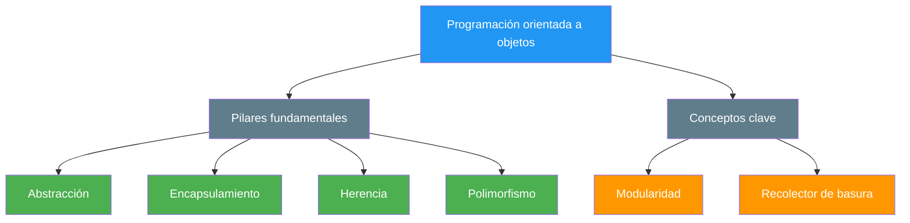
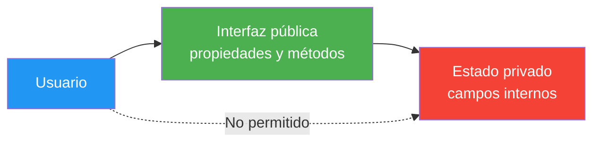
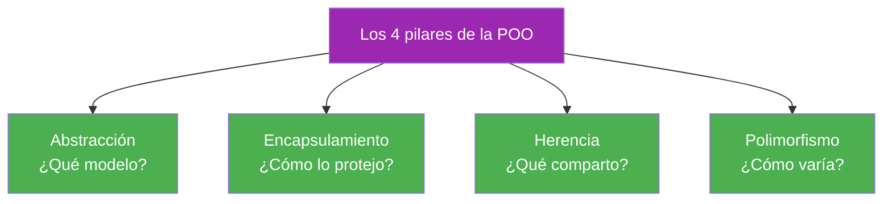

- [1. Programación orientada a objetos: conceptos y principios](#1-programación-orientada-a-objetos-conceptos-y-principios)
  - [1.1. ¿Qué es la programación orientada a objetos?](#11-qué-es-la-programación-orientada-a-objetos)
  - [1.2. Abstracción](#12-abstracción)
  - [1.3. Ocultación](#13-ocultación)
  - [1.4. Encapsulamiento](#14-encapsulamiento)
  - [1.5. Herencia](#15-herencia)
  - [1.6. Polimorfismo](#16-polimorfismo)
  - [1.7. Modularidad](#17-modularidad)
  - [1.8. Recolector de basura](#18-recolector-de-basura)
  - [1.9. Encapsulamiento u ocultación: un matiz del profesor](#19-encapsulamiento-u-ocultación-un-matiz-del-profesor)


# 1. Programación orientada a objetos: conceptos y principios

> 💡 **Punto de partida:** ¿Alguna vez te has preguntado cómo Instagram sabe qué fotos enseñarte primero, o cómo Glovo calcula el tiempo de entrega de tu pedido? Detrás de cada aplicación hay "cosas" con nombre: usuarios, fotos, pedidos, repartidores... La **programación orientada a objetos (POO)** es la forma de escribir el programa tal como está organizado el mundo: por objetos.

En este punto aprenderás qué es la POO, sus conceptos fundamentales (abstracción, encapsulamiento, herencia y polimorfismo) y por qué se ha convertido en la forma estándar de programar.

**Objetivos de aprendizaje:**

- Explicar qué es un objeto y describir sus tres componentes: estado, comportamiento e identidad
- Distinguir los conceptos clave de la POO: abstracción, ocultación, encapsulamiento, herencia, polimorfismo y modularidad
- Diferenciar encapsulamiento de ocultación sin liarte (y sin liarte en el examen)
- Describir qué hace el recolector de basura y por qué en C# no hay que liberar la memoria a mano
- Reconocer la POO en las aplicaciones que usas a diario

## 1.1. ¿Qué es la programación orientada a objetos?

La POO es una forma de pensar y de escribir programas inspirada en cómo observamos el mundo real: todo está formado por "cosas" (objetos) con características y comportamientos propios. En lugar de organizar el código en pasos sueltos, lo organizamos en objetos que se hablan entre sí.

Un objeto se define por tres componentes:

- **Estado:** los datos que guarda. En una bicicleta: el color, la marca, la velocidad actual.
- **Comportamiento:** las operaciones que puede realizar. La bicicleta puede frenar, pedalear o cambiar de marcha.
- **Identidad:** cada objeto es único, aunque dos tengan el mismo estado. Dos hojas de papel iguales siguen siendo dos hojas distintas: si cambias una, la otra no se entera.

📌 **Ejemplo real:** Instagram modela cada cuenta de usuario como un objeto con estado (nombre, seguidores, fotos), comportamiento (publicar, dar like, seguir) e identidad (cada cuenta tiene su identificador único). Cuando abres la app, no se "recalcula" tu perfil desde cero: se recupera tu objeto.

> 💡 **Analogía:** Programar con POO es como construir con piezas de Lego: cada pieza tiene su forma, su función y su nombre, y el programa entero es el modelo que consigues montar con ellas.

Los conceptos de la POO se agrupan en **pilares** y en otros conceptos de apoyo, como ves en el siguiente esquema:



> 💡 **Consejo:** En el examen, si te piden explicar qué es la POO, menciona los cuatro pilares (abstracción, encapsulamiento, herencia y polimorfismo) con un ejemplo de cada uno. Con eso siempre sacas el punto.

## 1.2. Abstracción

La **abstracción** consiste en fijarnos solo en las características importantes de un objeto, dejando de lado los detalles que no importan para lo que estamos construyendo.

Al diseñar un programa para una biblioteca, por ejemplo, te interesarán el título, el autor y el número de páginas de un libro, pero probablemente no importe el tipo de papel ni el color de la portada. Si modelaras el libro "completo", tardarías una semana; con abstracción, lo tienes en una tarde.

📌 **Ejemplo real:** Cuando Netflix recomienda qué ver, solo mira lo importante de cada serie (género, duración, tu historial) y deja de lado detalles como la resolución del tráiler o el idioma del doblaje. Eso es abstracción: ignorar lo que no cambia la decisión.

> 💡 **Analogía:** Es como mirar un coche por el retrovisor: ves lo necesario para conducir (gasolina, velocidad), no el número de tornillos que sujeta el motor.

## 1.3. Ocultación

La **ocultación** significa que cada objeto guarda sus secretos: no puedes ver ni modificar directamente sus datos internos, solo acceder a lo que te deja su interfaz pública.

Igual que con un mando de televisión: sabes que apretando el botón de encendido la tele se enciende, pero no sabes cómo funciona por dentro. Y no hace falta que lo sepas: el fabricante te oculta el circuito para que solo puedas usarlo bien.

📌 **Ejemplo real:** En tu aplicación del banco, al consultar el saldo ves el resultado, pero no los movimientos internos ni la forma en que se calcula. El banco te muestra una interfaz y oculta su mecanismo.

> ⚠️ **Advertencia:** No confundas ocultación con encapsulamiento. Son conceptos distintos que suelen ir juntos; al final del punto tienes un apartado del profesor que lo aclara con una tabla.

## 1.4. Encapsulamiento

El **encapsulamiento** junta el estado y los comportamientos de un objeto en un único contenedor (la clase), ocultando los detalles internos y controlando los cambios desde fuera. De ese modo, si mañana cambia algo por dentro del objeto, el resto del programa no se estropea.

Un automóvil decide por sí solo, según su motor y sus sensores, cuándo encender el ventilador de refrigeración; tú solo puedes conducir y revisar el panel, pero no gestionas directamente sus variables internas. Tú usas el panel (interfaz pública), él controla el motor (estado privado).

El siguiente ejemplo muestra una clase `Coche` con estado oculto y una interfaz pública controlada:

```csharp
public class Coche
{
    // Estado: campos privados (nadie de fuera los toca directamente)
    private string _marca = string.Empty;
    private int _velocidad;

    // Interfaz pública: el resto del programa solo pasa por aquí
    public string Marca
    {
        get => _marca;
        set => _marca = value ?? "Sin marca";
    }

    // Comportamiento: los métodos deciden cómo se toca el estado
    public void Acelerar(int incremento) => _velocidad += incremento;

    public void Frenar(int decremento) =>
        _velocidad = Math.Max(0, _velocidad - decremento);
}
```

Fíjate en que `_marca` y `_velocidad` están `private`: nadie puede poner la velocidad a `-500` desde fuera, porque el único camino para tocarla es pasar por `Acelerar` y `Frenar`, que ya validan lo que hacen.



📌 **Ejemplo real:** Un cajero automático encapsula el dinero: tú solo pulsas "sacar dinero" e introduces el PIN (interfaz pública); el mecanismo que cuenta los billetes y descuenta de tu cuenta está oculto y solo el banco lo toca.

> 💡 **Consejo:** La receta de encapsulamiento en C# es siempre la misma: campos `private` + propiedades `public` que controlan el acceso. Si un campo es `public` sin control, has perdido la encapsulación.

## 1.5. Herencia

La **herencia** permite crear clases que reutilizan características y comportamientos de otras más generales. Es como decir "todos los perros son animales": tienen patas y respiran como cualquier animal, pero además pueden ladrar.

En C#, la herencia se expresa con los dos puntos (`:`). La clase hija obtiene todo lo de la clase base y puede añadir lo suyo:

```csharp
// CocheDeportivo ES UN Coche: hereda de él
public class CocheDeportivo : Coche
{
    public bool TurboActivado { get; private set; }

    public void ActivarTurbo()
    {
        TurboActivado = true;
        Acelerar(50); // reutiliza el comportamiento heredado
    }
}
```

`CocheDeportivo` no reescribe `Acelerar`: lo hereda y lo usa. Si mañana corriges `Acelerar` en `Coche`, todos los coches deportivos se corrigen a la vez.

📌 **Ejemplo real:** En Glovo, un "pedido express" es un pedido normal al que le añades repartidor prioritario y plazo reducido. En vez de crear un sistema de pedidos desde cero, hereda todo lo que ya hace un pedido y solo añade lo que lo diferencia.

> ⚠️ **Advertencia:** Usa herencia solo cuando exista una relación real de "ES UN" (`CocheDeportivo` es un `Coche`). Si la relación es "TIENE UN" (un coche *tiene* un motor), lo correcto es la **composición**, que verás en el punto 9. Heredar "por si acaso" produce jerarquías imposibles de mantener.

## 1.6. Polimorfismo

El **polimorfismo** da flexibilidad: diferentes objetos pueden responder a la misma orden de maneras distintas. Si le pides a tu teléfono y al televisor "encender", ambos entienden la petición, pero cada uno lo hace a su manera.

En C#, el polimorfismo se consigue con `virtual` (en la clase base) y `override` (en la clase hija): la variable decide qué método ejecuta según el objeto real que contiene, no según el tipo de la variable.

```csharp
// En la clase Coche:
public virtual string Descripcion() => $"Coche {_marca}";

// En CocheDeportivo:
public override string Descripcion() => base.Descripcion() + " con turbo";

// Uso: mismo mensaje, respuesta según el objeto real
Coche a = new Coche();
Coche b = new CocheDeportivo();

Console.WriteLine(a.Descripcion()); // Coche ...
Console.WriteLine(b.Descripcion()); // Coche ... con turbo
```

Las dos líneas de `Descripcion()` son idénticas en el programa, pero salen respuestas distintas: eso es polimorfismo. El día que añadas un `Camioneta : Coche`, tu código de llamada **no cambia**: sigue funcionando.

📌 **Ejemplo real:** Las formas de pago de cualquier tienda online llaman al mismo método `Pagar(importe)`, pero con tarjeta, PayPal o Bizum cada uno ejecuta su propio código. La caja no sabe ni tiene que saber cómo paga cada cliente.

> 💡 **Consejo:** Si estás escribiendo un `if` o un `switch` que comprueba el tipo de un objeto para decidir qué hacer (`if (x is Coche)...`), casi siempre estás a punto de sustituirlo por polimorfismo. Es la señal de que toca `virtual`/`override`.

## 1.7. Modularidad

La **modularidad** es la práctica de dividir un programa en partes independientes y reutilizables llamadas módulos. Cada módulo encapsula una funcionalidad concreta y se comunica con los demás a través de interfaces bien definidas.

Los objetos, al encapsular estado y comportamiento, son módulos naturales: si el módulo de pagos falla, puedes arreglarlo sin tocar el módulo de pedidos, porque cada uno vive en su sitio y solo se hablan por sus métodos públicos.

📌 **Ejemplo real:** Glovo está dividido en módulos: pedidos, restaurantes, repartidores, pagos y notificaciones. Cada equipo de desarrolladores trabaja en su módulo sin pisar el de los demás; si se cae el módulo de pagos, los pedidos siguen visualizándose.

## 1.8. Recolector de basura

El **recolector de basura** (garbage collector o GC) es un sistema automático que gestiona la memoria en C# (y en Java, Kotlin o Swift). Su función es liberar la memoria de los objetos que ya nadie referencia, evitando fugas de memoria y optimizando el rendimiento.

Funciona por referencias: mientras un objeto tiene al menos una variable apuntando a él, sigue vivo. Cuando la última referencia desaparece (por ejemplo, la variable sale de ámbito), el GC lo detecta, reclama su memoria y la deja libre para otros objetos.


📌 **Ejemplo real:** Una app de mensajería puede tener decenas de miles de objetos `Mensaje` en memoria. Cuando cierras el chat y ya no hay ninguna referencia a ellos, el GC los recoge y recupera esa memoria sin que tú hagas nada. En C no hay GC: si olvidas liberar, la app se queda sin memoria.

> 📝 **Nota:** Por eso en C# no existe `free()` ni `delete`. Tu trabajo es no acumular referencias inútiles (por ejemplo, no guardar en una lista lo que ya no usas) y dejar que el GC haga lo suyo. Verás el heap y el stack con detalle en el punto 2.

## 1.9. Encapsulamiento u ocultación: un matiz del profesor

Es muy común confundir estos dos conceptos, y en el examen se nota. Aquí tienes la distinción definitiva:

| Concepto | Qué hace | Ejemplo en C# |
| :--- | :--- | :--- |
| **Encapsulamiento** | Agrupa estado y comportamiento en una misma unidad (la clase) | Una clase que reúne sus campos y sus métodos |
| **Ocultación** | Decide qué partes de esa cápsula se ven desde fuera y cuáles no | `private` para ocultar, `public` para exponer |

- El encapsulamiento **reúne**: pone la medicina dentro de la cápsula.
- La ocultación **protege**: decide qué lados de la cápsula son transparentes y cuáles opacos.



📌 **Ejemplo real:** Una app de streaming encapsula el reproductor de vídeo (todos sus datos y métodos van juntos en una clase) y lo oculta tras unos botones: tú solo ves play, pausa y barra de progreso.

> 💡 **Truco para el examen:** Los cuatro pilares se memorizan con las iniciales **AEHP** (Abstracción, Encapsulamiento, Herencia, Polimorfismo). Y si te preguntan la diferencia de este apartado, la respuesta corta es: el encapsulamiento **reúne**, la ocultación **protege**.

---

**Resumen del punto:**

| Concepto | Descripción |
| :--- | :--- |
| **Objeto** | Entidad con estado, comportamiento e identidad |
| **Abstracción** | Modelar solo lo importante, ignorar el resto |
| **Ocultación** | Ocultar lo interno; solo se ve la interfaz pública |
| **Encapsulamiento** | Agrupar datos y métodos en una misma clase |
| **Herencia** | Las clases hijas reutilizan lo de la clase base (`:`) |
| **Polimorfismo** | Un mismo mensaje, respuestas distintas (`virtual`/`override`) |
| **Modularidad** | Dividir el programa en módulos independientes |
| **Recolector de basura** | Libera la memoria de los objetos a los que nadie referencia |

## ¿Qué viene después?

En el siguiente punto veremos los objetos y las clases en C#: cómo se definen, cómo se crean instancias y cómo se usan en un programa completo.

## Buenas prácticas

- [ ] Modelar solo lo importante antes de escribir código (abstracción)
- [ ] Mantener los campos `private` y exponerlos con propiedades públicas
- [ ] Usar herencia solo cuando exista una relación real de "ES UN"
- [ ] Preferir composición a la herencia cuando la relación sea "TIENE UN"
- [ ] Sustituir los `if` que comparan tipos por polimorfismo (`virtual`/`override`)
- [ ] No preocuparse por liberar memoria a mano: en C# lo hace el recolector de basura
