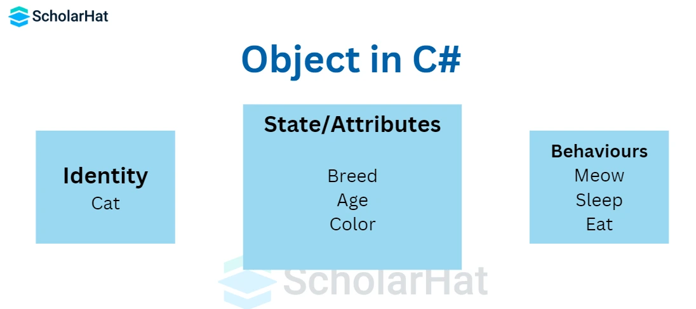
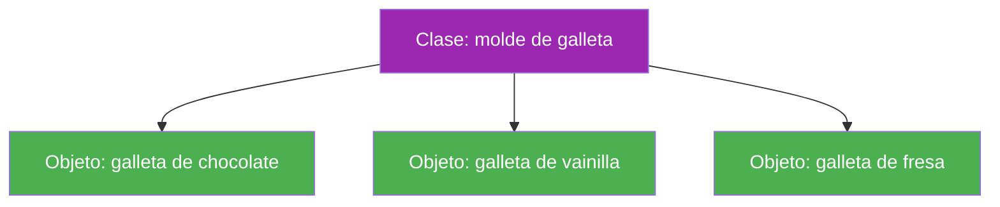
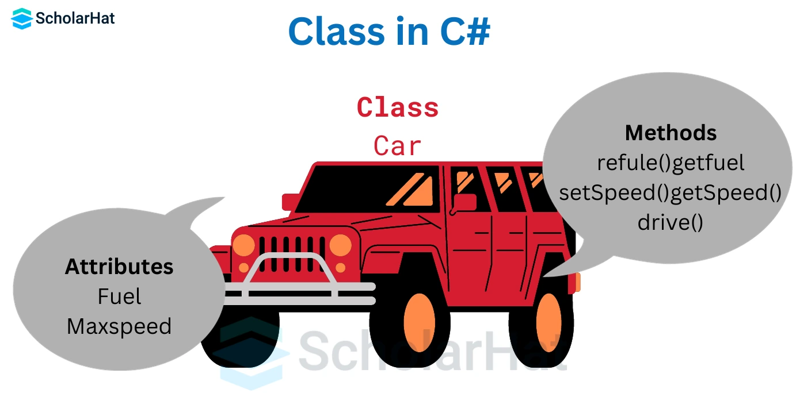
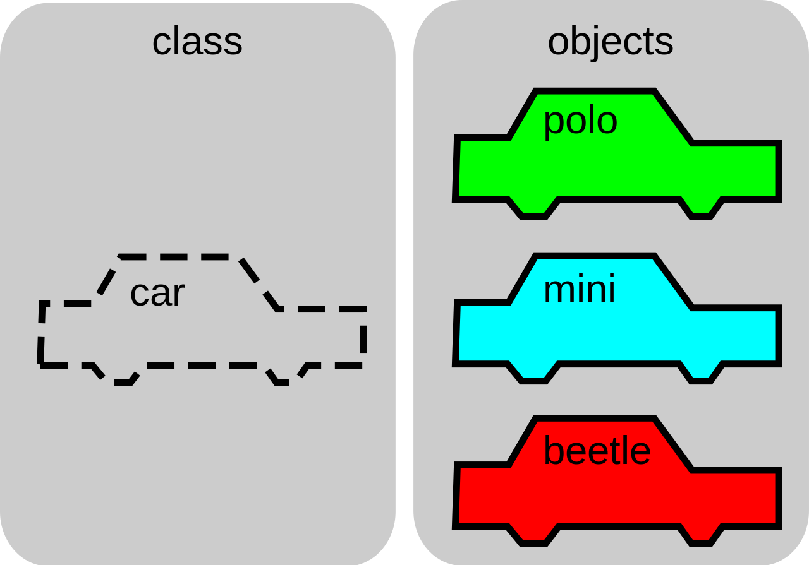
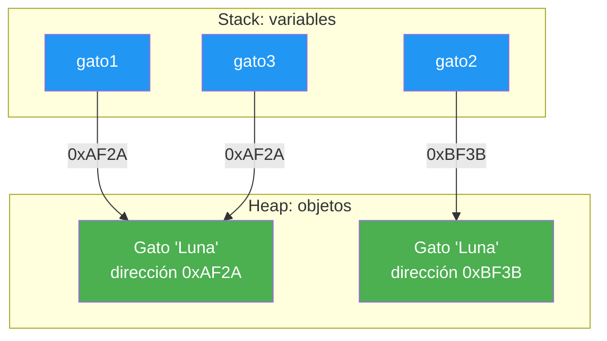
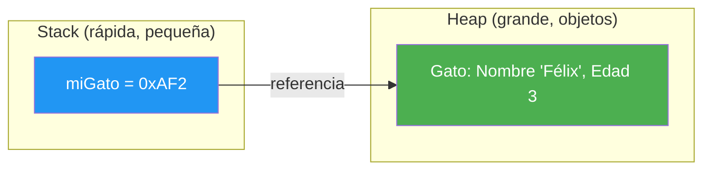

- [2. Objetos y clases](#2-objetos-y-clases)
  - [2.1. Identidad, estado y comportamiento](#21-identidad-estado-y-comportamiento)
    - [2.1.1. Identidad](#211-identidad)
    - [2.1.2. Estado](#212-estado)
    - [2.1.3. Comportamiento](#213-comportamiento)
    - [2.1.4. Interfaz pública](#214-interfaz-pública)
  - [2.2. Diferencia entre objetos y tipos simples](#22-diferencia-entre-objetos-y-tipos-simples)
  - [2.3. La clase: el molde de los objetos](#23-la-clase-el-molde-de-los-objetos)
  - [2.4. Crear objetos en C#: `new` y la referencia](#24-crear-objetos-en-c-new-y-la-referencia)
  - [2.5. Objetos a partir de clases predefinidas](#25-objetos-a-partir-de-clases-predefinidas)
  - [2.6. Stack y heap: dónde vive cada objeto](#26-stack-y-heap-dónde-vive-cada-objeto)


# 2. Objetos y clases

> 💡 **Punto de partida:** Cuando pides una hamburguesa en una app de comida, en pantalla aparece "tu pedido": restaurante, productos, precio, estado (preparando, en camino...). Ese pedido no es un número suelto de texto: es un **objeto** con datos y con cosas que puede hacer. En este punto verás de qué se hace un objeto y cómo se fabrica uno en C#.

En este punto aprenderás a distinguir los componentes de un objeto, qué es una clase, cómo se crean objetos con `new` y dónde viven en memoria.

**Objetivos de aprendizaje:**

- Diferenciar identidad, estado, comportamiento e interfaz pública de un objeto
- Explicar en qué se parecen y en qué se diferencian un objeto y un tipo simple
- Distinguir la clase (el molde) de sus instancias (los objetos fabricados)
- Crear objetos con `new` y seguir la referencia que devuelve
- Instanciar objetos a partir de clases predefinidas de la biblioteca de .NET
- Situar las variables en el stack y los objetos en el heap, y saber qué es `null`

## 2.1. Identidad, estado y comportamiento

Un **objeto** es una representación digital de algo del mundo real o de una idea. Es como un "actor" dentro de tu programa, con personalidad (identidad), datos (estado) y capacidades (comportamiento).



### 2.1.1. Identidad

La identidad es lo que hace único a cada objeto, aunque tenga la misma información que otro. En la vida real, dos carnés de identidad pueden mostrar la misma foto y los mismos datos personales, pero cada uno es una tarjeta física distinta, con su número y su dueño.

En programación, la identidad corresponde a la referencia que el ordenador guarda en memoria: cada vez que usas `new` en C#, creas un objeto con identidad propia, aunque le des exactamente los mismos datos que a otro.

📌 **Ejemplo real:** Dos bolígrafos azules nuevos pueden ser idénticos por dentro, pero uno está en Madrid y otro en Valencia: son dos unidades distintas. Igual que dos cuentas de Instagram con el mismo nombre visual: cada una tiene su identificador interno.

### 2.1.2. Estado

El estado de un objeto es la colección de datos que define cómo es ese objeto en un momento dado. Por ejemplo:

- Un alumno: estado = nombre, edad, nota media, curso.
- Un semáforo: estado = color actual, si está funcionando o no.

El estado puede cambiar a lo largo del tiempo si el objeto tiene comportamientos que lo permiten: el semáforo pasa de rojo a verde porque su método `avanzar()` lo decide.

### 2.1.3. Comportamiento

El comportamiento es el conjunto de acciones que el objeto puede ejecutar o las respuestas que puede dar. Estas acciones pueden modificar su estado o interactuar con otros objetos. Por ejemplo:

- Una puerta: puede abrirse, cerrarse, bloquearse.
- Un reloj: puede mostrar la hora, poner la alarma, vibrar.

En programación, el comportamiento se define como los **métodos** del objeto.

### 2.1.4. Interfaz pública

La interfaz pública de un objeto es el conjunto de métodos y propiedades que otras partes del programa (u otros objetos) pueden usar para interactuar con él. Es el "panel de mandos" que el objeto decide mostrar al exterior; el resto de sus miembros quedan ocultos (viene el encapsulamiento del punto anterior).

> 💡 **Analogía:** Un objeto es una nevera: el estado es lo que guarda (comida, temperatura), el comportamiento es lo que hace (enfriar, congelar), la identidad es su número de serie, y la interfaz pública son las puertas y botones que tú usas. Por dentro no ves el compresor: está oculto.

## 2.2. Diferencia entre objetos y tipos simples

Antes de crear tus propios objetos, observa que tipos como los números (`int`, `double`) y las cadenas (`char`, `string`) ya existen desde siempre en los lenguajes de programación:

- Un número como `42` es simplemente un valor; no necesitas rastrear su identidad, solo su estado.
- Una cadena como `"Hola"` es un pedazo de texto; puedes consultar su longitud o unirla con otras, pero no tiene una "personalidad" propia que rastrear.

El objeto va más allá: puedes definir cómo es, qué puede hacer y cómo debe comportarse en situaciones diferentes.

📌 **Ejemplo real:** Si tienes varios libros, cada uno tendrá un título, un autor y un número de páginas. Pero si programas una biblioteca, querrás representar cada libro como objeto para gestionarlo, buscarlo o prestarlo: ahí necesitas identidad (cada ejemplar es único, aunque la obra sea la misma).

> 📝 **Nota:** En C#, tanto los tipos simples como tus clases acaban siendo "objetos" por debajo (puedes llamar `"hola".ToUpper()`), pero programarás con ellos como valores: se copian, no se comparten por referencia. Lo verás con detalle en el punto 5.

## 2.3. La clase: el molde de los objetos

En C# (y en muchos lenguajes modernos), **la clase** es la herramienta que te permite definir cómo deben ser tus objetos: qué información guardan y qué acciones pueden realizar. La clase es como el molde de una galleta: define el borde, el tamaño y la forma; luego puedes fabricar galletas diferentes, pero todas se basan en ese molde.

A cada objeto creado desde la clase se le llama **instancia**, y a todos juntas, objetos de ese tipo.







**¿Por qué tipificar los objetos?** Tipificar significa que cada objeto tiene su propio "tipo" y que el compilador te ayuda a verificar que uses cada uno correctamente; así evitas confusiones y errores (por ejemplo, no intentas sumar una puerta a una bicicleta). Si la clase se llama `Coche`, el compilador solo dejará que trates como coche a lo que hayas creado como `Coche`.

> 💡 **Consejo:** Piensa la relación así: la clase es el **plano**, el objeto es la **casa** y la instancia es **cada casa concreta** construida con ese plano. Puedes tener mil casas del mismo plano; cada una sigue siendo una casa con su dirección.

## 2.4. Crear objetos en C#: `new` y la referencia

Cuando quieres utilizar un objeto en C#, lo creas a partir de una clase usando la palabra clave `new`. Esto hace tres cosas importantes:

1. **Reserva memoria** para almacenar la información del objeto.
2. **Inicializa el estado inicial** del objeto, según lo que hayas definido en la clase.
3. **Devuelve una referencia**, es decir, una "dirección" en la memoria por la que podrás localizar ese objeto para usarlo en el futuro.

Así, aunque crees dos objetos iguales (mismo estado), cada uno tendrá una referencia diferente y serán instancias distintas, con identidad propia. El siguiente programa lo demuestra con una clase `Gato`:

```csharp
// Demostración de identidad y referencia
public class Gato
{
    public string Nombre { get; set; }
    public Gato(string nombre) => Nombre = nombre;
}

// Creamos dos objetos con el MISMO estado
var gato1 = new Gato("Luna");
var gato2 = new Gato("Luna");

Console.WriteLine(gato1 == gato2);        // false (diferentes referencias)
Console.WriteLine(gato1.Equals(gato2));   // false (diferentes objetos)
Console.WriteLine(gato1.GetHashCode());   // distinto código hash
Console.WriteLine(gato2.GetHashCode());   // distinto código hash

// Ahora gato3 referencia al MISMO objeto que gato1
var gato3 = gato1;
Console.WriteLine(gato1 == gato3);        // true (misma referencia)
Console.WriteLine(gato1.GetHashCode());   // igual que gato3
```

Fíjate en que `gato1` y `gato2` tienen el mismo estado (`"Luna"`) pero son objetos distintos, mientras que `gato3` no es un objeto nuevo: es **otro nombre para el mismo objeto** que `gato1`. Cambiar `gato1.Nombre` también cambiaría el que ve `gato3`.

📌 **Ejemplo real:** Cuando Instagram te notifica "tu foto tiene 3 likes", actualiza el estado de un único objeto `Foto` al que apuntan muchas referencias (tu móvil, el de tus amigos, los servidores). Todos ven el mismo objeto, no copias sueltas.



> 💡 **Analogía del buzón:** Un objeto es una casa y la referencia es la dirección. Cuando escribes `Gato gato1 = new Gato()`, estás: construyendo la casa (el objeto), obteniendo la dirección (la referencia `0xAF2A`) y guardando esa dirección en tu agenda (la variable `gato1`).

## 2.5. Objetos a partir de clases predefinidas

No todas las clases las escribes tú: la propia biblioteca de clases de .NET (BCL) trae cientos de clases listas para usar, y **se usan exactamente igual** que una clase que hayas definido tú: con `new`, con punto y con sus métodos.

```csharp
// Clases predefinidas de .NET, usadas igual que una clase tuya
var azar = new Random();                    // objeto de una clase predefinida
Console.WriteLine(azar.Next(1, 7));         // un dado: 1..6

var datos = new List<int> { 10, 20, 30 };   // colección predefinida
Console.WriteLine(datos.Count);             // 3

var texto = "  Hola Mundo  ";               // string también es una clase
Console.WriteLine(texto.Trim().ToUpper());  // HOLA MUNDO

var hoy = DateTime.Now;                     // objeto con fecha y hora
Console.WriteLine($"Hoy es {hoy:dd/MM/yyyy} y son las {hoy:HH:mm}");
```

El patrón es siempre el mismo: **`new` → punto → método o propiedad**. Da igual que la clase la hayas escrito tú (`Gato`) o que venga de fábrica (`Random`, `List<T>`, `DateTime`): `new Random()` crea una instancia, `azar.Next(1, 7)` llama a un método de esa instancia y `hoy.Year` lee una propiedad.

📌 **Ejemplo real:** Un videojuego usa `new Random()` para decidir qué objeto cae del cielo; una app de mensajería usa `new StringBuilder()` (clase de `System.Text`) para concatenar miles de mensajes sin gastar memoria; cualquier programa con fechas trabaja con objetos `DateTime` en vez de cadenas sueltas.

> 💡 **Consejo:** Cuando en un ejercicio necesites algo "de fábrica" (fechas, azar, texto largo, colecciones), no lo reinventes: busca si la BCL ya tiene una clase para eso. Eso es reutilizar librerías de objetos, y es como se programa de verdad.

> 📝 **Nota:** `string`, `int` y `DateTime` son tipos, pero por debajo son clases con métodos: por eso `"hola".ToUpper()` funciona aunque `string` no lo hayas definido. En C# casi todo es objeto; la diferencia está en cómo se copian (punto 5).

## 2.6. Stack y heap: dónde vive cada objeto

Para un desarrollador, es vital entender qué pasa dentro del ordenador cuando escribes `Gato miGato = new Gato();`:

1. **Stack (pila):** memoria muy rápida pero pequeña. Aquí se guarda el nombre de la variable (`miGato`) y su **referencia** (la dirección del objeto).
2. **Heap (montículo):** memoria más grande donde viven los **objetos reales**. Allí es donde `new` reserva el espacio para los datos del gato.



Si la variable del stack no tiene ninguna dirección (apunta a nada), su valor es **`null`**. Si intentas usarla así, el programa falla porque no sabe a qué dirección del heap ir a buscar los datos. Eso es lo que aprenderemos a gestionar como **seguridad ante nulos**.

📌 **Ejemplo real:** Cuando una app de mensajería se queda sin cobertura y no puede cargar el chat, muestra "sin mensajes" en vez de romperse: está comprobando referencias `null` antes de usarlas.

> 💡 **Truco:** En el examen, cuando veas `new Clase()`, piensa: "se crea un objeto en el heap y se devuelve su referencia". Cuando veas `Clase objeto;` sin `new`, piensa: "solo existe una variable en el stack que apunta a `null`".

---

**Resumen del punto:**

| Concepto | Descripción |
| :--- | :--- |
| **Objeto** | Representación con identidad, estado y comportamiento |
| **Identidad** | Lo que hace único a cada objeto (su referencia en memoria) |
| **Estado** | Los datos que guarda en un momento dado |
| **Comportamiento** | Las acciones que puede ejecutar (sus métodos) |
| **Interfaz pública** | Lo que el objeto deja ver y usar desde fuera |
| **Clase** | El molde que define cómo serán sus objetos |
| **Instancia** | Cada objeto concreto fabricado desde la clase |
| **`new`** | Reserva memoria, inicializa y devuelve una referencia |
| **Referencia** | "Dirección" del objeto en el heap; `null` si apunta a nada |
| **Clases predefinidas** | Objetos de la biblioteca de .NET: se usan igual que los tuyos |
| **Stack vs. heap** | Variables y referencias en el stack; objetos en el heap |

## ¿Qué viene después?

En el siguiente punto veremos cómo se organiza un proyecto en C#: espacios de nombres, soluciones, proyectos y ensamblados, y cómo crear y compilar uno desde el entorno de desarrollo.

## Buenas prácticas

- [ ] Definir la clase (el molde) antes que las instancias que fabricarás con ella
- [ ] Recordar que `new` devuelve una referencia: dos objetos iguales no son el mismo objeto
- [ ] No reinventar lo que la biblioteca de .NET ya trae (`Random`, `DateTime`, `List<T>`...)
- [ ] Comprobar las referencias contra `null` antes de usarlas
- [ ] Distinguir siempre: la variable vive en el stack, el objeto en el heap
