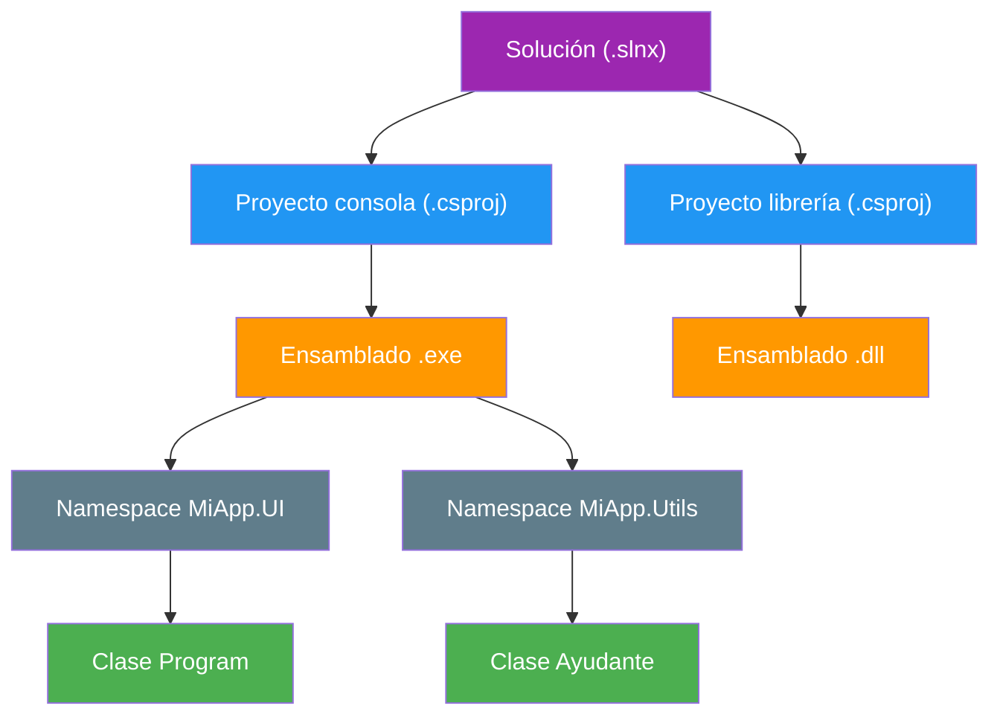

- [3. Espacios de nombres y organización del proyecto](#3-espacios-de-nombres-y-organización-del-proyecto)
  - [3.1. Namespace y file-scoped namespace](#31-namespace-y-file-scoped-namespace)
    - [3.1.1. File-scoped namespace (C# 10+)](#311-file-scoped-namespace-c-10)
  - [3.2. Using y alias](#32-using-y-alias)
  - [3.3. Soluciones, proyectos y ensamblados](#33-soluciones-proyectos-y-ensamblados)
    - [3.3.1. Solución (.slnx)](#331-solución-slnx)
    - [3.3.2. Proyecto (.csproj)](#332-proyecto-csproj)
    - [3.3.3. Ensamblado](#333-ensamblado)
  - [3.4. Relación práctica](#34-relación-práctica)
  - [3.5. Crear y compilar un proyecto en Rider y en la consola](#35-crear-y-compilar-un-proyecto-en-rider-y-en-la-consola)
  - [3.6. Incorporar y usar librerías de objetos](#36-incorporar-y-usar-librerías-de-objetos)
    - [3.6.1. NuGet: el gestor de paquetes](#361-nuget-el-gestor-de-paquetes)
    - [3.6.2. Usar una librería en tu código](#362-usar-una-librería-en-tu-código)
    - [3.6.3. Errores comunes al instalar paquetes](#363-errores-comunes-al-instalar-paquetes)
  - [3.7. Visualización de la estructura de trabajo](#37-visualización-de-la-estructura-de-trabajo)


# 3. Espacios de nombres y organización del proyecto

> 💡 **Punto de partida:** Cuando reparto la ropa de casa en cajones y arcones, cada pieza tiene su sitio y nunca la busco debajo de la cama. En un programa pasa igual: si metes todas las clases en un único fichero sin orden, llega un momento en que no sabes dónde está nada. En este punto aprenderás a organizar tu código con **espacios de nombres**, **soluciones** y **proyectos**, y a crear y compilar un programa desde cero con Rider y con la consola.

En este punto aprenderás a agrupar tus clases en espacios de nombres, a entender la estructura solución-proyecto-ensamblado, a crear y compilar un proyecto desde el IDE y desde la línea de comandos, y a incorporar librerías de objetos a tu programa.

**Objetivos de aprendizaje:**

- Definir espacios de nombres con la forma *file-scoped* y usar `using` y alias para importar tipos
- Distinguir solución, proyecto y ensamblado, y saber qué archivo corresponde a cada uno
- Crear un proyecto con la CLI (`dotnet new`) y en Rider, y compilarlo y ejecutarlo en ambos
- Incorporar una librería de objetos con NuGet y usar sus tipos en tu código
- Reconocer los errores habituales al instalar paquetes y saber cómo resolverlos

## 3.1. Namespace y file-scoped namespace

Un **namespace** (espacio de nombres) es como una carpeta virtual que agrupa tipos relacionados: clases, structs, interfaces… Te permite organizar tus clases y evitar que dos clases con el mismo nombre se mezclen o generen errores.

📌 **Ejemplo real:** Es como tener los documentos de "Matemáticas" y "Historia" en carpetas distintas: ambos pueden tener un archivo llamado "Examen.docx", pero están separados y no entran en conflicto. En una app de banco, `Banco.Core.Cuenta` y `Banco.Pruebas.Cuenta` son dos clases distintas que conviven sin pisarse.

Así se define una clase dentro de un espacio de nombres tradicional (con llaves):

```csharp
namespace MiAplicacion.Modelos
{
    public class Persona
    {
        public string Nombre { get; set; } = string.Empty;
    }
}
```

Aquí la clase `Persona` vive en el espacio de nombres `MiAplicacion.Modelos`, y así se referencia desde cualquier otro archivo: `MiAplicacion.Modelos.Persona`.

### 3.1.1. File-scoped namespace (C# 10+)

Desde C# 10 existe una forma más concisa y recomendada: el namespace a nivel de archivo. Se escribe una sola línea con punto y coma y **todo el archivo queda dentro** de ese espacio de nombres, sin llaves que abrir ni cerrar:

```csharp
namespace MiAplicacion.Modelos;

public class Producto
{
    public string Nombre { get; set; } = string.Empty;
}
```

> 💡 **Consejo:** En todos los puntos de esta unidad usaremos la forma *file-scoped* (`namespace X;`), porque es la que pide la norma del proyecto. Si abres un fichero y ves `namespace X;` sin llaves, no es un error: es la sintaxis moderna.

> ⚠️ **Advertencia:** El namespace **no** tiene por qué coincidir con la carpeta física donde vive el fichero, aunque es costumbre que sí coincida para que te sea fácil encontrar las clases al navegar por el proyecto.

## 3.2. Using y alias

La instrucción **`using`** permite importar otros espacios de nombres al archivo, para poder usar sus clases sin escribir el nombre completo cada vez.

Si repites muchas veces `MiAplicacion.Modelos.Persona`, puedes importar el namespace una sola vez arriba del fichero:

```csharp
using MiAplicacion.Modelos;

// Ahora puedes escribir simplemente:
Persona p = new Persona();
```

También puedes crear un **alias**, un nombre corto para un tipo o un namespace. Es muy útil cuando dos clases distintas se llaman igual:

```csharp
using M = MiAplicacion.Modelos;
using B = MiAplicacion.Biblioteca;

// Ahora puedes distinguirlas por el alias:
M.Persona p = new M.Persona();
B.Persona b = new B.Persona();
```

Y con **`using static`** importas los miembros estáticos de una clase concreta para usarlos directamente, sin poner el nombre de la clase:

```csharp
using static System.Math;

double resultado = Sqrt(25);  // igual que Math.Sqrt(25)
Console.WriteLine(resultado); // 5
```

📌 **Ejemplo real:** Cuando en la consola escribes `Console.WriteLine(...)`, el `using System;` del archivo es el que te ahorra escribir `System.Console.WriteLine(...)` en cada línea. Todo programa de C# lleva `using System;` (o los *implicit usings* del proyecto) precisamente por esto.

> 💡 **Truco:** Si dudas de dónde sale una clase, mira los `using` del archivo. El compilador sabe de dónde viene porque se lo dice el `using`; si falta, el error es "no se encontró el tipo o el espacio de nombres".

## 3.3. Soluciones, proyectos y ensamblados

Antes de escribir código conviene tener claro el mapa de carpetas que usarás en todos tus proyectos. Se estructura en tres niveles:



### 3.3.1. Solución (.slnx)

Una **solución** es un contenedor que agrupa uno o más **proyectos** relacionados, como diferentes piezas de una aplicación grande (por ejemplo, la web, la app móvil y la librería de utilidades). Define la estructura general y las dependencias entre proyectos. En .NET 10 el formato por defecto es el fichero **`.slnx`** (XML); si encuentras un `.sln` antiguo, puedes migrarlo con `dotnet sln migrate`.

### 3.3.2. Proyecto (.csproj)

Cada **proyecto** es una unidad que se compila en un ensamblado (EXE o DLL). Define sus propias dependencias, referencias y configuración en un fichero `.csproj`. Un proyecto puede depender de otros proyectos dentro de la misma solución (por ejemplo, la web usa la librería de utilidades).

### 3.3.3. Ensamblado

Un **ensamblado** es el resultado de compilar un proyecto. Puede ser un archivo ejecutable (`.exe`) o una biblioteca de enlace dinámico (`.dll`). Contiene el código compilado, los metadatos y los recursos necesarios para ejecutar o usar la funcionalidad del proyecto.

> 💡 **Analogía:** Piensa en una fábrica de muebles: la **solución** es el polígono industrial completo, cada **proyecto** es una nave con su máquina (el ensamblador) y el **ensamblado** es la caja final que sale por la puerta, lista para usar.

## 3.4. Relación práctica

Los cuatro conceptos se relacionan así:

- Una **solución** puede tener varios proyectos.
- Cada **proyecto** genera su propio ensamblado y puede tener diferentes namespaces.
- Un **ensamblado** es el resultado de compilar un proyecto.
- Los **namespaces** organizan los tipos dentro de los proyectos y pueden coincidir o no con la estructura de carpetas reales.

📌 **Ejemplo real:** En la TiendaDawApi-NetCore hay una solución con varios proyectos: la API, la librería de dominio y los tests. Cada uno compila a su propio `.dll` y se comunican entre sí por referencias y namespaces.

## 3.5. Crear y compilar un proyecto en Rider y en la consola

Para crear un programa simple no hace falta más que dos cosas: crear el proyecto y compilarlo. Puedes hacerlo desde **Rider** (nuestro IDE principal) o desde la **CLI de .NET**, que es lo mismo que hace el IDE por debajo.

### Con la CLI de .NET

Desde cualquier carpeta, la consola crea un proyecto de consola llamado `MiPrimerPrograma`:

```bash
# Crear un proyecto de consola en una carpeta nueva
dotnet new console -n MiPrimerPrograma

# Entrar en la carpeta del proyecto
cd MiPrimerPrograma

# Compilar (genera el ensamblado en bin/)
dotnet build

# Compilar y ejecutar en un solo paso
dotnet run

# Crear una solución e incorporar el proyecto a ella
dotnet new sln -n MiSolucion
dotnet sln add MiPrimerPrograma/MiPrimerPrograma.csproj
```

`dotnet new console` genera el `.csproj` y el `Program.cs` con *Top-Level Statements*, listos para escribir. `dotnet build` comprueba el código y, si no hay errores, crea el ensamblado en la carpeta `bin/`; `dotnet run` compila (si hace falta) y lo ejecuta.

📌 **Ejemplo real:** Todo el material de esta asignatura se puede crear y compilar así sin abrir ningún IDE: es exactamente lo que hace un *pipeline* de integración continua en una empresa antes de aprobar una versión.

### En JetBrains Rider

En Rider el flujo es el mismo, pero con botones:

1. **File → New Solution** (o `Ctrl+Alt+Shift+N`) y eliges **Console Application** con nombre y carpeta.
2. Rider genera la solución, el `.csproj` y el `Program.cs`.
3. Escribes tu código en el editor.
4. Pulsas **Run** (el triángulo verde) o `Shift+F10`: Rider compila y ejecuta.
5. Para compilar sin ejecutar: **Build → Build Solution** o `Ctrl+F9`.

La salida se ve en la consola inferior del IDE, con los errores señalados en el editor con un subrayado rojo: si hay un error de compilación, no llega a generarse el ensamblado.

> 📝 **Nota:** Da igual dónde lo hagas: el IDE usa exactamente los mismos comandos (`dotnet new`, `dotnet build`, `dotnet run`) que escribiste a mano en la CLI. Por eso los profesionales y los entornos automatizados prefieren la CLI: funciona en cualquier ordenador sin instalar un IDE.

> 💡 **Consejo:** Si Rider no te compila, mira primero la pestaña **Errors**: el 90 % de los errores de principiante son de sintaxis (falta un `;` o una llave). Compilar a menudo (en vez de al final) te ahorra horas: cuanto antes salte el error, más fácil es encontrarlo.

## 3.6. Incorporar y usar librerías de objetos

Casi nada se escribe de cero: los programas reales se construyen **encima de librerías**, conjuntos de clases ya probadas que resuelven problemas habituales. Ya conoces una enorme: la biblioteca de clases de .NET (BCL), con `Console`, `DateTime`, `Random` o `List<T>`. Pero además existen miles de librerías externas que se incorporan a tu proyecto como **paquetes**.

### 3.6.1. NuGet: el gestor de paquetes

**NuGet** es el gestor de paquetes de .NET: un almacén en línea con cientos de miles de librerías que se descargan y referencian desde tu proyecto. La forma más cómoda de instalar un paquete es la CLI, **desde la carpeta que contiene el `.csproj`**:

```bash
# Añadir una librería al proyecto actual
dotnet add package Spectre.Console

# Ver los paquetes instalados y sus versiones
dotnet list package

# Restaurar paquetes (normalmente lo hace build automáticamente)
dotnet restore
```

Al instalar, .NET escribe una referencia en el fichero `.csproj`. Esa línea **es la instalación hecha y versionada**: quien clone el proyecto la restaura automáticamente.

```xml
<ItemGroup>
  <PackageReference Include="Spectre.Console" Version="0.53.0" />
</ItemGroup>
```

📌 **Ejemplo real:** Rider tiene un panel gráfico de **NuGet** para instalar con un clic (click derecho en el proyecto → Manage NuGet Packages), pero en el ámbito profesional se prefiere la CLI: queda en los *scripts*, en la documentación y en los pipelines de integración continua sin depender de un IDE.

> 📝 **Nota:** La versión del paquete se fija en el `.csproj`. No compites "la última" a ciegas: se usa la versión con la que se probó el código, para que mañana el ejemplo siga compilando igual.

> ⚠️ **Advertencia:** Los comandos `dotnet add package` se ejecutan **dentro de la carpeta del proyecto** (la que tiene el `.csproj`), no en la carpeta de la solución. Si los lanzas donde no toca, el paquete no se añade a ningún sitio.

### 3.6.2. Usar una librería en tu código

Instalar el paquete solo te da los tipos: para usarlos, importa su espacio de nombres con `using` y trátalos como cualquier otra clase. Este programa usa `Spectre.Console` (una librería externa) junto con clases de la BCL:

```csharp
using Spectre.Console;   // librería externa (paquete NuGet)

// Texto con color usando etiquetas de estilo [color]...[/]
AnsiConsole.MarkupLine("[green]Aprobados:[/] 4 de 5");

// Una tabla con bordes y cabeceras: objeto de una clase de la librería
var tabla = new Table()
    .Border(TableBorder.Rounded)
    .AddColumn(new TableColumn("Alumno").Centered())
    .AddColumn(new TableColumn("Nota").Centered());

tabla.AddRow("Lucía", "7,5");
tabla.AddRow("Marcos", "4,0");
AnsiConsole.Write(tabla);
```

Fíjate en que el patrón es **idéntico** al de cualquier clase: `new Table()` crea un objeto, `.AddColumn(...)` llama a sus métodos y `AnsiConsole` agrupa operaciones estáticas. Da igual que la clase la hayas escrito tú o que venga de una librería: la usas igual.

📌 **Ejemplo real:** Cuando una app de Spotify muestra tablas y colores en consola, o cuando un servicio de Netflix escribe sus registros de actividad en fichero, está usando librerías instaladas igual: `dotnet add package` y un `using`. Nadie reescribe un motor de log ni un generador de tablas.

> 💡 **Consejo:** Antes de escribir una utilidad a mano, pregunta: "¿hay un paquete para esto?". Buscar y reutilizar librerías es señal de un profesional, no de pereza.

### 3.6.3. Errores comunes al instalar paquetes

| Error | Por qué ocurre | Cómo evitarlo |
| :--- | :--- | :--- |
| **`NU1101: no se encuentra el paquete`** | Error en el nombre o falta el *restore* | Revisa el nombre y ejecuta `dotnet restore` |
| **Versión incompatible con el framework** | El paquete no soporta `net10.0` | Comprueba la versión con `dotnet list package` |
| **Olvidar el `using`** | El paquete está instalado pero no se importa | Añade `using Spectre.Console;` (o el que corresponda) |
| **Comando en la carpeta equivocada** | Se lanzó fuera de la carpeta del `.csproj` | Entra en la carpeta del proyecto antes de `dotnet add package` |

## 3.7. Visualización de la estructura de trabajo

Este es el mapa completo que verás en el explorador de Rider al crear un proyecto con solución, tal como se muestra en el esquema inicial del punto:

- La **solución** (`.slnx`) agrupa uno o más **proyectos** (`.csproj`).
- Cada proyecto, al compilar, genera su **ensamblado** (`.exe` o `.dll`) en `bin/`.
- Dentro de cada proyecto, los tipos se agrupan en **namespaces** (`MiApp.UI`, `MiApp.Utils`…).
- Y dentro de cada namespace viven tus **clases** (`Program`, `Ayudante`…).

---

**Resumen del punto:**

| Concepto | Descripción |
| :--- | :--- |
| **Namespace** | Carpeta virtual que agrupa clases y evita conflictos de nombres |
| **File-scoped namespace** | Forma moderna (C# 10+): `namespace X;` sin llaves |
| **`using`** | Importa un namespace al archivo para usar sus tipos a corto |
| **`using static`** | Importa los miembros estáticos de una clase (`Sqrt(...)` en vez de `Math.Sqrt`) |
| **Solución (.slnx)** | Contenedor de proyectos relacionados; formato XML por defecto en .NET 10 |
| **Proyecto (.csproj)** | Unidad que se compila a un ensamblado con sus dependencias |
| **Ensamblado** | Resultado de compilar: `.exe` ejecutable o `.dll` biblioteca |
| **`dotnet new / build / run`** | Crear, compilar y ejecutar un proyecto desde la CLI |
| **NuGet** | Gestor de paquetes; `dotnet add package` añade la referencia al `.csproj` |
| **Paquete** | Librería externa que se instala y se usa con `using` como cualquier clase |

## ¿Qué viene después?

En el siguiente punto veremos cómo se define una clase en C#: sus miembros, modificadores de acceso y la sintaxis completa con la que construirás tus propios objetos.

## Buenas prácticas

- [ ] Nombrar los namespaces para que reflejen la estructura lógica del proyecto (`MiEmpresa.MiApp.Servicios`)
- [ ] Usar la forma *file-scoped* (`namespace X;`) de forma consistente
- [ ] No mezclar tipos sin relación en el mismo namespace
- [ ] Compilar a menudo (`dotnet build` o `Ctrl+F9`) para cazar errores pronto
- [ ] Instalar paquetes por CLI desde la carpeta del `.csproj` y fijar su versión
- [ ] Recordar el `using` de la librería antes de usar sus tipos
