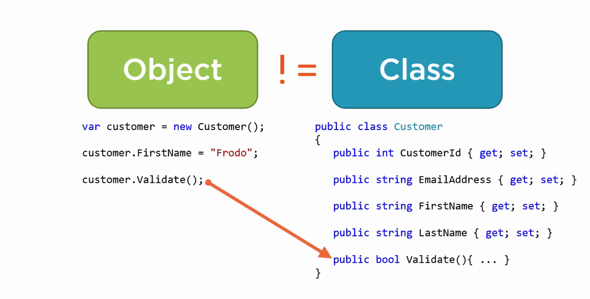
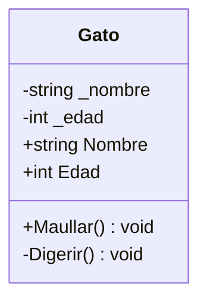
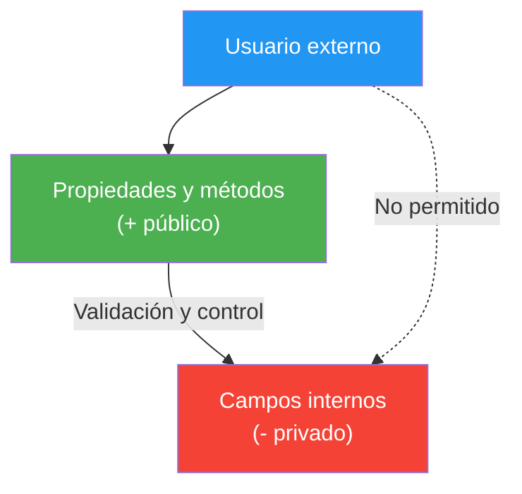

- [4. Clases: definición, atributos, visibilidad y modificadores](#4-clases-definición-atributos-visibilidad-y-modificadores)
  - [4.1. Sintaxis básica de una clase](#41-sintaxis-básica-de-una-clase)
  - [4.2. Estado definido por propiedades](#42-estado-definido-por-propiedades)
  - [4.3. Comportamiento definido por métodos](#43-comportamiento-definido-por-métodos)
  - [4.4. Visibilidad de atributos y métodos: cuándo usar cada uno](#44-visibilidad-de-atributos-y-métodos-cuándo-usar-cada-uno)
  - [4.5. Modificadores de acceso: public, internal, private, protected](#45-modificadores-de-acceso-public-internal-private-protected)
  - [4.6. Otros modificadores: sealed, const, readonly, static readonly, required](#46-otros-modificadores-sealed-const-readonly-static-readonly-required)
  - [4.7. Partial: una clase en varios ficheros](#47-partial-una-clase-en-varios-ficheros)
  - [4.8. Uso de is y as para comprobación y conversión de tipos](#48-uso-de-is-y-as-para-comprobación-y-conversión-de-tipos)
  - [4.9. Las clases son tipos por referencia](#49-las-clases-son-tipos-por-referencia)
  - [4.10. Objetos nulos: el peligro de apuntar a nada](#410-objetos-nulos-el-peligro-de-apuntar-a-nada)
  - [4.11. Representación en diagramas de clases (UML)](#411-representación-en-diagramas-de-clases-uml)
    - [4.11.1. Ejemplo: una clase en UML](#4111-ejemplo-una-clase-en-uml)
    - [4.11.2. Ejemplo completo: una clase bien diseñada](#4112-ejemplo-completo-una-clase-bien-diseñada)


# 4. Clases: definición, atributos, visibilidad y modificadores

> 💡 **Punto de partida:** Si abres la capucha de una máquina de café, verás cables, bombas y sensores que no quieres tocar; tú solo usas la pantalla y el botón. Una clase funciona igual: por dentro guarda sus datos y su lógica, y por fuera solo deja ver un panel de mandos. En este punto aprenderás a definir esa clase, a decidir qué se ve y qué no, y a leerlo en un diagrama UML.

En este punto aprenderás a escribir la sintaxis de una clase en C#, a separar estado (propiedades) de comportamiento (métodos), a controlar la visibilidad de cada miembro con los modificadores de acceso y a representar la clase en un diagrama UML.

**Objetivos de aprendizaje:**

- Definir una clase con sus atributos y métodos siguiendo la nomenclatura PascalCase
- Explicar por qué se usan propiedades en lugar de campos públicos
- Aplicar los modificadores de acceso (`public`, `private`, `internal`, `protected`) y saber cuándo conviene cada uno
- Distinguir los demás modificadores: `sealed`, `const`, `readonly`, `static readonly` y `required`
- Usar `is` y `as` para comprobar y convertir tipos de forma segura
- Reconocer los tipos por referencia, los objetos nulos y su representación en UML

📌 **Ejemplo real:** Cualquier app de mensajería modela un `Mensaje` como clase: su estado es el texto, el remitente y la hora; su comportamiento es enviarse o archivarse; y su visibilidad decide que nadie desde fuera pueda borrar el texto interdirectamente sin pasar por las reglas de la clase.



## 4.1. Sintaxis básica de una clase

La estructura mínima de una clase en C# se define con la palabra clave `class`, seguida del nombre de la clase y un bloque de llaves `{}` que contiene sus miembros (atributos y métodos). El nombre de la clase siempre se escribe en **PascalCase** (mayúscula inicial en cada palabra).

Así se ve una clase `Gato` completa:

```csharp
public class Gato
{
    // Atributos (estado)
    public string Nombre;
    public int Edad;

    // Método (comportamiento)
    public void Maullar()
    {
        Console.WriteLine($"{Nombre} está maullando.");
    }
}
```

Aquí `Nombre` y `Edad` son el **estado**, y `Maullar()` es el **comportamiento**. Con `new Gato()` fabricas un objeto concreto a partir de ese molde.

> 📝 **Nota:** Una clase puede tener tanto atributos como métodos, y también otros miembros (propiedades, eventos, constructores) que iremos añadiendo punto a punto.

## 4.2. Estado definido por propiedades

Las **propiedades** son las que guardan los datos del objeto. Permiten leer y modificar el estado de forma segura, y por eso se usan **preferiblemente en lugar de los campos públicos**: si mañana necesitas validar o proteger el dato, no tienes que cambiar el resto del programa.

Este es un ejemplo con una propiedad autoimplementada:

```csharp
public class Pelota
{
    public string Color { get; set; } = string.Empty;
}
```

La propiedad `Color` almacena el estado de cada pelota, y cualquier parte del programa puede leerla o cambiarla por la puerta pública.

> ⚠️ **Advertencia:** Un campo `public string Color;` "funciona" igual, pero deja que cualquiera le ponga cualquier cosa (`Color = null` o `Color = "7"`). La propiedad es el paso previo para controlar eso, como verás en el punto 7.

## 4.3. Comportamiento definido por métodos

Los **métodos** de la clase representan acciones o respuestas: son lo que el objeto *hace*. Se escriben en PascalCase, igual que el nombre de la clase.

Así queda un método `Botar` dentro de la clase `Pelota`:

```csharp
public class Pelota
{
    public string Color { get; set; } = string.Empty;

    public void Botar()
    {
        Console.WriteLine("¡La pelota ha botado!");
    }
}
```

📌 **Ejemplo real:** En una app de reparto, el objeto `Pedido` tiene métodos como `Cancelar()` o `MarcarComoEntregado()`: nadie de fuera "marca a mano" el estado del pedido; se hace a través de su comportamiento, que aplica las reglas de negocio.

## 4.4. Visibilidad de atributos y métodos: cuándo usar cada uno

Un **atributo o campo** es una variable interna a la clase. Elegir bien su visibilidad es la esencia del encapsulamiento:

- **Campos privados** (`private`): solo visibles dentro de la clase. Almacenan datos internos que no deben tocarse desde fuera y se manipulan mediante métodos o propiedades. Se suelen nombrar con guion bajo inicial (`_miCampo`).
- **Campos públicos** (`public`): visibles desde fuera… ¡evítalos! Mejor expón propiedades con acceso controlado.
- **Métodos privados**: operaciones internas que no deben ser accesibles desde fuera. Sirven para organizar la lógica dentro de la clase (en C# se nombran en PascalCase, como todos los métodos).
- **Métodos públicos**: la interfaz del objeto, lo que otros objetos pueden hacer con él. También en PascalCase.

Este ejemplo muestra la diferencia entre lo que se ve y lo que no:

```csharp
public class Caja
{
    private string _contenido = string.Empty; // solo accesible desde métodos de Caja
    public string Tipo { get; set; } = string.Empty; // accesible desde fuera

    // Método privado: lógica interna, invisible fuera
    private int CalcularPeso() => _contenido.Length * 2;

    // Método público: la puerta de entrada para usar la caja
    public void Guardar(string item) => _contenido = item;
}

var miCaja = new Caja();
miCaja.Tipo = "Madera";            // OK: propiedad pública
// miCaja._contenido = "Juguetes"; // ERROR: campo privado
miCaja.Guardar("Juguetes");         // OK: se accede por el método público
// miCaja.CalcularPeso();           // ERROR: método privado
```

📌 **Ejemplo real:** Un cajero automático tiene partes públicas (pantalla, ranura de tarjeta) y partes privadas (el mecanismo que cuenta billetes). Si el mecanismo fuera público, cualquiera podría pedirle que sacara dinero sin PIN.

## 4.5. Modificadores de acceso: public, internal, private, protected

Los modificadores de acceso deciden quién puede ver cada tipo o miembro:

| Modificador | ¿Quién tiene acceso? |
| :--- | :--- |
| **`public`** | Cualquier código que tenga una referencia al tipo; crea la interfaz pública del objeto |
| **`internal`** | Solo desde el mismo proyecto o ensamblado |
| **`private`** | Solo dentro de la propia clase (es el por defecto) |
| **`protected`** | La clase y sus subclases (herencia) |

Este ejemplo ilustra los tres primeros en una misma clase:

```csharp
public class Configuracion
{
    private string _clavePrivada = "1234"; // solo dentro de Configuracion
    public string NombreUsuario { get; set; } = string.Empty; // para todo el mundo
    internal int NivelAcceso { get; set; } // para este proyecto
}
```

> 💡 **Truco para el examen:** empieza siempre por `private` y solo aumenta la visibilidad si es estrictamente necesario. Es la "regla de oro" del encapsulamiento: si todo es público, cualquier línea puede romper tu objeto.

## 4.6. Otros modificadores: sealed, const, readonly, static readonly, required

Además de la visibilidad, C# ofrece modificadores que restringen cómo se usa un tipo o un miembro:

- **`sealed`**: la clase no se puede heredar (impide crear subclases).
- **`const`**: valor fijo en tiempo de compilación; solo para tipos simples.
- **`readonly`**: valor que solo puede asignarse en la declaración o en el constructor; después no cambia.
- **`static readonly`**: igual que `readonly` pero compartido por todas las instancias.
- **`required`** (C# 11+): la propiedad debe establecerse al crear el objeto, usando inicializadores o constructores.

Este ejemplo los reúne todos en una clase:

```csharp
public sealed class Utilidades
{
    public const double Pi = 3.1416;                       // fija en compilación
    public static readonly DateTime FechaInicio = DateTime.UtcNow; // compartida
    public required string Nombre { get; set; }            // obligatoria al crear
}
```

📌 **Ejemplo real:** `DateTime.Now` o `Math.PI` son miembros predefinidos de la BCL con estos mismos modificadores: `Pi` es `const` porque nunca cambia, y `FechaInicio` es `static readonly` porque es única para toda la clase pero no de cada objeto.

## 4.7. Partial: una clase en varios ficheros

El modificador **`partial`** permite dividir una clase en varios ficheros. Es útil cuando una parte del código se genera automáticamente (por ejemplo, por el diseñador de formularios o por herramientas) o en proyectos grandes donde varios desarrolladores trabajan en la misma clase.

Así se reparte la clase `Producto` en dos ficheros:

Archivo 1:

```csharp
public partial class Producto
{
    public string Nombre { get; set; } = string.Empty;
}
```

Archivo 2:

```csharp
public partial class Producto
{
    public int Stock { get; set; }
}
```

Al compilar, ambos ficheros forman **una única clase** `Producto` con sus cuatro miembros.

> 📝 **Nota:** No lo necesitas en estos momentos; basta con reconocerlo. Si un día ves `partial class` en un fichero generado, sabrás que es la mitad de una clase que está en otro sitio.

## 4.8. Uso de is y as para comprobación y conversión de tipos

El operador **`is`** verifica si un objeto es de un tipo concreto, y el operador **`as`** intenta convertir un objeto a un tipo determinado devolviendo `null` si no es posible. Son la forma segura de trabajar cuando no sabes qué tipo real lleva una referencia.

Este programa muestra los dos usos:

```csharp
object obj = "Hola Mundo";

// is: comprueba el tipo y, si coincide, deja el valor ya convertido
if (obj is string mensaje)
{
    Console.WriteLine(mensaje); // usa 'mensaje' si es string
}

// as: intenta convertir; si no puede, devuelve null en vez de lanzar error
string? texto = obj as string;
if (texto is not null)
{
    Console.WriteLine(texto); // usa 'texto' si la conversión fue exitosa
}
```

📌 **Ejemplo real:** Cuando tu app de archivos arrastra un archivo y no sabe si es una imagen o un vídeo, comprueba el tipo antes de decidir qué reproductor abrir. Si el tipo no encaja, `as` devuelve `null` y la app muestra un mensaje de error amable en vez de romperse.

> 💡 **Consejo:** `is` es preferible a un `try { (Tipo)x } catch { }`: es más limpio, más rápido y no lanza excepciones. Si solo necesitas comprobar, usa `is`; si necesitas el valor convertido, combínalo: `if (obj is string s)`.

## 4.9. Las clases son tipos por referencia

Las clases en C# son **tipos por referencia**: cuando asignas un objeto a otra variable, ambas variables apuntan **al mismo objeto** en memoria. Si modificas el objeto a través de una variable, el cambio se ve también desde la otra.

Este ejemplo lo demuestra, incluido el paso por referencia con `ref`:

```csharp
public class Persona
{
    public string Nombre { get; set; } = string.Empty;
}

var persona1 = new Persona { Nombre = "Ana" };
var persona2 = persona1; // persona2 apunta al MISMO objeto que persona1
persona2.Nombre = "Luis"; // cambia el nombre a través de persona2

Console.WriteLine(persona1.Nombre); // "Luis": ambas ven el mismo objeto

void CambiarReferencia(ref Persona p)
{
    p = new Persona { Nombre = "Carlos" }; // cambia la referencia
}

CambiarReferencia(ref persona1);
Console.WriteLine(persona1.Nombre); // "Carlos": ahora apunta a un objeto nuevo
```

📌 **Ejemplo real:** Cuando compartes un documento en Google Docs con un compañero, ambos estáis viendo **el mismo** documento: si él escribe, lo ves tú también. No es una copia, es la misma referencia.

> ⚠️ **Advertencia:** Este comportamiento es la causa número uno de "efectos secundarios" raros en los principiantes: modificas una variable "por casualidad" y cambian otras. Verás cómo funciona por dentro (stack y heap) en el punto 2 y cómo dominarlo en el punto 5.

## 4.10. Objetos nulos: el peligro de apuntar a nada

En C#, las variables de tipo clase pueden contener una referencia nula (`null`): no apuntan a ningún objeto en memoria. Intentar acceder a miembros de un objeto nulo provoca una excepción `NullReferenceException` y el programa se para.

A diferencia de los tipos valor (structs), las referencias no tienen `.Value` ni `.HasValue`: para acceder a sus miembros debemos asegurarnos de que la referencia no es nula o usar el operador de acceso seguro `?.`.

Este programa muestra las dos formas de protegerse:

```csharp
Persona? persona = null;

// Opción 1: comprobación explícita
if (persona is not null)
{
    Console.WriteLine(persona.Nombre); // evita NullReferenceException
}
else
{
    Console.WriteLine("La persona es nula.");
}

// Opción 2: acceso seguro con ?. (si es null, no falla: devuelve null)
Console.WriteLine(persona?.Nombre ?? "Sin nombre");
```

📌 **Ejemplo real:** Cuando una app de mensajería no puede cargar tu lista de contactos y muestra "sin contactos" en vez de cerrarse en bandeja, está comprobando referencias `null` antes de usarlas.

> 📝 **Nota:** La **gestión estricta de nulos** está activada en todos los proyectos de este ciclo (`<Nullable>enable</Nullable>`), así que el compilador te avisará con un warning cada vez que te olvides de comprobar una referencia. Es tu primer ayudante contra las excepciones.

## 4.11. Representación en diagramas de clases (UML)

Para diseñar software usamos el lenguaje visual **UML**. Es vital que aprendas a leer y escribir la visibilidad de los miembros sin mirar el código:

| Visibilidad | Símbolo UML | Modificador C# |
| :--- | :---: | :--- |
| **Público** | `+` | `public` |
| **Privado** | `-` | `private` |
| **Protegido** | `#` | `protected` |
| **Interno** | `~` | `internal` |

### 4.11.1. Ejemplo: una clase en UML

La clase `Gato` del inicio del punto, dibujada como diagrama de clases:



Fíjate en que `_nombre` y `_edad` llevan `-` (privados) y `Nombre`, `Edad` y `Maullar` llevan `+` (públicos): el diagrama dice exactamente lo mismo que el código.

### 4.11.2. Ejemplo completo: una clase bien diseñada

Este programa reúne todo lo visto en el punto: encapsulamiento, visibilidad, propiedades con validación y métodos públicos.

```csharp
// EJEMPLO COMPLETO: clase bien diseñada con encapsulamiento
public class CuentaBancaria
{
    // Campos privados (estado interno)
    private decimal _saldo;
    private readonly string _numeroCuenta; // solo asignable en el constructor

    // Constructor
    public CuentaBancaria(string numeroCuenta, decimal saldoInicial = 0)
    {
        _numeroCuenta = numeroCuenta;
        _saldo = saldoInicial;
    }

    // Propiedades públicas con lógica
    public string NumeroCuenta => _numeroCuenta; // solo lectura

    public decimal Saldo
    {
        get => _saldo; // getter público
        private set    // setter privado: solo la clase puede modificar
        {
            if (value < 0)
                throw new ArgumentException("El saldo no puede ser negativo");
            _saldo = value;
        }
    }

    // Métodos públicos (comportamiento)
    public void Depositar(decimal cantidad)
    {
        if (cantidad <= 0)
            throw new ArgumentException("La cantidad debe ser positiva");
        Saldo += cantidad;
    }

    public bool Retirar(decimal cantidad)
    {
        if (cantidad <= 0 || cantidad > Saldo)
            return false;
        Saldo -= cantidad;
        return true;
    }

    // Método privado (lógica interna)
    private string FormatearSaldo() => $" {_saldo:C}";
}

// Uso correcto
var cuenta = new CuentaBancaria("ES123456789", 1000);
cuenta.Depositar(500);               // OK
cuenta.Retirar(200);                 // OK
Console.WriteLine(cuenta.Saldo);     // 1300

// Esto es IMPOSIBLE por el encapsulamiento:
// cuenta.Saldo = -100;  // Error: setter privado
// cuenta._saldo = 0;    // Error: campo privado
```

El flujo de acceso a ese encapsulamiento, en un esquema:



> 💡 **Analogía del banco:** La cuenta bancaria es como una caja fuerte: el saldo (`_saldo`) está dentro, protegido. Tú solo puedes usar los métodos públicos (`Depositar`, `Retirar`) que aplican las reglas. No puedes meter dinero negativo ni sacar dinero directamente.

> 📝 **Nota:** Los modificadores de acceso no son para esconder información por esconderla, son para **evitar accidentes**. Si todo fuera público, cualquier línea podría escribir `cuenta.Saldo = -99999999` y tu programa fallaría.

> 💡 **Truco del examen:** Pregunta típica: "¿Por qué usar propiedades en lugar de campos públicos?" **Respuesta:** las propiedades permiten control (validación, solo lectura, lógica), mientras que un campo público puede modificarse libremente. Además, las propiedades participan en la reflexión y en el *data binding*.

---

**Resumen del punto:**

| Concepto | Descripción |
| :--- | :--- |
| **Clase** | Molde que define el estado (propiedades) y el comportamiento (métodos) de sus objetos |
| **PascalCase** | Nomenclatura obligatoria para clases, propiedades y métodos en C# |
| **`public` / `private`** | Visible para todos / solo dentro de la clase (por defecto) |
| **`internal` / `protected`** | Solo en el mismo ensamblado / en la clase y sus hijas |
| **`sealed`** | Impide heredar de la clase |
| **`const` / `readonly`** | Valor fijo en compilación / solo asignable una vez |
| **`required`** | La propiedad es obligatoria al crear el objeto |
| **`partial`** | Reparte una clase en varios ficheros |
| **`is` / `as`** | Comprobar el tipo / convertir devolviendo `null` si no encaja |
| **Tipos por referencia** | Asignar una variable a otra hace que apunten al mismo objeto |
| **`null` y `?.`** | Referencia a nada; el acceso seguro evita la `NullReferenceException` |
| **UML** | `+` público, `-` privado, `#` protegido, `~` interno |

## ¿Qué viene después?

En el siguiente punto veremos cómo se crean y se usan los objetos: instanciación, referencias, igualdad entre objetos y el método `ToString`.

## Buenas prácticas

- [ ] Empezar siempre por `private` y ampliar la visibilidad solo cuando sea imprescindible
- [ ] Usar propiedades en lugar de campos públicos para poder validar el estado
- [ ] Nombrar en PascalCase las clases, propiedades y métodos; `_camelCase` los campos privados
- [ ] Comprobar las referencias con `is not null` o acceder con `?.` antes de usarlas
- [ ] Preferir `is` y `as` a las conversiones con `try/catch`
- [ ] Marcar como `sealed` las clases de las que nadie deba heredar
