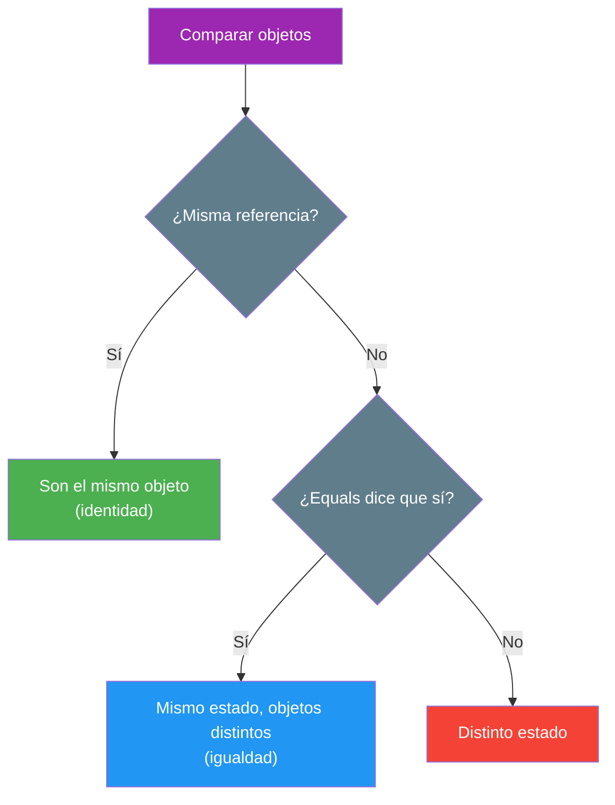

- [5. Instanciación, referencias, igualdad y ToString](#5-instanciación-referencias-igualdad-y-tostring)
  - [5.1. Creación e instanciación de objetos](#51-creación-e-instanciación-de-objetos)
    - [5.1.1. `new` y sintaxis básica](#511-new-y-sintaxis-básica)
    - [5.1.2. Object initializers y propiedades `init`](#512-object-initializers-y-propiedades-init)
    - [5.1.3. Target-typed new](#513-target-typed-new)
    - [5.1.4. Comparativa: constructor vs. object initializer](#514-comparativa-constructor-vs-object-initializer)
    - [5.1.5. Constructores secundarios con this](#515-constructores-secundarios-con-this)
  - [5.2. La referencia this](#52-la-referencia-this)
    - [5.2.1. Acceder a los miembros de la instancia](#521-acceder-a-los-miembros-de-la-instancia)
    - [5.2.2. Encadenamiento de constructores](#522-encadenamiento-de-constructores)
    - [5.2.3. Pasar this como argumento](#523-pasar-this-como-argumento)
  - [5.3. Representación como cadena: ToString](#53-representación-como-cadena-tostring)
    - [5.3.1. Override de ToString()](#531-override-de-tostring)
    - [5.3.2. Interpolación de cadenas](#532-interpolación-de-cadenas)
  - [5.4. Igualdad e identidad](#54-igualdad-e-identidad)
    - [5.4.1. ReferenceEquals y el comportamiento por defecto](#541-referenceequals-y-el-comportamiento-por-defecto)
    - [5.4.2. Igualdad por valor vs. por referencia](#542-igualdad-por-valor-vs-por-referencia)
    - [5.4.3. Sobrescribir `Equals(object)` y `GetHashCode()`](#543-sobrescribir-equalsobject-y-gethashcode)


# 5. Instanciación, referencias, igualdad y ToString

> 💡 **Punto de partida:** ¿Alguna vez has visto dos fotos de Instagram con el mismo contenido y has preguntado "¿es la misma foto o son dos copias?" En programación pasa igual con los objetos: dos objetos pueden tener el mismo estado y seguir siendo distintos. En este punto aprenderás a crearlos, a compararlos correctamente y a convertirlos en texto para mostrarlos.

En este punto aprenderás a crear instancias con `new` y sus variantes, a usar la referencia `this`, a convertir tus objetos a cadenas con `ToString` y a distinguir identidad de igualdad al comparar objetos.

**Objetivos de aprendizaje:**

- Instanciar objetos con `new`, *object initializers*, `init` y *target-typed new*
- Usar `this` para resolver ambigüedades y encadenar constructores
- Sobrescribir `ToString()` y usar la interpolación de cadenas para representar objetos
- Diferenciar identidad (misma referencia) de igualdad (mismo estado)
- Sobrescribir `Equals` y `GetHashCode` para comparar objetos por su contenido

## 5.1. Creación e instanciación de objetos

Crear o **instanciar** un objeto es el proceso de obtener una unidad concreta de una clase. Hay varias formas de hacerlo, y todas acaban en lo mismo: un objeto nuevo en el heap y una referencia en tu variable.

### 5.1.1. `new` y sintaxis básica

Cuando usas `new`, le pides al sistema que cree un objeto nuevo conforme a la definición de su clase. Este es el uso básico:

```csharp
var miGato = new Gato();
miGato.Nombre = "Felix";
miGato.Edad = 3;
```

Cada vez que usas `new` se crea una **referencia nueva** en memoria para ese objeto. El objeto se almacena en el heap, y la variable (`miGato`) contiene la referencia a esa ubicación.

> 💡 **Consejo:** `var` es solo azúcar sintáctico: el compilador deduce el tipo (`Gato`). No confundas con `var` de JavaScript, que es de tipo dinámico: aquí el tipo se fija en compilación.

### 5.1.2. Object initializers y propiedades `init`

Los **object initializers** permiten asignar propiedades en el mismo momento de crear el objeto, sin llamadas largas al constructor:

```csharp
var miLibro = new Libro { Titulo = "1984", Autor = "Orwell" };
```

Si la propiedad se declara con `init` en lugar de `set`, solo puede establecerse en el initializer o en el constructor: no podrá modificarse después.

```csharp
public class Usuario
{
    public string Nombre { get; init; } = string.Empty;
}

var usuario = new Usuario { Nombre = "Marta" }; // OK
// usuario.Nombre = "Ana"; // ERROR: solo puede fijarse al crearse
```

📌 **Ejemplo real:** Los objetos `record` de C# (como los datos de un pedido inmutables) usan `init` para que nadie pueda cambiar un pedido ya creado: así se evitan errores de datos "a medias".

### 5.1.3. Target-typed new

Desde C# 9 puedes acortar el código indicando el tipo a la izquierda y dejando que el compilador complete el `new`:

```csharp
Gato miGato = new("Miau", 2); // existe un constructor Gato(string, int)
```

Es muy legible cuando la variable es de tipo explícito y se lee de corrido: `Gato miGato = new(...)`.

### 5.1.4. Comparativa: constructor vs. object initializer

Usa **constructores** cuando necesitas garantizar algún valor sí o sí al crear el objeto, y **initializers** cuando quieres flexibilidad y claridad.

```csharp
// Constructor: no puedes olvidar la edad, es obligatorio
var gato = new Gato("Felix", 2);

// Initializer: puedes dejar campos sin poner (no recomendado si son importantes)
var libro = new Libro { Titulo = "1984", Autor = "Orwell" };
```

> ⚠️ **Advertencia:** Si el objeto no puede existir sin ciertos datos (un pedido sin cliente no tiene sentido), ese dato va en el **constructor**, no en un initializer opcional. El compilador no te dejará crear el objeto incompleto.

### 5.1.5. Constructores secundarios con this

Puedes definir varios constructores en una clase para las distintas formas de crear objetos. Usa `this(...)` para llamar a otro constructor y evitar repetir código; lo verás en detalle en el punto 6.

```csharp
public class Coche
{
    public string Marca { get; set; } = string.Empty;
    public string Modelo { get; set; } = string.Empty;
    public int Año { get; set; }

    // Constructor secundario: delega en el principal
    public Coche(string marca, string modelo) : this(marca, modelo, 0) { }

    // Constructor principal
    public Coche(string marca, string modelo, int año)
    {
        Marca = marca;
        Modelo = modelo;
        Año = año;
    }
}
```

## 5.2. La referencia this

La palabra clave **`this`** en C# siempre se refiere al **objeto actual**, es decir, la instancia sobre la que se está ejecutando el código. Sirve sobre todo para distinguir los atributos del objeto de los parámetros cuando se llaman igual.

### 5.2.1. Acceder a los miembros de la instancia

Este ejemplo muestra el caso clásico: el parámetro `x` y el atributo `x` con el mismo nombre.

```csharp
public class Punto
{
    private int _x;

    public void SetX(int x)
    {
        _x = x; // sin ambigüedad: _x es el atributo, x es el parámetro
    }

    // Con this (también válido y más explícito)
    public void SetXConThis(int x)
    {
        this._x = x; // "this._x" es el atributo de la instancia
    }
}
```

📌 **Ejemplo real:** En cualquier formulario de registro, el parámetro `nombre` llega del campo de la pantalla y el atributo `nombre` es el del objeto usuario: `this.nombre = nombre` guarda lo que escribió el usuario dentro de su propio objeto.

### 5.2.2. Encadenamiento de constructores

Con `this` puedes llamar a otro constructor de la misma clase y reutilizar su lógica en lugar de duplicarla:

```csharp
public class Persona
{
    public string Nombre { get; set; } = string.Empty;
    public int Edad { get; set; }

    public Persona(string nombre) : this(nombre, 0) { }

    public Persona(string nombre, int edad)
    {
        Nombre = nombre;
        Edad = edad;
    }
}
```

### 5.2.3. Pasar this como argumento

En métodos, `this` te permite referenciar la instancia actual para modificar datos o llamar a otros métodos de esa instancia, e incluso puedes **pasar `this` como argumento** a otros métodos que necesiten trabajar con el objeto completo.

```csharp
public class Gato
{
    public string Nombre { get; set; } = string.Empty;

    public void RegistrarEn(ClinicaVeterinaria clinica)
    {
        clinica.Anotar(this); // paso el objeto completo a otro método
    }
}
```

> 📝 **Nota:** Con las propiedades autoimplementadas (`{ get; set; }`) ya no necesitas `this.nombre = nombre` en los constructores modernos; el encadenamiento y las ambigüedades siguen siendo los usos principales.

## 5.3. Representación como cadena: ToString

Es muy útil que tus objetos puedan convertirse a texto para mostrar información, depurar o guardarla en un fichero.

### 5.3.1. Override de ToString()

Puedes sobrescribir el método `ToString()` en tu clase para devolver una representación legible del objeto:

```csharp
public class Persona
{
    public string Nombre { get; set; } = string.Empty;
    public int Edad { get; set; }

    public override string ToString() => $"Persona: {Nombre}, {Edad} años";
}
```

Ahora, si imprimes el objeto, verás ese texto en consola: `Console.WriteLine(new Persona { Nombre = "Jose", Edad = 20 })` mostrará `Persona: Jose, 20 años`.

📌 **Ejemplo real:** Cuando la consola de Windows o un visor de logs muestra un objeto completo en vez de `Namespace.Clase`, alguien ha reescrito `ToString` para que dé información útil. Sin ese override, solo verías el nombre del tipo.

### 5.3.2. Interpolación de cadenas

La interpolación con `$` permite mezclar variables y texto de forma cómoda, y es la forma habitual de construir el resultado de `ToString`:

```csharp
var nombre = "Jose";
var mensaje = $"Hola, {nombre}!"; // "Hola, Jose!"
Console.WriteLine(mensaje);
```

Dentro de las llaves puedes poner expresiones completas: `$"Tienes {lista.Count} elementos y el total es {precio * 1.21m}"`.

> 💡 **Truco:** En la interpolación puedes poner formato: `$"Nota: {nota:F1}"` muestra `Nota: 7,5`. Muy útil en `ToString` para fechas (`{fecha:dd/MM/yyyy}`) y monedas.

## 5.4. Igualdad e identidad

Cuando trabajas con objetos es fundamental distinguir entre comparar si son **el mismo objeto** (identidad) o si solo tienen **el mismo estado** (igualdad). Es la diferencia entre "¿es la misma foto?" y "¿son dos fotos iguales?".



### 5.4.1. ReferenceEquals y el comportamiento por defecto

Una comparación por **identidad** verifica si dos referencias apuntan al mismo objeto en memoria:

```csharp
var a = new Libro { Titulo = "1984" };
var b = new Libro { Titulo = "1984" };

Console.WriteLine(object.ReferenceEquals(a, b)); // False: son objetos distintos

var c = a;
Console.WriteLine(object.ReferenceEquals(a, c)); // True: misma referencia
```

### 5.4.2. Igualdad por valor vs. por referencia

Por defecto, en C# la comparación `==` entre objetos de tipo clase compara **la referencia** (identidad), no el contenido. Para comparar el **estado** debes:

- Sobrescribir el método `Equals(object?)`
- Sobrescribir también `GetHashCode()` (deben ir siempre juntos)

> ⚠️ **Advertencia:** Sobrescribir `Equals` **no** cambia el comportamiento de `==`: el operador sigue comparando referencias. Si quieres que `==` compare por estado, además debes sobrecargar el operador `==` con `operator ==`.

### 5.4.3. Sobrescribir `Equals(object)` y `GetHashCode()`

Esta es la clase `Libro` con igualdad por estado definida a mano:

```csharp
public class Libro
{
    public string Titulo { get; set; } = string.Empty;

    public override bool Equals(object? obj)
    {
        if (obj is Libro otro)
            return Titulo == otro.Titulo;
        return false;
    }

    public override int GetHashCode() => Titulo.GetHashCode();
}
```

Y así se comporta al compararla:

```csharp
var libro1 = new Libro { Titulo = "1984" };
var libro2 = new Libro { Titulo = "1984" };

Console.WriteLine(libro1.Equals(libro2));              // True: mismo estado
Console.WriteLine(object.ReferenceEquals(libro1, libro2)); // False: distinta referencia
Console.WriteLine(libro1 == libro2);                   // False: == compara referencias
```

Si la clase tiene varios campos, se comparan todos en `Equals` y se combinan en `GetHashCode`:

```csharp
public class Gato
{
    public string Nombre { get; set; } = string.Empty;
    public int Edad { get; set; }
    public string Raza { get; set; } = string.Empty;
    public bool EsDomestico { get; set; }

    public override string ToString() =>
        $"[Gato: {Nombre}, Edad: {Edad}, Raza: {Raza}, Doméstico: {EsDomestico}]";

    public override int GetHashCode() =>
        HashCode.Combine(Nombre, Edad, Raza, EsDomestico);

    public override bool Equals(object? obj) =>
        obj is Gato otro &&
        otro.Nombre == Nombre &&
        otro.Edad == Edad &&
        otro.Raza == Raza &&
        otro.EsDomestico == EsDomestico;
}
```

📌 **Ejemplo real:** Tu app de biblioteca guarda en un diccionario los libros por título: para que `diccionario[libro]` encuentre el libro, la clave necesita un `GetHashCode` y un `Equals` correctos. Sin ellos, cada consulta "pierde" el libro aunque tenga los mismos datos.

> 💡 **Consejo para el examen:** memoriza la pareja: **`Equals` y `GetHashCode` siempre se sobrescriben juntos**. Y recuerda: `==` compara referencias, `Equals` compara estado (si lo has sobrescrito).

---

**Resumen del punto:**

| Concepto | Descripción |
| :--- | :--- |
| **`new`** | Crea el objeto en el heap y devuelve su referencia |
| **Object initializer** | `new Tipo { Prop = valor }`: asigna propiedades al crear |
| **`init`** | Propiedad que solo puede fijarse al crear el objeto |
| **Target-typed new** | `Gato g = new(...)`: el tipo lo da la variable |
| **`this`** | Referencia a la instancia actual (ambigüedades y encadenamiento) |
| **`ToString()`** | Convierte el objeto a texto; se sobrescribe con `override` |
| **Interpolación** | `$"Hola {nombre}"`: mezcla texto y expresiones |
| **Identidad** | ¿Es el mismo objeto? `ReferenceEquals` y `==` |
| **Igualdad** | ¿Tiene el mismo estado? `Equals` + `GetHashCode` |

## ¿Qué viene después?

En el siguiente punto veremos los constructores e inicialización: cómo garantizar que un objeto nace con sus datos correctos, parámetros por defecto y validación desde el primer momento.

## Buenas prácticas

- [ ] Usar el constructor para los datos imprescindibles y los initializers para los opcionales
- [ ] Marcar como `init` las propiedades que no deben cambiar tras crearse el objeto
- [ ] Sobrescribir `ToString` en cualquier clase que muestres en consola o en logs
- [ ] Sobrescribir `Equals` y `GetHashCode` siempre juntos, nunca uno solo
- [ ] No olvidar que `==` compara referencias: para estado, usar `Equals`
- [ ] Usar `this` solo cuando haya ambigüedad o para encadenar constructores
