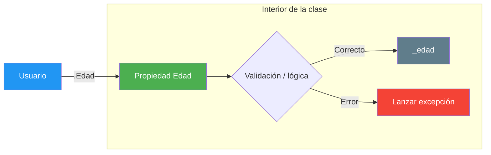
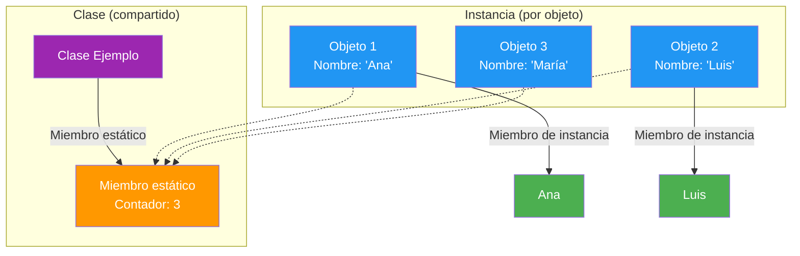

- [7. Encapsulación, propiedades y miembros estáticos](#7-encapsulación-propiedades-y-miembros-estáticos)
  - [7.1. Getters y setters](#71-getters-y-setters)
    - [7.1.1. Métodos GetX() y SetX()](#711-métodos-getx-y-setx)
    - [7.1.2. Encapsulación clásica y ejemplos](#712-encapsulación-clásica-y-ejemplos)
    - [7.1.3. Ventajas de migrar a propiedades](#713-ventajas-de-migrar-a-propiedades)
  - [7.2. Propiedades en C#](#72-propiedades-en-c)
    - [7.2.1. Propósito y por qué usar propiedades](#721-propósito-y-por-qué-usar-propiedades)
    - [7.2.2. Propiedades autoimplementadas](#722-propiedades-autoimplementadas)
    - [7.2.3. Propiedades de solo lectura (get-only)](#723-propiedades-de-solo-lectura-get-only)
    - [7.2.4. Propiedades init (get; init;)](#724-propiedades-init-get-init)
    - [7.2.5. Accesibilidad diferenciada en accesores](#725-accesibilidad-diferenciada-en-accesores)
    - [7.2.6. Propiedades expression-bodied](#726-propiedades-expression-bodied)
    - [7.2.7. Propiedades calculadas (computed properties)](#727-propiedades-calculadas-computed-properties)
    - [7.2.8. Propiedades con backing field (full properties)](#728-propiedades-con-backing-field-full-properties)
    - [7.2.9. Buenas prácticas y convenciones](#729-buenas-prácticas-y-convenciones)
  - [7.3. Miembros estáticos: métodos y propiedades de clase](#73-miembros-estáticos-métodos-y-propiedades-de-clase)
    - [7.3.1. Métodos y propiedades static: sintaxis y uso](#731-métodos-y-propiedades-static-sintaxis-y-uso)
    - [7.3.2. Propiedades estáticas inmutables (static readonly / const)](#732-propiedades-estáticas-inmutables-static-readonly--const)
    - [7.3.3. Constructor estático y orden de inicialización](#733-constructor-estático-y-orden-de-inicialización)
    - [7.3.4. Uso práctico: utilidades, contadores y cachés](#734-uso-práctico-utilidades-contadores-y-cachés)
    - [7.3.5. Clases estáticas: utilidad y restricciones](#735-clases-estáticas-utilidad-y-restricciones)
  - [7.4. Resumen de modificadores en C#](#74-resumen-de-modificadores-en-c)
    - [7.4.1. Modificadores de acceso (visibilidad)](#741-modificadores-de-acceso-visibilidad)
    - [7.4.2. Modificadores de estado](#742-modificadores-de-estado)
    - [7.4.3. Inicialización y accesores](#743-inicialización-y-accesores)
    - [7.4.4. Obligatoriedad y carga perezosa](#744-obligatoriedad-y-carga-perezosa)


# 7. Encapsulación, propiedades y miembros estáticos

> 💡 **Punto de partida:** En un coche, el velocímetro te muestra la velocidad pero no te deja cambiarla a mano: hay un dato interno que solo el coche toca, y tú accedes a él por un instrumento controlado. Eso es encapsulación con propiedades. En este punto verás cómo proteger el estado de tus objetos con `get`, `set` e `init`, y cómo definir miembros que pertenecen a la clase entera (`static`).

En este punto aprenderás a encapsular el estado con getters y setters, a usar todos los tipos de propiedades de C# (autoimplementadas, de solo lectura, `init`, calculadas y con *backing field*), y a trabajar con miembros estáticos y clases estáticas.

**Objetivos de aprendizaje:**

- Explicar qué son los getters y setters y por qué se migró a las propiedades
- Usar los distintos tipos de propiedades de C#: autoimplementadas, `get`-only, `init`, calculadas y con validación
- Aplicar los modificadores de acceso a las propiedades y a sus accesores
- Definir miembros `static`, constructores estáticos y clases estáticas
- Distinguir `required`, `init` y `Lazy<T>` y saber cuándo conviene cada uno

## 7.1. Getters y setters

Los **getters** y **setters** son métodos especiales que permiten acceder y modificar los atributos privados de una clase de forma controlada. Recuerda el principio de ocultación: los atributos deben ser privados y no accesibles directamente desde fuera. Esto ayuda a proteger el estado interno del objeto y a mantener su integridad.

### 7.1.1. Métodos GetX() y SetX()

La forma clásica (heredada de Java) consiste en un método para leer y otro para escribir:

```csharp
public class Perro
{
    private int _edad;

    public int GetEdad() => _edad;
    public void SetEdad(int valor) => _edad = valor;
}
```

Con estos métodos nadie toca `_edad` directamente: todo pasa por `GetEdad` y `SetEdad`.

### 7.1.2. Encapsulación clásica y ejemplos

La gran ventaja de este patrón es que puedes **controlar** cómo se accede y cambia el estado, por ejemplo añadiendo validaciones dentro del *setter*:

```csharp
public class Persona
{
    private int _edad;

    public int GetEdad() => _edad;

    public void SetEdad(int valor)
    {
        if (valor < 0)
            throw new ArgumentException("La edad no puede ser negativa");
        _edad = valor;
    }
}
```

📌 **Ejemplo real:** Cuando una app de citas te impide poner una edad negativa o superior a 150, hay una validación escondida en el método de escritura. Sin esa comprobación, cualquier dato corrupto entraría sin más.

### 7.1.3. Ventajas de migrar a propiedades

Las **propiedades** (`get`/`set`) de C# son más limpias y potentes: se usan con la sintaxis de un campo (`.Edad`), pero por dentro tienen la seguridad y el control de un método. Es por eso que C# las prefiere desde su primera versión.

```csharp
public class Persona
{
    public int Edad { get; set; }
}

var p = new Persona();
p.Edad = 25; // sintaxis de campo, control de método
```

> 💡 **Consejo:** Usa `GetEdad`/`SetEdad` solo si mantienes código heredado de Java o de versiones muy antiguas. En C#, el camino es **propiedades**.

## 7.2. Propiedades en C#

Las **propiedades** son una de las características más útiles de C#: combinan la sencillez de los campos y la seguridad de los métodos.

### 7.2.1. Propósito y por qué usar propiedades

Permiten exponer la información interna del objeto de forma controlada, pudiendo añadir validación, lógica o notificaciones. El objetivo es crear una interfaz clara y segura para interactuar con el estado del objeto: por fuera parece un campo, por dentro pasa por la lógica que tú decidas.



> 📝 **Nota:** Los subgrafos del diagrama se dejan sin estilo para que no se fundan con sus nodos: el color va solo en los recuadros interiores.

### 7.2.2. Propiedades autoimplementadas

Son propiedades que el compilador gestiona automáticamente, ideales para objetos de datos: no escribes campo ni lógica.

```csharp
public class Producto
{
    public string Nombre { get; set; } = string.Empty;
    public decimal Precio { get; set; }
}
```

Puedes inicializar el valor por defecto en la propia declaración:

```csharp
public string Descripcion { get; set; } = "Sin descripción";
```

> ⚠️ **Advertencia:** Con la gestión estricta de nulos activada, una propiedad `string` sin inicializar genera un *warning*: inicialízala (`= string.Empty`) o declárala `string?` si admite que no haya valor.

### 7.2.3. Propiedades de solo lectura (get-only)

No tienen `set`, o solo lo tienen privado/interno: el usuario no puede modificarlas después de crear el objeto. Este ejemplo calcula el área a partir de un radio inmutable:

```csharp
public class Circulo
{
    public double Radio { get; }
    public double Area => Math.PI * Radio * Radio;

    public Circulo(double radio)
    {
        Radio = radio;
    }
}
```

### 7.2.4. Propiedades init (get; init;)

Solo pueden asignarse durante la inicialización (en el constructor o en el `new { ... }`). Aumentan la inmutabilidad y la seguridad del objeto.

```csharp
public class Usuario
{
    public string Nombre { get; init; } = string.Empty;
    public int Edad { get; init; }
}

var usuario = new Usuario { Nombre = "Ana", Edad = 25 };
// usuario.Edad = 30; // ERROR: solo puede fijarse al crearse
```

📌 **Ejemplo real:** Los objetos `record` que modelan datos de solo lectura (una línea de factura, un mensaje recibido) usan `init` para que nadie pueda alterarlos después de crearlos: si el dato estaba bien, sigue bien.

### 7.2.5. Accesibilidad diferenciada en accesores

Puedes decidir quién puede leer o escribir cada propiedad por separado, siempre que el accesor sea **más restrictivo** que la propiedad:

```csharp
public class Cuenta
{
    // Todo el mundo lee; solo la clase modifica
    public string Clave { get; private set; } = string.Empty;
}
```

### 7.2.6. Propiedades expression-bodied

Las propiedades *expression-bodied* usan la sintaxis corta con `=>` para devolver un valor calculado:

```csharp
public int Area => Alto * Ancho;
```

Es la forma más breve de escribir una propiedad de solo lectura cuyo cuerpo es una única expresión.

### 7.2.7. Propiedades calculadas (computed properties)

Permiten devolver un valor derivado de otros, como el nombre completo a partir de nombre y apellidos:

```csharp
public string NombreCompleto => $"{Nombre} {Apellidos}";
```

> 💡 **Truco:** Una propiedad calculada **no guarda nada**: cada vez que la consultas se recalcula. Es perfecta para datos derivados, pero no para datos costosos de calcular (esos van con caché, como verás con `Lazy<T>`).

### 7.2.8. Propiedades con backing field (full properties)

Cuando necesitas lógica, validación o transformar los datos antes de guardarlos, usas la propiedad completa con su **campo de respaldo** (*backing field*). Son fundamentales para mantener la integridad del estado del objeto.

```csharp
private int _edad;

public int Edad
{
    get => _edad;
    set
    {
        if (value < 0)
            throw new ArgumentException("La edad no puede ser negativa");
        _edad = value;
    }
}
```

Fíjate en que `value` es el valor que llega al `set`: la propiedad decide si lo acepta o lanza una excepción.

Desde **C# 14** puedes usar contextualmente **`field`** para referirte al campo de respaldo sin declararlo explícitamente:

```csharp
public class Empleado
{
    public decimal Salario
    {
        get;
        set => field = (value >= 0)
            ? value
            : throw new ArgumentOutOfRangeException(nameof(value), "El salario no puede ser negativo.");
    }
}
```

**Usos comunes de los campos de respaldo:**

- **Validación en `set`:** comprueba y lanza excepción si el valor no es válido.
- **Encapsulación de invariantes:** asegura que siempre se cumplen las reglas del objeto.
- **Inicialización diferida:** se inicializa solo cuando hace falta (ideal para objetos costosos).
- **Normalización de entradas:** ajusta los valores antes de guardarlos (por ejemplo, nombres a mayúsculas).
- **Notificación de cambios:** útil en interfaces; puedes avisar cuando una propiedad cambia (`INotifyPropertyChanged`).

Y este es el mismo patrón con dos propiedades usando `field` en C# 14:

```csharp
public class Producto
{
    public string Nombre
    {
        get;
        set => field = value?.Trim()
            ?? throw new ArgumentNullException(nameof(value), "El nombre no puede ser nulo.");
    }

    public decimal Precio
    {
        get;
        set => field = (value >= 0)
            ? value
            : throw new ArgumentOutOfRangeException(nameof(value), "El precio no puede ser negativo.");
    }
}
```

### 7.2.9. Buenas prácticas y convenciones

- Usa **PascalCase** para los nombres de las propiedades.
- Prefiere las propiedades **autoimplementadas** salvo que necesites lógica adicional.
- Usa **campos de respaldo** solo si hay validación, transformación o control especial.

## 7.3. Miembros estáticos: métodos y propiedades de clase

Los **miembros estáticos** pertenecen a la clase, no a una instancia concreta: puedes acceder a ellos **sin crear un objeto** de esa clase. Son elementos **compartidos** por todas las instancias. Son útiles para datos o comportamientos que son de la clase entera, o para utilidades generales.

### 7.3.1. Métodos y propiedades static: sintaxis y uso

Este ejemplo define un método estático que se usa sin instanciar nada:

```csharp
public class Matematica
{
    public static double Sumar(double a, double b) => a + b;
}

double resultado = Matematica.Sumar(3, 5); // 8: se llama sobre la clase
```

📌 **Ejemplo real:** `Math.Sqrt(25)` o `Console.WriteLine(...)` son métodos estáticos: funcionan sin hacer `new Math()` ni `new Console()`, porque pertenecen a la clase, no a un objeto.

### 7.3.2. Propiedades estáticas inmutables (static readonly / const)

Hay dos formas de definir valores fijos a nivel de clase:

- **`const`:** valor fijo en **tiempo de compilación**; solo para tipos simples.
- **`static readonly`:** valor fijo en **tiempo de ejecución**, que puede inicializarse en el constructor estático.

```csharp
public class Iva
{
    public const double TipoGeneral = 0.21;   // fijo en compilación
    public static readonly double TipoReducido = 0.10; // fijo en ejecución
}
```

> 📝 **Nota:** `const` es como pegar el número en cada punto donde se usa (por eso solo vale para tipos simples); `static readonly` sí es un valor en memoria de la clase que se puede calcular al arrancar.

### 7.3.3. Constructor estático y orden de inicialización

El constructor estático se usa para inicializar datos compartidos de la clase **antes de que se use cualquier miembro**:

```csharp
public class Configuracion
{
    public static readonly string RutaConfig;

    static Configuracion()
    {
        RutaConfig = "/etc/config"; // se ejecuta una sola vez
    }
}

var ruta = Configuracion.RutaConfig;
Console.WriteLine(ruta); // Imprime: /etc/config
```

### 7.3.4. Uso práctico: utilidades, contadores y cachés

Un uso clásico es contar cuántos objetos se han creado de una clase:

```csharp
public class Ejemplo
{
    public static int ContadorInstancias { get; private set; }

    public Ejemplo() => ContadorInstancias++;
}

var e1 = new Ejemplo();
var e2 = new Ejemplo();
Console.WriteLine(Ejemplo.ContadorInstancias); // Imprime: 2
```

📌 **Ejemplo real:** Un sistema de tickets usa un contador estático para numerar los pedidos: aunque cada pedido es un objeto distinto, el número siguiente es **uno solo** para toda la clase.

### 7.3.5. Clases estáticas: utilidad y restricciones

Una clase **estática** solo puede tener miembros estáticos y no puede instanciarse. Es la forma correcta de agrupar métodos de utilidad.

```csharp
public static class Utilidades
{
    public static int Max(int a, int b) => (a > b) ? a : b;
}

var maximo = Utilidades.Max(10, 20); // 20
```

> ⚠️ **Advertencia:** Si intentas hacer `new Utilidades()`, recibirás un error de compilación: las clases estáticas no se instancian, solo se usan a través de sus miembros estáticos.

## 7.4. Resumen de modificadores en C#

Las **propiedades** son miembros de una clase o *struct* que proporcionan un mecanismo flexible para acceder a campos privados. Exponen el dato a través de **accesores** (`get`, `set`, `init`), permitiendo la lógica de validación, cálculo o acceso diferido. Este apartado resume de un vistazo todos los modificadores que has ido viendo.

### 7.4.1. Modificadores de acceso (visibilidad)

Estos modificadores controlan qué partes del código pueden interactuar con la propiedad o con sus accesores individuales.

| Modificador | Alcance | Descripción | Ejemplo |
| :--- | :--- | :--- | :--- |
| **`public`** | Todo el código | Acceso sin restricciones desde cualquier parte del programa | `public string Nombre { get; set; }` |
| **`private`** | Solo la clase o *struct* contenedora | Solo los métodos y miembros de la clase donde está declarada | `private decimal CostoInterno { get; set; }` |
| **`internal`** | Solo el ensamblado (proyecto) actual | Limitado a los tipos definidos dentro del mismo ensamblado | `internal bool EstaEnOferta { get; set; }` |
| **`protected`** | La clase y las clases derivadas | Se permite en la base y en cualquier clase que herede de ella | `protected DateTime FechaCreacion { get; set; }` |

Puedes restringir además la accesibilidad de un accesor (`set` o `get`), siempre que sea **más restrictiva** que la propiedad principal. Este ejemplo muestra las dos restricciones habituales:

```csharp
public class Producto
{
    // Público para leer, pero solo la clase 'Producto' puede modificarla
    public decimal Precio { get; private set; }

    // Interno para leer, pero solo 'Producto' (y sus herederas) pueden establecerlo
    internal string Codigo { get; protected set; }

    public Producto(string codigo, decimal precio)
    {
        // 'private set' y 'protected set' son accesibles aquí (dentro de la clase)
        Codigo = codigo;
        Precio = precio;
    }
}
```

### 7.4.2. Modificadores de estado

**`static`:** la propiedad pertenece a la **clase**, no a una instancia individual. Hay una única copia compartida por todos los objetos. Uso común: contadores, constantes o registros de actividad de la clase.

```csharp
public class Pedido
{
    // Contador global para todos los pedidos
    public static int TotalPedidos { get; private set; }

    public Pedido() => TotalPedidos++; // cada nuevo pedido suma
}

// Acceso a través de la clase, no de una instancia
Console.WriteLine(Pedido.TotalPedidos); // 0
var p1 = new Pedido();
var p2 = new Pedido();
Console.WriteLine(Pedido.TotalPedidos); // 2
```

**`readonly`:** garantiza que un campo solo se pueda asignar una vez: en la **declaración** o en el **constructor**. Sirve para la inmutabilidad y para saber que un valor no cambiará después de la construcción.

```csharp
public class Config
{
    private readonly string _nombreServidor;

    // Propiedad de solo lectura que expone el campo
    public string NombreServidor => _nombreServidor;

    public Config(string nombre)
    {
        // Único lugar fuera de la declaración donde se puede asignar
        _nombreServidor = nombre;
    }

    // public void IntentarCambiar() { _nombreServidor = "otro"; } // ERROR: es readonly
}
```

### 7.4.3. Inicialización y accesores

Los **accesores** definen cómo se lee (`get`) y cómo se escribe (`set`/`init`) el valor de la propiedad.

| Accesor | Propósito | Comportamiento |
| :--- | :--- | :--- |
| **`get`** | Lectura de valor | Contiene la lógica para devolver el valor de la propiedad |
| **`set`** | Escritura de valor (mutable) | Permite cambiar el valor en cualquier momento después de crear el objeto |
| **`init`** | Escritura de valor (solo inicialización) | Solo permite cambiar el valor durante la inicialización (C# 9); después es de solo lectura |

Este ejemplo combina los tres accesores en una misma clase:

```csharp
public class Empleado
{
    // 'set': se puede modificar en cualquier momento
    public string Puesto { get; set; } = "Junior";

    // 'init': solo se puede establecer al crear el objeto
    public int IdEmpleado { get; init; }

    // Solo 'get', asignado en el constructor
    public string NombreCompleto { get; }

    public Empleado(string nombreCompleto)
    {
        NombreCompleto = nombreCompleto; // asignación válida dentro del constructor
    }
}

var e = new Empleado("Ana García")
{
    IdEmpleado = 101 // válido: inicializador de objeto
};

e.Puesto = "Senior"; // válido: tiene 'set'
// e.IdEmpleado = 102; // ERROR: es init-only
```

### 7.4.4. Obligatoriedad y carga perezosa

**`required`** obliga al código cliente a inicializar la propiedad: el compilador genera un error si no se establece durante la creación del objeto. Su propósito es garantizar que un objeto siempre se encuentre en un estado válido.

**La diferencia clave entre `required` e `init`:** `init` controla **cuándo** se puede asignar (solo al inicio), pero no obliga a que se asigne; `required` controla **si** se debe asignar y obliga a que tenga valor.

| Propiedad | ¿Es required? | ¿Obliga a inicializar? | ¿Permite cambiar luego? |
| :--- | :--- | :--- | :--- |
| `public string A { get; set; }` | No | No | Sí |
| `public string B { get; init; }` | No | No | No |
| `public required string C { get; set; }` | Sí | Sí | Sí |
| `public required string D { get; init; }` | Sí | Sí | No |

Y este es un uso real de `required` en una configuración de base de datos:

```csharp
public class ConfiguracionBBDD
{
    // OBLIGATORIO: la cadena de conexión debe proporcionarla el usuario
    public required string CadenaConexion { get; init; }

    // OPCIONAL: tiene valor por defecto
    public int Timeout { get; init; } = 30;
}

// Uso correcto:
var config1 = new ConfiguracionBBDD { CadenaConexion = "Server=LocalDB" };

// Uso INCORRECTO:
// var config2 = new ConfiguracionBBDD { Timeout = 60 };
// ERROR: la propiedad 'CadenaConexion' es required y no se ha inicializado.
```

**`Lazy<T>`** implementa la **inicialización diferida** (*lazy loading* o carga perezosa): el código de inicialización solo se ejecuta cuando se accede a la propiedad por primera vez. Sirve para cargar recursos pesados o complejos solo si son estrictamente necesarios.

```csharp
// Un objeto que tarda mucho en construirse
public class ReporteMensual
{
    public ReporteMensual()
    {
        Thread.Sleep(5000); // simula una carga de 5 segundos
        Console.WriteLine("Reporte creado.");
    }
}

public class Dashboard
{
    // El objeto NO se crea al crear el Dashboard
    private readonly Lazy<ReporteMensual> _reporteLazy = new(() => new ReporteMensual());

    // La propiedad activa la creación en el primer acceso
    public ReporteMensual DatosReporte => _reporteLazy.Value;

    public void MostrarResumen()
    {
        Console.WriteLine("Mostrando resumen rápido...");
        // El reporte NO se ha creado todavía
    }
}

var dash = new Dashboard();
dash.MostrarResumen(); // inmediato

// SOLO aquí, por primera vez, se ejecuta el constructor de ReporteMensual
var datos = dash.DatosReporte; // tarda 5 segundos e imprime "Reporte creado."
```

📌 **Ejemplo real:** Una app de vídeo carga el miniaturas mientras navegas, pero el reproductor completo solo se construye cuando pulsas "play". Eso es `Lazy<T>`: pagar el coste solo cuando de verdad hace falta.

> 💡 **Truco del examen:** Pregunta típica: "¿Cuándo usar `static` y cuándo instancia?" **Respuesta:** `static` para datos y métodos que pertenecen a la **clase** (contadores, utilidades, configuración global); instancia para datos y métodos específicos de cada **objeto** (el nombre de una persona, la edad de un gato). Regla nemotécnica: *"lo estático se queda en la clase, lo de instancia viaja con el objeto"*.

La siguiente imagen resume esa diferencia:



> 💡 **Analogía del hotel:** Imagina un hotel con recepción global (`static`) y habitaciones individuales (instancia). El mostrador de recepción es único para todos (contador de huéspedes), pero cada habitación tiene sus propios datos (nombre del huésped, fecha de entrada).

> 📝 **Nota:** El principio de encapsulamiento se resume en *"oculta lo que no necesito mostrar, protege lo que no quiero que cambie"*. Las propiedades son la herramienta perfecta para esto.

**Comparativa rápida de modificadores:**

| Modificador | ¿Pertenece a...? | ¿Cuándo inicializar? | ¿Se puede cambiar? |
| :--- | :--- | :--- | :--- |
| `const` | Clase | Compilación | Nunca |
| `static readonly` | Clase | Tiempo de ejecución | Nunca |
| `readonly` (campo) | Instancia | Constructor | Nunca |
| `get; set;` | Instancia | Cuando quieras | Sí |
| `get; init;` | Instancia | Solo al crear | No |
| `static` | Clase | Cuando se usa | Sí |

---

**Resumen del punto:**

| Concepto | Descripción |
| :--- | :--- |
| **Getter / setter** | Método de lectura / escritura de un atributo privado (forma clásica) |
| **Propiedad** | Sintaxis de campo con control de método; la forma idiomática en C# |
| **Autoimplementada** | `{ get; set; }`: la gestiona el compilador, sin lógica propia |
| **`get`-only** | Solo lectura; útil con propiedades calculadas |
| **`init`** | Solo permite escribir al crear el objeto |
| **Backing field** | Campo privado con lógica de validación en los accesores |
| **`static`** | Miembro compartido por la clase entera; se accede sin `new` |
| **`const` / `static readonly`** | Valor fijo en compilación / fijo en ejecución |
| **Clase estática** | Solo miembros estáticos; no se puede instanciar |
| **`required`** | Obliga a inicializar la propiedad al crear el objeto |
| **`Lazy<T>`** | Inicialización diferida: se construye en el primer acceso |

## ¿Qué viene después?

En el siguiente punto veremos enums, structs y records: tres formas de definir tipos propios que resuelven problemas distintos a los de las clases.

## Buenas prácticas

- [ ] Exponer el estado con propiedades, nunca con campos públicos
- [ ] Usar propiedades autoimplementadas salvo que haya lógica que aplicar
- [ ] Validar en el `set` (o con `field` en C# 14) y lanzar excepciones con mensajes claros
- [ ] Marcar como `init` lo que no debe cambiar tras crearse el objeto
- [ ] Reservar `static` para lo que es de la clase: contadores, utilidades, configuración
- [ ] Usar `required` para los datos imprescindibles y `Lazy<T>` para lo costoso
