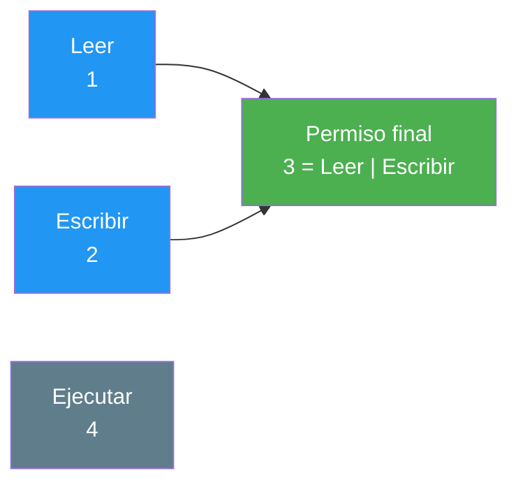
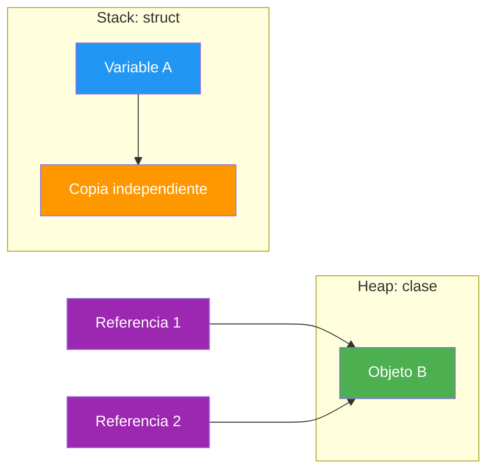

- [8. Enums, structs y records](#8-enums-structs-y-records)
  - [8.1. Enums (enumerados)](#81-enums-enumerados)
    - [8.1.1. Definición básica y uso](#811-definición-básica-y-uso)
    - [8.1.2. Asignación de valores específicos](#812-asignación-de-valores-específicos)
    - [8.1.3. Representación como cadena y análisis (parsing)](#813-representación-como-cadena-y-análisis-parsing)
    - [8.1.4. Enums con `[Flags]` y operaciones bit a bit](#814-enums-con-flags-y-operaciones-bit-a-bit)
  - [8.2. Structs y records](#82-structs-y-records)
    - [8.2.1. Structs (value types)](#821-structs-value-types)
    - [8.2.2. Record class](#822-record-class)
    - [8.2.3. Record struct](#823-record-struct)
    - [8.2.4. Comparativa: class vs. struct vs. record](#824-comparativa-class-vs-struct-vs-record)
    - [8.2.5. Tipos anónimos y tuplas](#825-tipos-anónimos-y-tuplas)


# 8. Enums, structs y records

> 💡 **Punto de partida:** Cuando juegas a un videojuego y eliges personaje, las opciones son "guerrero, mago, pícaro": ni una más ni una menos. Para eso existen los **enums**. Y cuando guardas un dato pequeño como unas coordenadas, ¿merece la pena todo el peso de un objeto? Aquí entran los **structs** y los **records**. En este punto aprenderás tres formas de definir tipos propios que no son clases "corrientes".

En este punto aprenderás a definir enums con valores concretos y combinables, a diferenciar los tipos por valor (structs) de los tipos por referencia, y a usar los records para modelar datos inmutables con igualdad automática.

**Objetivos de aprendizaje:**

- Definir enums, asignarles valores y convertirlos a cadenas y viceversa
- Usar enums con `[Flags]` para combinar opciones con operadores bit a bit
- Explicar la diferencia entre tipos por valor y tipos por referencia al copiarlos y pasarlos
- Emplear records con la expresión `with` para crear copias modificadas
- Elegir entre `class`, `struct` y `record` según el problema que se resuelva

## 8.1. Enums (enumerados)

Los **enums** te permiten definir un conjunto de valores posibles para un tipo. Se usan para representar opciones limitadas y conocidas. En el fondo, son números enteros con nombres legibles para los humanos.

📌 **Ejemplo real:** Cuando en una app eliges el estado de un pedido ("pendiente", "enviado", "entregado"), hay un enum detrás. Nadie puede escribir "casi entregado": o estás en uno de los valores definidos o no estás en ninguno.

### 8.1.1. Definición básica y uso

Definir un enum es declarar sus miembros y usarlos como si fueran constantes con nombre:

```csharp
public enum Color { Rojo, Verde, Azul }

Color miColor = Color.Azul;
```

En cuanto lo tienes, el compilador solo acepta esos valores: `miColor = "Azul"` no compila, porque `Color` no es un texto.

### 8.1.2. Asignación de valores específicos

Puedes asignar valores numéricos concretos a cada miembro. Si no se asignan, empiezan en `0` y aumentan en `1`.

```csharp
public enum DiaSemana
{
    Lunes = 1,
    Martes = 2,
    Miercoles = 3,
    Jueves = 4,
    Viernes = 5,
    Sabado = 6,
    Domingo = 7
}

DiaSemana hoy = DiaSemana.Miercoles;
int valor = (int)hoy; // valor será 3

// También se puede convertir un número a enum mediante casting
DiaSemana dia = (DiaSemana)5; // dia será DiaSemana.Viernes
```

> 💡 **Consejo:** Si el enum se va a guardar en una base de datos o en un fichero, fija siempre los valores a mano (`= 1`, `= 2`...). Si mañana añades un miembro al principio, los números de los demás no se mueven y tu información guardada sigue siendo válida.

### 8.1.3. Representación como cadena y análisis (parsing)

Puedes convertir enums a cadenas y viceversa de forma sencilla:

```csharp
Color color = Color.Rojo;
string nombreColor = color.ToString(); // "Rojo"

// Convertir string a enum (parsing)
Color color2 = (Color)Enum.Parse(typeof(Color), "Verde");
```

📌 **Ejemplo real:** Cuando el usuario escribe "Verde" en un formulario y tu app lo guarda como `Color.Verde` en la base de datos, hay un `Enum.Parse` haciendo de traductor entre el texto humano y el valor del enum.

> ⚠️ **Advertencia:** `Enum.Parse` lanza una excepción si el texto no es válido. En código de producción se prefiere `Enum.TryParse<Color>("Verde", out var c)`, que devuelve `false` en vez de romper el programa.

### 8.1.4. Enums con `[Flags]` y operaciones bit a bit

Con el atributo `[Flags]` puedes **combinar valores** para indicar varias opciones simultáneamente. Es muy útil para permisos o configuraciones. Así se combina el permiso de lectura y el de escritura:



Y este es el enum con sus combinaciones:

```csharp
[Flags]
public enum Permiso
{
    Ninguno = 0,
    Leer = 1,
    Escribir = 2,
    Ejecutar = 4
}

// Combinar permisos con el operador OR (|)
Permiso p = Permiso.Leer | Permiso.Escribir;

// Verificar permisos con .HasFlag (o con AND bitwise: p & Permiso.Escribir)
bool puedeEscribir = p.HasFlag(Permiso.Escribir); // true
bool puedeEjecutar = p.HasFlag(Permiso.Ejecutar); // false
```

📌 **Ejemplo real:** Los permisos de un sistema de ficheros (leer, escribir, ejecutar) o los roles de una app se modelan con `[Flags]`: un usuario puede tener varios a la vez, y `HasFlag` comprueba si tiene uno concreto.

> 💡 **Truco:** Los valores deben ser potencias de dos (`1, 2, 4, 8...`) para que cada uno ocupe un "bit" distinto y las combinaciones no se solapen.

## 8.2. Structs y records

### 8.2.1. Structs (value types)

Los **structs** son tipos por **valor**. A diferencia de las clases, cuando copias un struct creas una copia **independiente** de todos sus datos.

- Se usan para datos pequeños e inmutables (puntos, colores, coordenadas).
- Representan valores que tienen un significado propio sin identidad única.
- No pueden heredar de otros structs ni de clases (ni tener herencia ellos mismos).
- Se almacenan normalmente en la pila (**stack**), lo que los hace muy rápidos.

```csharp
public struct Punto
{
    public int X { get; }
    public int Y { get; }

    public Punto(int x, int y) => (X, Y) = (x, y);
}
```

**Paso por valor vs. paso por referencia.** Es crucial entender cómo se comportan al pasarlos a métodos:

- **Struct:** se pasa una **copia** (por valor). Si lo modificas dentro del método, el original no cambia.
- **Clase:** se pasa una **referencia**. Si lo modificas dentro del método, el objeto original cambia.



Fíjate en que las dos referencias de la derecha apuntan al **mismo** objeto, mientras que a la izquierda cada variable tiene sus propios datos: datos independientes a un lado, sitio común al otro.

📌 **Ejemplo real:** Tu dirección postal es un valor: si se la pasas a un amigo por copia y luego la cambias, la de él no se entera. En cambio, un documento compartido es una referencia: si tú lo editas, él ve los cambios.

> ⚠️ **Advertencia:** Aunque un struct se almacene en el stack por defecto, si es grande (más de unos bytes) o está dentro de un array, el compilador puede moverlo al heap. No escribas código que dependa de esa decisión.

### 8.2.2. Record class

Los **records** son tipos por referencia que introducen la **igualdad por valor**: dos records son iguales si sus datos coinciden, aunque sean objetos distintos. Son ideales para modelos de datos inmutables (DTO).

- Generan automáticamente `Equals`, `GetHashCode` y `ToString`.
- Soportan la expresión `with` para crear copias modificadas.

```csharp
public record Persona(string Nombre, int Edad);

var p1 = new Persona("Juan", 30);
var p2 = p1 with { Edad = 31 }; // copia con la edad cambiada

Console.WriteLine(p1 == p2); // False: los datos difieren
Console.WriteLine(p1);       // Persona { Nombre = Juan, Edad = 30 }
```

📌 **Ejemplo real:** En una API web, los datos que viajan en JSON (un producto, un usuario) suelen ser `record`: si llegan dos respuestas con los mismos campos, son "el mismo dato" para la aplicación, sin importar cuántos objetos se hayan creado.

### 8.2.3. Record struct

Son como los records, pero son tipos por **valor**. Se recomiendan para datos pequeños que necesiten la comodidad de los records (igualdad automática y representación en texto) pero la gestión de memoria de los structs.

```csharp
public record struct Coordenada(double Lat, double Lon);

var c1 = new Coordenada(40.4, -3.7);
var c2 = c1 with { Lon = -0.4 };

Console.WriteLine(c1 == c2); // False: valores distintos
```

### 8.2.4. Comparativa: class vs. struct vs. record

Para decidir con rapidez, esta tabla resume las diferencias:

| Característica | Class | Struct | Record |
| :--- | :--- | :--- | :--- |
| **Semántica** | Entidad con identidad única | Valor simple / dato | Dato / modelo inmutable |
| **Memoria** | Referencia (heap) | Valor (stack) | Referencia (record class) o valor (record struct) |
| **Copia** | Copia de referencia | Copia de todos los datos | Copia profunda (`with`) |
| **Igualdad** | Por identidad (referencia) | Por valor (campos) | Por valor (automática) |

**¿Cuándo usar cada uno?**

- **`class`:** para objetos con "vida" y comportamiento complejo (factura, usuario, pedido).
- **`struct`:** para valores matemáticos o datos muy pequeños que se crean y destruyen rápido (coordenadas, dinero).
- **`record`:** para contenedores de datos que solo sirven para transportar información (DTO, respuestas de API).

> 💡 **Consejo para el examen:** la pregunta clave es *"¿tiene identidad propia?"*. Si dos entidades con los mismos datos pueden ser la misma o no (dos usuarios distintos con el mismo nombre), es `class`. Si solo importan los valores (2 + 2 = 4 sea quien sea), es `struct` o `record`.

### 8.2.5. Tipos anónimos y tuplas

Permiten agrupar datos de forma rápida sin definir una clase o struct formal. Primero los tipos anónimos:

```csharp
var anon = new { Nombre = "Juan", Edad = 30 };
Console.WriteLine(anon.Nombre); // Juan
```

Y después las tuplas (ValueTuples), que además admiten nombres en sus elementos:

```csharp
var tupla = (Nombre: "Ana", Edad: 25);
Console.WriteLine(tupla.Nombre); // Ana
```

📌 **Ejemplo real:** Cuando devuelves de un método la nota media y el número de intentos a la vez, sin querer crear una clase entera para eso, usas una tupla: rápida, anónima y suficiente para el caso.

> ⚠️ **Advertencia:** Los tipos anónimos no se pueden devolver de un método con tipo explícito (el compilador no sabe escribir su tipo). Para eso existen los `record` o las clases: si el dato viaja por la aplicación, dale nombre propio.

---

**Resumen del punto:**

| Concepto | Descripción |
| :--- | :--- |
| **Enum** | Conjunto fijo de valores con nombre; números enteros legibles |
| **`[Flags]`** | Enum combinable con `|` y `HasFlag` (potencias de dos) |
| **`Enum.Parse` / `TryParse`** | Texto → enum; `TryParse` no lanza excepciones |
| **Struct** | Tipo por valor: al copiarlo, los datos se duplican |
| **Record class** | Tipo por referencia con igualdad por valor y `with` |
| **Record struct** | Tipo por valor con igualdad automática |
| **`with`** | Crea una copia del record con algún campo cambiado |
| **Tipo anónimo** | Objeto sin nombre (`new { ... }`); no se puede devolver de un método |
| **Tupla** | Varios valores en uno, con nombres opcionales: `(Nombre: "Ana")` |

## ¿Qué viene después?

En el siguiente punto veremos las clases anidadas y la composición: cómo organizar clases dentro de otras y cuándo usar "tiene un" en lugar de "es un".

## Buenas prácticas

- [ ] Usar enums para todo lo que sea un conjunto fijo de opciones (estados, roles, colores)
- [ ] Fijar los valores numéricos de los enums a mano si van a persistirse
- [ ] Usar `Enum.TryParse` en vez de `Enum.Parse` con datos de entrada del usuario
- [ ] Reservar los structs a datos pequeños e inmutables, sin identidad propia
- [ ] Usar `record` para DTOs y datos de transporte; `class` para entidades con comportamiento
- [ ] No abusar de los tipos anónimos: si el dato viaja, ponerle nombre (`record`)
