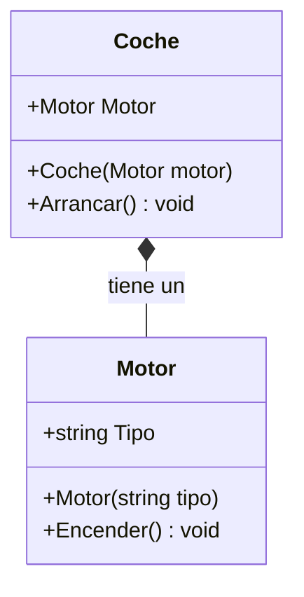

- [9. Clases anidadas y composición](#9-clases-anidadas-y-composición)
  - [9.1. Clases anidadas](#91-clases-anidadas)
    - [9.1.1. Clases anidadas (estáticas vs. de instancia)](#911-clases-anidadas-estáticas-vs-de-instancia)
    - [9.1.2. Escenarios de uso](#912-escenarios-de-uso)
  - [9.2. Composición de objetos](#92-composición-de-objetos)
    - [9.2.1. Contener objetos como campos o propiedades](#921-contener-objetos-como-campos-o-propiedades)
    - [9.2.2. Ventajas frente a la herencia](#922-ventajas-frente-a-la-herencia)


# 9. Clases anidadas y composición

> 💡 **Punto de partida:** Si abres un coche, verás que dentro tiene un motor, y dentro del motor hay piezas que solo tienen sentido estando ahí: nadie usa un pistón suelto en la cocina. En POO pasa igual: a veces una clase solo tiene sentido dentro de otra, y a veces lo mejor es construir un objeto **juntando otros objetos**. En este punto verás las clases anidadas y la composición.

En este punto aprenderás a definir clases dentro de otras, y a construir objetos complejos a partir de piezas más simples aplicando el principio de "reutilización sobre herencia".

**Objetivos de aprendizaje:**

- Definir clases anidadas y saber cuándo conviene hacerlo
- Construir objetos por composición: contener otros objetos como estado
- Aplicar la inyección de objetos a través del constructor
- Distinguir las relaciones "es un" (herencia) de las "tiene un" (composición)
- Justificar por qué la composición suele ser preferible a la herencia

## 9.1. Clases anidadas

Las **clases anidadas** son clases definidas dentro de otras clases. Son útiles para agrupar tipos relacionados que solo tienen sentido dentro del contexto de la clase contenedora.

### 9.1.1. Clases anidadas (estáticas vs. de instancia)

Una clase interna puede acceder a los miembros de la clase externa si estos son accesibles, lo que permite una encapsulación más estrecha. Este ejemplo define `Documento` dentro de `Persona`:

```csharp
public class Persona
{
    public string Nombre { get; set; } = string.Empty;

    // Clase anidada: solo tiene sentido dentro de Persona
    public class Documento
    {
        public string Tipo { get; set; } = string.Empty;   // DNI, pasaporte, etc.
        public string Numero { get; set; } = string.Empty;
    }
}

// Uso: se referencia como Persona.Documento
var p = new Persona { Nombre = "José" };
var doc = new Persona.Documento { Tipo = "DNI", Numero = "12345678Z" };
```

📌 **Ejemplo real:** En una app de biblioteca, la clase `Prestamo` puede anidar su clase `Devolucion`: un tipo de devolución suelto no tiene sentido sin un préstamo que lo origine.

> 💡 **Consejo:** Las clases anidadas **estáticas** no necesitan referencia a la externa (son como módulos internos); las de **instancia** pueden usar `new Persona.Documento()` y hasta acceder a miembros de la instancia de `Persona`. Elige la estática por defecto: es más simple y no arrastra estado.

### 9.1.2. Escenarios de uso

Úsalas para agrupar tipos que solo tienen sentido dentro de otro, o para evitar crear ficheros extra para clases de utilidad muy pequeñas. Es especialmente útil en patrones como el **Builder**, donde la clase Builder suele estar anidada dentro de la clase que se construye.

📌 **Ejemplo real:** El patrón `StringBuilder` de .NET, o los *builders* de configuración (`new LoggerConfiguration()...`), montan su resultado paso a paso con clases internas que solo importan durante la construcción.

## 9.2. Composición de objetos

La **composición** es un patrón fundamental en POO: consiste en construir objetos que contienen otros objetos como parte de su estado. Representa una relación de **"tiene un"** o **"es parte de"**.

> 💡 **Analogía:** Un coche **tiene un** motor (composición), pero un coche deportivo **es un** coche (herencia). Si borras el motor, el coche deja de ser coche; si cambias el motor, el coche sigue siendo coche: la composición es intercambiable, la herencia no.

### 9.2.1. Contener objetos como campos o propiedades

Cuando una clase contiene a otra, decimos que la clase principal depende de la clase contenida. Este ejemplo compone un `Coche` con su `Motor`:

```csharp
public class Motor
{
    public string Tipo { get; }

    public Motor(string tipo) => Tipo = tipo;

    public void Encender() => Console.WriteLine("Motor encendido");
}

public class Coche
{
    public Motor Motor { get; }

    // Inyectamos el motor en el constructor
    public Coche(Motor motor)
    {
        Motor = motor;
    }

    public void Arrancar() => Motor.Encender();
}
```

Aquí la clase `Coche` se compone de un `Motor`. Esto permite reutilizar la clase `Motor` en otros contextos (un camión, una lancha) y facilita el mantenimiento. La relación se ve así en un diagrama de clases:



En este diseño el `Coche` tiene una dependencia hacia el `Motor`, por lo que debemos **"inyectar"** el objeto `Motor` en el constructor de `Coche`. Y así se usa:

```csharp
var motorV8 = new Motor("V8");
var miCoche = new Coche(motorV8);
miCoche.Arrancar(); // Imprime: Motor encendido
```

> 📝 **Nota:** Este patrón de pasar las piezas por el constructor es el mismo que usas con la inyección de dependencias en los servicios: la clase no fabrica sus piezas, recibe las que necesita y solo se preocupa de usarlas.

### 9.2.2. Ventajas frente a la herencia

Aunque la herencia es potente, la composición suele ser preferible en muchos diseños de software (principio *"favor composition over inheritance"*). Estas son sus ventajas:

| Ventaja | Por qué ocurre |
| :--- | :--- |
| **Más flexible** | Puedes cambiar el motor de un coche en tiempo de ejecución, pero no puedes cambiar la clase de la que hereda un objeto |
| **Menos acoplamiento** | Las clases son más independientes: el coche no necesita saber cómo funciona el motor por dentro, solo cómo encenderlo |
| **Más fácil de extender** | Añades un motor nuevo sin tocar la clase `Coche` |
| **Más fácil de testear** | Puedes probar la clase `Motor` por separado antes de usarla en `Coche` |

📌 **Ejemplo real:** Netflix no hereda de cada tipo de dispositivo para verlo en la tele, el móvil o la consola: **compone** su reproductor con distintos motores de decodificación que puede cambiar sin reescribir la app. Si la herencia hubiera sido la base, cada nuevo dispositivo obligaría a crear una subclase nueva.

> ⚠️ **Advertencia:** La herencia no es mala: es la base del polimorfismo (`virtual`/`override`, punto 1). La regla es usar herencia solo para relaciones reales de "es un" y composición para las de "tiene un".

---

**Resumen del punto:**

| Concepto | Descripción |
| :--- | :--- |
| **Clase anidada** | Clase definida dentro de otra; se accede como `Externa.Interna` |
| **Clase anidada estática** | No necesita referencia a la externa; la opción por defecto |
| **Composición** | Relación "tiene un": el objeto contiene a otros como estado |
| **Inyección** | Pasar las piezas por el constructor en lugar de fabricarlas dentro |
| **"Es un" vs. "tiene un"** | Herencia para lo primero, composición para lo segundo |
| **Favor composition over inheritance** | Principio: preferir composición por flexibilidad y bajo acoplamiento |

## ¿Qué viene después?

En el siguiente punto veremos patrones básicos de diseño: soluciones probadas a problemas recurrentes, como el Singleton, el Builder o los métodos fábrica.

## Buenas prácticas

- [ ] Anidar clases solo cuando el tipo interior no tiene sentido fuera de su contenedor
- [ ] Preferir composición a la herencia cuando la relación sea "tiene un"
- [ ] Inyectar las piezas por el constructor en lugar de fabricarlas dentro de la clase
- [ ] Mantener la herencia para relaciones reales de "es un" que usen polimorfismo
- [ ] Diseñar las clases para poder testearlas por separado (bajo acoplamiento)
