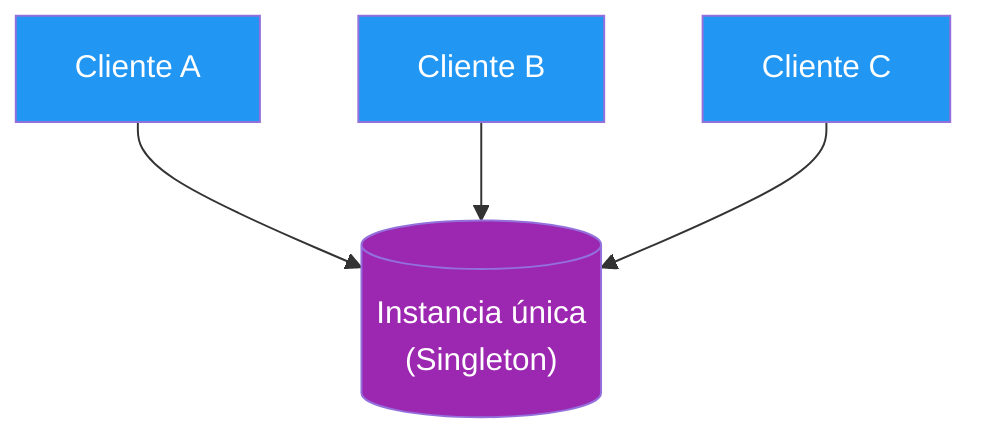
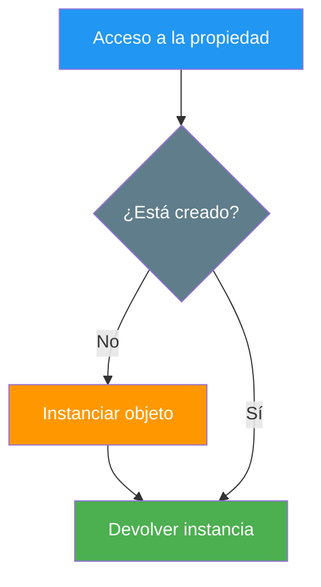
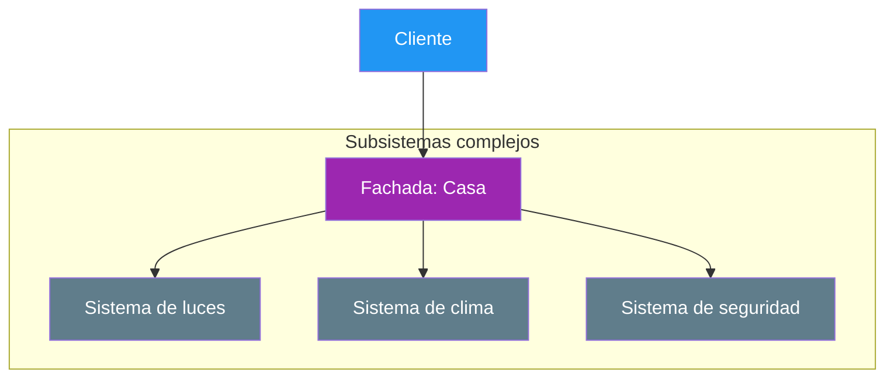
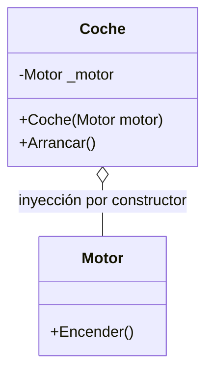

- [10. Patrones básicos de diseño orientados a objetos](#10-patrones-básicos-de-diseño-orientados-a-objetos)
  - [10.1. Singleton](#101-singleton)
  - [10.2. Lazy o perezoso](#102-lazy-o-perezoso)
  - [10.3. Métodos fábrica (factory methods / static creators)](#103-métodos-fábrica-factory-methods--static-creators)
  - [10.4. Inicializadores estáticos (static constructors)](#104-inicializadores-estáticos-static-constructors)
  - [10.5. Instanciación y buenas prácticas para records y structs](#105-instanciación-y-buenas-prácticas-para-records-y-structs)
  - [10.6. API fluida (fluent pattern)](#106-api-fluida-fluent-pattern)
  - [10.7. Builder](#107-builder)
  - [10.8. Fachada (facade)](#108-fachada-facade)
  - [10.9. Composición e inyección de dependencias por constructor](#109-composición-e-inyección-de-dependencias-por-constructor)


# 10. Patrones básicos de diseño orientados a objetos

> 💡 **Punto de partida:** Si en una receta de cocina repites siempre los mismos pasos para hacer un bizcocho, terminas memorizando la receta: eso es un patrón. En software pasa igual: los **patrones de diseño** son soluciones probadas a problemas comunes, escritas una vez y reutilizadas mil. En este punto aprenderás los patrones básicos que usarás en todos tus proyectos.

En este punto aprenderás los patrones fundamentales para construir objetos: Singleton, carga perezosa, métodos fábrica, API fluida, Builder, Fachada y la inyección de dependencias por constructor.

**Objetivos de aprendizaje:**

- Explicar qué es un patrón de diseño y por qué conviene reutilizar soluciones probadas
- Implementar Singleton y carga perezosa (`Lazy<T>`) correctamente en C#
- Crear objetos con métodos fábrica y constructores privados
- Encadenar configuraciones con la API fluida y el patrón Builder
- Agrupar subsistemas complejos tras una Fachada
- Aplicar la composición con inyección de dependencias por constructor

## 10.1. Singleton

El **Singleton** asegura que solo haya **una instancia** de una clase en todo el programa, y que todos accedan a ella por un único punto. Es como el único servidor de correos de una oficina: todos los departamentos usan el mismo.



Este es el ejemplo clásico, con constructor privado y creación perezosa:

```csharp
public sealed class Config
{
    private static Config? _instancia;

    private Config() { } // nadie puede hacer new desde fuera

    public static Config ObtenerInstancia()
    {
        _instancia ??= new Config(); // se crea solo si hace falta
        return _instancia;
    }
}
```

Otra forma más sencilla y segura en C# es usar un campo estático con inicialización directa:

```csharp
public sealed class Config
{
    private static readonly Config _instancia = new Config();

    private Config() { }

    public static Config ObtenerInstancia() => _instancia;
}
```

📌 **Ejemplo real:** Tu app tiene un único gestor de conexión a la base de datos o un único reloj de sistema: si cada módulo creara el suyo, tendrías diez conexiones abiertas sin querer. El Singleton evita exactamente eso.

> ⚠️ **Advertencia:** Úsalo con moderación: un Singleton global complica los tests (su estado vive entre pruebas). En proyectos con inyección de dependencias se registra como "una sola instancia" en el contenedor, sin código Singleton a mano.

## 10.2. Lazy o perezoso

El patrón **lazy** retrasa la creación de un objeto hasta que se necesite de verdad. Optimiza recursos: si el objeto nunca se usa, nunca se crea, ahorrando tiempo y memoria. Es especialmente útil cuando la creación es costosa.



- **Pros:** ahorra recursos y mejora el rendimiento inicial.
- **Contras:** añade complejidad y puede ser más lento la primera vez que se accede.

La implementación más cómoda en C# es `Lazy<T>`:

```csharp
public class RecursoCostoso
{
    private static readonly Lazy<RecursoCostoso> _instancia =
        new(() => new RecursoCostoso());

    private RecursoCostoso() { }

    public static RecursoCostoso Instancia => _instancia.Value;
}
```

📌 **Ejemplo real:** Una app de edición de imágenes carga el motor de reconocimiento facial solo cuando abres esa función; si nunca la usas, ese motor jamás ocupa memoria. Netflix precarga los reproductores de las series que vas a ver, pero no de las 5.000 que tienes en la lista.

## 10.3. Métodos fábrica (factory methods / static creators)

Los **métodos fábrica** encapsulan la lógica de creación de objetos. Con ellos controlas cómo se crean, aplicas validaciones o devuelves distintos tipos según un valor (por ejemplo, un enum).


Este ejemplo combina constructor privado con método fábrica:

```csharp
public class Usuario
{
    public string Nombre { get; }

    private Usuario(string nombre) => Nombre = nombre;

    // Método fábrica: única puerta de creación
    public static Usuario Crear(string nombre)
    {
        if (string.IsNullOrWhiteSpace(nombre))
            throw new ArgumentException("El nombre no puede estar vacío");
        return new Usuario(nombre);
    }
}
```

📌 **Ejemplo real:** Cuando tu app decide crear un `PagoTarjeta`, `PagoPayPal` o `PagoBizum` según la opción elegida, hay un método fábrica devolviendo el tipo adecuado: la caja no sabe qué clase concreta usa, solo que puede `Pagar()`.

> 💡 **Consejo:** Si ves `new` por todas partes queriendo centralizar reglas de creación, toca convertirlo en un método fábrica estático.

## 10.4. Inicializadores estáticos (static constructors)

Los **constructores estáticos** inicializan datos compartidos de la clase antes de que se use cualquier miembro, y se ejecutan una sola vez.

```csharp
public class Configuracion
{
    public static readonly string RutaConfig;

    static Configuracion()
    {
        RutaConfig = "/etc/config"; // se ejecuta una única vez
    }
}

var ruta = Configuracion.RutaConfig;
Console.WriteLine(ruta); // Imprime: /etc/config
```

📌 **Ejemplo real:** Una clase que carga los datos de localización de una app (idioma, moneda, formato de fecha) los prepara en su constructor estático: la primera vez que alguien toca la clase, ya está todo listo.

> 📝 **Nota:** Ya viste los constructores estáticos en el punto 6; aquí cuentan como patrón porque resuelven un problema concreto: **inicialización perezosa y segura de datos de clase**.

## 10.5. Instanciación y buenas prácticas para records y structs

Para records y structs conviene **preferir la inmutabilidad, inicializar todo al crear el objeto y evitar valores nulos**. Con eso, el objeto nace correcto y ya no cambia.

```csharp
public record Persona(string Nombre, int Edad);

var p = new Persona("Juan", 30);
var p2 = p with { Edad = 31 }; // copia modificada, el original intacto
```

📌 **Ejemplo real:** Los mensajes que viajan por una API (`record`) se crean una vez con todos sus campos y se propagan sin miedo a que alguien los modifique por sorpresa en mitad del camino.

> 💡 **Truco:** Si un record admite `null` en algún campo, decláralo `string?` explícitamente. La gestión estricta de nulos te obliga a decidirlo, en vez de descubrirlo en producción.

## 10.6. API fluida (fluent pattern)

La **API fluida** permite encadenar métodos para configurar objetos de forma cómoda: cada método de configuración devuelve `this`, de modo que la llamada siguiente puede seguir justo detrás.


Este ejemplo construye una consulta SQL encadenando `From` y `Where`:

```csharp
public class Consulta
{
    private string _tabla = string.Empty;
    private string _condicion = string.Empty;

    public Consulta From(string tabla)
    {
        _tabla = tabla;
        return this; // clave del patrón fluido
    }

    public Consulta Where(string condicion)
    {
        _condicion = condicion;
        return this;
    }

    public string Build() => $"SELECT * FROM {_tabla} WHERE {_condicion}";
}

var consulta = new Consulta()
    .From("Usuarios")
    .Where("Edad > 18")
    .Build();

Console.WriteLine(consulta); // SELECT * FROM Usuarios WHERE Edad > 18
```

📌 **Ejemplo real:** Entity Framework, Serilog y el propio FluentValidation de .NET se configuran así: `new LoggerConfiguration().WriteTo.Console().CreateLogger()`. La lectura encadenada indica el orden de los pasos.

## 10.7. Builder

El **Builder** ayuda a construir objetos complejos paso a paso. Así creas objetos con muchas opciones sin necesidad de constructores con decenas de parámetros ni parámetros opcionales por todas partes.

```mermaid
graph TD
    C[Cliente] --> B[PersonaBuilder]
    B --> N[SetNombre]
    B --> E[SetEdad]
    N --> F[Build()]
    E --> F
    F --> P[Persona completa]
    style C fill:#2196F3,color:#fff
    style B fill:#FF9800,color:#fff
    style N fill:#607D8B,color:#fff
    style E fill:#607D8B,color:#fff
    style F fill:#9C27B0,color:#fff
    style P fill:#4CAF50,color:#fff
```

Este es el patrón completo con su uso:

```csharp
public class PersonaBuilder
{
    private string _nombre = string.Empty;
    private int _edad;

    public PersonaBuilder SetNombre(string nombre)
    {
        _nombre = nombre;
        return this;
    }

    public PersonaBuilder SetEdad(int edad)
    {
        _edad = edad;
        return this;
    }

    public Persona Build() => new(_nombre, _edad);
}

var persona = new PersonaBuilder()
    .SetNombre("Ana")
    .SetEdad(22)
    .Build();
```

📌 **Ejemplo real:** Cuando configuras un coche en una web (color, motor, llantas, techo solar), cada paso añade una opción y al final confirmas: eso es un Builder montando un objeto complejo a la vista del usuario.

## 10.8. Fachada (facade)

La **Fachada** agrupa múltiples operaciones complejas tras una interfaz simple. Encapsula la complejidad y facilita el uso de los subsistemas: el cliente solo llama a un método y la fachada orquesta lo demás.



Este ejemplo implementa la fachada `Casa` sobre sus subsistemas:

```csharp
public class Casa
{
    private readonly Puerta _puerta = new();
    private readonly Ventana _ventana = new();

    // Una sola llamada que coordina varios subsistemas
    public void AbrirTodo()
    {
        _puerta.Abrir();
        _ventana.Abrir();
    }

    public void CerrarTodo()
    {
        _puerta.Cerrar();
        _ventana.Cerrar();
    }
}
```

📌 **Ejemplo real:** Cuando entras a una web con "Iniciar sesión con Google", la fachada de autenticación orquesta validación, token, permisos y registro de sesión detrás de un único botón: tú no ves ni la mitad de los subsistemas que se activan.

## 10.9. Composición e inyección de dependencias por constructor

La composición facilita la **inyección de dependencias**: en lugar de fabricar dentro los objetos que tu clase necesita, se los pasas por el constructor. Así el código es más flexible, más fácil de cambiar y de testear.



Y este es el código con inyección explícita en el constructor:

```csharp
public class Motor
{
    public string Tipo { get; }

    public Motor(string tipo) => Tipo = tipo;

    public void Encender() => Console.WriteLine("Motor encendido");
}

public class Coche
{
    private readonly Motor _motor;

    // La dependencia llega de fuera: no hay new escondido dentro
    public Coche(Motor motor) => _motor = motor;

    public void Arrancar() => _motor.Encender();
}

var motorV8 = new Motor("V8");
var miCoche = new Coche(motorV8);
miCoche.Arrancar(); // Imprime: Motor encendido
```

📌 **Ejemplo real:** En la TiendaDawApi, los servicios reciben sus repositorios por el constructor (`public class ProductosService(IProductosRepository repo)`). En los tests se les pasa un doble falso y el servicio funciona sin base de datos: eso es inyección de dependencias.

> 💡 **Consejo:** Esta es la base de la Inyección de Dependencias de .NET que usarás en todos los proyectos web del ciclo: `builder.Services.AddScoped<...>` registra qué objeto entrega el contenedor cuando se lo pidan por constructor.

---

**Resumen del punto:**

| Concepto | Descripción |
| :--- | :--- |
| **Patrón de diseño** | Solución probada y reutilizable a un problema recurrente |
| **Singleton** | Una única instancia en toda la aplicación; constructor privado |
| **Lazy** | Creación diferida hasta el primer uso; `Lazy<T>` en C# |
| **Método fábrica** | Centraliza la creación y aplica reglas antes del `new` |
| **Constructor estático** | Inicializa datos compartidos antes del primer uso |
| **API fluida** | Métodos que devuelven `this` para encadenar configuración |
| **Builder** | Construye objetos complejos paso a paso |
| **Fachada** | Interfaz simple sobre varios subsistemas complejos |
| **Inyección por constructor** | Las dependencias llegan de fuera; código flexible y testeable |

## ¿Qué viene después?

En el siguiente punto veremos las excepciones en la POO: cómo detectar, lanzar y capturar errores sin romper el programa.

## Buenas prácticas

- [ ] Usar Singleton solo cuando el problema lo exija (un recurso único), no por costumbre
- [ ] Aplicar carga perezosa a lo costoso que puede no usarse nunca
- [ ] Centralizar reglas de creación en métodos fábrica en vez de `new` repartidos
- [ ] Configurar objetos con API fluida o Builder cuando haya muchas opciones
- [ ] Ocultar la complejidad de varios subsistemas tras una Fachada
- [ ] Inyectar las dependencias por el constructor: nunca fabricarlas dentro de la clase
