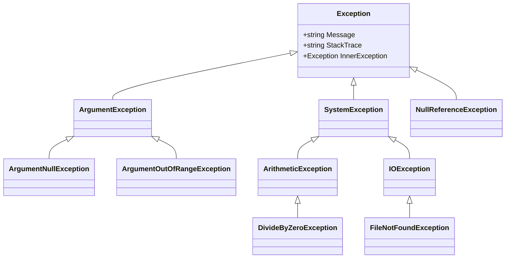
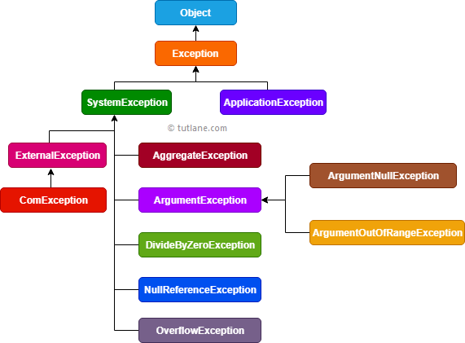
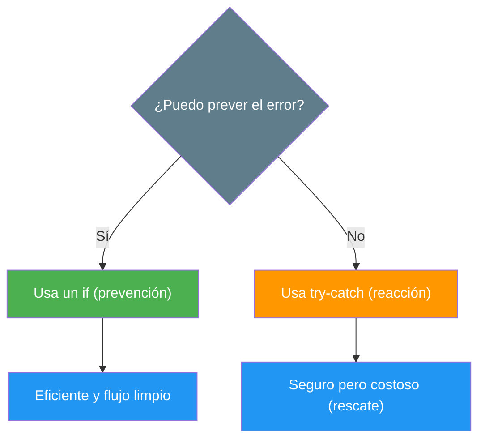
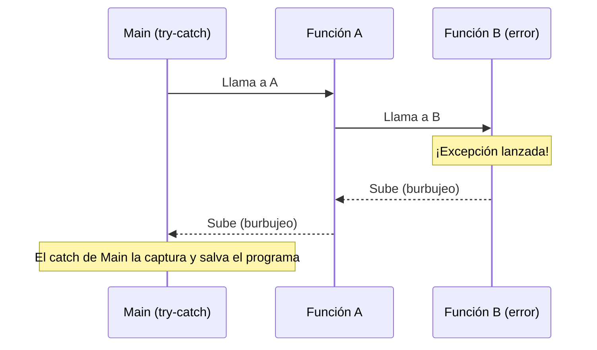
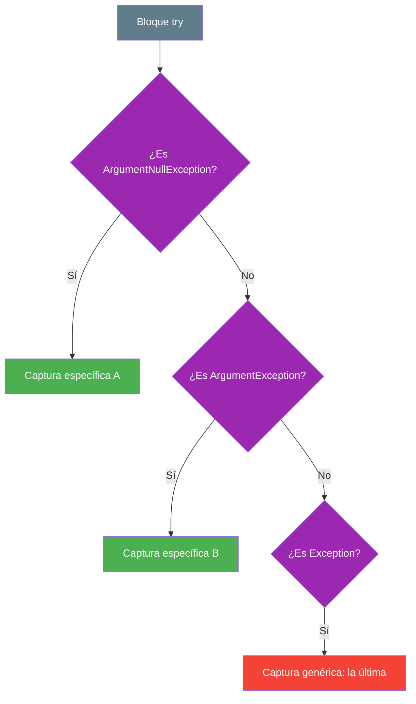

- [12. Excepciones en la programación orientada a objetos](#12-excepciones-en-la-programación-orientada-a-objetos)
  - [12.1. ¿Qué es realmente una excepción?](#121-qué-es-realmente-una-excepción)
  - [12.2. Jerarquía de excepciones en C#](#122-jerarquía-de-excepciones-en-c)
  - [12.3. Filosofía del manejo: prevención vs. reacción](#123-filosofía-del-manejo-prevención-vs-reacción)
    - [12.3.1. Prevención con el `if`: el arquitecto previsor](#1231-prevención-con-el-if-el-arquitecto-previsor)
    - [12.3.2. Reacción con `try-catch`: el rescate de emergencia](#1232-reacción-con-try-catch-el-rescate-de-emergencia)
    - [12.3.3. Toma de decisiones](#1233-toma-de-decisiones)
  - [12.4. Lanzar excepciones con `throw`](#124-lanzar-excepciones-con-throw)
    - [12.4.1. Uso de excepciones para acotar dominios](#1241-uso-de-excepciones-para-acotar-dominios)
  - [12.5. Manejo de excepciones: `try`, `catch` y `finally`](#125-manejo-de-excepciones-try-catch-y-finally)
    - [12.5.1. El bloque `try`: la zona vigilada](#1251-el-bloque-try-la-zona-vigilada)
    - [12.5.2. El bloque `catch`: el estado estable y el rollback](#1252-el-bloque-catch-el-estado-estable-y-el-rollback)
    - [12.5.3. El bloque `finally`: la limpieza](#1253-el-bloque-finally-la-limpieza)
  - [12.6. El burbujeo de excepciones (unwinding)](#126-el-burbujeo-de-excepciones-unwinding)
  - [12.7. Excepciones comunes y buenas prácticas](#127-excepciones-comunes-y-buenas-prácticas)
    - [12.7.1. Reglas de oro](#1271-reglas-de-oro)
  - [12.8. El orden de captura: la regla de la especificidad](#128-el-orden-de-captura-la-regla-de-la-especificidad)
    - [12.8.1. De lo específico a lo genérico](#1281-de-lo-específico-a-lo-genérico)
    - [12.8.2. Ejemplo de orden correcto](#1282-ejemplo-de-orden-correcto)
    - [12.8.3. El peligro de "comérselo todo"](#1283-el-peligro-de-comérselo-todo)


# 12. Excepciones en la programación orientada a objetos

> 💡 **Punto de partida:** ¿Alguna vez has visto la app del banco quedarse en blanco al hacer una transferencia? Un error mal gestionado rompe la aplicación entera. En POO los errores no son simples mensajes: son **objetos** que encapsulan toda la información sobre un fallo. En este punto aprenderás a prevenirlos, a lanzarlos y a capturarlos como un profesional.

En este punto aprenderás qué es realmente una excepción, su jerarquía en C#, cuándo prevenir con `if` y cuándo reaccionar con `try-catch`, y el orden correcto al capturar varios tipos de error.

**Objetivos de aprendizaje:**

- Explicar qué es una excepción y por qué los errores de ejecución son impredecibles
- Reconocer la jerarquía de excepciones de .NET y elegir la más adecuada
- Distinguir la prevención (`if`) de la reacción (`try-catch`) y saber cuándo usar cada una
- Lanzar excepciones con `throw` para acotar dominios y validar datos
- Usar `try`, `catch` y `finally` para manejar errores y limpiar recursos
- Capturar las excepciones del orden correcto, de lo específico a lo genérico

## 12.1. ¿Qué es realmente una excepción?

Una **excepción** es un objeto que se crea cuando ocurre un evento inesperado que interrumpe el flujo normal de las instrucciones. Surge de la brecha entre la **predictibilidad** del código y la **impredictibilidad** del entorno real.

| Fase | Nivel de control | Ejemplos de fallo |
| :--- | :--- | :--- |
| **Tiempo de compilación** | Alto (control del programador) | Sintaxis errónea, errores de tipo: el compilador te avisa antes de ejecutar |
| **Tiempo de ejecución** | Bajo (depende del entorno) | El usuario introduce texto donde debe haber un número, red caída, disco lleno |

Las excepciones son el mecanismo para gestionar estos **eventos impredecibles del entorno**.

📌 **Ejemplo real:** Spotify no puede prever que pierdas la cobertura a mitad de canción; cuando ocurre, lanza una excepción de red y la app muestra "sin conexión" en vez de cerrarse. El error es del entorno, no del código.

## 12.2. Jerarquía de excepciones en C#

En C#, todas las excepciones heredan de la clase base `System.Exception`. Es fundamental entender esta jerarquía para capturar los errores de forma precisa, porque el `catch` decide qué tipos acepta. La clase `Exception` vive en el ensamblado `System.Runtime` y de ella cuelgan dos grandes familias: las de **sistema** (`SystemException`) y las de **aplicación** (`ApplicationException`).

Este es el esquema completo de la jerarquía, listo para dibujarlo en el papel antes de escribir una sola línea:



La misma jerarquía, ya dibujada como diagrama de referencia con las familias principales de .NET:



📌 **Ejemplo real:** Cuando una API de pago falla, el servicio distingue `PaymentDeclinedException` (el banco dijo que no) de `TimeoutException` (la red no respondió): cada una lleva a una reacción distinta (reintentar vs. avisar al usuario). Esa precisión nace de la jerarquía.

> 💡 **Consejo:** Captura siempre el tipo **más específico** que puedas. `NullReferenceException` y `IOException` significan cosas muy distintas: tratarlas igual es tapar el problema.

## 12.3. Filosofía del manejo: prevención vs. reacción

Para ser un buen arquitecto de software debes distinguir entre dos niveles de seguridad: **prevenir** lo que puedes prever y **reaccionar** ante lo impredecible.

### 12.3.1. Prevención con el `if`: el arquitecto previsor

Usamos `if` para condiciones que **podemos verificar antes** de que ocurran. Es más eficiente y no interrumpe el flujo bruscamente.

> 💡 **Metáfora:** Vas caminando, ves una piedra en el camino y la esquivas. Nunca llegaste a tropezar.

**Ejemplo recomendado:** prevenir la división por cero preguntando antes de dividir:

```csharp
int numerador = 10;
int divisor = 0;

if (divisor != 0)
{
    Console.WriteLine("Resultado: " + (numerador / divisor));
}
else
{
    Console.WriteLine("Error: No se puede dividir por cero.");
}
```

**Análisis:** una simple comparación de un nanosegundo. El flujo es limpio y el rendimiento es máximo.

### 12.3.2. Reacción con `try-catch`: el rescate de emergencia

Se reserva para fallos externos inevitables e impredecibles. Su objetivo es salvar el programa del desastre cuando algo se sale de nuestro control.

> 💡 **Metáfora:** Vas caminando, pisas una piedra inesperada y tropiezas. El bloque `catch` es el compañero que te agarra del brazo antes de que caigas al suelo.

**Ejemplo (no recomendado si se puede prever):** aquí dejamos que el error ocurra y luego intentamos arreglarlo:

```csharp
int numerador = 10;
int divisor = 0;

try
{
    Console.WriteLine("Resultado: " + (numerador / divisor));
}
catch (DivideByZeroException e)
{
    Console.WriteLine("Error capturado: " + e.Message);
}
```

**Análisis:** cuando ocurre la división por cero, el procesador se detiene, se crea un objeto `Exception` (que consume memoria), se guarda el estado de la pila y se busca un manejador. Es miles de veces más lento que un `if`.

> ⚠️ **Advertencia:** Un `try-catch` no es "más seguro" que un `if`: es más caro y rompe el flujo. Úsalo cuando el error venga de fuera (red, disco, usuario), no para lo que tú mismo puedes comprobar.

### 12.3.3. Toma de decisiones

Este esquema resume cuándo usar cada opción:



## 12.4. Lanzar excepciones con `throw`

Usamos **`throw`** para notificar que algo ha ido mal y que el flujo normal no puede continuar. Lanzar una excepción es "avisar por el canal de errores" en lugar de devolver algo raro.

### 12.4.1. Uso de excepciones para acotar dominios

Las excepciones garantizan la **pureza del dominio de retorno**. Si una función debe devolver un `int`, no debemos usar valores "mágicos" (como `-1`) para indicar error, ya que `-1` es un número perfectamente válido. Usamos `throw` para comunicar el error por un "canal lateral".

```csharp
public int LeerEdad(string texto)
{
    if (!EsNumerico(texto))
    {
        // Opción BUENA: lanzar para no contaminar el retorno int
        throw new ArgumentException("La entrada debe ser un número.");
    }
    return int.Parse(texto);
}
```

📌 **Ejemplo real:** `int.Parse("abc")` lanza `FormatException` en vez de devolver `-1`: así quien llama sabe que hubo un error real y no confunde un número con una señal.

> 💡 **Analogía:** Es como la señal de humo: no cambia el contenido de la sala (el valor de retorno), pero avisa a todos de que algo ha ido mal por otro canal.

## 12.5. Manejo de excepciones: `try`, `catch` y `finally`

### 12.5.1. El bloque `try`: la zona vigilada

Contiene el código arriesgado. El programa "intenta" ejecutarlo estando alerta: si algo falla dentro, salta directamente al `catch` correspondiente.

### 12.5.2. El bloque `catch`: el estado estable y el rollback

Manejar una excepción **no es solo mostrar un mensaje**: es devolver el programa a un estado seguro.

> 💡 **Metáfora bancaria:** si ocurre un fallo en mitad de una transferencia (dinero restado de A pero no sumado en B), el bloque `catch` debe ejecutar un **rollback** (reversión) para que los datos vuelvan al estado inicial seguro.

### 12.5.3. El bloque `finally`: la limpieza

Se ejecuta **siempre**, haya error o no. Es el lugar ideal para cerrar archivos o liberar conexiones a bases de datos. Este ejemplo muestra los tres bloques juntos:

```csharp
try
{
    AbrirConexion();
    ProcesarDatos();
}
catch (IOException ex) // excepción específica del fallo esperado
{
    Log(ex.Message);
    DeshacerCambios();  // recuperar estado estable (rollback)
}
finally
{
    CerrarConexion();   // limpieza garantizada, con o sin error
}
```

📌 **Ejemplo real:** Cualquier app que descarga ficheros usa `finally` (o `using`) para cerrar el flujo: aunque la descarga falle, el fichero queda cerrado y no se queda bloqueado en disco.

> 📝 **Nota:** En C# existe además la cláusula `using` (y `using var`), que hace el trabajo del `finally` por ti con los recursos que implementan `IDisposable`: se cierran solos al salir del ámbito.

## 12.6. El burbujeo de excepciones (unwinding)

Si una excepción ocurre y no hay un `catch` en el método actual, la excepción **burbujea** (sube) por la pila de llamadas hasta encontrar un manejador. Si llega al `Main` y nadie la captura, el programa se cierra.



📌 **Ejemplo real:** En una web con varios niveles (controlador → servicio → repositorio), si el repositorio falla y nadie lo captura, el error sube hasta el manejador global que devuelve una página de error al navegador. Sin ese manejador final, el usuario vería la app caída.

> ⚠️ **Advertencia:** Capturar y no hacer nada (o solo imprimir) en cada nivel es un anti-patrón: captura en el nivel que sabe **recuperarse**, y deja subir lo que no puedas resolver.

## 12.7. Excepciones comunes y buenas prácticas

Estas son las excepciones que usarás a diario y para qué sirve cada una:

| Excepción | Cuándo usarla |
| :--- | :--- |
| **`ArgumentNullException`** | Un parámetro obligatorio es `null` |
| **`ArgumentOutOfRangeException`** | El valor está fuera del rango (por ejemplo, nota < 0) |
| **`InvalidOperationException`** | El estado del objeto no permite la acción |
| **`NullReferenceException`** | (Evitarla) Uso de una variable nula |

### 12.7.1. Reglas de oro

1. **Principio *fail-fast*:** es mejor que el programa falle en el constructor si los datos son malos, a que falle más tarde corrompiendo datos.
2. **No captures `Exception` a la ligera:** captura siempre la excepción más específica posible (especialista, no médico general).
3. **No silencies excepciones:** un `catch` vacío es como poner cinta aislante sobre una luz de alarma en un avión. El problema sigue ahí, pero ahora no lo ves.

📌 **Ejemplo real:** Cuando Facebook detecta un error en producción, su equipo consulta los registros de las excepciones capturadas. Si alguien hubiera escrito `catch { }`, ese fallo seguiría invisible y afectando a los usuarios sin que nadie lo supiera.

## 12.8. El orden de captura: la regla de la especificidad

Cuando usamos varios bloques `catch`, el orden **sí importa**: C# procesa los bloques de arriba hacia abajo y se queda con el primero que coincida con el tipo de excepción lanzada.

### 12.8.1. De lo específico a lo genérico

Debes colocar siempre los bloques de las excepciones más específicas (las clases hijas) **antes** de las más genéricas (las clases padres).

> 💡 **Analogía médica:**
>
> 1. Si te duele el corazón, vas al **cardiólogo** (excepción específica).
> 2. Si no hay especialista, vas al **médico de cabecera** (excepción de sistema).
> 3. Como último recurso, vas a **urgencias generales** (`Exception` genérica).
>
> ¡Si pusieras urgencias generales en la puerta de entrada, nunca llegarías al cardiólogo!

### 12.8.2. Ejemplo de orden correcto

Este es el orden correcto: primero `ArgumentNullException` (hija), luego `ArgumentException` (madre) y al final `Exception`:

```csharp
try
{
    // Código que puede lanzar varios errores
}
catch (ArgumentNullException ex)
{
    // 1. El especialista: solo si el argumento es nulo
    Console.WriteLine("Error: No has enviado el objeto obligatorio.");
}
catch (ArgumentException ex)
{
    // 2. El generalista: cualquier ArgumentException que NO sea null
    Console.WriteLine("Error en los argumentos.");
}
catch (Exception ex)
{
    // 3. El último recurso: cualquier otra cosa
    Console.WriteLine("Ocurrió un error inesperado.");
}
```

### 12.8.3. El peligro de "comérselo todo"

Si colocas `catch (Exception)` el primero, **te comerás todas las excepciones**: no podrás dar mensajes personalizados ni realizar acciones de recuperación específicas (como pedir un dato concreto de nuevo). Además, C# detectará que los bloques inferiores son inalcanzables y te dará un **error de compilación**.



---

**Resumen del punto:**

| Concepto | Descripción |
| :--- | :--- |
| **Excepción** | Objeto que describe un fallo imprevisto de ejecución |
| **`throw`** | Lanza la excepción y corta el flujo normal |
| **`try`** | Zona vigilada donde puede ocurrir el fallo |
| **`catch`** | Manejador; captura el tipo indicado (o sus hijas) |
| **`finally`** | Se ejecuta siempre: limpieza de recursos garantizada |
| **Burbujeo** | La excepción sube por la pila hasta encontrar un `catch` |
| **Prevención (`if`)** | Comprobar antes para no depender del manejo de errores |
| **Orden de captura** | De lo específico a lo genérico; `Exception` al final |
| **Reglas de oro** | *Fail-fast*, excepciones específicas y nunca silenciar errores |

## ¿Qué viene después?

En el siguiente punto veremos las buenas prácticas en el desarrollo de software: convenciones, organización y hábitos que separan un código profesional de uno improvisado.

## Buenas prácticas

- [ ] Prevenir con `if` todo lo que se pueda prever; reservar `try-catch` para lo impredecible
- [ ] Lanzar excepciones con mensajes claros en lugar de devolver valores mágicos
- [ ] Capturar siempre la excepción más específica posible; `Exception` solo como último recurso
- [ ] Nunca dejar un `catch` vacío: registrar o relanzar el error
- [ ] Liberar recursos en `finally` o con `using var`
- [ ] Ordenar los `catch` de lo específico a lo genérico
