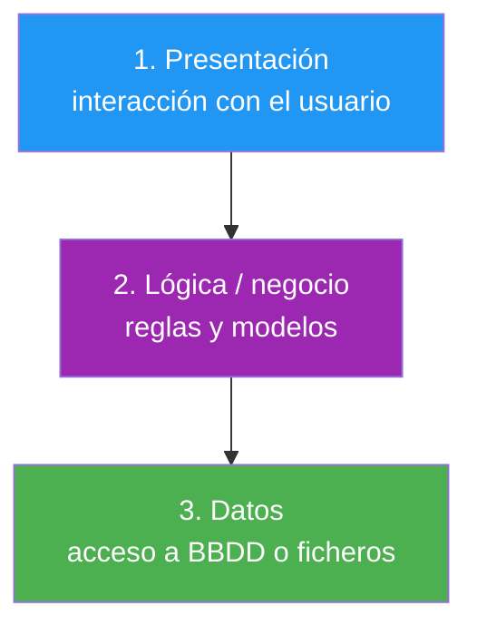

- [13. Buenas prácticas en el desarrollo de software](#13-buenas-prácticas-en-el-desarrollo-de-software)
  - [13.1. Nomenclatura y estilo](#131-nomenclatura-y-estilo)
  - [13.2. Mantener clases pequeñas y con responsabilidad única (SRP)](#132-mantener-clases-pequeñas-y-con-responsabilidad-única-srp)
  - [13.3. Métodos cortos y enfocados](#133-métodos-cortos-y-enfocados)
    - [13.3.1. Principio DRY (`Don't Repeat Yourself`)](#1331-principio-dry-dont-repeat-yourself)
  - [13.4. Preferir propiedades sobre campos públicos](#134-preferir-propiedades-sobre-campos-públicos)
  - [13.5. Inmutabilidad cuando proceda](#135-inmutabilidad-cuando-proceda)
  - [13.6. Validación temprana (fail-fast)](#136-validación-temprana-fail-fast)
  - [13.7. Documentación con XML comments](#137-documentación-con-xml-comments)
  - [13.8. Consideraciones de rendimiento](#138-consideraciones-de-rendimiento)
  - [13.9. Gestión de dependencias y separación de capas](#139-gestión-de-dependencias-y-separación-de-capas)


# 13. Buenas prácticas en el desarrollo de software

> 💡 **Punto de partida:** ¿Por qué dos programas que "hacen lo mismo" pueden tardar semanas en mantenerse uno y meses el otro? La diferencia no es la funcionalidad, es el código: nombres claros, clases pequeñas, sin repetición. En este punto recopilarás las buenas prácticas que separan al aficionado del profesional.

En este punto aprenderás las convenciones de nomenclatura, los principios de diseño (SRP, DRY), y los hábitos de validación, documentación y organización que hacen que tu código dure.

**Objetivos de aprendizaje:**

- Aplicar las convenciones de nomenclatura de C# de forma consistente
- Explicar y aplicar los principios SRP y DRY en clases y métodos
- Preferir propiedades e inmutabilidad para proteger el estado
- Validar pronto con el principio *fail-fast* y documentar con XML comments
- Organizar el código en capas con namespaces claros

## 13.1. Nomenclatura y estilo

El código se lee muchas más veces de las que se escribe. Usa nombres que expliquen la **intención**, no el tipo:

- **PascalCase:** para nombres de clases, métodos y propiedades (`class CuentaBancaria`, `public void RetirarEfectivo`).
- **camelCase:** para variables locales y parámetros de métodos (`int saldoActual`, `string nombreUsuario`).
- **Guion bajo inicial (`_`):** para campos privados (`private decimal _saldo`).

📌 **Ejemplo real:** En el código de cualquier empresa verás `usuarioRepository.ObtenerPorId(42)`: en una línea sabes qué hace. Si en cambio hubiera `hacer2(x)`, tendrías que leer veinte líneas para descubrirlo (y posiblemente malinterpretarlo).

> 💡 **Consejo:** Los nombres en inglés son la convención profesional (identificadores), pero los mensajes al usuario y los comentarios van en español: así lo hacemos en todo el ciclo.

## 13.2. Mantener clases pequeñas y con responsabilidad única (SRP)

El principio de **responsabilidad única** (*Single Responsibility Principle*) dicta que una clase debe tener **una sola razón para cambiar**.

- Si tu clase `Usuario` también envía correos electrónicos y se conecta a la base de datos, tiene demasiadas responsabilidades.
- Divide y vencerás: crea una clase `ServicioCorreo` y una clase `RepositorioUsuario`.

📌 **Ejemplo real:** En Netflix, el sistema que recomienda películas no descarga los vídeos: es una clase distinta de la que los sirve. Si mañana cambian el algoritmo de recomendaciones, no tocan nada del reproductor.

## 13.3. Métodos cortos y enfocados

Cada método debe hacer una sola tarea. Si un método es muy largo o tiene muchos niveles de anidamiento, es una señal clara de que debe dividirse.

> 💡 **Analogía:** Un método es una receta de cocina: si ocupa tres páginas, es probablemente tres recetas pegadas. Mejor tres métodos que se llaman entre sí.

### 13.3.1. Principio DRY (`Don't Repeat Yourself`)

Evita repetir código. Si ves que copias y pegas la misma lógica en tres sitios, extrae esa lógica a un método común o a una clase de utilidad. La duplicación es la raíz de muchos *bugs*: si cambias la lógica en un sitio, debes acordarte de cambiarla en todos.

```csharp
// ❌ MALO: la misma lógica de cálculo de IVA en tres métodos
// ✅ BUENO: un único método Iva.Calcular(importe) usado por todos
decimal total = importe + Iva.Calcular(importe);
```

📌 **Ejemplo real:** Si cada pantalla de tu app calcula el precio final a su manera, llegará el día en que una aplique IVA y otra no. Centralizar el cálculo en un sitio es la diferencia entre un bug puntual y un escándalo contable.

## 13.4. Preferir propiedades sobre campos públicos

El estado de un objeto debe estar protegido. Nunca expongas variables directamente (`public int Edad`): usa siempre propiedades, incluso si son automáticas, para poder añadir validaciones en el futuro sin romper el código que ya usa tu clase.

```csharp
// ❌ MALO: campo público, cualquiera puede poner Edad = -5
public int Edad;

// ✅ BUENO: propiedad; mañana añades validación sin tocar a nadie
public int Edad { get; set; }
```

## 13.5. Inmutabilidad cuando proceda

Si un objeto no debe cambiar después de crearse (una transacción terminada, un punto en el espacio), usa propiedades `readonly`, `init` y el tipo `record`. Los objetos inmutables son mucho más fáciles de depurar y más seguros en entornos multihilo.

```csharp
public record Venta(string Producto, decimal Importe, DateTime Fecha);

// Una venta registrada no cambia: se crea una nueva si hay un ajuste
var venta = new Venta("Teclado", 49.99m, DateTime.Now);
var ajuste = venta with { Importe = 44.99m };
```

📌 **Ejemplo real:** Los importes de una factura ya emitida no se editan: si hay un error, se emite una factura rectificativa. Modelarlo como `record` inmutable reproduce esa regla de negocio en el propio código.

## 13.6. Validación temprana (fail-fast)

Comprueba los argumentos de los métodos y constructores lo antes posible. No esperes a que el error ocurra en la línea 50: lanza una excepción en la línea 1 si los datos son malos.

```csharp
public void ProcesarPedido(Pedido p)
{
    if (p is null)
        throw new ArgumentNullException(nameof(p));
    // ... resto de la lógica ...
}
```

> 💡 **Truco:** `nameof(p)` devuelve el nombre del parámetro como texto: si mañana renombras la variable, el mensaje de error se actualiza solo.

## 13.7. Documentación con XML comments

Escribe siempre resúmenes que expliquen el **qué** y el **por qué**, no solo el **cómo**. C# permite generar documentación automática a partir de estos comentarios:

```csharp
/// <summary>
/// Calcula el interés anual basado en el tipo de riesgo del cliente.
/// </summary>
/// <param name="capital">Monto inicial invertido.</param>
/// <param name="riesgo">Nivel de riesgo del 1 al 5.</param>
/// <returns>El monto de interés generado.</returns>
public decimal CalcularInteres(decimal capital, int riesgo)
{
    // ...
}
```

📌 **Ejemplo real:** Cuando usas `Console.WriteLine` y ves la ayuda al pasar el cursor, estás viendo la documentación XML que alguien escribió con `///`. En equipo, es lo que permite a otro desarrollador usar tu método sin leer su código.

> 📝 **Nota:** La norma del proyecto exige XMLDoc en clases públicas, interfaces y métodos públicos; el código autoexplicativo no necesita comentario.

## 13.8. Consideraciones de rendimiento

Evita operaciones costosas (consultas a base de datos, cálculos complejos) dentro de los bloques `get` de las propiedades o dentro de los constructores. Para estos casos, usa métodos explícitos (`CargarDatos()`) o el patrón `Lazy<T>`.

```csharp
// ❌ MALO: cada consulta de la propiedad lanza una consulta a la BD
public List<Usuario> Usuarios => Repositorio.ObtenerTodos();

// ✅ BUENO: el coste se paga solo cuando se necesita
private readonly Lazy<List<Usuario>> _usuarios = new(Repositorio.ObtenerTodos);
public List<Usuario> Usuarios => _usuarios.Value;
```

> ⚠️ **Advertencia:** Una propiedad debe parecer barata: quien la llama no espera que "haga cosas raras". Si leer algo es caro, mejor es un método (`ObtenerUsuarios()`), que avisa por su nombre de que hay trabajo detrás.

## 13.9. Gestión de dependencias y separación de capas

Organiza tu código en capas lógicas, cada una con su misión:



Usa namespaces claros para reflejar esta estructura y mantén las capas separadas, para que un cambio en la interfaz no obligue a cambiar la base de datos:

```csharp
namespace MiApp.Presentacion;   // capa 1
namespace MiApp.Servicios;      // capa 2
namespace MiApp.Repositorios;   // capa 3
```

📌 **Ejemplo real:** La TiendaDawApi separa `Controllers` (presentación), `Services` (lógica) y `Repositories` (datos): si mañana cambias de SQLite a PostgreSQL, solo tocas la capa de datos.

---

**Resumen del punto:**

| Concepto | Descripción |
| :--- | :--- |
| **Nomenclatura** | PascalCase en clases/métodos/propiedades, `camelCase` en variables, `_` en campos privados |
| **SRP** | Una clase, una razón para cambiar |
| **DRY** | No repitas lógica: extrae a un método o clase común |
| **Propiedades** | Nunca campos públicos; protegen el estado para el futuro |
| **Inmutabilidad** | `readonly`, `init` y `record` para lo que no debe cambiar |
| **Fail-fast** | Validar al principio y lanzar excepción con `nameof` |
| **XML comments** | Documentar el qué y el por qué con `///` |
| **Rendimiento** | Nada caro en getters ni constructores; usa `Lazy<T>` o métodos |
| **Capas** | Presentación → lógica → datos, con namespaces propios |

## ¿Qué viene después?

En el siguiente punto cerraremos la unidad con un resumen completo: mapa conceptual, errores comunes, checklist de supervivencia y glosario de términos clave.

## Buenas prácticas

- [ ] Nombrar por intención, siguiendo las convenciones de C#
- [ ] Mantener una responsabilidad por clase y una tarea por método
- [ ] Eliminar la duplicación (DRY) extrayendo lógica común
- [ ] Exponer siempre propiedades, nunca campos públicos
- [ ] Validar pronto con `fail-fast` y documentar con XML comments
- [ ] Separar el código en capas con namespaces claros
