- [13. Resumen y conclusiones UD04](#13-resumen-y-conclusiones-ud04)
  - [13.1. Mapa conceptual de la unidad](#131-mapa-conceptual-de-la-unidad)
  - [13.2. Conceptos clave](#132-conceptos-clave)
    - [Conceptos y principios de la POO](#conceptos-y-principios-de-la-poo)
    - [Objetos y clases](#objetos-y-clases)
    - [Clases, miembros y visibilidad](#clases-miembros-y-visibilidad)
    - [Constructores e inicialización](#constructores-e-inicialización)
    - [Encapsulación, propiedades y miembros estáticos](#encapsulación-propiedades-y-miembros-estáticos)
    - [Enums, structs y records](#enums-structs-y-records)
    - [Composición y patrones de diseño](#composición-y-patrones-de-diseño)
    - [Excepciones y buenas prácticas](#excepciones-y-buenas-prácticas)
  - [13.3. Herramientas y perfiles](#133-herramientas-y-perfiles)
  - [13.4. Errores comunes a evitar](#134-errores-comunes-a-evitar)
  - [13.5. Checklist de supervivencia](#135-checklist-de-supervivencia)
  - [13.6. Glosario de términos](#136-glosario-de-términos)
  - [13.7. Ejercicios de repaso](#137-ejercicios-de-repaso)
  - [13.8. ¿Qué viene después?](#138-qué-viene-después)
  - [13.9. Mapa de conexiones entre temas](#139-mapa-de-conexiones-entre-temas)


# 13. Resumen y conclusiones UD04

> 💡 **Punto de partida:** Has pasado de escribir programas con datos sueltos a modelar el mundo real con objetos: clases, propiedades, constructores, patrones y excepciones. Este resumen es tu mapa para repasarlo todo antes del examen.

**Objetivos de aprendizaje:**

- Repasar los conceptos fundamentales de la unidad
- Consolidar el vocabulario técnico de la POO
- Tener una referencia rápida para el examen

## 13.1. Mapa conceptual de la unidad

```mermaid
graph TD
    UD04["UD04: POO"] --> P1["Conceptos y principios"]
    UD04 --> P2["Objetos y clases"]
    UD04 --> P3["Clases y miembros"]
    UD04 --> P4["Constructores"]
    UD04 --> P5["Encapsulación y propiedades"]
    UD04 --> P6["Tipos propios"]
    UD04 --> P7["Composición y patrones"]
    UD04 --> P8["Excepciones y buenas prácticas"]
    P1 --> A1["Abstracción, encapsulamiento"]
    P1 --> A2["Herencia y polimorfismo"]
    P2 --> B1["Identidad, estado, comportamiento"]
    P2 --> B2["new, referencias, stack y heap"]
    P3 --> C1["Atributos, métodos, propiedades"]
    P3 --> C2["Visibilidad y modificadores"]
    P4 --> D1["Parametrizados y encadenados"]
    P4 --> D2["Estáticos, privados, required"]
    P5 --> E1["Propiedades get, set, init"]
    P5 --> E2["Miembros static"]
    P6 --> F1["Enums y Flags"]
    P6 --> F2["Structs y records"]
    P7 --> G1["Singleton, Factory, Builder"]
    P7 --> G2["Composición y Fachada"]
    P8 --> H1["throw, try, catch, finally"]
    P8 --> H2["SRP, DRY, fail-fast"]
    style UD04 fill:#2196F3,color:#fff
    style P1 fill:#4CAF50,color:#fff
    style P2 fill:#4CAF50,color:#fff
    style P3 fill:#4CAF50,color:#fff
    style P4 fill:#4CAF50,color:#fff
    style P5 fill:#4CAF50,color:#fff
    style P6 fill:#4CAF50,color:#fff
    style P7 fill:#4CAF50,color:#fff
    style P8 fill:#4CAF50,color:#fff
    style A1 fill:#607D8B,color:#fff
    style A2 fill:#607D8B,color:#fff
    style B1 fill:#607D8B,color:#fff
    style B2 fill:#607D8B,color:#fff
    style C1 fill:#607D8B,color:#fff
    style C2 fill:#607D8B,color:#fff
    style D1 fill:#607D8B,color:#fff
    style D2 fill:#607D8B,color:#fff
    style E1 fill:#607D8B,color:#fff
    style E2 fill:#607D8B,color:#fff
    style F1 fill:#607D8B,color:#fff
    style F2 fill:#607D8B,color:#fff
    style G1 fill:#607D8B,color:#fff
    style G2 fill:#607D8B,color:#fff
    style H1 fill:#607D8B,color:#fff
    style H2 fill:#607D8B,color:#fff
```



## 13.2. Conceptos clave

### Conceptos y principios de la POO

- **Objeto:** entidad con identidad, estado y comportamiento
- **Abstracción:** modelar solo lo importante, ignorar el resto
- **Encapsulamiento:** agrupar datos y métodos; la ocultación decide qué se ve
- **Herencia:** clases hijas que reutilizan lo de la base (`:`)
- **Polimorfismo:** un mismo mensaje, respuestas distintas (`virtual`/`override`)
- **Recolector de basura:** libera la memoria de lo que nadie referencia

📌 **Ejemplo real:** Instagram modela cada cuenta como objeto: estado (seguidores, fotos), comportamiento (publicar, dar like) e identidad (su id único).

### Objetos y clases

- **Clase:** el molde; **instancia:** cada objeto fabricado con él
- **`new`:** reserva memoria, inicializa y devuelve una **referencia**
- **Stack vs. heap:** variables y referencias en el stack; objetos en el heap
- **`null`:** referencia que no apunta a nada; acceso seguro con `?.`
- **Clases predefinidas:** `Random`, `DateTime`, `List<T>`... se usan igual que las tuyas

📌 **Ejemplo real:** Dos pedidos con el mismo contenido son dos objetos distintos con identidad propia; el sistema los rastrea por su referencia.

### Clases, miembros y visibilidad

- **Sintaxis:** `public class Nombre { ... }` en PascalCase
- **`public` / `private`:** para todos / solo dentro de la clase (por defecto)
- **`internal` / `protected`:** mismo ensamblado / clase y sus hijas
- **`sealed`, `const`, `readonly`, `required`:** restringen herencia, valor y obligatoriedad
- **`partial`:** reparte una clase en varios ficheros
- **`is` y `as`:** comprobar y convertir tipos sin riesgo
- **UML:** `+` público, `-` privado, `#` protegido, `~` interno

📌 **Ejemplo real:** Una cuenta bancaria expone `Depositar` y `Retirar` (`public`) y esconde `_saldo` (`private`): nadie puede poner el saldo a -100.

### Constructores e inicialización

- **Constructor:** método especial que inicializa el objeto; sin tipo de retorno
- **Sobrecarga y `this(...)`:** varios constructores que delegan en el más completo
- **Estático / privado:** inicializa datos de la clase / controla la creación (singleton)
- **Validación:** lanzar excepciones si los argumentos no son válidos (*fail-fast*)
- **Primario (C# 12+):** parámetros en la declaración; ideal para inyección de dependencias

📌 **Ejemplo real:** Un `Pedido` sin cliente no debería existir: el constructor lo obliga a recibirlo.

### Encapsulación, propiedades y miembros estáticos

- **Getters y setters:** forma clásica; en C# se usan **propiedades**
- **Autoimplementadas:** `{ get; set; }`; **`init`:** solo al crear; **`get`-only:** solo lectura
- **Backing field:** validación en el `set` (o `field` en C# 14)
- **`static`:** miembro de la clase, compartido por todas las instancias
- **`const` / `static readonly`:** fijo en compilación / fijo en ejecución
- **`Lazy<T>`:** inicialización diferida, coste solo en el primer acceso

📌 **Ejemplo real:** `Math.PI` es `const` de la clase `Math`: no hace falta `new Math()` para usarlo.

### Enums, structs y records

- **Enum:** conjunto fijo de valores con nombre; `[Flags]` para combinar con `|`
- **Struct:** tipo por **valor**: copiarlo duplica los datos
- **Record:** igualdad automática, `ToString` generado y copias con `with`
- **Tipos anónimos y tuplas:** agrupar datos sin declarar clase

📌 **Ejemplo real:** Los estados de un pedido ("pendiente", "enviado", "entregado") son un enum: nadie puede inventar un estado fuera de la lista.

### Composición y patrones de diseño

- **Composición:** relación "tiene un"; frente a la herencia es más flexible y testeable
- **Clases anidadas:** tipos que solo tienen sentido dentro de otro
- **Singleton:** una única instancia en toda la aplicación
- **Factory / Builder / API fluida:** crear y configurar objetos con control
- **Fachada:** interfaz simple sobre subsistemas complejos
- **Inyección por constructor:** las dependencias llegan de fuera

📌 **Ejemplo real:** Un coche **tiene un** motor (composición) y un coche deportivo **es un** coche (herencia).

### Excepciones y buenas prácticas

- **Excepción:** objeto que describe un fallo de ejecución
- **`throw` / `try` / `catch` / `finally`:** lanzar, vigilar, manejar y limpiar
- **Burbujeo:** la excepción sube por la pila hasta un manejador
- **Orden de captura:** de lo específico a lo genérico; nunca silenciar errores
- **SRP / DRY / fail-fast:** una responsabilidad, sin repetir, validar pronto
- **XMLDoc:** documentar clases y métodos públicos con `///`

📌 **Ejemplo real:** `int.Parse("abc")` lanza `FormatException` en vez de devolver un número mágico: el error viaja por su canal.

## 13.3. Herramientas y perfiles

### IDE y entorno

- **JetBrains Rider:** IDE principal para C#. Crear soluciones (`File → New Solution`), compilar (`Ctrl+F9`) y ejecutar (`Shift+F10`)
- **Gestión estricta de nulos:** habilitada en todos los proyectos; el compilador avisa de referencias sin comprobar

### Comandos de la CLI

Para que te los lleves de bolsillo, los comandos con los que se crea, compila y ejecuta todo lo de esta unidad:

```bash
# Crear un proyecto de consola
dotnet new console -n MiProyecto

# Compilar y ejecutar
dotnet build
dotnet run

# Añadir una librería (NuGet) desde la carpeta del .csproj
dotnet add package Spectre.Console
```

### Estructura de la solución

- **`.slnx`:** solución (formato XML por defecto en .NET 10)
- **`.csproj`:** proyecto con sus dependencias y referencias a paquetes
- **Ensamblado:** resultado de compilar (`.exe` o `.dll`)

## 13.4. Errores comunes a evitar

| Error | Por qué está mal | Cómo evitarlo |
| :--- | :--- | :--- |
| **Campos `public` sin control** | Cualquiera rompe el estado del objeto | Propiedades con acceso controlado |
| **Pensar que `==` compara contenido** | En clases compara referencias | Usar `Equals` (+ `GetHashCode`) o sobrecargar `==` |
| **Olvidar comprobar `null`** | `NullReferenceException` en runtime | `is not null` o acceso seguro `?.` |
| **Capturar `Exception` primero** | Se come todas las excepciones específicas | Ordenar de lo específico a lo genérico |
| **`catch` vacío** | Esconde el problema en vez de resolverlo | Registrar, relanzar o manejar de verdad |
| **Herencia por si acaso** | Jerarquías imposibles de mantener | Composición para "tiene un"; herencia solo para "es un" |
| **Constructores gigantes** | Código rígido y difícil de probar | Primarios, parámetros por defecto y fábricas |
| **Usar `-1` como señal de error** | Contamina el tipo de retorno | Lanzar la excepción adecuada |
| **Instalar paquetes fuera del `.csproj`** | El paquete no se añade a ningún sitio | Entrar en la carpeta del proyecto antes de `dotnet add package` |
| **Métodos que hacen cinco cosas** | Imposibles de leer y de testear | Responsabilidad única por método |

## 13.5. Checklist de supervivencia

Antes de dar por cerrado el tema, asegúrate de poder responder **SÍ** a estas preguntas:

- [ ] ¿Explico la diferencia entre identidad, estado y comportamiento?
- [ ] ¿Sé qué hace `new` y dónde queda el objeto (stack vs. heap)?
- [ ] ¿Distingo encapsulamiento de ocultación?
- [ ] ¿Conozco los cuatro modificadores de acceso y sus símbolos UML?
- [ ] ¿Sé usar `get`, `set`, `init`, `required` y las propiedades calculadas?
- [ ] ¿Creo constructores parametrizados y encadeno con `this(...)`?
- [ ] ¿Diferencio `class`, `struct` y `record` y sé cuándo usar cada uno?
- [ ] ¿Compara objetos por identidad y por estado según convenga?
- [ ] ¿Aplico composición cuando la relación es "tiene un"?
- [ ] ¿Sé montar un Singleton y un Builder correctos?
- [ ] ¿Capturo excepciones en el orden correcto y nunca las silencio?
- [ ] ¿Recuerdo el patrón **AEHP** (Abstracción, Encapsulamiento, Herencia, Polimorfismo)?

> 🔧 **Truco mnemotécnico:**
> - **AEHP** = los 4 pilares de la POO
> - **"El encapsulamiento reúne, la ocultación protege"**
> - **`init` = cuándo se escribe; `required` = si se escribe**
> - **Específico → genérico** en los `catch`

## 13.6. Glosario de términos

| Término | Definición |
| :--- | :--- |
| **Objeto** | Entidad con identidad, estado y comportamiento |
| **Clase** | Molde que define cómo serán sus objetos |
| **Instancia** | Objeto concreto fabricado desde una clase |
| **Referencia** | "Dirección" de un objeto en el heap; `null` si apunta a nada |
| **Encapsulamiento** | Agrupar datos y métodos protegiendo lo interno |
| **Herencia** | Clases hijas que reutilizan miembros de la base |
| **Polimorfismo** | Un mismo mensaje con respuestas distintas (`override`) |
| **Constructor** | Método que inicializa el objeto al crearlo |
| **Propiedad** | Acceso controlado a un campo con `get`, `set` o `init` |
| **Miembro estático** | Perteneciente a la clase, compartido por todas las instancias |
| **Namespace** | Carpeta virtual que agrupa tipos y evita conflictos |
| **Ensamblado** | Resultado de compilar un proyecto (`.exe` o `.dll`) |
| **NuGet** | Gestor de paquetes de .NET |
| **Enum** | Conjunto fijo de valores con nombre |
| **Struct** | Tipo por valor: copiarlo duplica los datos |
| **Record** | Tipo con igualdad por valor y copias con `with` |
| **Composición** | Relación "tiene un": el objeto contiene a otros |
| **Singleton** | Patrón de única instancia |
| **Excepción** | Objeto que describe un fallo de ejecución |
| **`finally`** | Bloque que se ejecuta siempre, con o sin error |
| **SRP** | Principio de responsabilidad única: una razón para cambiar |
| **DRY** | No repitas código: extrae la lógica común |

## 13.7. Ejercicios de repaso

1. **Modela una clase `Alumno`** con nombre, nota y un método que diga si aprueba; instancía tres alumnos.
2. **Encapsula** la clase anterior: campos `private` y propiedades públicas con validación de nota entre 0 y 10.
3. **Crea dos constructores** para `Coche` (con y sin año) encadenándolos con `this(...)`.
4. **Escribe un enum `EstadoPedido`** con `[Flags]` y combina estados con `|` y `HasFlag`.
5. **Compara dos objetos** iguales por estado: sobrescribe `Equals` y `GetHashCode` y demuestra la diferencia con `==`.
6. **Implementa un Singleton** de configuración y verifica que dos accesos devuelven la misma instancia.
7. **Construye un objeto con Builder** de al menos cinco propiedades y úsalo con encadenamiento.
8. **Diseña una Fachada** que agrupe las operaciones de abrir y cerrar puerta, ventanas y alarma.
9. **Escribe un método** que lance `ArgumentException` si recibe datos inválidos y captúralo en el llamante con el orden correcto.
10. **Revisa un código** que hayas escrito antes y aplícale SRP y DRY: divide clases y elimina duplicidades.

## 13.8. ¿Qué viene después?

En la **UD05: POO avanzada** profundizarás en herencia, polimorfismo, interfaces y abstracción: los conceptos que aquí has visto por primera vez se convertirán en arquitecturas completas. Los arrays de la UD03 y los objetos de esta unidad se unirán en colecciones y genéricos.

| Tema de la UD actual | Se usa en la siguiente UD para |
| :--- | :--- |
| Clases y encapsulamiento | Definir jerarquías y contratos con interfaces |
| Herencia y polimorfismo | Diseñar sistemas extensibles con abstracción |
| Constructores y `required` | Inyección de dependencias y servicios |
| Composición | Ensamblar objetos complejos por capas |
| Excepciones | Gestionar errores en aplicaciones completas |
| Patrones básicos | Aplicar patrones avanzados de diseño |

## 13.9. Mapa de conexiones entre temas

```mermaid
graph LR
    UD01["UD01:<br/>Introducción"] --> UD02["UD02:<br/>Estructurada<br/>y Modular"]
    UD02 --> UD03["UD03:<br/>Almacenamiento<br/>Estático"]
    UD03 --> UD04["UD04:<br/>POO"]
    UD04 --> UD05["UD05:<br/>POO<br/>Avanzada"]
    UD05 --> UD06["UD06:<br/>Genérica<br/>y Funcional"]
    UD06 --> UD07["UD07:<br/>Colecciones<br/>Dinámicas"]
    UD07 --> UD08["UD08:<br/>Ficheros"]
    UD08 --> UD09["UD09:<br/>Bases de<br/>Datos"]
    UD09 --> UD10["UD10:<br/>BDOO"]
    UD10 --> UD11["UD11:<br/>Interfaces<br/>Gráficas"]
    style UD01 fill:#4CAF50,color:#fff
    style UD02 fill:#4CAF50,color:#fff
    style UD03 fill:#2196F3,color:#fff
    style UD04 fill:#FF9800,color:#fff
    style UD05 fill:#FF9800,color:#fff
    style UD06 fill:#9C27B0,color:#fff
    style UD07 fill:#9C27B0,color:#fff
    style UD08 fill:#f44336,color:#fff
    style UD09 fill:#f44336,color:#fff
    style UD10 fill:#f44336,color:#fff
    style UD11 fill:#607D8B,color:#fff
```



## Buenas prácticas

- [ ] Repasar los conceptos clave antes de empezar la práctica
- [ ] Seguir el patrón Análisis → Diseño → Codificación
- [ ] Usar el resumen como referencia rápida durante el examen
- [ ] Practicar los ejercicios de repaso hasta dominarlos
- [ ] Revisar el checklist de supervivencia antes de la evaluación
