<div class="flex items-center gap-4 w-full">
  
  <span class="ud-pill">Programación · 1DAW · Curso 2026-2027</span>
</div>

# Programación Orientada a Objetos

### Creando programas organizados en clases y objetos

<div class="mt-10 flex items-end justify-between w-full">
  <div class="text-left">
    <b class="text-lg">José Luis González Sánchez</b><br/>
    <span class="opacity-70">IES Luis Vives · Leganés · <a href="https://joseluisgs.dev">joseluisgs.dev</a></span>
  </div>
  <PacMan :size="54" label="Cargando ideas..." />
</div>

---

## 📦 Materiales de la unidad

Todo el material de la UD04 está publicado en el repositorio de GitHub, organizado por carpetas:

<div class="grid grid-cols-2 gap-6 items-start">
<div>

- 📚 **14 puntos** — teoría, ejemplos reales y resúmenes
- 📝 **Prácticas** — ejercicios graduados en `practicas/`
- 💻 **Soluciones** — programas C# resueltos en `soluciones/`
- 🖼️ **Imágenes y recursos** — diagramas y esquemas en `images/`
- 🎬 **Vídeos** — lista de reproducción en YouTube

</div>
<div class="flex flex-col items-center justify-center gap-4 pt-4">

<RepoBadge caption="Repositorio con materiales de la unidad" />

<div class="text-sm opacity-75 text-center max-w-55">

Clónalo, forquéalo o descárgalo en zip: el material siempre está a un clic.

</div>

</div>
</div>

---

## 📚 Índice: los 14 puntos del tema

<div class="grid grid-cols-5 gap-3 text-sm">

<TopicCard :num="1" title="Conceptos y principios de la POO" desc="Qué es la POO y sus principios" />
<TopicCard :num="2" title="Objetos y clases" desc="Identidad, estado y comportamiento" />
<TopicCard :num="3" title="Espacios de nombres y organización" desc="Namespaces, soluciones y proyectos" />
<TopicCard :num="4" title="Definición de clases y miembros" desc="Propiedades, métodos y visibilidad" />
<TopicCard :num="5" title="Instanciación, referencias e igualdad" desc="new, this, ToString e identidad" />
<TopicCard :num="6" title="Constructores e inicialización" desc="Defecto, sobrecarga y readonly" />
<TopicCard :num="7" title="Encapsulación y propiedades" desc="Getters, setters y miembros estáticos" />
<TopicCard :num="8" title="Enums, structs y records" desc="Tipos de valor propios" />
<TopicCard :num="9" title="Clases anidadas y composición" desc="Clases dentro de clases y relaciones" />
<TopicCard :num="10" title="Diseño orientado a objetos" desc="Del diagrama E/R a las clases" />
<TopicCard :num="11" title="Patrones básicos de diseño" desc="Singleton, factory, builder y fachada" />
<TopicCard :num="12" title="Excepciones en la POO" desc="throw, try/catch y jerarquía" />
<TopicCard :num="13" title="Buenas prácticas" desc="SRP, nomenclatura y documentación" />
<TopicCard :num="14" title="Resumen y conclusiones" desc="Mapa, errores y checklist" />

</div>

<div class="ud-card mt-4 flex items-center justify-between gap-4 px-4 py-2">

<span class="text-sm">📦 <b>Materiales:</b> los 14 puntos, prácticas, soluciones y vídeos de la unidad</span>

<RepoBadge />

</div>

---

## 🎯 Resultados de aprendizaje: RA 2

<RaaCcee
  code="RA 2"
  title="Escribe y prueba programas sencillos, reconociendo y aplicando los fundamentos de la programación orientada a objetos."
  :ccee="[
    'Se han identificado los fundamentos de la programación orientada a objetos.',
    'Se han escrito programas simples.',
    'Se han instanciado objetos a partir de clases predefinidas.',
    'Se han utilizado métodos y propiedades de los objetos.',
    'Se han escrito llamadas a métodos estáticos.',
    'Se han utilizado parámetros en la llamada a métodos.',
    'Se han incorporado y utilizado librerías de objetos.',
    'Se han utilizado constructores.',
    'Se ha utilizado el entorno integrado de desarrollo en la creación y compilación de programas simples.',
  ]"
/>

---

## 🎯 Resultados de aprendizaje: RA 4

<RaaCcee
  code="RA 4"
  title="Desarrolla programas organizados en clases analizando y aplicando los principios de la programación orientada a objetos."
  :ccee="[
    'Se ha reconocido la sintaxis, estructura y componentes típicos de una clase.',
    'Se han definido clases.',
    'Se han definido propiedades y métodos.',
    'Se han creado constructores.',
    'Se han desarrollado programas que instancien y utilicen objetos de las clases creadas anteriormente.',
    'Se han utilizado mecanismos para controlar la visibilidad de las clases y de sus miembros.',
  ]"
/>

---
layout: section
---

<div class="ud-section-number">01</div>

# Conceptos y principios de la POO

<div class="opacity-70">Qué es la POO, sus cuatro pilares y los conceptos que la completan</div>

---

## 1 · Punto de partida

<div class="grid grid-cols-2 gap-5 items-start">
<div>

<TipBox type="consejo" title="Punto de partida">

¿Alguna vez te has preguntado **cómo Instagram sabe qué fotos enseñarte primero**, o **cómo Glovo calcula el tiempo de entrega** de tu pedido? Detrás de cada aplicación hay "cosas" con nombre: usuarios, fotos, pedidos, repartidores... La **POO** escribe el programa tal como está organizado el mundo: por objetos.

</TipBox>

<TipBox type="analogia">

**Programar con POO es como construir con piezas de Lego:** cada pieza tiene su forma, su función y su nombre, y el programa entero es el modelo que consigues montar con ellas.

</TipBox>

</div>
<div>

<Objetivos
  :items="[
    'Explicar qué es un objeto y sus tres componentes: estado, comportamiento e identidad',
    'Distinguir los conceptos clave de la POO: abstracción, ocultación, encapsulamiento, herencia y polimorfismo',
    'Diferenciar encapsulamiento de ocultación sin liarte (ni liarte en el examen)',
    'Describir qué hace el recolector de basura y por qué en C# no liberamos la memoria a mano',
  ]"
/>

</div>
</div>

---

## ¿Qué es la programación orientada a objetos?

La POO es una forma de pensar y escribir programas inspirada en el mundo real: todo está formado por "cosas" (objetos) con características y comportamientos propios, que se hablan entre sí.

Un objeto se define por tres componentes:

- **Estado:** los datos que guarda. En una bicicleta: color, marca, velocidad actual.
- **Comportamiento:** las operaciones que puede realizar: frenar, pedalear, cambiar de marcha.
- **Identidad:** cada objeto es único, aunque dos tengan el mismo estado.

<RealExample app="Instagram">

Instagram modela cada cuenta como un objeto con estado (nombre, seguidores, fotos), comportamiento (publicar, dar like, seguir) e identidad (identificador único). Al abrir la app no se recalcula tu perfil: se recupera tu objeto.

</RealExample>

---

## 🧩 La POO no es "programación orientada a clases"

<TipBox type="nota">

La POO es un **paradigma**: una manera de modelar el programa en objetos con estado, comportamiento e identidad —no un lenguaje en particular—. Lo que cambia de un lenguaje a otro es **cómo se construyen esos objetos**:

</TipBox>

<div class="grid grid-cols-2 gap-5 items-start mt-4">
<div>

**Lenguajes con clases** (C#, Java, C++)

Fabrican cada objeto a partir de una **clase** —un molde— y de paso **tipifican** los objetos: el compilador comprueba que solo uses cada tipo donde corresponde. Encajan con los lenguajes **tipados**.

</div>
<div>

**Lenguajes con prototipos** (JavaScript, Lua)

No tienen clases: un objeto nuevo nace **copiando otro objeto de referencia**, su prototipo. Encajan con los lenguajes **no tipados o de tipado dinámico**.

</div>
</div>

Misma filosofía —objetos que se hablan entre sí—, mecanismos distintos para construirlos: estudiar POO en C# no te ata a C#.

---

## 🏛️ Los pilares y conceptos de la POO

Los conceptos de la POO se agrupan en **pilares** y en otros conceptos de apoyo:

<div class="grid grid-cols-2 gap-5 items-start">
<div>

<div class="ud-mer-angosto">

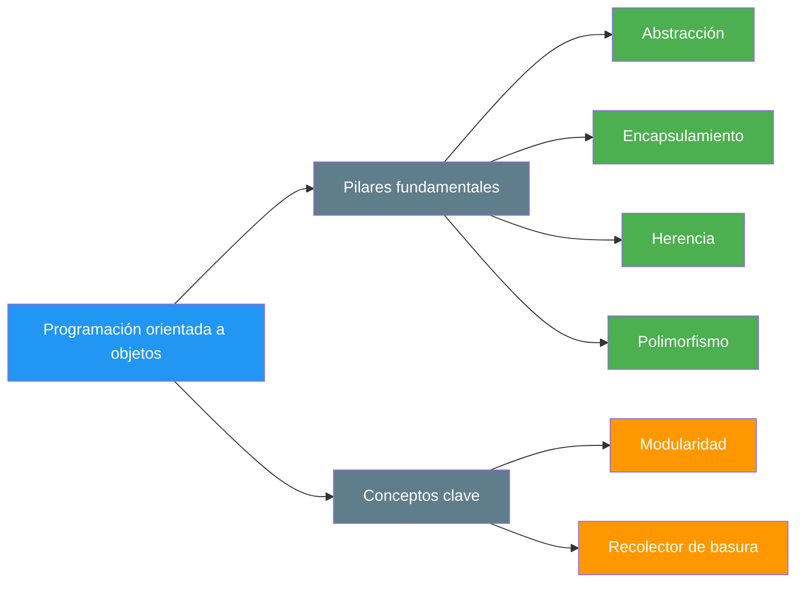

</div>

</div>
<div>

En verde, los **cuatro pilares** que sostienen todo; en naranja, los conceptos que los completan. Los veremos uno a uno en este punto.

<TipBox type="consejo">

En el examen, si te piden explicar qué es la POO, menciona los cuatro pilares —abstracción, encapsulamiento, herencia y polimorfismo— con un ejemplo de cada uno. Con eso siempre sacas el punto.

</TipBox>

</div>
</div>

---

## 🔍 Abstracción: mirar solo lo importante

La **abstracción** consiste en fijarnos solo en las características importantes de un objeto, dejando de lado los detalles que no importan.

<div class="grid grid-cols-2 gap-5 items-start">
<div>

Al diseñar el catálogo de una **biblioteca**, te interesan el título, el autor y el número de páginas; probablemente no importe el tipo de papel ni el color de la portada. Con abstracción, lo tienes en una tarde.

<TipBox type="analogia">

Es como mirar un coche por el **retrovisor**: ves lo necesario para conducir —gasolina, velocidad—, no el número de tornillos que sujeta el motor.

</TipBox>

</div>
<div>

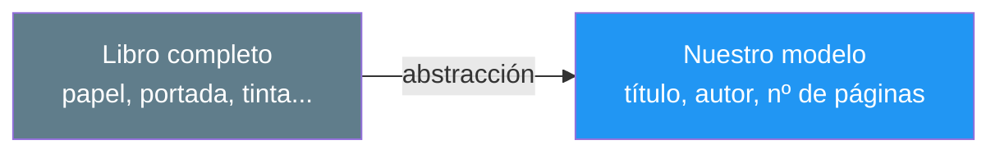

<RealExample app="Netflix">

Al recomendarte, Netflix solo mira lo importante de cada serie —género, duración, tu historial— e ignora detalles como la resolución del tráiler o el idioma del doblaje.

</RealExample>

</div>
</div>

---

## 🔒 Ocultación: cada objeto guarda sus secretos

La **ocultación** significa que no puedes ver ni modificar directamente los datos internos de un objeto: solo accedes a lo que te deja su **interfaz pública**.

<div class="grid grid-cols-2 gap-5 items-start">
<div>

Igual que con un **mando de televisión**: sabes que apretando «encender» la tele se enciende, pero no sabes cómo funciona por dentro. No hace falta: el fabricante oculta el circuito para que solo puedas usarlo bien.

<RealExample app="Banco">

En tu app del banco, al consultar el saldo ves el resultado, pero no los movimientos internos ni la forma en que se calcula: el banco te muestra una interfaz y oculta su mecanismo.

</RealExample>

</div>
<div>

<TipBox type="advertencia">

No confundas **ocultación** con **encapsulamiento**: son conceptos distintos que suelen ir juntos. Al final del punto tienes el matiz del profesor, con una tabla que lo aclara.

</TipBox>

</div>
</div>

---

## 📦 Encapsulamiento: todo junto y controlado por dentro

El **encapsulamiento** junta estado y comportamiento en un único contenedor —la clase—, ocultando el detalle interno y controlando los cambios desde fuera. Si mañana cambia algo por dentro, el resto del programa no se estropea.

<div class="grid grid-cols-2 gap-5 items-start">
<div>

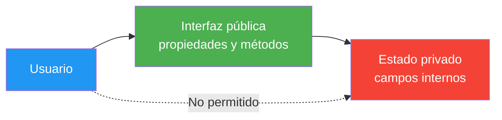

</div>
<div>

Un **coche** decide por sí solo, según sus sensores, cuándo encender el ventilador; tú solo conduces y revisas el panel. Tú usas la interfaz pública, él controla su estado privado.

<TipBox type="consejo">

La receta en C# es siempre la misma: campos **`private`** + propiedades **`public`** que controlan el acceso. Si un campo queda `public` sin control, has perdido la encapsulación.

</TipBox>

</div>
</div>

---

## 🧱 Encapsulamiento en C#: la clase `Coche`

El siguiente ejemplo muestra una clase con estado oculto y una interfaz pública controlada:

<div class="grid grid-cols-2 gap-5 items-start">
<div>

```csharp
public class Coche
{
    // Estado: privado
    private string _marca = string.Empty;
    private int _velocidad;
    // Interfaz pública controlada
    public string Marca
    {
        get => _marca;
        set => _marca = value ?? "Sin marca";
    }
    // Los métodos tocan el estado
    public void Acelerar(int n)
        => _velocidad += n;
    public void Frenar(int d) =>
        _velocidad = Math.Max(0,
            _velocidad - d);
}
```

</div>
<div>

`_marca` y `_velocidad` están `private`: nadie puede poner la velocidad a `-500` desde fuera, porque el único camino para tocarla es pasar por `Acelerar` y `Frenar`, que ya validan lo que hacen.

<RealExample app="Cajero">

Un cajero encapsula el dinero: tú solo pulsas «sacar dinero» e introduces el PIN; el mecanismo que cuenta los billetes y descuenta de tu cuenta está oculto y solo el banco lo toca.

</RealExample>

</div>
</div>

---

## 🧬 Herencia: reutilizar lo que ya existe

La **herencia** crea clases que reutilizan características y comportamientos de otras más generales: "todos los perros son animales", pero además pueden ladrar. En C# se expresa con los dos puntos (`:`).

<div class="grid grid-cols-2 gap-5 items-start">
<div>

```csharp
// CocheDeportivo ES UN Coche
public class CocheDeportivo : Coche
{
    public bool TurboActivado { get; private set; }
    public void ActivarTurbo()
    {
        TurboActivado = true;
        Acelerar(50); // reutiliza el heredado
    }
}
```

`CocheDeportivo` no reescribe `Acelerar`: lo hereda; si lo corriges en `Coche`, todos sus hijos se corrigen a la vez.

</div>
<div>

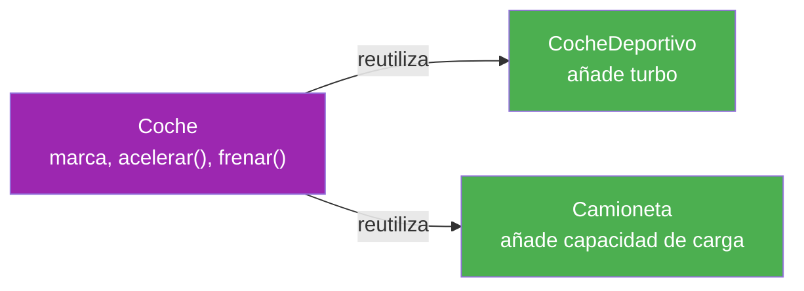

</div>
</div>

---

## ⚠️ ES UN o TIENE UN: no confundas la herencia

<div class="grid grid-cols-2 gap-5 items-start">
<div>

<TipBox type="advertencia">

Usa herencia solo con relaciones reales de "**ES UN**": `CocheDeportivo` es un `Coche`. Si la relación es "TIENE UN" —un coche *tiene* un motor—, lo correcto es la **composición** (punto 9).

</TipBox>

<TipBox type="nota">

Heredar "por si acaso" produce jerarquías imposibles de mantener: cada clase hija arrastra todo lo del padre, aunque no lo necesite.

</TipBox>

</div>
<div>

<RealExample app="Glovo">

Un "pedido express" es un pedido normal al que le añades repartidor prioritario y plazo reducido. En vez de crear un sistema de pedidos desde cero, hereda todo lo que ya hace un pedido y solo añade lo que lo diferencia.

</RealExample>

</div>
</div>

---

## 🎭 Polimorfismo: un mismo mensaje, respuestas distintas

El **polimorfismo** da flexibilidad: diferentes objetos responden a la misma orden de maneras distintas. Si le pides «encender» a tu teléfono y a tu televisor, ambos entienden la petición, pero cada uno la ejecuta a su manera.

<div class="grid grid-cols-2 gap-5 items-start">
<div>

```csharp
// En la clase Coche:
public virtual string Descripcion()
    => $"Coche {_marca}";

// En CocheDeportivo:
public override string Descripcion()
    => base.Descripcion() + " con turbo";

// Mismo mensaje, respuesta
// según el objeto real
Coche a = new Coche();
Coche b = new CocheDeportivo();
Console.WriteLine(a.Descripcion());
// Coche ...
Console.WriteLine(b.Descripcion());
// Coche ... con turbo
```

</div>
<div>

<RealExample app="PayPal">

Las formas de pago de una tienda llaman al mismo `Pagar(importe)`, pero con tarjeta, PayPal o Bizum cada uno ejecuta su propio código. La caja no sabe ni tiene que saber cómo paga cada cliente.

</RealExample>

<TipBox type="consejo">

Si escribes `if (x is Coche)` o un `switch` decidiendo por tipos, casi siempre estás a punto de sustituirlo por polimorfismo: es la señal de `virtual`/`override`.

</TipBox>

</div>
</div>

---

## 🧩 Modularidad: dividir para gobernar

La **modularidad** divide el programa en partes independientes y reutilizables llamadas **módulos**. Cada módulo encapsula una funcionalidad y se comunica con los demás a través de interfaces bien definidas.

<div class="grid grid-cols-2 gap-5 items-start">
<div>

Los objetos, al encapsular estado y comportamiento, son módulos naturales: si el módulo de **pagos** falla, puedes arreglarlo sin tocar el de **pedidos**, porque cada uno vive en su sitio.

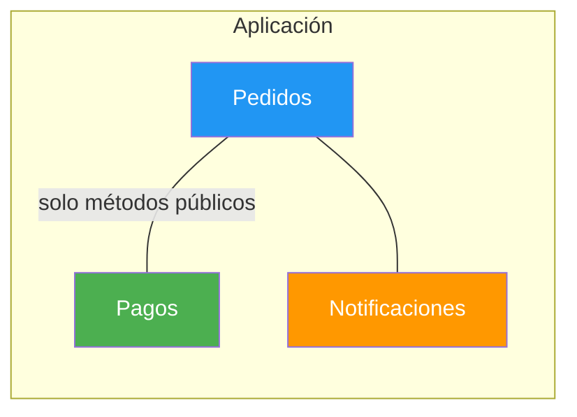

</div>
<div>

<RealExample app="Glovo">

Glovo está dividido en módulos: pedidos, restaurantes, repartidores, pagos y notificaciones. Cada equipo trabaja en su módulo sin pisar el de los demás; si se cae pagos, los pedidos siguen visualizándose.

</RealExample>

<TipBox type="analogia">

Es un edificio con habitaciones: si se estropea la cocina, sigues durmiendo en tu dormitorio. Cada módulo tiene su puerta y solo se entra por ella.

</TipBox>

</div>
</div>

---

## 🗑️ El recolector de basura: la memoria se gestiona sola

El **recolector de basura** (garbage collector o GC) libera automáticamente la memoria de los objetos a los que ya nadie referencia, evitando fugas y optimizando el rendimiento.

<div class="grid grid-cols-2 gap-5 items-start">
<div>

Funciona por **referencias**: mientras algo apunte al objeto, sigue vivo. Cuando desaparece la última referencia, el GC reclama su memoria y la deja libre.

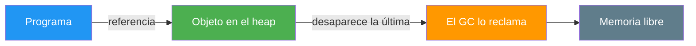

</div>
<div>

<RealExample app="Mensajería">

Una mensajería tiene miles de objetos `Mensaje`; al cerrar el chat y no quedar referencias, el GC los recoge sin que tú hagas nada.

</RealExample>

<TipBox type="nota">

En C# no hay `free()` ni `delete`: la memoria la gestiona el GC. C# **sí tiene destructores** (finalizadores `~Clase()`), pero **apenas se usan**: solo para recursos no administrados; no acumules referencias inútiles. Verás el heap y el stack en el **punto 2**.

</TipBox>

</div>
</div>

---

## 🎓 Encapsulamiento u ocultación: el matiz del profesor

Es muy común confundir estos dos conceptos, y en el examen se nota. Aquí tienes la distinción definitiva:

| Concepto | Qué hace | Ejemplo en C# |
|----------|----------|---------------|
| **Encapsulamiento** | Agrupa estado y comportamiento en una misma unidad (la clase) | Una clase que reúne sus campos y sus métodos |
| **Ocultación** | Decide qué partes de esa cápsula se ven desde fuera y cuáles no | `private` para ocultar, `public` para exponer |

<div class="grid grid-cols-2 gap-5 items-start mt-4">
<div>

<RealExample app="Streaming">

Una app de streaming encapsula el reproductor de vídeo —todos sus datos y métodos van juntos en una clase— y lo oculta tras unos botones: tú solo ves play, pausa y barra de progreso.

</RealExample>

</div>
<div>

<TipBox type="truco">

Los cuatro pilares se memorizan con las iniciales **AEHP**: **A**bstracción, **E**ncapsulamiento, **H**erencia, **P**olimorfismo. Y la respuesta corta del examen: el encapsulamiento **reúne**, la ocultación **protege**.

</TipBox>

</div>
</div>

---

## Resumen del punto 1

<div class="grid grid-cols-2 gap-5 items-start">
<div>

| Concepto | Descripción |
|----------|-------------|
| **Objeto** | Estado, comportamiento e identidad |
| **Abstracción** | Modelar solo lo importante |
| **Ocultación** | Solo se ve la interfaz pública |
| **Encapsulamiento** | Datos y métodos en una clase |
| **Herencia** | Reutilizar lo de la clase base (`:`) |
| **Polimorfismo** | Un mismo mensaje, respuestas distintas |
| **Modularidad** | El programa, en módulos independientes |
| **Recolector de basura** | Libera la memoria sin referencias |

</div>
<div>

<ConceptCard icon="✅" title="Buenas prácticas" accent="green">

- Modelar solo lo importante antes de codificar
- Exponer el estado con propiedades públicas, nunca campos sueltos
- Usar herencia solo con relaciones reales de "ES UN"
- Sustituir los `if` por tipos con polimorfismo

</ConceptCard>

<div class="mt-3">

**⏭️ ¿Qué viene después?** En el **punto 2** veremos objetos y clases en C#: cómo se definen, cómo se crean con `new` y cómo se usan en un programa.

</div>

</div>
</div>

---
layout: section
---

<div class="ud-section-number">02</div>

# Objetos y clases

<div class="opacity-70">Identidad, estado y comportamiento, la clase como molde y dónde vive cada objeto</div>

---

## 2 · Punto de partida

<div class="grid grid-cols-2 gap-5 items-start">
<div>

<TipBox type="consejo" title="Punto de partida">

Cuando pides una hamburguesa en una app de comida, en pantalla aparece "tu pedido": restaurante, productos, precio, estado (preparando, en camino...). Ese pedido no es un texto suelto: es un **objeto** con datos y con cosas que puede hacer. En este punto verás de qué se hace uno y cómo se fabrica en C#.

</TipBox>

</div>
<div>

<Objetivos
  :items="[
    'Diferenciar identidad, estado, comportamiento e interfaz pública de un objeto',
    'Distinguir la clase (el molde) de sus instancias (los objetos fabricados)',
    'Crear objetos con new y seguir la referencia que devuelve',
    'Situar las variables en el stack y los objetos en el heap, y saber qué es null',
  ]"
/>

</div>
</div>

---

## 🪪 Identidad, estado y comportamiento

Un **objeto** es una representación digital de algo del mundo real o de una idea: un "actor" dentro de tu programa, con personalidad, datos y capacidades.

<div class="grid grid-cols-2 gap-5 items-start">
<div>


</div>
<div>

- **Identidad:** lo que hace único al objeto, aunque tenga la misma información que otro —dos carnés iguales siguen siendo dos tarjetas distintas—. En C#, es su **referencia** en memoria.
- **Estado:** los datos que guarda ahora mismo: un alumno (nombre, nota, curso), un semáforo (su color actual).
- **Comportamiento:** las acciones que puede ejecutar —una puerta abre, un reloj pone la alarma—. En C#, son sus **métodos**.

</div>
</div>

---

## 🚪 La interfaz pública: el panel de mandos

La **interfaz pública** es el conjunto de métodos y propiedades que otros objetos pueden usar para interactuar con él: el "panel de mandos" que el objeto decide mostrar al exterior. El resto de sus miembros queda oculto (el encapsulamiento del punto anterior).

<div class="grid grid-cols-2 gap-5 items-start">
<div>

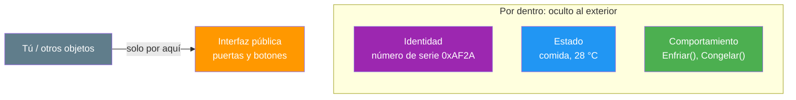

</div>
<div>

<TipBox type="analogia">

Un objeto es una **nevera**: el estado es lo que guarda —comida, temperatura—, el comportamiento lo que hace —enfriar, congelar—, la identidad su número de serie, y la interfaz pública las puertas y botones que tú usas. Por dentro no ves el compresor: está oculto.

</TipBox>

</div>
</div>

---

## 🔢 Objetos y tipos simples: en qué se diferencian

Antes de crear tus propios objetos, observa que tipos como los números (`int`, `double`) y las cadenas (`char`, `string`) ya existen desde siempre en los lenguajes:

<div class="grid grid-cols-2 gap-5 items-start">
<div>

- Un número como `42` es un valor suelto: no hay identidad que rastrear, solo estado.
- Una cadena como `"Hola"` puedes consultar su longitud o unirla con otras, pero no tiene "personalidad" propia.

El objeto va más allá: tú defines cómo es, qué puede hacer y cómo debe comportarse.

</div>
<div>

<RealExample app="Biblioteca">

Si tienes varios libros, cada uno tendrá título, autor y número de páginas. Pero si programas una biblioteca, representarás cada libro como objeto para gestionarlo o prestarlo: ahí necesitas identidad, porque cada ejemplar es único.

</RealExample>

<TipBox type="nota">

En C#, los tipos simples también son objetos por debajo —por eso funciona `"hola".ToUpper()`—, pero se usan como valores: se copian, no se comparten. Lo verás con detalle en el **punto 5**.

</TipBox>

</div>
</div>

---

## 🍪 La clase: el molde de los objetos

En C#, **la clase** es la herramienta que define cómo deben ser tus objetos: qué información guardan y qué acciones pueden realizar. Es como el molde de una galleta: define la forma; luego fabricas galletas distintas, todas basadas en ese molde.

<div class="grid grid-cols-2 gap-5 items-start">
<div>

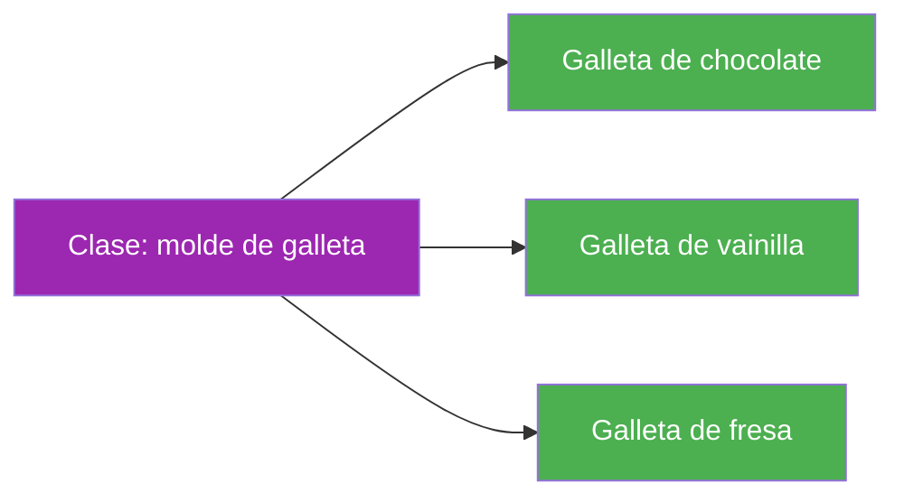

</div>
<div>

A cada objeto creado desde la clase se le llama **instancia**. **Tipificar** —dar a cada objeto su propio "tipo"— evita que mezcles usos: si la clase es `Coche`, solo tratarás como coche lo creado como `Coche`.

<TipBox type="consejo">

La clase es el **plano**, el objeto es la **casa** y la instancia es **cada casa concreta**.

</TipBox>

</div>
</div>

---

## 🆕 `new`: crear objetos y obtener su referencia

Cuando quieres utilizar un objeto en C#, lo creas a partir de su clase con la palabra clave `new`. Esto hace **tres cosas importantes**:

<div class="grid grid-cols-2 gap-5 items-start">
<div>

1. **Reserva memoria** para almacenar la información del objeto.
2. **Inicializa su estado inicial**, según lo que hayas definido en la clase.
3. **Devuelve una referencia**: la "dirección" en memoria por la que localizarás ese objeto para usarlo en el futuro.

</div>
<div>

<TipBox type="advertencia">

La clase **no es el objeto**: es solo el plano, guardado en los metadatos. Declarar `Gato g;` no crea nada detrás; si usas la referencia sin crear el objeto, el compilador te avisa, y si acaba en `null`, el primer acceso falla con `NullReferenceException`.

</TipBox>

<TipBox type="nota">

`new` no es novedad de la POO: lo llevas usando desde la **UD03** con los arrays (`new int[5]`). Misma idea —reservar espacio en memoria—; con una clase, además se ejecuta su constructor.

</TipBox>

</div>
</div>

---

## 🔬 Dos gatos "Luna": identidad con código

El siguiente programa crea dos objetos con el **mismo estado** y comprueba que, aun así, son objetos distintos:

<div class="grid grid-cols-2 gap-5 items-start">
<div>

```csharp
public class Gato
{
    public string Nombre { get; set; }
    public Gato(string nombre) => Nombre = nombre;
}

// Dos objetos con el MISMO estado
var gato1 = new Gato("Luna");
var gato2 = new Gato("Luna");

Console.WriteLine(gato1 == gato2);      // false
Console.WriteLine(gato1.Equals(gato2)); // false

// gato3: otro nombre para el MISMO objeto
var gato3 = gato1;
Console.WriteLine(gato1 == gato3);      // true
```

</div>
<div>

`gato1` y `gato2` tienen el mismo estado (`"Luna"`) pero son objetos distintos; `gato3` no es un objeto nuevo: es **otro nombre para el mismo objeto** que `gato1`. Cambiar `gato1.Nombre` cambiaría el que ve `gato3`.

<RealExample app="Instagram">

Cuando Instagram te avisa "tu foto tiene 3 likes", actualiza el estado de un único objeto `Foto` al que apuntan muchas referencias: tu móvil, el de tus amigos, los servidores. Todos ven el mismo objeto, no copias sueltas.

</RealExample>

</div>
</div>

---

## 📬 La referencia: la dirección de la casa

Aunque crees dos objetos iguales (mismo estado), cada uno tendrá una referencia diferente y serán instancias distintas, con identidad propia:

<div class="grid grid-cols-2 gap-5 items-start">
<div>

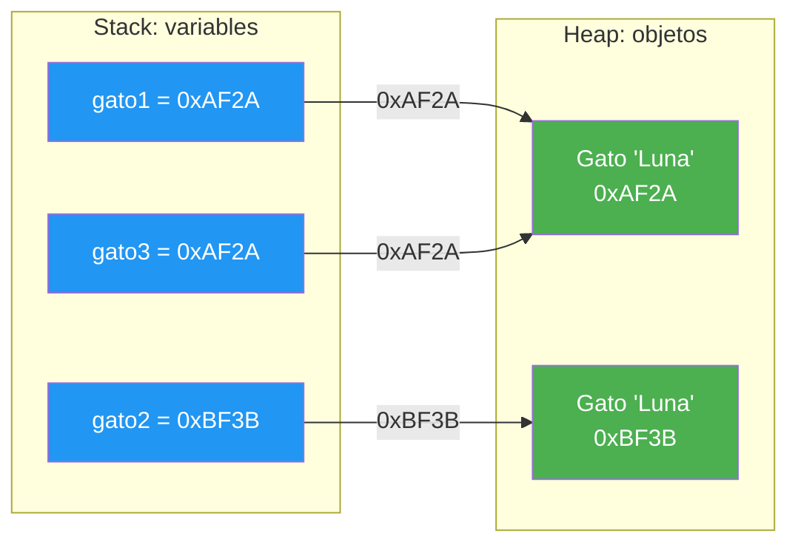

</div>
<div>

`gato1` y `gato3` comparten dirección: son el mismo objeto con dos nombres. `gato2` vive en otra dirección: es otra instancia.

<TipBox type="analogia">

Un objeto es una **casa** y la referencia, su **dirección**. Al escribir `Gato gato1 = new Gato()`, estás construyendo la casa, obteniendo la dirección (`0xAF2A`) y guardándola en tu agenda: la variable `gato1`.

</TipBox>

</div>
</div>

---

## 🏭 Objetos a partir de clases predefinidas

No todas las clases las escribes tú: la biblioteca de clases de .NET (BCL) trae cientos listas para usar, y **se usan exactamente igual** que una clase que hayas definido tú.

<div class="grid grid-cols-2 gap-5 items-start">
<div>

```csharp
// Clases predefinidas de .NET: igual que las tuyas
var azar = new Random();
Console.WriteLine(azar.Next(1, 7)); // un dado: 1..6

var datos = new List<int> { 10, 20, 30 };
Console.WriteLine(datos.Count);     // 3

var texto = "  Hola Mundo  "; // string es una clase
Console.WriteLine(texto.Trim().ToUpper());

var hoy = DateTime.Now;
Console.WriteLine($"{hoy:dd/MM/yyyy} {hoy:HH:mm}");
```

</div>
<div>

El patrón es siempre el mismo: **`new` → punto → método o propiedad**, igual para tus clases que para las de fábrica. Y **no reinventes lo que la BCL ya trae**: para fechas, azar o texto largo, busca antes la clase de fábrica.

<RealExample app="Videojuegos">

Un videojuego usa `new Random()` para decidir qué cae del cielo; una mensajería, `new StringBuilder()` para concatenar mensajes.

</RealExample>

</div>
</div>

---

## 📚 Stack y heap: dónde vive cada objeto

Cuando escribes `Gato miGato = new Gato();` ocurren dos cosas, cada una en su zona de memoria:

<div class="grid grid-cols-2 gap-5 items-start">
<div>

- **Stack (pila):** memoria rápida pero pequeña. Guarda el nombre de la variable (`miGato`) y su **referencia**: la dirección del objeto.
- **Heap (montículo):** memoria grande donde viven los **objetos reales**. Allí es donde `new` reserva el espacio para los datos del gato.

</div>
<div>

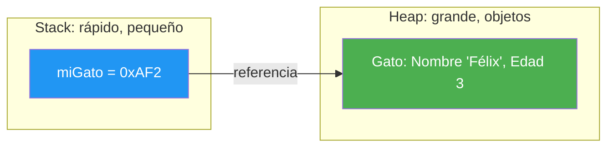

</div>
</div>

---

## 💤 `null`: la referencia que apunta a nada

Si la variable del stack no tiene ninguna dirección —apunta a nada—, su valor es **`null`**. Si intentas usarla así, el programa falla porque no sabe a qué dirección del heap ir a buscar los datos.

<div class="grid grid-cols-2 gap-5 items-start">
<div>

<TipBox type="truco">

En el examen, cuando veas `new Clase()`: "se crea un objeto en el heap y se devuelve su referencia". Cuando veas `Clase objeto;` sin `new`: "solo existe una variable en el stack que apunta a `null`".

</TipBox>

</div>
<div>

<RealExample app="Mensajería">

Cuando una mensajería se queda sin cobertura y no puede cargar el chat, muestra "sin mensajes" en vez de romperse: está comprobando referencias `null` antes de usarlas.

</RealExample>

<TipBox type="nota">

Eso es lo que aprenderemos a gestionar como **seguridad ante nulos**: comprobar la referencia antes de usarla.

</TipBox>

</div>
</div>

---

## Resumen del punto 2

<div class="grid grid-cols-2 gap-5 items-start">
<div>

| Concepto | Descripción |
|----------|-------------|
| **Objeto** | Identidad, estado y comportamiento |
| **Interfaz pública** | Lo que el objeto deja ver desde fuera |
| **Clase** | El molde que define sus objetos |
| **Instancia** | Objeto concreto fabricado desde la clase |
| **`new`** | Reserva memoria y devuelve una referencia |
| **Referencia** | Dirección del objeto; `null` si apunta a nada |
| **Clases predefinidas** | Objetos de .NET: se usan igual que los tuyos |
| **Stack vs. heap** | Variables en el stack; objetos en el heap |

</div>
<div>

<ConceptCard icon="✅" title="Buenas prácticas" accent="green">

- Definir la clase (el molde) antes que las instancias
- `new` devuelve una referencia: dos iguales no son el mismo objeto
- No reinventar lo que la BCL ya trae (`Random`, `DateTime`, `List<T>`)
- Comprobar las referencias contra `null` antes de usarlas

</ConceptCard>

<div class="mt-3">

**⏭️ ¿Qué viene después?** En el **punto 3** veremos cómo se organiza un proyecto en C#: espacios de nombres, soluciones, proyectos y ensamblados, y cómo crear y compilar uno.

</div>

</div>
</div>

---
layout: section
---

<div class="ud-section-number">03</div>

# Espacios de nombres y organización del proyecto

<div class="opacity-70">Namespace y using, solución, proyecto y ensamblado, crear y compilar con la CLI y en Rider, y librerías con NuGet</div>

---

## 3 · Punto de partida

<div class="grid grid-cols-2 gap-5 items-start">
<div>

<TipBox type="consejo" title="Punto de partida">

En casa reparto la ropa en cajones y arcones: cada pieza tiene su sitio y nunca la busco debajo de la cama. En un programa pasa igual: si metes todas las clases en un único fichero sin orden, llega un momento en que no sabes dónde está nada.

</TipBox>

</div>
<div>

<Objetivos
  :items="[
    'Definir espacios de nombres con la forma file-scoped y usar using y alias',
    'Distinguir solución, proyecto y ensamblado, y saber qué archivo es cada uno',
    'Crear un proyecto con la CLI (dotnet new) y en Rider, y compilarlo y ejecutarlo',
    'Incorporar una librería de objetos con NuGet y usar sus tipos en tu código',
  ]"
/>

</div>
</div>

---

## 📁 Namespace: la carpeta virtual de tus clases

Un **namespace** (espacio de nombres) es una carpeta virtual que agrupa tipos relacionados: clases, structs, interfaces… Te permite organizar el código y evitar que dos clases con el mismo nombre se mezclen.

<div class="grid grid-cols-2 gap-5 items-start">
<div>

```csharp
namespace MiAplicacion.Modelos
{
    public class Persona
    {
        public string Nombre { get; set; } = string.Empty;
    }
}
```

</div>
<div>

<RealExample app="Banca digital">

Es como tener los documentos de "Matemáticas" y "Historia" en carpetas distintas: ambos pueden llamarse "Examen.docx" sin entrar en conflicto. En una app de banco, `Banco.Core.Cuenta` y `Banco.Pruebas.Cuenta` conviven sin pisarse.

</RealExample>

<TipBox type="advertencia">

El namespace **no** tiene por qué coincidir con la carpeta física del fichero, aunque es costumbre que sí coincida para encontrar las clases al navegar por el proyecto.

</TipBox>

</div>
</div>

---

## ✨ File-scoped namespace: la forma moderna

Desde C# 10 existe una forma más concisa: el namespace a nivel de archivo. Se escribe una sola línea con punto y coma y **todo el archivo queda dentro**, sin llaves que abrir ni cerrar:

```csharp
namespace MiAplicacion.Modelos;

public class Producto
{
    public string Nombre { get; set; } = string.Empty;
}
```

<TipBox type="consejo">

En esta unidad usaremos siempre la forma *file-scoped* (`namespace X;`), porque es la que pide la norma del proyecto. Si abres un fichero y ves `namespace X;` sin llaves, no es un error: es la sintaxis moderna.

</TipBox>

---

## 🔀 Using y alias: importar sin repetir nombres

La instrucción **`using`** importa otros espacios de nombres al archivo, para usar sus clases sin escribir el nombre completo cada vez. Con un **alias** creas un nombre corto para un tipo o un namespace, y con **`using static`** importas los miembros estáticos de una clase:

<div class="grid grid-cols-2 gap-5 items-start">
<div>

```csharp
using MiAplicacion.Modelos;

// Ahora puedes escribir simplemente:
Persona p = new Persona();
```

</div>
<div>

```csharp
using M = MiAplicacion.Modelos;
using B = MiAplicacion.Biblioteca;

// Ahora puedes distinguirlas por el alias:
M.Persona a = new M.Persona();
B.Persona b = new B.Persona();

using static System.Math;
double resultado = Sqrt(25); // igual que Math.Sqrt(25)
```

</div>
</div>

<TipBox type="truco">

Si dudas de dónde sale una clase, mira los `using` del archivo: si falta, el error es "no se encontró el tipo o el espacio de nombres".

</TipBox>

---

## 🗺 Dos `Persona` que no se pisan

Cada `Persona` vive en su namespace y el alias es su nombre corto: así dos clases con el mismo nombre conviven sin conflicto.

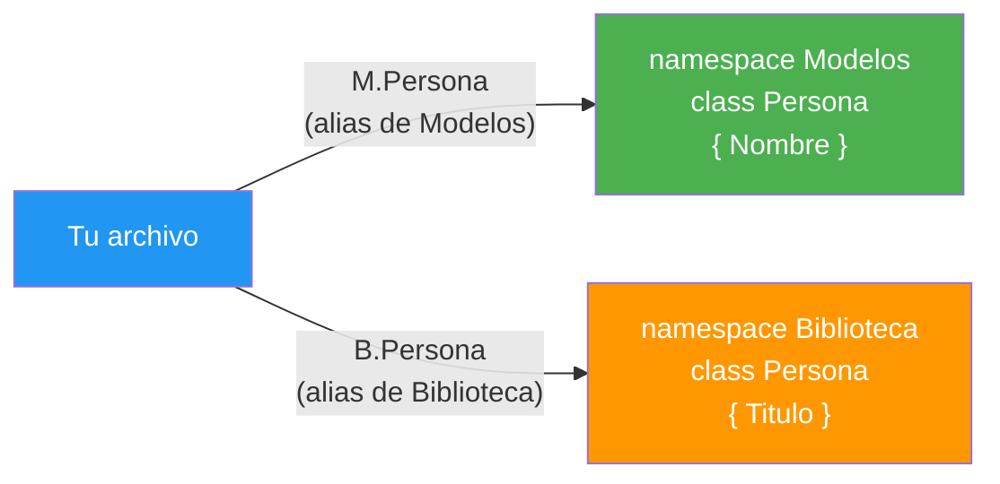

---

## 🧱 Solución, proyecto y ensamblado

Antes de escribir código, ten claro el mapa de carpetas: son tres niveles.

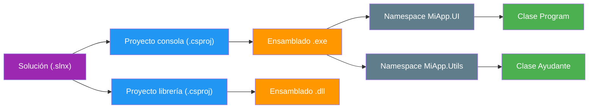

<TipBox type="analogia">

Piensa en una fábrica de muebles: la **solución** es el polígono, cada **proyecto** es una nave y el **ensamblado** es la caja final que sale por la puerta.

</TipBox>

---

## 🔗 La relación práctica

- Una **solución** puede tener varios proyectos.
- Cada **proyecto** genera su propio ensamblado y puede tener diferentes namespaces.
- Un **ensamblado** es el resultado de compilar un proyecto.
- Los **namespaces** organizan los tipos dentro de los proyectos y pueden coincidir o no con la estructura de carpetas reales.

En el explorador de Rider verás exactamente este mapa: la solución agrupa los proyectos, cada proyecto genera su ensamblado en `bin/` y, dentro, tus clases viven en sus namespaces.

<RealExample app="TiendaDawApi-NetCore">

En la Tienda hay una solución con varios proyectos: la API, la librería de dominio y los tests. Cada uno compila a su propio `.dll` y se comunican entre sí por referencias y namespaces.

</RealExample>

---

## 🖥 Crear y compilar con la CLI

Para crear un programa simple no hace falta más que dos cosas: crear el proyecto y compilarlo. Desde cualquier carpeta, la consola crea un proyecto de consola llamado `MiPrimerPrograma`:

<div class="grid grid-cols-2 gap-5 items-start">
<div>

```bash
# Crear un proyecto de consola en una carpeta nueva
dotnet new console -n MiPrimerPrograma

# Entrar en la carpeta del proyecto
cd MiPrimerPrograma

# Compilar (genera el ensamblado en bin/)
dotnet build

# Compilar y ejecutar en un solo paso
dotnet run

# Crear una solución e incorporar el proyecto
dotnet new sln -n MiSolucion
dotnet sln add MiPrimerPrograma/MiPrimerPrograma.csproj
```

</div>
<div>

`dotnet new console` genera el `.csproj` y el `Program.cs` con *Top-Level Statements*, listos para escribir. `dotnet build` comprueba el código y, si no hay errores, crea el ensamblado en `bin/`; `dotnet run` compila (si hace falta) y lo ejecuta.

<RealExample app="Integración continua">

Todo el material de esta asignatura se puede crear y compilar así sin abrir ningún IDE: es exactamente lo que hace un *pipeline* de integración continua en una empresa antes de aprobar una versión.

</RealExample>

</div>
</div>

---

## 🏍 Crear y compilar en Rider

En Rider el flujo es el mismo, pero con botones:

1. **File → New Solution** (o `Ctrl+Alt+Shift+N`) y eliges **Console Application**.
2. Rider genera la solución, el `.csproj` y el `Program.cs`.
3. Escribe tu código en el editor.
4. Pulsas **Run** (o `Shift+F10`) para compilar y ejecutar; **Build Solution** (`Ctrl+F9`) sin ejecutar.

Da igual dónde lo hagas: el IDE usa exactamente los mismos comandos (`dotnet new`, `dotnet build`, `dotnet run`) que en la CLI. Por eso en el ámbito profesional se prefiere la CLI: funciona en cualquier ordenador sin instalar un IDE.

<TipBox type="consejo">

Si Rider no te compila, mira la pestaña **Errors**: el 90 % de los errores de principiante son de sintaxis. Compilar a menudo te ahorra horas: cuanto antes salte el error, más fácil es encontrarlo.

</TipBox>

---

## 📦 NuGet: el gestor de paquetes

Casi nada se escribe de cero: los programas reales se construyen **encima de librerías** externas que se incorporan como **paquetes**. **NuGet** es el gestor de paquetes de .NET:

<div class="grid grid-cols-2 gap-5 items-start">
<div>

```bash
# Añadir una librería al proyecto actual
dotnet add package Spectre.Console

# Ver los paquetes instalados y sus versiones
dotnet list package

# Restaurar paquetes (normalmente lo hace build)
dotnet restore
```

</div>
<div>

Al instalar, .NET escribe la referencia en el `.csproj`: esa línea **es la instalación hecha y versionada**; quien clone el proyecto la restaura solo.

```xml
<ItemGroup>
  <PackageReference Include="Spectre.Console"
                     Version="0.53.0"/>
</ItemGroup>
```

<TipBox type="advertencia">

`dotnet add package` se ejecuta **dentro de la carpeta del proyecto**: si lo lanzas donde no toca, el paquete no se añade a ningún sitio.

</TipBox>

</div>
</div>

---

## 📦 El recorrido de un paquete

El paquete recorre siempre el mismo camino, desde el comando hasta tu código:

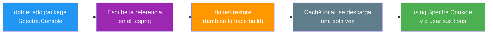

<RealExample app="Rider y entornos profesionales">

Rider tiene un panel gráfico de NuGet para instalar con un clic (click derecho en el proyecto → Manage NuGet Packages), pero en el ámbito profesional se prefiere la CLI: queda en los *scripts*, en la documentación y en los pipelines de integración continua sin depender de un IDE.

</RealExample>

---

## 📖 Usar una librería en tu código

Instalar el paquete solo te da los tipos: para usarlos, importa su espacio de nombres con `using` y trátalos como cualquier otra clase. Este programa usa `Spectre.Console` junto con clases de la BCL:

<div class="grid grid-cols-2 gap-5 items-start">
<div>

```csharp
using Spectre.Console;   // librería externa (paquete NuGet)

// Texto con color usando etiquetas [color]...[/]
AnsiConsole.MarkupLine("[green]Aprobados:[/] 4 de 5");

// Una tabla con bordes y cabeceras
var tabla = new Table()
    .Border(TableBorder.Rounded)
    .AddColumn(new TableColumn("Alumno").Centered())
    .AddColumn(new TableColumn("Nota").Centered());

tabla.AddRow("Lucía", "7,5");
tabla.AddRow("Marcos", "4,0");
AnsiConsole.Write(tabla);
```

</div>
<div>

El patrón es **idéntico** al de cualquier clase: `new Table()` crea un objeto, `.AddColumn(...)` llama a sus métodos y `AnsiConsole` agrupa operaciones estáticas. Da igual que la clase la hayas escrito tú o que venga de una librería: la usas igual.

<TipBox type="consejo">

Antes de escribir una utilidad a mano, pregunta: "¿hay un paquete para esto?". Buscar y reutilizar librerías es señal de un profesional, no de pereza.

</TipBox>

</div>
</div>

---

## ⚠️ Errores comunes al instalar paquetes

Los errores habituales al instalar paquetes son siempre los mismos cuatro:

| Error | Por qué ocurre | Cómo evitarlo |
| :--- | :--- | :--- |
| **`NU1101: no se encuentra el paquete`** | Error en el nombre o falta el *restore* | Revisa el nombre y ejecuta `dotnet restore` |
| **Versión incompatible con el framework** | El paquete no soporta `net10.0` | Comprueba la versión con `dotnet list package` |
| **Olvidar el `using`** | El paquete está instalado pero no se importa | Añade `using Spectre.Console;` (o el que corresponda) |
| **Comando en la carpeta equivocada** | Se lanzó fuera de la carpeta del `.csproj` | Entra en la carpeta del proyecto antes de `dotnet add package` |

---

## Resumen del punto 3

<div class="grid grid-cols-2 gap-5 items-start">
<div>

| Concepto | Descripción |
|----------|-------------|
| **Namespace** | Carpeta virtual que agrupa clases y evita conflictos |
| **File-scoped namespace** | Forma moderna (C# 10+): `namespace X;` sin llaves |
| **`using`** | Importa un namespace; `using static`, miembros estáticos |
| **Solución (.slnx)** | Contenedor de proyectos; XML por defecto en .NET 10 |
| **Proyecto (.csproj)** | Unidad que se compila a un ensamblado |
| **Ensamblado** | Resultado de compilar: `.exe` ejecutable o `.dll` |
| **NuGet** | Gestor de paquetes; `dotnet add package` al `.csproj` |

</div>
<div>

<ConceptCard icon="✅" title="Buenas prácticas" accent="green">

- Namespace que refleje la lógica del proyecto (`MiEmpresa.MiApp.Servicios`)
- Usar siempre la forma *file-scoped* (`namespace X;`)
- Compilar a menudo (`dotnet build` o `Ctrl+F9`) para cazar errores pronto
- Instalar paquetes por CLI desde la carpeta del `.csproj` y fijar su versión

</ConceptCard>

<div class="mt-3">

**⏭️ ¿Qué viene después?** En el **punto 4** veremos cómo se define una clase en C#: sus miembros, atributos, visibilidad y modificadores de acceso.

</div>

</div>
</div>

---
layout: center
---

<div class="flex flex-col items-center gap-3 w-full text-center">

<PacMan :size="64" />

# ¡Hasta el próximo deploy! <span class="ud-emoji">👋</span>

<b class="text-lg">Tema 04: Programación Orientada a Objetos (POO)</b>

<span class="ud-pill">Programación · 1DAW · Curso 2026-2027</span>

<RepoBadge caption="📚 Materiales, prácticas y soluciones" size="lg" />

<div class="flex flex-wrap items-center justify-center gap-x-6 gap-y-3 text-sm">

<a class="ud-pill ud-pill-link" href="https://joseluisgs.dev" target="_blank">🌐 joseluisgs.dev</a>
<a class="ud-pill ud-pill-link" href="https://github.com/joseluisgs" target="_blank">🐙 GitHub</a>
<a class="ud-pill ud-pill-link" href="https://www.linkedin.com/in/JoseLuisGSDev" target="_blank">💼 LinkedIn</a>
<a class="ud-pill ud-pill-link" href="https://www.youtube.com/@joseluisgs" target="_blank">🎬 YouTube</a>
<a class="ud-pill ud-pill-link" href="https://x.com/JoseLuisGSDev" target="_blank">🐦 X</a>
<a class="ud-pill ud-pill-link" href="https://www.instagram.com/joseluisgs.dev/" target="_blank">📸 Instagram</a>

</div>

</div>
