<div class="flex items-center gap-4 w-full">
  
  <span class="ud-pill">Programación · 1DAW · Curso 2026-2027</span>
</div>

# Programación Orientada a Objetos

### Creando programas organizados en clases y objetos

<div class="mt-10 flex items-end justify-between w-full">
  <div class="text-left">
    <b class="text-lg">José Luis González Sánchez</b><br/>
    <span class="opacity-70">IES Luis Vives · Leganés · <a href="https://joseluisgs.dev">joseluisgs.dev</a></span>
  </div>
  <PacMan :size="54" label="Cargando ideas..." />
</div>

---

## 📦 Materiales de la unidad

Todo el material de la UD04 está publicado en el repositorio de GitHub, organizado por carpetas:

<div class="grid grid-cols-2 gap-6 items-start">
<div>

- 📚 **14 puntos** — teoría, ejemplos reales y resúmenes
- 📝 **Prácticas** — ejercicios graduados en `practicas/`
- 💻 **Soluciones** — programas C# resueltos en `soluciones/`
- 🖼️ **Imágenes y recursos** — diagramas y esquemas en `images/`
- 🎬 **Vídeos** — lista de reproducción en YouTube

</div>
<div class="flex flex-col items-center justify-center gap-4 pt-4">

<RepoBadge caption="Repositorio con materiales de la unidad" />

<div class="text-sm opacity-75 text-center max-w-55">

Clónalo, forquéalo o descárgalo en zip: el material siempre está a un clic.

</div>

</div>
</div>

---

## 📚 Índice: los 14 puntos del tema

<div class="grid grid-cols-5 gap-3 text-sm">

<TopicCard :num="1" title="Conceptos y principios de la POO" desc="Qué es la POO y sus principios" />
<TopicCard :num="2" title="Objetos y clases" desc="Identidad, estado y comportamiento" />
<TopicCard :num="3" title="Espacios de nombres y organización" desc="Namespaces, soluciones y proyectos" />
<TopicCard :num="4" title="Definición de clases y miembros" desc="Propiedades, métodos y visibilidad" />
<TopicCard :num="5" title="Instanciación, referencias e igualdad" desc="new, this, ToString e identidad" />
<TopicCard :num="6" title="Constructores e inicialización" desc="Defecto, sobrecarga y readonly" />
<TopicCard :num="7" title="Encapsulación y propiedades" desc="Getters, setters y miembros estáticos" />
<TopicCard :num="8" title="Enums, structs y records" desc="Tipos de valor propios" />
<TopicCard :num="9" title="Clases anidadas y composición" desc="Clases dentro de clases y relaciones" />
<TopicCard :num="10" title="Diseño orientado a objetos" desc="Del diagrama E/R a las clases" />
<TopicCard :num="11" title="Patrones básicos de diseño" desc="Singleton, factory, builder y fachada" />
<TopicCard :num="12" title="Excepciones en la POO" desc="throw, try/catch y jerarquía" />
<TopicCard :num="13" title="Buenas prácticas" desc="SRP, nomenclatura y documentación" />
<TopicCard :num="14" title="Resumen y conclusiones" desc="Mapa, errores y checklist" />

</div>

<div class="ud-card mt-4 flex items-center justify-between gap-4 px-4 py-2">

<span class="text-sm">📦 <b>Materiales:</b> los 14 puntos, prácticas, soluciones y vídeos de la unidad</span>

<RepoBadge />

</div>

---

## 🎯 Resultados de aprendizaje: RA 2

<RaaCcee
  code="RA 2"
  title="Escribe y prueba programas sencillos, reconociendo y aplicando los fundamentos de la programación orientada a objetos."
  :ccee="[
    'Se han identificado los fundamentos de la programación orientada a objetos.',
    'Se han escrito programas simples.',
    'Se han instanciado objetos a partir de clases predefinidas.',
    'Se han utilizado métodos y propiedades de los objetos.',
    'Se han escrito llamadas a métodos estáticos.',
    'Se han utilizado parámetros en la llamada a métodos.',
    'Se han incorporado y utilizado librerías de objetos.',
    'Se han utilizado constructores.',
    'Se ha utilizado el entorno integrado de desarrollo en la creación y compilación de programas simples.',
  ]"
/>

---

## 🎯 Resultados de aprendizaje: RA 4

<RaaCcee
  code="RA 4"
  title="Desarrolla programas organizados en clases analizando y aplicando los principios de la programación orientada a objetos."
  :ccee="[
    'Se ha reconocido la sintaxis, estructura y componentes típicos de una clase.',
    'Se han definido clases.',
    'Se han definido propiedades y métodos.',
    'Se han creado constructores.',
    'Se han desarrollado programas que instancien y utilicen objetos de las clases creadas anteriormente.',
    'Se han utilizado mecanismos para controlar la visibilidad de las clases y de sus miembros.',
  ]"
/>

---
layout: section
---

<div class="ud-section-number">01</div>

# Conceptos y principios de la POO

<div class="opacity-70">Qué es la POO y sus cuatro pilares</div>

---

## 1 · Punto de partida

<div class="grid grid-cols-2 gap-5 items-start">
<div>

<TipBox type="consejo" title="Punto de partida">

¿Alguna vez te has preguntado **cómo Instagram sabe qué fotos enseñarte primero**, o **cómo Glovo calcula el tiempo de entrega** de tu pedido? Detrás de cada aplicación hay "cosas" con nombre: usuarios, fotos, pedidos, repartidores... La **POO** escribe el programa tal como está organizado el mundo: por objetos.

</TipBox>

<TipBox type="analogia">

**Programar con POO es como construir con piezas de Lego:** cada pieza tiene su forma, su función y su nombre, y el programa entero es el modelo que consigues montar con ellas.

</TipBox>

</div>
<div>

<Objetivos
  :items="[
    'Explicar qué es un objeto y sus tres componentes: estado, comportamiento e identidad',
    'Distinguir los conceptos clave de la POO: abstracción, ocultación, encapsulamiento, herencia y polimorfismo',
    'Diferenciar encapsulamiento de ocultación sin liarte (ni liarte en el examen)',
    'Describir qué hace el recolector de basura y por qué en C# no liberamos la memoria a mano',
  ]"
/>

</div>
</div>

---

## 💡 ¿Qué es la programación orientada a objetos?

La POO es una forma de pensar y escribir programas inspirada en el mundo real: todo está formado por "cosas" (objetos) con características y comportamientos propios, que se hablan entre sí.

Un objeto se define por tres componentes:

- **Estado:** los datos que guarda. En una bicicleta: color, marca, velocidad actual.
- **Comportamiento:** las operaciones que puede realizar: frenar, pedalear, cambiar de marcha.
- **Identidad:** cada objeto es único, aunque dos tengan el mismo estado.

<RealExample app="Instagram">

Instagram modela cada cuenta como un objeto con estado (nombre, seguidores, fotos), comportamiento (publicar, dar like, seguir) e identidad (identificador único). Al abrir la app no se recalcula tu perfil: se recupera tu objeto.

</RealExample>

---

## 🧩 La POO no es "programación orientada a clases"

<TipBox type="nota">

La POO es un **paradigma**: una manera de modelar el programa en objetos con estado, comportamiento e identidad —no un lenguaje en particular—. Lo que cambia de un lenguaje a otro es **cómo se construyen esos objetos**:

</TipBox>

<div class="grid grid-cols-2 gap-5 items-start mt-4">
<div>

**Lenguajes con clases** (C#, Java, C++)

Fabrican cada objeto a partir de una **clase** —un molde— y de paso **tipifican** los objetos: el compilador comprueba que solo uses cada tipo donde corresponde. Encajan con los lenguajes **tipados**.

</div>
<div>

**Lenguajes con prototipos** (JavaScript, Lua)

No tienen clases: un objeto nuevo nace **copiando otro objeto de referencia**, su prototipo. Encajan con los lenguajes **no tipados o de tipado dinámico**.

</div>
</div>

Misma filosofía —objetos que se hablan entre sí—, mecanismos distintos para construirlos: estudiar POO en C# no te ata a C#.

---

## 🏗️ Los pilares y conceptos de la POO

Los conceptos de la POO se agrupan en **pilares** y en otros conceptos de apoyo:

<div class="grid grid-cols-2 gap-5 items-start">
<div>

<div class="ud-mer-angosto">

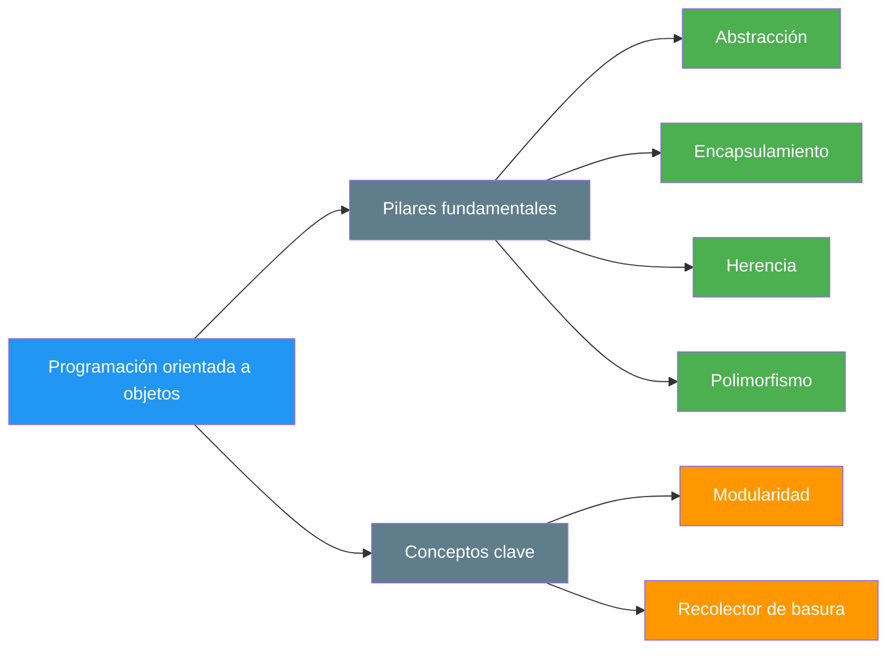

</div>

</div>
<div>

En verde, los **cuatro pilares** que sostienen todo; en naranja, los conceptos que los completan. Los veremos uno a uno en este punto.

<TipBox type="consejo">

En el examen, si te piden explicar qué es la POO, menciona los cuatro pilares —abstracción, encapsulamiento, herencia y polimorfismo— con un ejemplo de cada uno. Con eso siempre sacas el punto.

</TipBox>

</div>
</div>

---

## 🔍 Abstracción: mirar solo lo importante

La **abstracción** consiste en fijarnos solo en las características importantes de un objeto, dejando de lado los detalles que no importan.

<div class="grid grid-cols-2 gap-5 items-start">
<div>

Al diseñar el catálogo de una **biblioteca**, te interesan el título, el autor y el número de páginas; probablemente no importe el tipo de papel ni el color de la portada. Con abstracción, lo tienes en una tarde.

<TipBox type="analogia">

Es como mirar un coche por el **retrovisor**: ves lo necesario para conducir —gasolina, velocidad—, no el número de tornillos que sujeta el motor.

</TipBox>

</div>
<div>

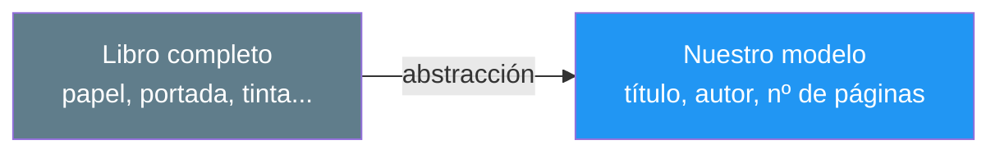

<RealExample app="Netflix">

Al recomendarte, Netflix solo mira lo importante de cada serie —género, duración, tu historial— e ignora detalles como la resolución del tráiler o el idioma del doblaje.

</RealExample>

</div>
</div>

---

## 🔒 Ocultación: cada objeto guarda sus secretos

La **ocultación** significa que no puedes ver ni modificar directamente los datos internos de un objeto: solo accedes a lo que te deja su **interfaz pública**.

<div class="grid grid-cols-2 gap-5 items-start">
<div>

Igual que con un **mando de televisión**: sabes que apretando «encender» la tele se enciende, pero no sabes cómo funciona por dentro. No hace falta: el fabricante oculta el circuito para que solo puedas usarlo bien.

<RealExample app="Banco">

En tu app del banco, al consultar el saldo ves el resultado, pero no los movimientos internos ni la forma en que se calcula: el banco te muestra una interfaz y oculta su mecanismo.

</RealExample>

</div>
<div>

<TipBox type="advertencia">

No confundas **ocultación** con **encapsulamiento**: son conceptos distintos que suelen ir juntos. Al final del punto tienes el matiz del profesor, con una tabla que lo aclara.

</TipBox>

</div>
</div>

---

## 📦 Encapsulamiento: todo junto y controlado por dentro

El **encapsulamiento** junta estado y comportamiento en un único contenedor —la clase—, ocultando el detalle interno y controlando los cambios desde fuera. Si mañana cambia algo por dentro, el resto del programa no se estropea.

<div class="grid grid-cols-2 gap-5 items-start">
<div>

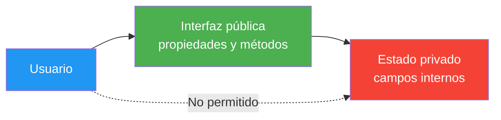

</div>
<div>

Un **coche** decide por sí solo, según sus sensores, cuándo encender el ventilador; tú solo conduces y revisas el panel. Tú usas la interfaz pública, él controla su estado privado.

<TipBox type="consejo">

La receta en C# es siempre la misma: campos **`private`** + propiedades **`public`** que controlan el acceso. Si un campo queda `public` sin control, has perdido la encapsulación.

</TipBox>

</div>
</div>

---

## 🧱 Encapsulamiento en C#: la clase `Coche`

El siguiente ejemplo muestra una clase con estado oculto y una interfaz pública controlada:

<div class="grid grid-cols-2 gap-5 items-start">
<div>

```csharp
public class Coche
{
    // Estado: privado
    private string _marca = string.Empty;
    private int _velocidad;
    // Interfaz pública controlada
    public string Marca
    {
        get => _marca;
        set => _marca = value ?? "Sin marca";
    }
    // Los métodos tocan el estado
    public void Acelerar(int n)
        => _velocidad += n;
    public void Frenar(int d) =>
        _velocidad = Math.Max(0,
            _velocidad - d);
}
```

</div>
<div>

`_marca` y `_velocidad` están `private`: nadie puede poner la velocidad a `-500` desde fuera, porque el único camino para tocarla es pasar por `Acelerar` y `Frenar`, que ya validan lo que hacen.

<RealExample app="Cajero">

Un cajero encapsula el dinero: tú solo pulsas «sacar dinero» e introduces el PIN; el mecanismo que cuenta los billetes y descuenta de tu cuenta está oculto y solo el banco lo toca.

</RealExample>

</div>
</div>

---

## 🧬 Herencia: reutilizar lo que ya existe

La **herencia** crea clases que reutilizan características y comportamientos de otras más generales: "todos los perros son animales", pero además pueden ladrar. En C# se expresa con los dos puntos (`:`).

<div class="grid grid-cols-2 gap-5 items-start">
<div>

```csharp
// CocheDeportivo ES UN Coche
public class CocheDeportivo : Coche
{
    public bool TurboActivado { get; private set; }
    public void ActivarTurbo()
    {
        TurboActivado = true;
        Acelerar(50); // reutiliza el heredado
    }
}
```

`CocheDeportivo` no reescribe `Acelerar`: lo hereda; si lo corriges en `Coche`, todos sus hijos se corrigen a la vez.

</div>
<div>

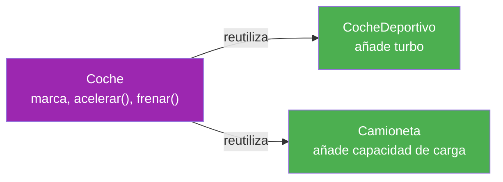

</div>
</div>

---

## ⚠️ ES UN o TIENE UN: no confundas la herencia

<div class="grid grid-cols-2 gap-5 items-start">
<div>

<TipBox type="advertencia">

Usa herencia solo con relaciones reales de "**ES UN**": `CocheDeportivo` es un `Coche`. Si la relación es "TIENE UN" —un coche *tiene* un motor—, lo correcto es la **composición** (punto 9).

</TipBox>

<TipBox type="nota">

Heredar "por si acaso" produce jerarquías imposibles de mantener: cada clase hija arrastra todo lo del padre, aunque no lo necesite.

</TipBox>

</div>
<div>

<RealExample app="Glovo">

Un "pedido express" es un pedido normal al que le añades repartidor prioritario y plazo reducido. En vez de crear un sistema de pedidos desde cero, hereda todo lo que ya hace un pedido y solo añade lo que lo diferencia.

</RealExample>

</div>
</div>

---

## 🎭 Polimorfismo: un mismo mensaje, respuestas distintas

El **polimorfismo** da flexibilidad: diferentes objetos responden a la misma orden de maneras distintas. Si le pides «encender» a tu teléfono y a tu televisor, ambos entienden la petición, pero cada uno la ejecuta a su manera.

<div class="grid grid-cols-2 gap-5 items-start">
<div>

```csharp
// En la clase Coche:
public virtual string Descripcion()
    => $"Coche {_marca}";

// En CocheDeportivo:
public override string Descripcion()
    => base.Descripcion() + " con turbo";

// Mismo mensaje, respuesta
// según el objeto real
Coche a = new Coche();
Coche b = new CocheDeportivo();
Console.WriteLine(a.Descripcion());
// Coche ...
Console.WriteLine(b.Descripcion());
// Coche ... con turbo
```

</div>
<div>

<RealExample app="PayPal">

Las formas de pago de una tienda llaman al mismo `Pagar(importe)`, pero con tarjeta, PayPal o Bizum cada uno ejecuta su propio código. La caja no sabe ni tiene que saber cómo paga cada cliente.

</RealExample>

<TipBox type="consejo">

Si escribes `if (x is Coche)` o un `switch` decidiendo por tipos, casi siempre estás a punto de sustituirlo por polimorfismo: es la señal de `virtual`/`override`.

</TipBox>

</div>
</div>

---

## 🧩 Modularidad: dividir para gobernar

La **modularidad** divide el programa en partes independientes y reutilizables llamadas **módulos**. Cada módulo encapsula una funcionalidad y se comunica con los demás a través de interfaces bien definidas.

<div class="grid grid-cols-2 gap-5 items-start">
<div>

Los objetos, al encapsular estado y comportamiento, son módulos naturales: si el módulo de **pagos** falla, puedes arreglarlo sin tocar el de **pedidos**, porque cada uno vive en su sitio.

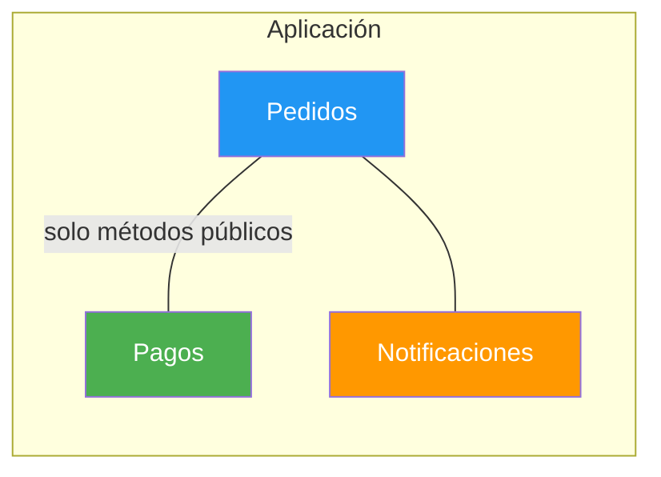

</div>
<div>

<RealExample app="Glovo">

Glovo está dividido en módulos: pedidos, restaurantes, repartidores, pagos y notificaciones. Cada equipo trabaja en su módulo sin pisar el de los demás; si se cae pagos, los pedidos siguen visualizándose.

</RealExample>

<TipBox type="analogia">

Es un edificio con habitaciones: si se estropea la cocina, sigues durmiendo en tu dormitorio. Cada módulo tiene su puerta y solo se entra por ella.

</TipBox>

</div>
</div>

---

## 🧹 El recolector de basura: la memoria se gestiona sola

El **recolector de basura** (garbage collector o GC) libera automáticamente la memoria de los objetos a los que ya nadie referencia, evitando fugas y optimizando el rendimiento.

<div class="grid grid-cols-2 gap-5 items-start">
<div>

Funciona por **referencias**: mientras algo apunte al objeto, sigue vivo. Cuando desaparece la última referencia, el GC reclama su memoria y la deja libre.


</div>
<div>

<RealExample app="Mensajería">

Una mensajería tiene miles de objetos `Mensaje`; al cerrar el chat y no quedar referencias, el GC los recoge sin que tú hagas nada.

</RealExample>

<TipBox type="nota">

En C# no hay `free()` ni `delete`: la memoria la gestiona el GC. C# **sí tiene destructores** (finalizadores `~Clase()`), pero **apenas se usan**: solo para recursos no administrados; no acumules referencias inútiles. Verás el heap y el stack en el **punto 2**.

</TipBox>

</div>
</div>

---

## 🎓 Encapsulamiento u ocultación: el matiz del profesor

Es muy común confundir estos dos conceptos, y en el examen se nota. Aquí tienes la distinción definitiva:

| Concepto | Qué hace | Ejemplo en C# |
|----------|----------|---------------|
| **Encapsulamiento** | Agrupa estado y comportamiento en una misma unidad (la clase) | Una clase que reúne sus campos y sus métodos |
| **Ocultación** | Decide qué partes de esa cápsula se ven desde fuera y cuáles no | `private` para ocultar, `public` para exponer |

<div class="grid grid-cols-2 gap-5 items-start mt-4">
<div>

<RealExample app="Streaming">

Una app de streaming encapsula el reproductor de vídeo —todos sus datos y métodos van juntos en una clase— y lo oculta tras unos botones: tú solo ves play, pausa y barra de progreso.

</RealExample>

</div>
<div>

<TipBox type="truco">

Los cuatro pilares se memorizan con las iniciales **AEHP**: **A**bstracción, **E**ncapsulamiento, **H**erencia, **P**olimorfismo. Y la respuesta corta del examen: el encapsulamiento **reúne**, la ocultación **protege**.

</TipBox>

</div>
</div>

---

## Resumen del punto 1

<div class="grid grid-cols-2 gap-5 items-start">
<div>

| Concepto | Descripción |
|----------|-------------|
| **Objeto** | Estado, comportamiento e identidad |
| **Abstracción** | Modelar solo lo importante |
| **Ocultación** | Solo se ve la interfaz pública |
| **Encapsulamiento** | Datos y métodos en una clase |
| **Herencia** | Reutilizar lo de la clase base (`:`) |
| **Polimorfismo** | Un mismo mensaje, respuestas distintas |
| **Modularidad** | El programa, en módulos independientes |
| **Recolector de basura** | Libera la memoria sin referencias |

</div>
<div>

<ConceptCard icon="✅" title="Buenas prácticas" accent="green">

- Modelar solo lo importante antes de codificar
- Exponer el estado con propiedades públicas, nunca campos sueltos
- Usar herencia solo con relaciones reales de "ES UN"
- Sustituir los `if` por tipos con polimorfismo

</ConceptCard>

<div class="mt-3">

**⏭️ ¿Qué viene después?** En el **punto 2** veremos objetos y clases en C#: cómo se definen, cómo se crean con `new` y cómo se usan en un programa.

</div>

</div>
</div>

---
layout: section
---

<div class="ud-section-number">02</div>

# Objetos y clases

<div class="opacity-70">Identidad, estado y comportamiento</div>

---

## 2 · Punto de partida

<div class="grid grid-cols-2 gap-5 items-start">
<div>

<TipBox type="consejo" title="Punto de partida">

Cuando pides una hamburguesa en una app de comida, en pantalla aparece "tu pedido": restaurante, productos, precio, estado (preparando, en camino...). Ese pedido no es un texto suelto: es un **objeto** con datos y con cosas que puede hacer. En este punto verás de qué se hace uno y cómo se fabrica en C#.

</TipBox>

</div>
<div>

<Objetivos
  :items="[
    'Diferenciar identidad, estado, comportamiento e interfaz pública de un objeto',
    'Distinguir la clase (el molde) de sus instancias (los objetos fabricados)',
    'Crear objetos con new y seguir la referencia que devuelve',
    'Situar las variables en el stack y los objetos en el heap, y saber qué es null',
  ]"
/>

</div>
</div>

---

## 🪪 Identidad, estado y comportamiento

Un **objeto** es una representación digital de algo del mundo real o de una idea: un "actor" dentro de tu programa, con personalidad, datos y capacidades.

<div class="grid grid-cols-2 gap-5 items-start">
<div>


</div>
<div>

- **Identidad:** lo que hace único al objeto, aunque tenga la misma información que otro —dos carnés iguales siguen siendo dos tarjetas distintas—. En C#, es su **referencia** en memoria.
- **Estado:** los datos que guarda ahora mismo: un alumno (nombre, nota, curso), un semáforo (su color actual).
- **Comportamiento:** las acciones que puede ejecutar —una puerta abre, un reloj pone la alarma—. En C#, son sus **métodos**.

</div>
</div>

---

## 🚪 La interfaz pública: el panel de mandos

La **interfaz pública** es el conjunto de métodos y propiedades que otros objetos pueden usar para interactuar con él: el "panel de mandos" que el objeto decide mostrar al exterior. El resto de sus miembros queda oculto (el encapsulamiento del punto anterior).

<div class="grid grid-cols-2 gap-5 items-start">
<div>

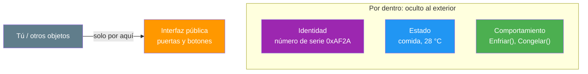

</div>
<div>

<TipBox type="analogia">

Un objeto es una **nevera**: el estado es lo que guarda —comida, temperatura—, el comportamiento lo que hace —enfriar, congelar—, la identidad su número de serie, y la interfaz pública las puertas y botones que tú usas. Por dentro no ves el compresor: está oculto.

</TipBox>

</div>
</div>

---

## 🔢 Objetos y tipos simples: en qué se diferencian

Antes de crear tus propios objetos, observa que tipos como los números (`int`, `double`) y las cadenas (`char`, `string`) ya existen desde siempre en los lenguajes:

<div class="grid grid-cols-2 gap-5 items-start">
<div>

- Un número como `42` es un valor suelto: no hay identidad que rastrear, solo estado.
- Una cadena como `"Hola"` puedes consultar su longitud o unirla con otras, pero no tiene "personalidad" propia.

El objeto va más allá: tú defines cómo es, qué puede hacer y cómo debe comportarse.

</div>
<div>

<RealExample app="Biblioteca">

Si tienes varios libros, cada uno tendrá título, autor y número de páginas. Pero si programas una biblioteca, representarás cada libro como objeto para gestionarlo o prestarlo: ahí necesitas identidad, porque cada ejemplar es único.

</RealExample>

<TipBox type="nota">

En C#, los tipos simples también son objetos por debajo —por eso funciona `"hola".ToUpper()`—, pero se usan como valores: se copian, no se comparten. Lo verás con detalle en el **punto 5**.

</TipBox>

</div>
</div>

---

## 🍪 La clase: el molde de los objetos

En C#, **la clase** es la herramienta que define cómo deben ser tus objetos: qué información guardan y qué acciones pueden realizar. Es como el molde de una galleta: define la forma; luego fabricas galletas distintas, todas basadas en ese molde.

<div class="grid grid-cols-2 gap-5 items-start">
<div>

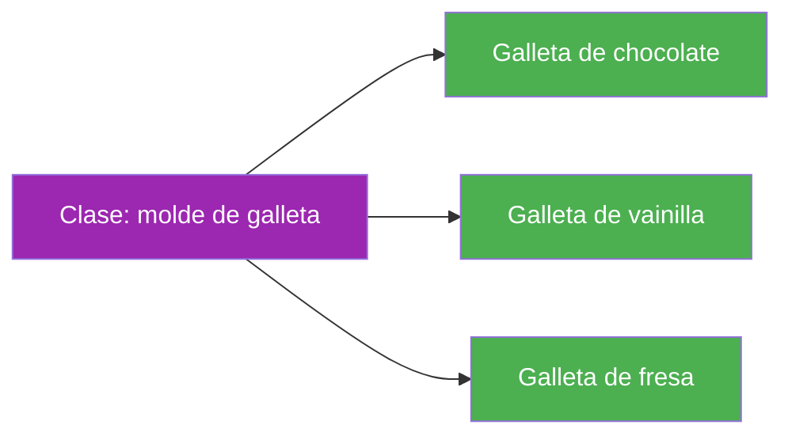

</div>
<div>

A cada objeto creado desde la clase se le llama **instancia**. **Tipificar** —dar a cada objeto su propio "tipo"— evita que mezcles usos: si la clase es `Coche`, solo tratarás como coche lo creado como `Coche`.

<TipBox type="consejo">

La clase es el **plano**, el objeto es la **casa** y la instancia es **cada casa concreta**.

</TipBox>

</div>
</div>

---

## 🆕 `new`: crear objetos y obtener su referencia

Cuando quieres utilizar un objeto en C#, lo creas a partir de su clase con la palabra clave `new`. Esto hace **tres cosas importantes**:

<div class="grid grid-cols-2 gap-5 items-start">
<div>

1. **Reserva memoria** para almacenar la información del objeto.
2. **Inicializa su estado inicial**, según lo que hayas definido en la clase.
3. **Devuelve una referencia**: la "dirección" en memoria por la que localizarás ese objeto para usarlo en el futuro.

</div>
<div>

<TipBox type="advertencia">

La clase **no es el objeto**: es solo el plano, guardado en los metadatos. Declarar `Gato g;` no crea nada detrás; si usas la referencia sin crear el objeto, el compilador te avisa, y si acaba en `null`, el primer acceso falla con `NullReferenceException`.

</TipBox>

<TipBox type="nota">

`new` no es novedad de la POO: lo llevas usando desde la **UD03** con los arrays (`new int[5]`). Misma idea —reservar espacio en memoria—; con una clase, además se ejecuta su constructor.

</TipBox>

</div>
</div>

---

## 🔬 Dos gatos "Luna": identidad con código

El siguiente programa crea dos objetos con el **mismo estado** y comprueba que, aun así, son objetos distintos:

<div class="grid grid-cols-2 gap-5 items-start">
<div>

```csharp
public class Gato
{
    public string Nombre { get; set; }
    public Gato(string nombre) => Nombre = nombre;
}

// Dos objetos con el MISMO estado
var gato1 = new Gato("Luna");
var gato2 = new Gato("Luna");

Console.WriteLine(gato1 == gato2);      // false
Console.WriteLine(gato1.Equals(gato2)); // false

// gato3: otro nombre para el MISMO objeto
var gato3 = gato1;
Console.WriteLine(gato1 == gato3);      // true
```

</div>
<div>

`gato1` y `gato2` tienen el mismo estado (`"Luna"`) pero son objetos distintos; `gato3` no es un objeto nuevo: es **otro nombre para el mismo objeto** que `gato1`. Cambiar `gato1.Nombre` cambiaría el que ve `gato3`.

<RealExample app="Instagram">

Cuando Instagram te avisa "tu foto tiene 3 likes", actualiza el estado de un único objeto `Foto` al que apuntan muchas referencias: tu móvil, el de tus amigos, los servidores. Todos ven el mismo objeto, no copias sueltas.

</RealExample>

</div>
</div>

---

## 📬 La referencia: la dirección de la casa

Aunque crees dos objetos iguales (mismo estado), cada uno tendrá una referencia diferente y serán instancias distintas, con identidad propia:

<div class="grid grid-cols-2 gap-5 items-start">
<div>

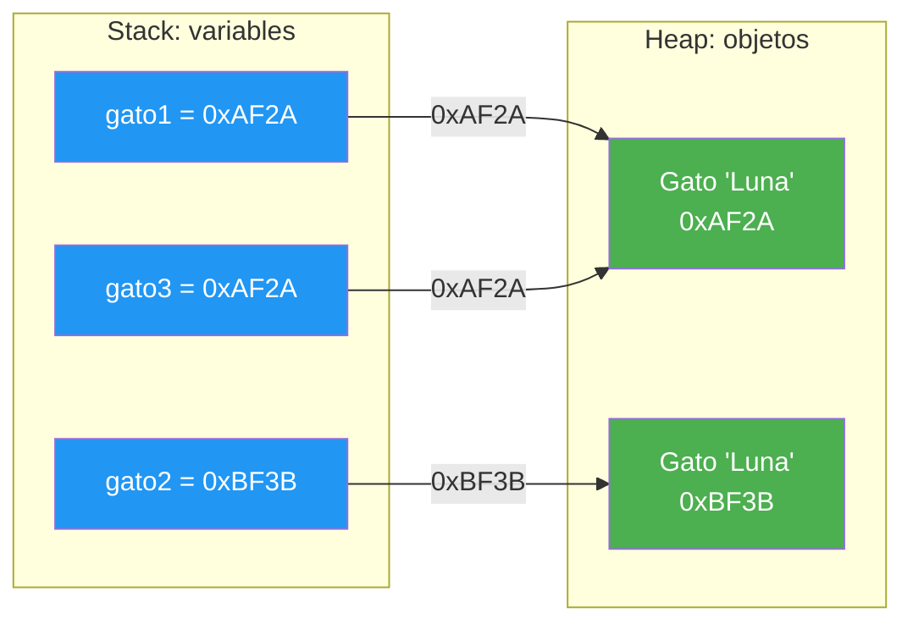

</div>
<div>

`gato1` y `gato3` comparten dirección: son el mismo objeto con dos nombres. `gato2` vive en otra dirección: es otra instancia.

<TipBox type="analogia">

Un objeto es una **casa** y la referencia, su **dirección**. Al escribir `Gato gato1 = new Gato()`, estás construyendo la casa, obteniendo la dirección (`0xAF2A`) y guardándola en tu agenda: la variable `gato1`.

</TipBox>

</div>
</div>

---

## 🏭 Objetos a partir de clases predefinidas

No todas las clases las escribes tú: la biblioteca de clases de .NET (BCL) trae cientos listas para usar, y **se usan exactamente igual** que una clase que hayas definido tú.

<div class="grid grid-cols-2 gap-5 items-start">
<div>

```csharp
// Clases predefinidas de .NET: igual que las tuyas
var azar = new Random();
Console.WriteLine(azar.Next(1, 7)); // un dado: 1..6

var datos = new List<int> { 10, 20, 30 };
Console.WriteLine(datos.Count);     // 3

var texto = "  Hola Mundo  "; // string es una clase
Console.WriteLine(texto.Trim().ToUpper());

var hoy = DateTime.Now;
Console.WriteLine($"{hoy:dd/MM/yyyy} {hoy:HH:mm}");
```

</div>
<div>

El patrón es siempre el mismo: **`new` → punto → método o propiedad**, igual para tus clases que para las de fábrica. Y **no reinventes lo que la BCL ya trae**: para fechas, azar o texto largo, busca antes la clase de fábrica.

<RealExample app="Videojuegos">

Un videojuego usa `new Random()` para decidir qué cae del cielo; una mensajería, `new StringBuilder()` para concatenar mensajes.

</RealExample>

</div>
</div>

---

## 📚 Stack y heap: dónde vive cada objeto

Cuando escribes `Gato miGato = new Gato();` ocurren dos cosas, cada una en su zona de memoria:

<div class="grid grid-cols-2 gap-5 items-start">
<div>

- **Stack (pila):** memoria rápida pero pequeña. Guarda el nombre de la variable (`miGato`) y su **referencia**: la dirección del objeto.
- **Heap (montículo):** memoria grande donde viven los **objetos reales**. Allí es donde `new` reserva el espacio para los datos del gato.

</div>
<div>

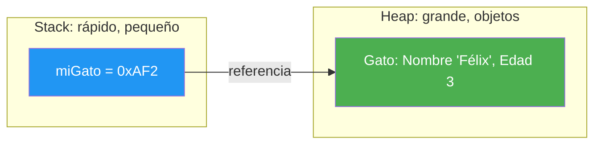

</div>
</div>

---

## 💤 `null`: la referencia que apunta a nada

Si la variable del stack no tiene ninguna dirección —apunta a nada—, su valor es **`null`**. Si intentas usarla así, el programa falla porque no sabe a qué dirección del heap ir a buscar los datos.

<div class="grid grid-cols-2 gap-5 items-start">
<div>

<TipBox type="truco">

En el examen, cuando veas `new Clase()`: "se crea un objeto en el heap y se devuelve su referencia". Cuando veas `Clase objeto;` sin `new`: "solo existe una variable en el stack que apunta a `null`".

</TipBox>

</div>
<div>

<RealExample app="Mensajería">

Cuando una mensajería se queda sin cobertura y no puede cargar el chat, muestra "sin mensajes" en vez de romperse: está comprobando referencias `null` antes de usarlas.

</RealExample>

<TipBox type="nota">

Eso es lo que aprenderemos a gestionar como **seguridad ante nulos**: comprobar la referencia antes de usarla.

</TipBox>

</div>
</div>

---

## Resumen del punto 2

<div class="grid grid-cols-2 gap-5 items-start">
<div>

| Concepto | Descripción |
|----------|-------------|
| **Objeto** | Identidad, estado y comportamiento |
| **Interfaz pública** | Lo que el objeto deja ver desde fuera |
| **Clase** | El molde que define sus objetos |
| **Instancia** | Objeto concreto fabricado desde la clase |
| **`new`** | Reserva memoria y devuelve una referencia |
| **Referencia** | Dirección del objeto; `null` si apunta a nada |
| **Clases predefinidas** | Objetos de .NET: se usan igual que los tuyos |
| **Stack vs. heap** | Variables en el stack; objetos en el heap |

</div>
<div>

<ConceptCard icon="✅" title="Buenas prácticas" accent="green">

- Definir la clase (el molde) antes que las instancias
- `new` devuelve una referencia: dos iguales no son el mismo objeto
- No reinventar lo que la BCL ya trae (`Random`, `DateTime`, `List<T>`)
- Comprobar las referencias contra `null` antes de usarlas

</ConceptCard>

<div class="mt-3">

**⏭️ ¿Qué viene después?** En el **punto 3** veremos cómo se organiza un proyecto en C#: espacios de nombres, soluciones, proyectos y ensamblados, y cómo crear y compilar uno.

</div>

</div>
</div>

---
layout: section
---

<div class="ud-section-number">03</div>

# Espacios de nombres y organización del proyecto

<div class="opacity-70">Namespaces, proyectos y paquetes</div>

---

## 3 · Punto de partida

<div class="grid grid-cols-2 gap-5 items-start">
<div>

<TipBox type="consejo" title="Punto de partida">

En casa reparto la ropa en cajones y arcones: cada pieza tiene su sitio y nunca la busco debajo de la cama. En un programa pasa igual: si metes todas las clases en un único fichero sin orden, llega un momento en que no sabes dónde está nada.

</TipBox>

</div>
<div>

<Objetivos
  :items="[
    'Definir espacios de nombres con la forma file-scoped y usar using y alias',
    'Distinguir solución, proyecto y ensamblado, y saber qué archivo es cada uno',
    'Crear un proyecto con la CLI (dotnet new) y en Rider, y compilarlo y ejecutarlo',
    'Incorporar una librería de objetos con NuGet y usar sus tipos en tu código',
  ]"
/>

</div>
</div>

---

## 📁 Namespace: la carpeta virtual de tus clases

Un **namespace** (espacio de nombres) es una carpeta virtual que agrupa tipos relacionados: clases, structs, interfaces… Te permite organizar el código y evitar que dos clases con el mismo nombre se mezclen.

<div class="grid grid-cols-2 gap-5 items-start">
<div>

```csharp
namespace MiAplicacion.Modelos
{
    public class Persona
    {
        public string Nombre { get; set; } = string.Empty;
    }
}
```

</div>
<div>

<RealExample app="Banca digital">

Es como tener los documentos de "Matemáticas" y "Historia" en carpetas distintas: ambos pueden llamarse "Examen.docx" sin entrar en conflicto. En una app de banco, `Banco.Core.Cuenta` y `Banco.Pruebas.Cuenta` conviven sin pisarse.

</RealExample>

<TipBox type="advertencia">

El namespace **no** tiene por qué coincidir con la carpeta física del fichero, aunque es costumbre que sí coincida para encontrar las clases al navegar por el proyecto.

</TipBox>

</div>
</div>

---

## ✨ File-scoped namespace: la forma moderna

Desde C# 10 existe una forma más concisa: el namespace a nivel de archivo. Se escribe una sola línea con punto y coma y **todo el archivo queda dentro**, sin llaves que abrir ni cerrar:

```csharp
namespace MiAplicacion.Modelos;

public class Producto
{
    public string Nombre { get; set; } = string.Empty;
}
```

<TipBox type="consejo">

En esta unidad usaremos siempre la forma *file-scoped* (`namespace X;`), porque es la que pide la norma del proyecto. Si abres un fichero y ves `namespace X;` sin llaves, no es un error: es la sintaxis moderna.

</TipBox>

---

## 🔀 Using y alias: importar sin repetir nombres

La instrucción **`using`** importa otros espacios de nombres al archivo, para usar sus clases sin escribir el nombre completo cada vez. Con un **alias** creas un nombre corto para un tipo o un namespace, y con **`using static`** importas los miembros estáticos de una clase:

<div class="grid grid-cols-2 gap-5 items-start">
<div>

```csharp
using MiAplicacion.Modelos;

// Ahora puedes escribir simplemente:
Persona p = new Persona();
```

</div>
<div>

```csharp
using M = MiAplicacion.Modelos;
using B = MiAplicacion.Biblioteca;

// Ahora puedes distinguirlas por el alias:
M.Persona a = new M.Persona();
B.Persona b = new B.Persona();

using static System.Math;
double resultado = Sqrt(25); // igual que Math.Sqrt(25)
```

</div>
</div>

<TipBox type="truco">

Si dudas de dónde sale una clase, mira los `using` del archivo: si falta, el error es "no se encontró el tipo o el espacio de nombres".

</TipBox>

---

## 🗺️ Dos `Persona` que no se pisan

Cada `Persona` vive en su namespace y el alias es su nombre corto: así dos clases con el mismo nombre conviven sin conflicto.

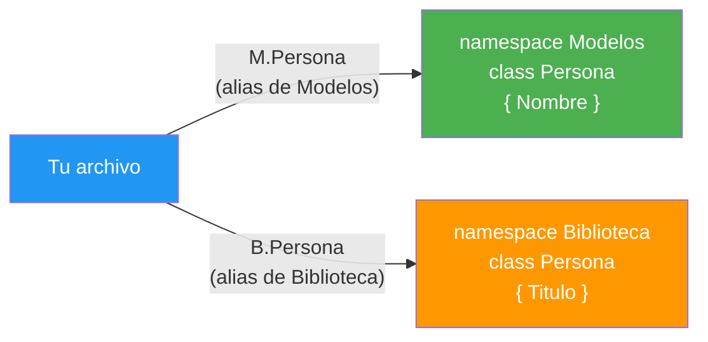

---

## 🧱 Solución y proyecto: el contenedor

El mapa de carpetas de cualquier proyecto .NET tiene tres niveles; los dos primeros son el **contenedor** donde escribes el código:

<div class="grid grid-cols-2 gap-5 items-start">
<div>

| Nivel | Fichero | Qué es |
| :--- | :--- | :--- |
| **Solución** | `.slnx` | Agrupa uno o más proyectos relacionados |
| **Proyecto** | `.csproj` | Una unidad con sus dependencias y su configuración |

</div>
<div>

<TipBox type="analogia">

Piensa en una **fábrica de muebles**: la solución es el polígono industrial completo y cada proyecto es una nave con su máquina.

</TipBox>

<TipBox type="nota">

En .NET 10 el formato por defecto es el `.slnx` (XML); si encuentras un `.sln` antiguo, lo migras con `dotnet sln migrate`.

</TipBox>

</div>
</div>

---

## 📦 Del proyecto al ensamblado

Al compilar, cada proyecto genera su **ensamblado**: la caja final que sale por la puerta. Dentro viven sus namespaces y sus clases:

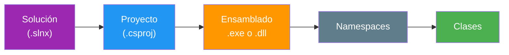

<TipBox type="nota">

El ensamblado lleva el código compilado, los **metadatos** y los recursos. Si el proyecto tiene errores de compilación, **no llega a generarse**.

</TipBox>

---

## ↔️ La relación práctica

- Una **solución** puede tener varios proyectos.
- Cada **proyecto** genera su propio ensamblado y puede tener diferentes namespaces.
- Un **ensamblado** es el resultado de compilar un proyecto.
- Los **namespaces** organizan los tipos dentro de los proyectos y pueden coincidir o no con la estructura de carpetas reales.

En el explorador de Rider verás exactamente este mapa: la solución agrupa los proyectos, cada proyecto genera su ensamblado en `bin/` y, dentro, tus clases viven en sus namespaces.

<RealExample app="TiendaDawApi-NetCore">

En la Tienda hay una solución con varios proyectos: la API, la librería de dominio y los tests. Cada uno compila a su propio `.dll` y se comunican entre sí por referencias y namespaces.

</RealExample>

---

## 🖥️ Crear y compilar con la CLI

Para crear un programa simple no hace falta más que dos cosas: crear el proyecto y compilarlo. Desde cualquier carpeta, la consola crea un proyecto de consola llamado `MiPrimerPrograma`:

<div class="grid grid-cols-2 gap-5 items-start">
<div>

```bash
# Crear un proyecto de consola en una carpeta nueva
dotnet new console -n MiPrimerPrograma

# Entrar en la carpeta del proyecto
cd MiPrimerPrograma

# Compilar (genera el ensamblado en bin/)
dotnet build

# Compilar y ejecutar en un solo paso
dotnet run

# Crear una solución e incorporar el proyecto
dotnet new sln -n MiSolucion
dotnet sln add MiPrimerPrograma/MiPrimerPrograma.csproj
```

</div>
<div>

`dotnet new console` genera el `.csproj` y el `Program.cs` con *Top-Level Statements*, listos para escribir. `dotnet build` comprueba el código y, si no hay errores, crea el ensamblado en `bin/`; `dotnet run` compila (si hace falta) y lo ejecuta.

<RealExample app="Integración continua">

Todo el material de esta asignatura se puede crear y compilar así sin abrir ningún IDE: es exactamente lo que hace un *pipeline* de integración continua en una empresa antes de aprobar una versión.

</RealExample>

</div>
</div>

---

## 🏍️ Crear y compilar en Rider

En Rider el flujo es el mismo, pero con botones:

1. **File → New Solution** (o `Ctrl+Alt+Shift+N`) y eliges **Console Application**.
2. Rider genera la solución, el `.csproj` y el `Program.cs`.
3. Escribe tu código en el editor.
4. Pulsas **Run** (o `Shift+F10`) para compilar y ejecutar; **Build Solution** (`Ctrl+F9`) sin ejecutar.

Da igual dónde lo hagas: el IDE usa exactamente los mismos comandos (`dotnet new`, `dotnet build`, `dotnet run`) que en la CLI. Por eso en el ámbito profesional se prefiere la CLI: funciona en cualquier ordenador sin instalar un IDE.

<TipBox type="consejo">

Si Rider no te compila, mira la pestaña **Errors**: el 90 % de los errores de principiante son de sintaxis. Compilar a menudo te ahorra horas: cuanto antes salte el error, más fácil es encontrarlo.

</TipBox>

---

## 📦 NuGet: el gestor de paquetes

Casi nada se escribe de cero: los programas reales se construyen **encima de librerías** externas que se incorporan como **paquetes**. **NuGet** es el gestor de paquetes de .NET:

<div class="grid grid-cols-2 gap-5 items-start">
<div>

```bash
# Añadir una librería al proyecto actual
dotnet add package Spectre.Console

# Ver los paquetes instalados y sus versiones
dotnet list package

# Restaurar paquetes (normalmente lo hace build)
dotnet restore
```

</div>
<div>

Al instalar, .NET escribe la referencia en el `.csproj`: esa línea **es la instalación hecha y versionada**; quien clone el proyecto la restaura solo.

```xml
<ItemGroup>
  <PackageReference Include="Spectre.Console"
                     Version="0.53.0"/>
</ItemGroup>
```

<TipBox type="advertencia">

`dotnet add package` se ejecuta **dentro de la carpeta del proyecto**: si lo lanzas donde no toca, el paquete no se añade a ningún sitio.

</TipBox>

</div>
</div>

---

## 📦 El recorrido de un paquete

El paquete recorre siempre el mismo camino, desde el comando hasta tu código:

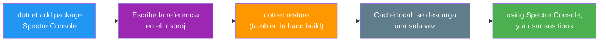

<RealExample app="Rider y entornos profesionales">

Rider tiene un panel gráfico de NuGet para instalar con un clic (click derecho en el proyecto → Manage NuGet Packages), pero en el ámbito profesional se prefiere la CLI: queda en los *scripts*, en la documentación y en los pipelines de integración continua sin depender de un IDE.

</RealExample>

---

## 📖 Usar una librería en tu código

Instalar el paquete solo te da los tipos: para usarlos, importa su espacio de nombres con `using` y trátalos como cualquier otra clase. Este programa usa `Spectre.Console` junto con clases de la BCL:

<div class="grid grid-cols-2 gap-5 items-start">
<div>

```csharp
using Spectre.Console;   // librería externa (paquete NuGet)

// Texto con color usando etiquetas [color]...[/]
AnsiConsole.MarkupLine("[green]Aprobados:[/] 4 de 5");

// Una tabla con bordes y cabeceras
var tabla = new Table()
    .Border(TableBorder.Rounded)
    .AddColumn(new TableColumn("Alumno").Centered())
    .AddColumn(new TableColumn("Nota").Centered());

tabla.AddRow("Lucía", "7,5");
tabla.AddRow("Marcos", "4,0");
AnsiConsole.Write(tabla);
```

</div>
<div>

El patrón es **idéntico** al de cualquier clase: `new Table()` crea un objeto, `.AddColumn(...)` llama a sus métodos y `AnsiConsole` agrupa operaciones estáticas. Da igual que la clase la hayas escrito tú o que venga de una librería: la usas igual.

<TipBox type="consejo">

Antes de escribir una utilidad a mano, pregunta: "¿hay un paquete para esto?". Buscar y reutilizar librerías es señal de un profesional, no de pereza.

</TipBox>

</div>
</div>

---

## ⚠️ Errores comunes al instalar paquetes

Los errores habituales al instalar paquetes son siempre los mismos cuatro:

| Error | Por qué ocurre | Cómo evitarlo |
| :--- | :--- | :--- |
| **`NU1101: no se encuentra el paquete`** | Error en el nombre o falta el *restore* | Revisa el nombre y ejecuta `dotnet restore` |
| **Versión incompatible con el framework** | El paquete no soporta `net10.0` | Comprueba la versión con `dotnet list package` |
| **Olvidar el `using`** | El paquete está instalado pero no se importa | Añade `using Spectre.Console;` (o el que corresponda) |
| **Comando en la carpeta equivocada** | Se lanzó fuera de la carpeta del `.csproj` | Entra en la carpeta del proyecto antes de `dotnet add package` |

---

## Resumen del punto 3

<div class="grid grid-cols-2 gap-5 items-start">
<div>

| Concepto | Descripción |
|----------|-------------|
| **Namespace** | Carpeta virtual que agrupa clases y evita conflictos |
| **File-scoped namespace** | Forma moderna (C# 10+): `namespace X;` sin llaves |
| **`using`** | Importa un namespace; `using static`, miembros estáticos |
| **Solución (.slnx)** | Contenedor de proyectos; XML por defecto en .NET 10 |
| **Proyecto (.csproj)** | Unidad que se compila a un ensamblado |
| **Ensamblado** | Resultado de compilar: `.exe` ejecutable o `.dll` |
| **NuGet** | Gestor de paquetes; `dotnet add package` al `.csproj` |

</div>
<div>

<ConceptCard icon="✅" title="Buenas prácticas" accent="green">

- Namespace que refleje la lógica del proyecto (`MiEmpresa.MiApp.Servicios`)
- Usar siempre la forma *file-scoped* (`namespace X;`)
- Compilar a menudo (`dotnet build` o `Ctrl+F9`) para cazar errores pronto
- Instalar paquetes por CLI desde la carpeta del `.csproj` y fijar su versión

</ConceptCard>

<div class="mt-3">

**⏭️ ¿Qué viene después?** En el **punto 4** veremos cómo se define una clase en C#: sus miembros, atributos, visibilidad y modificadores de acceso.

</div>

</div>
</div>

---
layout: section
---

<div class="ud-section-number">04</div>

# Clases: definición, atributos, visibilidad y modificadores

<div class="opacity-70">Propiedades, métodos y visibilidad</div>

---

## 4 · Punto de partida

<div class="grid grid-cols-2 gap-5 items-start">
<div>

<TipBox type="consejo" title="Punto de partida">

Si abres la capucha de una **máquina de café**, verás cables, bombas y sensores que no quieres tocar; tú solo usas la pantalla y el botón. Una **clase** funciona igual: por dentro guarda sus datos y su lógica, y por fuera solo deja ver un panel de mandos.

</TipBox>

</div>
<div>

<Objetivos
  :items="[
    'Definir una clase con sus atributos y métodos siguiendo la nomenclatura PascalCase',
    'Usar parámetros en la llamada a métodos: por valor, ref, out y argumentos con nombre',
    'Explicar por qué se usan propiedades en lugar de campos públicos',
    'Aplicar los modificadores de acceso y distinguir sealed, const, readonly y required',
    'Usar is y as, y reconocer los tipos por referencia, los nulos y su representación en UML',
  ]"
/>

</div>
</div>

---

## 🧱 Sintaxis básica de una clase

La estructura mínima de una clase es la palabra clave `class`, su nombre en **PascalCase** y un bloque de llaves `{}` con sus miembros. Aquí `Nombre` y `Edad` son el **estado** y `Maullar()` es el **comportamiento**: con `new Gato()` fabricas un objeto concreto a partir de ese molde.

<div class="grid grid-cols-2 gap-5 items-start">
<div>

```csharp
public class Gato
{
    // Atributos (estado)
    public string Nombre;
    public int Edad;

    // Método (comportamiento)
    public void Maullar()
    {
        Console.WriteLine($"{Nombre} está maullando.");
    }
}
```

</div>
<div>

Al escribir `class Gato` no solo defines el molde: creas un **tipo nuevo** para el compilador, que solo dejará guardar un `Gato` donde toca. Dos clases distintas son **dos tipos distintos** aunque tengan los mismos campos: eso es tipificar tus objetos.

<RealExample app="Mensajería">

Cualquier app de mensajería modela un `Mensaje` como clase: su estado es el texto, el remitente y la hora; su comportamiento es enviarse o archivarse; y su visibilidad decide que nadie desde fuera pueda borrar el texto sin pasar por las reglas de la clase.

</RealExample>

</div>
</div>

---

## 🖼️ La clase, el molde de los objetos

Todo lo que definas dentro de la clase vale para todos los objetos que fabriques con `new`: ese es el molde. Por eso una clase puede tener tanto atributos como métodos, y también otros miembros (propiedades, eventos, constructores) que iremos añadiendo punto a punto.

<div class="grid grid-cols-2 gap-5 items-start">
<div>


</div>
<div>

📌 **Ejemplo real:** en una app de reparto, el objeto `Pedido` se define una sola vez como clase, pero la tienda tiene cientos de `Pedido` distintos: todos comparten el mismo molde —texto, hora, estado— y cada uno guarda sus propios datos.

</div>
</div>

---

## 🎯 El estado vive en propiedades

Las **propiedades** son las que guardan los datos del objeto: permiten leer y modificar el estado de forma segura, y por eso se usan **preferiblemente en lugar de los campos públicos**. Si mañana necesitas validar o proteger el dato, no tienes que cambiar el resto del programa.

<div class="grid grid-cols-2 gap-5 items-start">
<div>

```csharp
public class Pelota
{
    public string Color { get; set; } = string.Empty;
}
```

</div>
<div>

<TipBox type="advertencia">

Un campo `public string Color;` "funciona" igual, pero deja que cualquiera le ponga cualquier cosa (`Color = null` o `Color = "7"`). La propiedad es el paso previo para controlar eso, como verás en el punto 7.

</TipBox>

</div>
</div>

---

## 🏃 El comportamiento vive en métodos

Los **métodos** de la clase representan acciones o respuestas: son lo que el objeto *hace*. Se escriben en PascalCase, igual que el nombre de la clase.

<div class="grid grid-cols-2 gap-5 items-start">
<div>

```csharp
public class Pelota
{
    public string Color { get; set; } = string.Empty;

    public void Botar()
    {
        Console.WriteLine("¡La pelota ha botado!");
    }
}
```

</div>
<div>

<RealExample app="App de reparto">

El objeto `Pedido` tiene métodos como `Cancelar()` o `MarcarComoEntregado()`: nadie de fuera "marca a mano" el estado del pedido; se hace a través de su comportamiento, que aplica las reglas de negocio.

</RealExample>

</div>
</div>

---

## 🔢 Parámetros: valor, ref, out e in

Cuatro formas de pasar datos a un método: por valor (una copia), `ref` (modifica el original), `out` (el resultado) e `in` (solo lectura). Cada una con su llamada:

<div class="grid grid-cols-2 gap-5 items-start">
<div>

```csharp
public class Calculadora
{
    // 1. Paso por valor: el método recibe una COPIA
    public int Duplicar(int numero) => numero * 2;
    // 2. ref: puede MODIFICAR el original
    public void Redondear(ref double valor)
        => valor = Math.Round(valor);
    // 3. out: DEBE asignar el valor antes de terminar
    public void Dividir(int a, int b,
                        out int cociente, out int resto)
    {
        cociente = a / b;
        resto = a % b;
    }
    // 4. in: pasa por referencia PERO solo lee
    public double Sumar(in double a, in double b)
        => ((a++) + b); // Error al reasignar
}
```

</div>
<div>

```csharp
var calc = new Calculadora();

// Por valor: el original no se entera
int resultado = calc.Duplicar(5); // 10

// ref: el original SÍ cambia
double precio = 4.999;
calc.Redondear(ref precio);         // precio = 5.0

// out: devuelve DOS resultados a la vez (3 y 2)
calc.Dividir(17, 5, out int cociente, out int resto);

// in: pasa por referencia PERO solo lee
double total = calc.Sumar(in 2.5, in 3.5); // Error solo lectura
```

</div>
</div>

---

## 🏷️ Argumentos con nombre y opcionales

Para que quien llame solo indique lo que le interesa, C# admite **parámetros opcionales** y **argumentos con nombre**:

<div class="grid grid-cols-2 gap-5 items-start">
<div>

```csharp
public void Registrar(string nombre,
                     string rol = "cliente",
                     int intentos = 0)
{
    // ...
}

// rol e intentos usan sus valores por defecto
Registrar("Ana");

// argumento con nombre: salta el intermedio
Registrar("Luis", intentos: 3);
```

</div>
<div>

<RealExample app="Subida de fotos">

Cuando una app te deja subir una foto sin indicar la descripción (parámetro opcional), o escribir solo `descripcion: "playa"` sin tocar el resto (argumento con nombre), están usando estas formas de llamada.

</RealExample>

<TipBox type="truco">

Si un método necesita devolver **varios resultados**, un `out` suele ser más cómodo que crear una clase entera solo para eso.

</TipBox>

</div>
</div>

---

## 🔐 Visibilidad: qué se ve y qué no

Un **atributo o campo** es una variable interna a la clase. Elegir bien su visibilidad es la esencia del encapsulamiento. Este ejemplo muestra la diferencia entre lo que se ve y lo que no:

<div class="grid grid-cols-2 gap-5 items-start">
<div>

- **Campos privados**: solo se ven dentro de la clase; datos internos que no deben tocarse desde fuera. Suelen llamarse `_miCampo`.
- **Campos públicos**: visibles desde fuera… ¡evítalos! Mejor expón propiedades con acceso controlado.
- **Métodos privados**: lógica interna que no debe verse fuera (en PascalCase, como todos).
- **Métodos públicos**: la interfaz del objeto, lo que otros pueden hacer con él.

</div>
<div>

```csharp
public class Caja
{
    private string _contenido = string.Empty;
    public string Tipo { get; set; } = string.Empty;

    // Método privado: lógica interna, invisible fuera
    private int CalcularPeso() => _contenido.Length * 2;

    // Método público: la puerta de entrada
    public void Guardar(string item) => _contenido = item;
}

var miCaja = new Caja();
miCaja.Tipo = "Madera";             // OK: propiedad pública
// miCaja._contenido = "Juguetes";   // ERROR: campo privado
miCaja.Guardar("Juguetes");         // OK: método público
// miCaja.CalcularPeso();            // ERROR: método privado
```

</div>
</div>

---

## 🚪 Modificadores de acceso

Los modificadores de acceso deciden **quién puede ver** cada tipo o miembro:

<div class="grid grid-cols-2 gap-5 items-start">
<div>

| Modificador | ¿Quién tiene acceso? |
| :--- | :--- |
| **`public`** | Cualquier código con una referencia al tipo; la interfaz pública |
| **`internal`** | Solo desde el mismo proyecto o ensamblado |
| **`private`** | Solo dentro de la propia clase (es el por defecto) |
| **`protected`** | La clase y sus subclases (herencia) |

</div>
<div>

```csharp
public class Configuracion
{
    // solo dentro de Configuracion
    private string _clavePrivada = "1234";

    // para todo el mundo
    public string NombreUsuario { get; set; } = string.Empty;

    // para este proyecto
    internal int NivelAcceso { get; set; }
}
```

</div>
</div>

---

## 🧭 Cada modificador, un alcance

Cada modificador abre un alcance distinto, del más cerrado al más abierto:

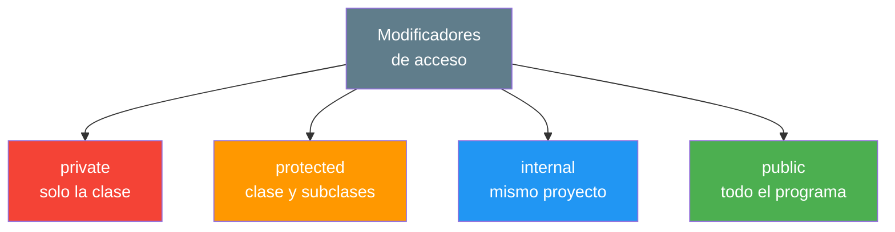

<TipBox type="truco">

**Para el examen:** empieza siempre por `private` y amplía solo si es imprescindible. Si todo es público, cualquier línea puede romper tu objeto.

</TipBox>

---

## 🧰 Otros modificadores

Además de la visibilidad, C# ofrece modificadores que restringen cómo se usa un tipo o un miembro:

<div class="grid grid-cols-2 gap-5 items-start">
<div>

- **`sealed`**: la clase no se puede heredar.
- **`const`**: valor fijo en tiempo de compilación; solo para tipos simples.
- **`readonly`**: solo puede asignarse en la declaración o en el constructor.
- **`static readonly`**: igual que `readonly` pero compartido por todas las instancias.
- **`required`** (C# 11+): la propiedad debe establecerse al crear el objeto.

</div>
<div>

```csharp
public sealed class Utilidades
{
    // fija en compilación
    public const double Pi = 3.1416;

    // compartida por todas las instancias
    public static readonly DateTime FechaInicio =
        DateTime.UtcNow;

    // obligatoria al crear el objeto
    public required string Nombre { get; set; }
}
```

</div>
</div>

---

## 🧩 Partial: una clase en varios ficheros

El modificador **`partial`** permite dividir una clase en varios ficheros: es útil cuando una parte la genera una herramienta o cuando varios desarrolladores trabajan en la misma clase.

<div class="grid grid-cols-2 gap-5 items-start">
<div>

```csharp
// Archivo 1
public partial class Producto
{
    public string Nombre { get; set; } = string.Empty;
}
```

</div>
<div>

```csharp
// Archivo 2
public partial class Producto
{
    public int Stock { get; set; }
}
```

</div>
</div>

<TipBox type="nota">

Al compilar, ambos ficheros forman **una única clase** `Producto` con sus cuatro miembros. No lo necesitas ahora: basta con reconocerlo — si un día ves `partial class`, es la mitad de una clase que está en otro sitio.

</TipBox>

---

## 🔎 `is` y `as`: comprobar y convertir tipos

El operador **`is`** verifica si un objeto es de un tipo concreto; **`as`** intenta convertirlo devolviendo `null` si no es posible. Son la forma segura de trabajar cuando no sabes qué tipo real lleva una referencia:

<div class="grid grid-cols-2 gap-5 items-start">
<div>

```csharp
object obj = "Hola Mundo";

// is: comprueba el tipo y deja el valor ya convertido
if (obj is string mensaje)
{
    Console.WriteLine(mensaje); // usa 'mensaje'
}

// as: si no puede convertir, devuelve null
string? texto = obj as string;
if (texto is not null)
{
    Console.WriteLine(texto);
}
```

</div>
<div>

<RealExample app="Visor de archivos">

Cuando tu app arrastra un archivo y no sabe si es imagen o vídeo, comprueba el tipo antes de decidir qué reproductor abrir. Si no encaja, `as` devuelve `null` y la app muestra un mensaje amable en vez de romperse.

</RealExample>

<TipBox type="consejo">

`is` es preferible a `try { (Tipo)x } catch { }`: es más limpio y no lanza excepciones. Si solo necesitas comprobar, usa `is`; si necesitas el valor convertido, combínalo: `if (obj is string s)`.

</TipBox>

</div>
</div>

---

## 👉 Las clases son tipos por referencia

Las clases en C# son **tipos por referencia**: al asignar un objeto a otra variable, ambas apuntan **al mismo objeto**. Si lo modificas por una variable, el cambio se ve desde la otra:

<div class="grid grid-cols-2 gap-5 items-start">
<div>

```csharp
public class Persona
{
    public string Nombre { get; set; } = string.Empty;
}
var persona1 = new Persona { Nombre = "Ana" };
var persona2 = persona1; // MISMO objeto
persona2.Nombre = "Luis";

Console.WriteLine(persona1.Nombre); // "Luis": lo ven las dos

void CambiarReferencia(ref Persona p)
{
    p = new Persona { Nombre = "Carlos" };
}

CambiarReferencia(ref persona1);
Console.WriteLine(persona1.Nombre); // "Carlos": objeto nuevo
```

</div>
<div>

<RealExample app="Google Docs">

Cuando compartes un documento con un compañero, ambos estáis viendo **el mismo** documento: si él escribe, lo ves tú también. No es una copia, es la misma referencia.

</RealExample>

</div>
</div>

---

## 🪢 Dos variables, un mismo objeto

Las dos primeras asignaciones, en un esquema: `persona1` y `persona2` son dos nombres para el mismo objeto.

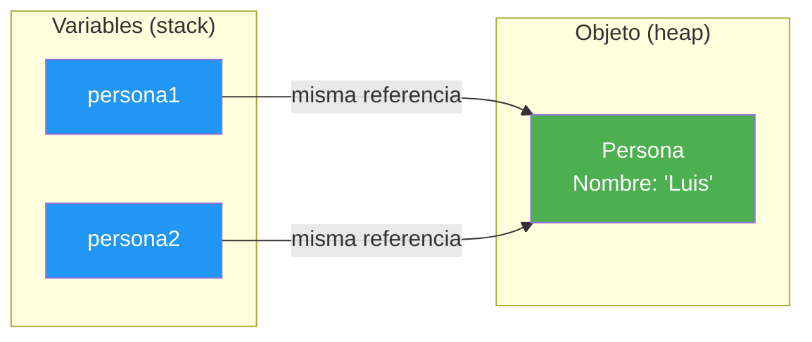

<TipBox type="advertencia">

Es la causa número uno de "efectos secundarios" raros en los principiantes: modificas una variable "por casualidad" y cambian otras. Verás el stack y el heap en el punto 2 y cómo dominarlo en el punto 5.

</TipBox>

---

## 💤 Objetos nulos: apuntar a nada

Una referencia puede valer `null`: **no apunta a ningún objeto**. Acceder a los miembros de un objeto nulo provoca `NullReferenceException` y el programa se para. Para protegerte, comprueba la referencia o usa el acceso seguro `?.`:

<div class="grid grid-cols-2 gap-5 items-start">
<div>

```csharp
Persona? persona = null;

// Opción 1: comprobación explícita
if (persona is not null)
{
    Console.WriteLine(persona.Nombre);
}
else
{
    Console.WriteLine("La persona es nula.");
}

// Opción 2: acceso seguro con ?.
Console.WriteLine(persona?.Nombre ?? "Sin nombre");
```

</div>
<div>

<RealExample app="Mensajería">

Cuando la app no puede cargar tu lista de contactos y muestra "sin contactos" en vez de cerrarse en bandeja, está comprobando referencias `null` antes de usarlas.

</RealExample>

<TipBox type="nota">

La **gestión estricta de nulos** está activada en todos los proyectos (`Nullable enable`): el compilador te avisa con un warning cada vez que te olvides de comprobar una referencia.

</TipBox>

</div>
</div>

---

## 🖊️ UML: leer y escribir la visibilidad

Para diseñar software usamos el lenguaje visual **UML**: es vital saber leer y escribir la visibilidad de los miembros sin mirar el código.

<div class="grid grid-cols-2 gap-5 items-start">
<div>

| Visibilidad | Símbolo UML | Modificador C# |
| :--- | :---: | :--- |
| **Público** | `+` | `public` |
| **Privado** | `-` | `private` |
| **Protegido** | `#` | `protected` |
| **Interno** | `~` | `internal` |

Fíjate en que `_nombre` y `_edad` llevan `-` (privados) y `Nombre`, `Edad` y `Maullar` llevan `+` (públicos): el diagrama dice **exactamente lo mismo que el código**.

</div>
<div>

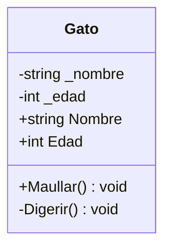

</div>
</div>

---

## 💳 Ejemplo completo: una clase bien diseñada

Este ejemplo reúne lo esencial del punto: encapsulamiento, visibilidad y una propiedad con validación. Los métodos públicos (`Depositar`, `Retirar`) son los únicos que tocan el saldo:

<div class="grid grid-cols-2 gap-5 items-start">
<div>

```csharp
public class CuentaBancaria
{
    private decimal _saldo;

    public decimal Saldo
    {
        get => _saldo;          // getter público
        private set             // setter privado
        {
            if (value < 0)
                throw new ArgumentException(
                    "El saldo no puede ser negativo");
            _saldo = value;
        }
    }
}
```

</div>
<div>

```csharp
var cuenta = new CuentaBancaria("ES123456789", 1000);
cuenta.Depositar(500);           // OK
cuenta.Retirar(200);             // OK
Console.WriteLine(cuenta.Saldo); // 1300

// IMPOSIBLE por el encapsulamiento:
// cuenta.Saldo = -100;  // setter privado
// cuenta._saldo = 0;    // campo privado
```

<TipBox type="analogia">

**El banco:** la cuenta es una caja fuerte; el saldo está dentro, protegido. Tú solo usas los métodos públicos, que aplican las reglas: no puedes meter dinero negativo ni sacarlo directamente.

</TipBox>

</div>
</div>

---

## 🔒 El flujo del encapsulamiento

El flujo de acceso a ese encapsulamiento, en un esquema:

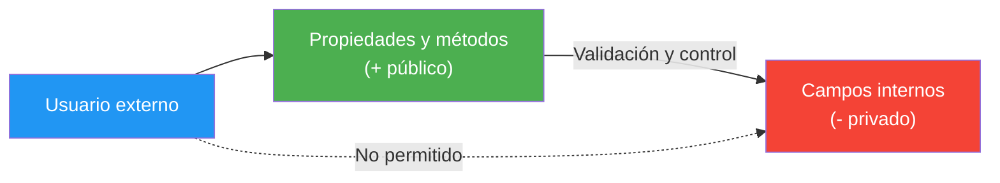

<TipBox type="nota">

Los modificadores de acceso no son para esconder información, son para **evitar accidentes**: si todo fuera público, cualquier línea podría escribir `cuenta.Saldo = -99999999`.

</TipBox>

---

## 🔑 Propiedades frente a campos públicos

Pregunta típica de examen: **¿por qué usar propiedades en lugar de campos públicos?** La respuesta cabe en una tabla:

| | **Campo público** | **Propiedad** |
| :--- | :--- | :--- |
| **Acceso** | Cualquiera lo cambia | Se controla desde la clase |
| **Validación** | No admite | Sí, dentro del `set` |
| **Solo lectura** | No es posible | Sí, si solo tiene `get` |

<TipBox type="truco">

**Truco del examen:** las propiedades dan **control** (validación, solo lectura, lógica) y un campo público se modifica libremente. Además, las propiedades participan en la **reflexión** y en el ***data binding***.

</TipBox>

---

## Resumen del punto 4

<div class="grid grid-cols-2 gap-5 items-start">
<div>

| Concepto | Descripción |
|----------|-------------|
| **Clase** | Molde del estado (propiedades) y el comportamiento (métodos) |
| **PascalCase** | Nomenclatura de clases, propiedades y métodos |
| **`public` / `private`** | Visible para todos / solo en la clase (por defecto) |
| **`internal` / `protected`** | Solo en el ensamblado / en la clase y sus hijas |
| **`is` / `as`** | Comprobar el tipo / convertir devolviendo `null` si no encaja |
| **Tipos por referencia** | Dos variables pueden apuntar al mismo objeto |
| **UML** | `+` público, `-` privado, `#` protegido, `~` interno |

</div>
<div>

<ConceptCard icon="✅" title="Buenas prácticas" accent="green">

- Empezar por `private` y ampliar solo si es imprescindible
- Propiedades en lugar de campos públicos para validar
- PascalCase en clases y métodos; `_camelCase` en campos
- Comprobar con `is not null` o acceder con `?.`

</ConceptCard>

<div class="mt-3">

**⏭️ ¿Qué viene después?** En el **punto 5** veremos cómo se crean y se usan los objetos: instanciación, referencias, igualdad entre objetos y el método `ToString`.

</div>

</div>
</div>

---
layout: section
---

<div class="ud-section-number">05</div>

# Instanciación, referencias, igualdad y ToString

<div class="opacity-70">Crear, comparar y mostrar objetos</div>

---

## 5 · Punto de partida

<div class="grid grid-cols-2 gap-5 items-start">
<div>

<TipBox type="consejo" title="Punto de partida">

¿Alguna vez has visto **dos fotos de Instagram con el mismo contenido** y has preguntado si es la misma foto o son dos copias? En programación pasa igual con los objetos: dos objetos pueden tener el mismo estado y seguir siendo distintos. En este punto aprenderás a **crearlos, a compararlos correctamente y a convertirlos en texto** para mostrarlos.

</TipBox>

</div>
<div>

<Objetivos
  :items="[
    'Instanciar objetos con new, object initializers, init y target-typed new',
    'Usar this para resolver ambigüedades y encadenar constructores',
    'Sobrescribir ToString() y usar la interpolación de cadenas para representar objetos',
    'Diferenciar identidad (misma referencia) de igualdad (mismo estado)',
    'Sobrescribir Equals y GetHashCode para comparar objetos por su contenido',
  ]"
/>

</div>
</div>

---

## 📦 Creación e instanciación de objetos

Crear o **instanciar** un objeto es obtener una unidad concreta de una clase.

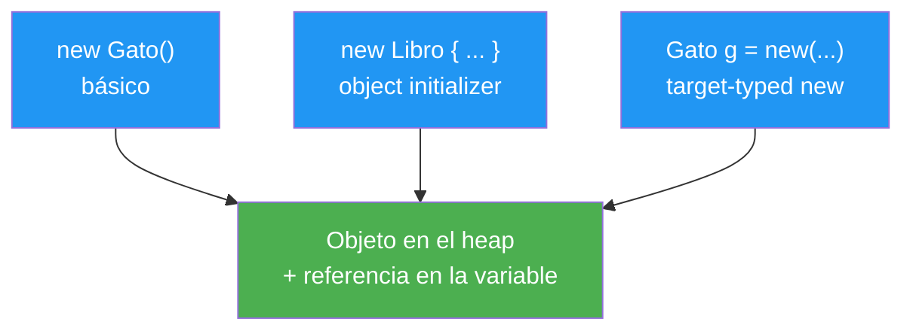

---

## 🆕 `new` y sintaxis básica

Cuando usas `new`, le pides al sistema que cree un objeto nuevo conforme a la definición de su clase. Este es el uso básico:

<div class="grid grid-cols-2 gap-5 items-start">
<div>

```csharp
var miGato = new Gato();
miGato.Nombre = "Felix";
miGato.Edad = 3;
```

</div>
<div>

Cada vez que usas `new` se crea una **referencia nueva** en memoria para ese objeto. El objeto se almacena en el heap, y la variable (`miGato`) contiene la referencia a esa ubicación.

<TipBox type="consejo">

`var` es solo azúcar sintáctico: el compilador deduce el tipo (`Gato`). No confundas con `var` de JavaScript, que es de tipo dinámico: aquí el tipo se fija en compilación.

</TipBox>

</div>
</div>

---

## 📋 Object initializers y propiedades `init`

Los **object initializers** permiten asignar propiedades en el mismo momento de crear el objeto, sin llamadas largas al constructor:

<div class="grid grid-cols-2 gap-5 items-start">
<div>

```csharp
var miLibro = new Libro { Titulo = "1984", Autor = "Orwell" };
```

```csharp
public class Usuario
{
    public string Nombre { get; init; } = string.Empty;
}

var usuario = new Usuario { Nombre = "Marta" }; // OK
// usuario.Nombre = "Ana"; 
// ERROR: solo puede fijarse al crearse
```

</div>
<div>

Si la propiedad se declara con `init` en lugar de `set`, solo puede establecerse en el initializer o en el constructor: no podrá modificarse después.

<RealExample app="Pedidos">

Los objetos `record` de C# (como los datos de un pedido inmutables) usan `init` para que nadie pueda cambiar un pedido ya creado: así se evitan errores de datos "a medias".

</RealExample>

</div>
</div>

---

## ⚡ Target-typed new y cuándo usar cada forma

Desde C# 9 puedes acortar el código indicando el tipo a la izquierda y dejando que el compilador complete el `new`:

```csharp
Gato miGato = new("Miau", 2); // existe un constructor Gato(string, int)
```

Es muy legible cuando la variable es de tipo explícito: el código se lee de corrido. Usa **constructores** cuando el valor es obligatorio al crear el objeto, e **initializers** cuando buscas flexibilidad y claridad:

<div class="grid grid-cols-[7fr_4fr] gap-5 items-start">
<div>

```csharp
// Constructor: no puedes olvidar la edad, es obligatorio
var gato = new Gato("Felix", 2);

// Initializer: puedes dejar campos sin poner (no recomendado si son importantes)
var libro = new Libro { Titulo = "1984", Autor = "Orwell" };
```

</div>
<div>

<TipBox type="advertencia">

Si el objeto no puede existir sin ciertos datos (un pedido sin cliente no tiene sentido), ese dato va en el **constructor**, no en un initializer opcional. El compilador no te dejará crear el objeto incompleto.

</TipBox>

</div>
</div>

---

## 🧩 Constructores secundarios con `this`

Puedes definir varios constructores en una clase para las distintas formas de crear objetos. Usa `this(...)` para llamar a otro constructor y evitar repetir código; lo verás en detalle en el punto 6.

```csharp
public class Coche
{
    public string Marca { get; set; } = string.Empty;
    public string Modelo { get; set; } = string.Empty;
    public int Año { get; set; }

    // Constructor secundario: delega en el principal
    public Coche(string marca, string modelo) : this(marca, modelo, 0) { }

    // Constructor principal
    public Coche(string marca, string modelo, int año)
    {
        Marca = marca;
        Modelo = modelo;
        Año = año;
    }
}
```

---

## 🎯 `this`: el objeto actual

La palabra clave **`this`** en C# siempre se refiere al **objeto actual**, es decir, la instancia sobre la que se está ejecutando el código. Sirve sobre todo para distinguir los atributos del objeto de los parámetros cuando se llaman igual.

<div class="grid grid-cols-2 gap-5 items-start">
<div>

```csharp
public class Punto
{
    private int _x;

    public void SetX(int x)
    {
        _x = x; // sin ambigüedad: _x es el atributo, 
                //x es el parámetro
    }

    // Con this (también válido y más explícito)
    public void SetXConThis(int x)
    {
        this._x = x; // "this._x" es el atributo de la instancia
    }
}
```

</div>
<div>

Este ejemplo muestra el caso clásico: el parámetro `x` y el atributo `x` con el mismo nombre.

<RealExample app="Registro">

En cualquier formulario de registro, el parámetro `nombre` llega del campo de la pantalla y el atributo `nombre` es el del objeto usuario: `this.nombre = nombre` guarda lo que escribió el usuario dentro de su propio objeto.

</RealExample>

</div>
</div>

---

## 🔁 Encadenamiento de constructores

Con `this` puedes llamar a otro constructor de la misma clase y reutilizar su lógica en lugar de duplicarla:

```csharp
public class Persona
{
    public string Nombre { get; set; } = string.Empty;
    public int Edad { get; set; }

    public Persona(string nombre) : this(nombre, 0) { }

    public Persona(string nombre, int edad)
    {
        Nombre = nombre;
        Edad = edad;
    }
}
```

---

## 📤 Pasar `this` como argumento

En métodos, `this` te permite referenciar la instancia actual para modificar datos o llamar a otros métodos de esa instancia, e incluso puedes **pasar `this` como argumento** a otros métodos que necesiten trabajar con el objeto completo.

```csharp
public class Gato
{
    public string Nombre { get; set; } = string.Empty;

    public void RegistrarEn(ClinicaVeterinaria clinica)
    {
        clinica.Anotar(this); // paso el objeto completo a otro método
    }
}
```

<TipBox type="nota">

Con las propiedades autoimplementadas (`{ get; set; }`) ya no necesitas `this.nombre = nombre` en los constructores modernos; el encadenamiento y las ambigüedades siguen siendo los usos principales.

</TipBox>

---

## 📝 ToString: tu objeto en texto

Puedes sobrescribir el método `ToString()` en tu clase para devolver una representación legible del objeto:

```csharp
public class Persona
{
    public string Nombre { get; set; } = string.Empty;
    public int Edad { get; set; }

    public override string ToString() => $"Persona: {Nombre}, {Edad} años";
}
```

Ahora, si imprimes el objeto, verás ese texto en consola:

```csharp
Console.WriteLine(new Persona { Nombre = "Jose", Edad = 20 });
// Persona: Jose, 20 años
```

---

## 💡 ¿Por qué sobrescribir `ToString`?

Es muy útil que tus objetos puedan convertirse a texto para mostrar información, depurar o guardarla en un fichero:

<RealExample app="Logs">

Cuando la consola de Windows o un visor de logs muestra un objeto completo en vez de `Namespace.Clase`, alguien ha reescrito `ToString` para que dé información útil. Sin ese override, solo verías el nombre del tipo.

</RealExample>

<TipBox type="consejo">

Sobrescribir `ToString` en cualquier clase que muestres en consola o en logs.

</TipBox>

---

## 💬 Interpolación de cadenas

La interpolación con `$` permite mezclar variables y texto de forma cómoda, y es la forma habitual de construir el resultado de `ToString`:

```csharp
var nombre = "Jose";
var mensaje = $"Hola, {nombre}!"; // "Hola, Jose!"
Console.WriteLine(mensaje);
```

Dentro de las llaves puedes poner expresiones completas:

```csharp
$"Tienes {lista.Count} elementos y el total es {precio * 1.21m}"
```

<TipBox type="truco">

En la interpolación puedes poner formato: `$"Nota: {nota:F1}"` muestra `Nota: 7,5`. Muy útil en `ToString` para fechas (`{fecha:dd/MM/yyyy}`) y monedas.

</TipBox>

---

## ⚖️ Igualdad e identidad

Al comparar objetos hay que distinguir **el mismo objeto** (identidad) del **mismo estado** (igualdad): es la diferencia entre "¿es la misma foto?" y "¿son dos fotos iguales?".

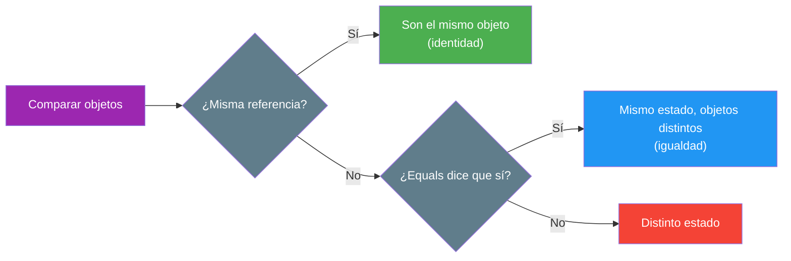

---

## ↔️ ReferenceEquals y el comportamiento por defecto

Una comparación por **identidad** verifica si dos referencias apuntan al mismo objeto en memoria:

```csharp
var a = new Libro { Titulo = "1984" };
var b = new Libro { Titulo = "1984" };

Console.WriteLine(object.ReferenceEquals(a, b)); // False: son objetos distintos

var c = a;
Console.WriteLine(object.ReferenceEquals(a, c)); // True: misma referencia
```

---

## 📊 Igualdad por valor frente a por referencia

Por defecto, en C# la comparación `==` entre objetos de tipo clase compara **la referencia** (identidad), no el contenido. Para comparar el **estado** debes:

- Sobrescribir el método `Equals(object?)`
- Sobrescribir también `GetHashCode()` (deben ir siempre juntos)

| Comparación | Qué comprueba |
|-------------|---------------|
| `==` | La referencia: ¿es el mismo objeto? |
| `Equals` | El estado: ¿tiene los mismos datos? |

<TipBox type="advertencia">

Sobrescribir `Equals` **no** cambia el comportamiento de `==`: el operador sigue comparando referencias. Si quieres que `==` compare por estado, además debes sobrecargar el operador `==` con `operator ==`.

</TipBox>

---

## 🧬 Sobrescribir `Equals` y `GetHashCode`

Esta es la clase `Libro` con igualdad por estado definida a mano:

```csharp
public class Libro
{
    public string Titulo { get; set; } = string.Empty;

    public override bool Equals(object? obj)
    {
        if (obj is Libro otro)
            return Titulo == otro.Titulo;
        return false;
    }

    public override int GetHashCode() => Titulo.GetHashCode();
}
```

---

## 🔀 Al comparar: mismo estado, distinta referencia

Y así se comporta al compararla:

```csharp
var libro1 = new Libro { Titulo = "1984" };
var libro2 = new Libro { Titulo = "1984" };

Console.WriteLine(libro1.Equals(libro2));              // True: mismo estado
Console.WriteLine(object.ReferenceEquals(libro1, libro2)); // False: distinta referencia
Console.WriteLine(libro1 == libro2);                   // False: == compara referencias
```

<RealExample app="Biblioteca">

Tu app de biblioteca guarda en un diccionario los libros por título: para que `diccionario[libro]` encuentre el libro, la clave necesita un `GetHashCode` y un `Equals` correctos. Sin ellos, cada consulta "pierde" el libro aunque tenga los mismos datos.

</RealExample>

---

## 🗄️ Varios campos: se comparan todos

<div class="grid grid-cols-[7fr_4fr] gap-5 items-start">
<div>

```csharp
public class Gato
{
    public string Nombre { get; set; } = string.Empty;
    public int Edad { get; set; }
    public string Raza { get; set; } = string.Empty;
    public bool EsDomestico { get; set; }

    public override string ToString() =>
        $"[Gato: {Nombre}, Edad: {Edad}, Raza: {Raza}, Doméstico: {EsDomestico}]";

    public override int GetHashCode() =>
        HashCode.Combine(Nombre, Edad, Raza, EsDomestico);

    public override bool Equals(object? obj) =>
        obj is Gato otro &&
        otro.Nombre == Nombre &&
        otro.Edad == Edad &&
        otro.Raza == Raza &&
        otro.EsDomestico == EsDomestico;
}
```

</div>
<div>

Si la clase tiene varios campos, se comparan todos en `Equals` y se combinan en `GetHashCode`:

<TipBox type="consejo">

**Consejo para el examen:** memoriza la pareja: **`Equals` y `GetHashCode` siempre se sobrescriben juntos**. Y recuerda: `==` compara referencias, `Equals` compara estado (si lo has sobrescrito).

</TipBox>

</div>
</div>

---

## Resumen del punto 5

<div class="grid grid-cols-2 gap-5 items-start">
<div>

| Concepto | Descripción |
|----------|-------------|
| **`new`** | Crea el objeto en el heap y da su referencia |
| **Object initializer** | `new Tipo { Prop = valor }` al crear |
| **`init`** | Solo puede fijarse al crear el objeto |
| **Target-typed new** | `Gato g = new(...)`: el tipo lo da la variable |
| **`this`** | Referencia a la instancia actual |
| **`ToString()`** | El objeto convertido a texto con `override` |
| **Identidad** | ¿El mismo objeto? `ReferenceEquals` y `==` |
| **Igualdad** | ¿El mismo estado? `Equals` + `GetHashCode` |

</div>
<div>

<ConceptCard icon="✅" title="Buenas prácticas" accent="green">

- Constructor para lo imprescindible; initializers, para lo opcional
- Propiedades `init`: solo se fijan al crear el objeto
- `Equals` y `GetHashCode`: siempre juntos, nunca uno solo
- Recuerda: `==` compara referencias, `Equals` compara el estado

</ConceptCard>

<div class="mt-3">

**⏭️ ¿Qué viene después?** En el **punto 6**: constructores, parámetros por defecto y validación.

</div>

</div>
</div>

---
layout: section
---

<div class="ud-section-number">06</div>

# Constructores e inicialización

<div class="opacity-70">Nacer con los datos correctos</div>

---

## 6 · Punto de partida

<div class="grid grid-cols-2 gap-5 items-start">
<div>

<TipBox type="consejo" title="Punto de partida">

Cuando compras un móvil nuevo, de fábrica ya viene configurado: idioma, hora, cuentas de ejemplo. Si te lo entregaran "en blanco y roto", no serviría de nada. Los objetos también: un constructor es el **"ritual de bienvenida"** que garantiza que cada objeto nace con sus datos correctos y listo para usar.

</TipBox>

</div>
<div>

<Objetivos
  :items="[
    'Explicar la función de un constructor y diferenciarlo de un método normal',
    'Usar constructores por defecto, parametrizados y la sobrecarga con this(...)',
    'Aplicar constructores estáticos, privados y de copia en sus contextos',
    'Validar argumentos lanzando excepciones para no crear objetos inválidos',
    'Emplear parámetros opcionales, argumentos con nombre y constructores primarios',
  ]"
/>

</div>
</div>

---

## 🧭 Propósito de un constructor

<div class="grid grid-cols-2 gap-5 items-start">
<div>

Un **constructor** es el método que se llama al crear un objeto y fija su estado inicial: una función con el nombre de la clase y **sin tipo de retorno**.

</div>
<div>

Los constructores obligan al estado inicial: nadie crea un `CuentaBancaria` sin saldo ni un `Pedido` sin cliente.

</div>
</div>


<RealExample app="Instagram">

Cuando Instagram crea tu cuenta, no te deja existir "a medias": el proceso de registro garantiza que haya nombre, usuario y correo desde el primer segundo. Eso es lo que hace un constructor por tu cuenta.

</RealExample>

---

## ⚙️ Constructor por defecto

Si no defines ningún constructor, C# crea uno sin parámetros que inicializa los atributos a sus valores por defecto (`null` para las referencias, `0` para los números, `false` para los booleanos). Este es un ejemplo de clase sin constructores explícitos:

```csharp
public class Animal
{
    public string Nombre { get; set; } = string.Empty; // "" por defecto (no null)
    public int Edad { get; set; }                       // 0 por defecto
}

var perro = new Animal(); // usa el constructor por defecto
```

<TipBox type="advertencia">

En cuanto defines **un** constructor cualquiera, C# deja de ofrecer el por defecto: si luego escribes `new Animal()` sin parámetros, recibirás un error de compilación. Tendrás que definirlo tú si lo necesitas.

</TipBox>

---

## 🎛️ Constructores parametrizados

Los constructores parametrizados permiten pasar información para personalizar el estado al crear el objeto. Así no hay que rellenar los datos a posteriori, campo a campo.

<div class="grid grid-cols-2 gap-5 items-start">
<div>

```csharp
public class Animal
{
    public string Nombre { get; set; } = string.Empty;
    public int Edad { get; set; }

    public Animal(string nombre)
    {
        Nombre = nombre;
    }
}

var perro = new Animal("Rex"); // nace con nombre ya puesto
```

</div>
<div>

<RealExample app="Reservas de hotel">

En una app de reservas, crear un `Hotel` sin ciudad ni categoría no tiene sentido; por eso su constructor recibe esos datos obligatorios y el resto de la app puede confiar en que siempre estarán.

</RealExample>

</div>
</div>

---

## 🔀 Sobrecarga de constructores

Puedes definir varios constructores para permitir distintos modos de inicialización.

<div class="grid grid-cols-[7fr_4fr] gap-5 items-start">
<div>

```csharp
public class Animal
{
    public string Nombre { get; set; } = string.Empty;
    public int Edad { get; set; }

    // Si nos pasan solo el nombre, la edad será 0 por defecto
    public Animal(string nombre) : this(nombre, 0) { }

    // Constructor principal (el más completo)
    public Animal(string nombre, int edad)
    {
        Nombre = nombre;
        Edad = edad;
    }
}

var perro = new Animal("Rex");        // edad 0
var gato = new Animal("Miau", 3);     // edad 3
```

</div>
<div>

Con la **sobrecarga**, cada constructor tiene una firma diferente (número o tipo de parámetros), de modo que puedes crear objetos con diferentes niveles de detalle.

<TipBox type="consejo">

Usa `this(...)` para que la sobrecarga **delegue** en el constructor más completo, en vez de repetir el mismo código en cada uno. Así solo hay una fuente de verdad.

</TipBox>

</div>
</div>

---

## 🔁 Encadenamiento con `this(...)`

El encadenamiento reutiliza lógica y evita errores, como has visto en el ejemplo anterior. Aquí la versión completa con un `Libro`:

<div class="grid grid-cols-[7fr_4fr] gap-5 items-start">
<div>

```csharp
public class Libro
{
    public string Titulo { get; set; } = string.Empty;
    public string Autor { get; set; } = string.Empty;
    public int Paginas { get; set; }

    // Constructor secundario: delega en el principal
    public Libro(string titulo) : this(titulo, "Desconocido", 0) { }

    // Constructor principal
    public Libro(string titulo, string autor, int paginas)
    {
        Titulo = titulo;
        Autor = autor;
        Paginas = paginas;
    }
}
```

</div>
<div>

```csharp
var libro1 = new Libro("1984"); // Autor="Desconocido", Paginas=0
var libro2 = new Libro("1984", "Orwell", 328); // todo completo
```

</div>
</div>

---

## 🔁 Una sola fuente de verdad

El encadenamiento, en un esquema: el constructor corto delega en el largo.

```mermaid
graph LR
    S["Libro(titulo)<br/>constructor secundario"] -->|"this(...) delega en"| P["Libro(titulo, autor, paginas)<br/>constructor principal"]
    P --> O["Objeto completo<br/>con una sola fuente de verdad"]
    style S fill:#FF9800,color:#fff
    style P fill:#2196F3,color:#fff
    style O fill:#4CAF50,color:#fff
```

<RealExample app="Compra online">

Los formularios de compra online suelen tener "envío estándar" por defecto y "envío exprés" opcional: el segundo construye el pedido completo y el primero delega en él poniendo los valores por defecto. Mismo patrón.

</RealExample>

---

## 🏁 Constructor estático

Un constructor **`static`** se ejecuta una sola vez, antes de que se use la clase por primera vez, para inicializar datos compartidos por todas sus instancias.

```csharp
public class Configuracion
{
    public static string RutaConfig { get; set; } = string.Empty;

    static Configuracion()
    {
        RutaConfig = "/etc/config"; // se ejecuta una única vez
    }
}
```

<TipBox type="nota">

Un constructor estático no tiene parámetros y no puede ser `public`: solo prepara lo que es **de la clase** (datos estáticos), no lo de cada objeto. Lo verás con más detalle en el punto 7, junto a los miembros estáticos.

</TipBox>

---

## 🔒 Constructores privados

Los constructores **`private`** sirven para controlar cómo se instancian los objetos: nadie desde fuera puede hacer `new`, solo la propia clase decide cuántos y cuándo. Es la base de patrones como el **singleton** (una única instancia) o las fábricas.

<div class="grid grid-cols-2 gap-5 items-start">
<div>

```csharp
public class Singleton
{
    private static Singleton? _instancia;

    private Singleton() { } // nadie puede crearlo desde fuera

    public static Singleton ObtenerInstancia()
    {
        // Lazy: se crea solo si hace falta (y solo una vez)
        _instancia ??= new Singleton();
        return _instancia;
    }
}
```

</div>
<div>

<RealExample app="Gestor de conexiones">

Tu app tiene un único gestor de conexión a la base de datos o un único reloj de sistema: si cada módulo pudiera crear el suyo, tendrías diez conexiones abiertas sin querer. El constructor privado impide ese desastre.

</RealExample>

</div>
</div>

---

## 📋 Constructor de copia

El **constructor de copia** crea una nueva instancia **copiando el estado** de otro objeto.

<div class="grid grid-cols-[7fr_4fr] gap-5 items-start">
<div>

```csharp
public class Punto
{
    public int X { get; set; }
    public int Y { get; set; }

    // Constructor de copia
    public Punto(Punto otro)
    {
        X = otro.X;
        Y = otro.Y;
    }
}

var p1 = new Punto { X = 5, Y = 10 };
var p2 = new Punto(p1); // p2 es una COPIA: p2.X = 5, p2.Y = 10

p2.X = 99;
Console.WriteLine(p1.X); // 5: p1 no se entera del cambio
```

</div>
<div>

Permite duplicar objetos **sin compartir la referencia** entre ambos.

<TipBox type="advertencia">

No confundas copia con referencia: `var p3 = p1` hace que apunten al **mismo** objeto; `var p3 = new Punto(p1)` crea uno **nuevo y separado**. Es la misma distinción del punto anterior.

</TipBox>

</div>
</div>

---

## 🎚️ Parámetros opcionales, named arguments y params

Puedes facilitar distintos modos de uso con parámetros por defecto y argumentos con nombre, igual que en los métodos normales.

<div class="grid grid-cols-[7fr_4fr] gap-5 items-start">
<div>

```csharp
public class Rectangulo
{
    public int Alto { get; set; }
    public int Ancho { get; set; }

    public Rectangulo(int alto = 10, int ancho = 5)
    {
        Alto = alto;
        Ancho = ancho;
    }
}

var r1 = new Rectangulo();              // alto=10, ancho=5
var r2 = new Rectangulo(ancho: 15);     // alto=10, ancho=15 (argumento con nombre)
var r3 = new Rectangulo(20);            // alto=20, ancho=5
```

</div>
<div>

<RealExample app="Alta de usuario">

Un constructor de `Usuario` con `rol = "cliente"` por defecto deja que la mayoría de registros no tengan que pensarlo, mientras que un administrador lo indica explícitamente con `rol: "admin"`.

</RealExample>

</div>
</div>

---

## 🧊 Inicialización de campos `readonly`

Los campos **`readonly`** pueden fijarse solo una vez: en la declaración o dentro del constructor. Ayudan a crear objetos inmutables que no se pueden modificar después de ser creados.

<div class="grid grid-cols-[7fr_4fr] gap-5 items-start">
<div>

```csharp
public class Circulo
{
    public readonly double Radio;

    public Circulo(double radio)
    {
        Radio = radio;
    }
}

var c = new Circulo(5.0);
// c.Radio = 10.0; // ERROR de compilación: no se puede modificar después
```

</div>
<div>

<TipBox type="truco">

`readonly` es tu forma de decir "este dato no cambia jamás" sin necesidad de propiedades complejas. Si alguien intenta tocarlo fuera del constructor, el compilador lo para antes de ejecutar nada.

</TipBox>

</div>
</div>

---

## 🧬 Constructores en structs y records

Cada tipo tiene sus particularidades:

- **Structs:** debes inicializar **todos** los campos en el constructor; si no defines ninguno, existe uno por defecto que los pone a cero.
- **Records:** suelen tener constructores posicionales (`record Persona(string Nombre, int Edad)`) y soportan la inicialización con `with` para crear copias modificadas.

```csharp
// Record con constructor positional
record Persona(string Nombre, int Edad);

var ana = new Persona("Ana", 30);
var ana2 = ana with { Edad = 31 }; // copia con un cambio
```

<RealExample app="Facturación">

Los `record` son ideales para datos inmutables como líneas de factura: `linea with { Cantidad = 2 }` te devuelve una línea nueva sin tocar la original.

</RealExample>

---

## 🚨 Manejo de errores en constructores

Lanza excepciones si los argumentos son inválidos, para asegurar objetos consistentes desde el principio: mejor un error en el `new` que un objeto roto escondido por el programa.

<div class="grid grid-cols-[7fr_4fr] gap-5 items-start">
<div>

```csharp
public class CuentaBancaria
{
    public decimal Saldo { get; private set; }

    public CuentaBancaria(decimal saldoInicial)
    {
        if (saldoInicial < 0)
            throw new ArgumentException("El saldo inicial no puede ser negativo.");
        Saldo = saldoInicial;
    }
}

var cuenta = new CuentaBancaria(-100); // lanza ArgumentException
```

</div>
<div>

<RealExample app="Banca online">

Cuando una app de banca online te rechaza un alta con datos incorrectos en el primer paso, es el constructor el que se niega a crear un objeto inválido. Es preferible que falle ahí a que el problema aparezca tres pantallas después.

</RealExample>

<TipBox type="nota">

Las excepciones se estudian en el punto 11.

</TipBox>

</div>
</div>

---

## ✨ Constructores primarios (C# 12+)

Los **constructores primarios** permiten definir parámetros directamente en la declaración de la clase, simplificando la sintaxis para clases simples. Están disponibles desde C# 12.

```csharp
public class Persona(string nombre, int edad)
{
    public string Nombre { get; } = nombre;
    public int Edad { get; } = edad;
}

var p = new Persona("Ana", 30);
```

---

## ✨ Primarios: inyección de dependencias

Esta forma es ideal para la **inyección de dependencias** y para simplificar clases con campos `readonly`, como este servicio de correo:

<div class="grid grid-cols-[7fr_4fr] gap-5 items-start">
<div>

```csharp
public class ServicioCorreo(string servidorSmtp, int puerto)
{
    private readonly string _servidorSmtp = servidorSmtp;
    private readonly int _puerto = puerto;

    public void EnviarCorreo(string destinatario, string asunto, string cuerpo)
    {
        // Lógica para enviar el correo usando _servidorSmtp y _puerto
    }
}
```

<TipBox type="consejo">

En este ciclo usamos el constructor primario con **inyección de dependencias**: cada parámetro es una dependencia que la clase necesita.

</TipBox>

</div>
<div>

Los constructores secundarios pueden seguir definiéndose como antes, y pueden llamar al constructor primario usando `this(...)`:

```csharp
public class Producto(string nombre, decimal precio)
{
    public string Nombre { get; } = nombre;
    public decimal Precio { get; } = precio;

    // Constructor secundario: precio por defecto 0
    public Producto(string nombre) : this(nombre, 0.0m) { }
}
```

</div>
</div>

---

## 🪦 Finalizadores: casi no se usan

Los **finalizadores** —antiguamente llamados **destructores**— son la contraparte del constructor: mientras el constructor se ejecuta al nacer el objeto, el finalizador `~Clase()` lo ejecuta, si llega, **el recolector de basura justo antes de reclamar su memoria**. Existir existen —y conviene saber que existen—, pero en el día a día **casi nunca se escriben**: la memoria ya la gestiona el GC (la 1.8) y los recursos se liberan de forma explícita (el punto 12).

```csharp
class Animal
{
    ~Animal()   // finalizador (antes llamado destructor): sin parámetros y sin modificadores
    {
        // limpieza final, si hiciera falta
    }
}
```

<RealExample app="Sistema operativo">

Los recursos que lleva el sistema operativo —ficheros abiertos, conexiones de red, ventanas— no los recoge el GC: para esos, y solo para esos, existe el finalizador, como salvaguarda por si alguien olvida cerrarlos.

</RealExample>

---

## 🪦 Reglas de los finalizadores

Lo esencial de su comportamiento, según la documentación oficial de C#:

- Solo en **clases** (nunca en structs) y **uno por clase**: sin parámetros.
- **No se pueden llamar**: los invoca solo el GC y **él decide cuándo**. Además, en .NET 5+ **no se ejecutan al salir de la aplicación**.
- No sirven de nada los finalizadores **vacíos**: toda clase con finalizador entra en la cola de finalización del GC, y eso cuesta de rendimiento.
- ⚠️ Dentro de un finalizador **solo se tocan recursos no administrados** (ficheros, ventanas): los administrados pueden haber desaparecido ya.

<TipBox type="nota" title="Nota: ¿y en la práctica?">

Libera los recursos de forma explícita con `IDisposable` e `using` (punto 12): **sin recursos no administrados, no necesitas finalizador**.

</TipBox>

---

## Resumen del punto 6

<div class="grid grid-cols-[7fr_4fr] gap-5 items-start">
<div>

| Concepto | Descripción |
|----------|-------------|
| **Constructor** | Método que inicializa el objeto al crearlo |
| **Por defecto** | Sin parámetros; desaparece si defines otro |
| **Parametrizado** | Recibe datos: el objeto nace completo |
| **Sobrecarga** | Firmas distintas; delegan con `this(...)` |
| **Estático** | Se ejecuta una vez para datos de la clase |
| **Privado** | Controla la creación: singleton y fábricas |
| **Copia** | Copia el estado sin compartir referencia |
| **`readonly`** | Fijable en la declaración o el constructor |
| **Validación** | Excepciones si los argumentos no son válidos |
| **Primario (C# 12+)** | Parámetros en la clase; ideal para DI |

</div>
<div>

<ConceptCard icon="✅" title="Buenas prácticas" accent="green">

- Constructores simples; delega lo largo
- Mantén los invariantes del objeto
- Valida los argumentos con excepciones
- Parametrizados antes que setters después

</ConceptCard>

<div class="mt-3">

**⏭️ ¿Qué viene después?** En el **punto 7**: encapsulación, propiedades completas y miembros estáticos.

</div>

</div>
</div>

---
layout: section
---

<div class="ud-section-number">07</div>

# Encapsulación, propiedades y miembros estáticos

<div class="opacity-70">Por fuera un campo, por dentro la lógica</div>

---

## 7 · Punto de partida

<div class="grid grid-cols-2 gap-5 items-start">
<div>

<TipBox type="consejo" title="Punto de partida">

En un coche, el velocímetro te muestra la velocidad pero no te deja cambiarla a mano: hay un dato interno que solo el coche toca, y tú accedes a él por un instrumento controlado. Eso es **encapsulación con propiedades**: protege el estado y lo expone de forma segura.

</TipBox>

</div>
<div>

<Objetivos
  :items="[
    'Explicar qué son los getters y setters y por qué se migró a las propiedades',
    'Usar los tipos de propiedades: autoimplementadas, get-only, init, calculadas y con validación',
    'Aplicar los modificadores de acceso a las propiedades y a sus accesores',
    'Definir miembros static, constructores estáticos y clases estáticas',
    'Distinguir required, init y Lazy<T> y saber cuándo conviene cada uno',
  ]"
/>

</div>
</div>

---

## 🔐 Getters y setters: la forma clásica

Los **getters** y **setters** son métodos especiales que permiten acceder y modificar los atributos privados de una clase de forma controlada: los atributos quedan ocultos y nadie los toca desde fuera.

La forma clásica (heredada de Java) consiste en un método para leer y otro para escribir:

```csharp
public class Perro
{
    private int _edad;

    public int GetEdad() => _edad;
    public void SetEdad(int valor) => _edad = valor;
}
```

Con estos métodos nadie toca `_edad` directamente: todo pasa por `GetEdad` y `SetEdad`.

---

## 🎯 Validación en el setter

<div class="grid grid-cols-[7fr_4fr] gap-5 items-start">
<div>

La gran ventaja de este patrón es que puedes **controlar** cómo se accede y cambia el estado, por ejemplo añadiendo validaciones dentro del *setter*:

```csharp
public class Persona
{
    private int _edad;

    public int GetEdad() => _edad;

    public void SetEdad(int valor)
    {
        if (valor < 0)
            throw new ArgumentException("La edad no puede ser negativa");
        _edad = valor;
    }
}
```

</div>
<div>

<RealExample app="App de citas">

Cuando una app de citas te impide poner una edad negativa o superior a 150, hay una validación escondida en el método de escritura. Sin esa comprobación, cualquier dato corrupto entraría sin más.

</RealExample>

</div>
</div>

---

## ➡️ De getters y setters a propiedades

Las **propiedades** (`get`/`set`) de C# son más limpias y potentes: se usan con la sintaxis de un campo (`.Edad`), pero por dentro tienen la seguridad y el control de un método. Es por eso que C# las prefiere desde su primera versión.

```csharp
public class Persona
{
    public int Edad { get; set; }
}

var p = new Persona();
p.Edad = 25; // sintaxis de campo, control de método
```

<TipBox type="consejo">

Usa `GetEdad`/`SetEdad` solo si mantienes código heredado de Java o de versiones muy antiguas. En C#, el camino es **propiedades**.

</TipBox>

---

## 🧩 Los cinco tipos de propiedades

Este es el mapa de los cinco tipos de propiedades que verás en este apartado:

```mermaid
graph TD
    P["Propiedades<br/>en C#"] --> A["Autoimplementada<br/>{ get; set; }"]
    P --> B["Solo lectura<br/>{ get; }"]
    P --> C["init<br/>{ get; init; }"]
    P --> D["Calculada<br/>=> expresión"]
    P --> E["Full property<br/>con backing field"]
    style P fill:#9C27B0,color:#fff
    style A fill:#4CAF50,color:#fff
    style B fill:#4CAF50,color:#fff
    style C fill:#4CAF50,color:#fff
    style D fill:#4CAF50,color:#fff
    style E fill:#4CAF50,color:#fff
```

---

## 🚪 Por fuera un campo, por dentro la lógica

Permiten exponer la información interna del objeto de forma controlada, pudiendo añadir validación, lógica o notificaciones: por fuera parece un campo, por dentro pasa por la lógica que tú decidas.

```mermaid
graph LR
    U[Usuario] -->|".Edad"| P[Propiedad Edad]
    subgraph S[Interior de la clase]
        P --> L{Validación / lógica}
        L -->|Correcto| F[_edad]
        L -->|Error| E[Lanzar excepción]
    end
    style U fill:#2196F3,color:#fff
    style P fill:#4CAF50,color:#fff
    style F fill:#607D8B,color:#fff
    style E fill:#f44336,color:#fff
```

---

## ✨ Propiedades autoimplementadas

Son propiedades que el compilador gestiona automáticamente, ideales para objetos de datos: no escribes campo ni lógica:

```csharp
public class Producto
{
    public string Nombre { get; set; } = string.Empty;
    public decimal Precio { get; set; }
}
```

Puedes inicializar el valor por defecto en la propia declaración:

```csharp
public string Descripcion { get; set; } = "Sin descripción";
```

<TipBox type="advertencia">

Con la gestión estricta de nulos activada, una propiedad `string` sin inicializar genera un *warning*: inicialízala (`= string.Empty`) o declárala `string?` si admite que no hay valor.

</TipBox>

---

## 🔒 Propiedades de solo lectura

No tienen `set`, o solo lo tienen privado/interno: el usuario no puede modificarlas después de crear el objeto. Este ejemplo calcula el área a partir de un radio inmutable:

```csharp
public class Circulo
{
    public double Radio { get; }
    public double Area => Math.PI * Radio * Radio;

    public Circulo(double radio)
    {
        Radio = radio;
    }
}
```

---

## 🆕 Propiedades `init`

Solo pueden asignarse durante la inicialización (en el constructor o en el `new { ... }`). Aumentan la inmutabilidad y la seguridad del objeto:

<div class="grid grid-cols-[7fr_4fr] gap-5 items-start">
<div>

```csharp
public class Usuario
{
    public string Nombre { get; init; } = string.Empty;
    public int Edad { get; init; }
}

var usuario = new Usuario { Nombre = "Ana", Edad = 25 };
// usuario.Edad = 30; // ERROR: solo puede fijarse al crearse
```

</div>
<div>

<RealExample app="Datos de solo lectura">

Los objetos `record` que modelan datos de solo lectura (una línea de factura, un mensaje recibido) usan `init` para que nadie pueda alterarlos después de crearlos: si el dato estaba bien, sigue bien.

</RealExample>

</div>
</div>

---

## 🔑 Accesibilidad diferenciada en accesores

Puedes decidir quién puede leer o escribir cada propiedad por separado, siempre que el accesor sea **más restrictivo** que la propiedad:

```csharp
public class Cuenta
{
    // Todo el mundo lee; solo la clase modifica
    public string Clave { get; private set; } = string.Empty;
}
```

---

## ✂️ Propiedades calculadas con `=>`

Las propiedades *expression-bodied* usan la sintaxis corta con `=>` para devolver un valor calculado, y las **calculadas** (*computed properties*) derivan un valor de otros, como el nombre completo a partir del nombre y los apellidos:

```csharp
public int Area => Alto * Ancho;
```

Es la forma más breve de escribir una propiedad de solo lectura cuyo cuerpo es una única expresión:

```csharp
public string NombreCompleto => $"{Nombre} {Apellidos}";
```

<TipBox type="truco">

Una propiedad calculada **no guarda nada**: cada vez que la consultas se recalcula. Es perfecta para datos derivados, pero no para datos costosos de calcular (esos van con caché, como verás con `Lazy<T>`).

</TipBox>

---

## 🗄️ Backing field: lógica con campo de respaldo

Cuando necesitas lógica o validación antes de guardar el dato, usas la propiedad completa con su **campo de respaldo** (*backing field*): `value` llega al `set` y la propiedad decide si lo acepta.

<div class="grid grid-cols-[7fr_4fr] gap-5 items-start">
<div>

```csharp
private int _edad;

public int Edad
{
    get => _edad;
    set
    {
        if (value < 0)
            throw new ArgumentException("La edad no puede ser negativa");
        _edad = value;
    }
}
```

</div>
<div>

Desde **C# 14** puedes usar contextualmente **`field`** para referirte al campo de respaldo sin declararlo explícitamente:

```csharp
public class Empleado
{
    public decimal Salario
    {
        get;
        set => field = (value >= 0)
            ? value
            : throw new ArgumentOutOfRangeException(
                nameof(value),
                "El salario no puede ser negativo.");
    }
}
```

</div>
</div>

---

## 🧭 Usos de los campos de respaldo

Los campos de respaldo se usan para:

<div class="grid grid-cols-[7fr_4fr] gap-5 items-start">
<div>

- **Validación en `set`:** comprueba y lanza excepción si el valor no es válido.
- **Encapsulación de invariantes:** asegura que siempre se cumplen las reglas del objeto.
- **Inicialización diferida:** se inicializa solo cuando hace falta (ideal para objetos costosos).
- **Normalización de entradas:** ajusta los valores antes de guardarlos (nombres a mayúsculas, por ejemplo).
- **Notificación de cambios:** útil en interfaces; puedes avisar cuando una propiedad cambia (`INotifyPropertyChanged`).

</div>
<div>

<TipBox type="consejo">

Usa **PascalCase** para los nombres de las propiedades. Prefiere las **autoimplementadas** salvo que necesites lógica adicional, y reserva los **campos de respaldo** para cuando haya validación, transformación o control especial.

</TipBox>

</div>
</div>

---

## ⚡ Miembros estáticos: de la clase, no del objeto

Los **miembros estáticos** pertenecen a la clase, no a una instancia concreta: puedes acceder a ellos **sin crear un objeto** y son **compartidos** por todas las instancias. Este ejemplo define un método estático que se usa sin instanciar nada:

```csharp
public class Matematica
{
    public static double Sumar(double a, double b) => a + b;
}

double resultado = Matematica.Sumar(3, 5); // 8: se llama sobre la clase
```

<RealExample app="APIs de plataforma">

`Math.Sqrt(25)` o `Console.WriteLine(...)` son métodos estáticos: funcionan sin hacer `new Math()` ni `new Console()`, porque pertenecen a la clase, no a un objeto.

</RealExample>

---

## 🧊 `const` y `static readonly`

Hay dos formas de definir valores fijos a nivel de clase:

- **`const`:** valor fijo en **tiempo de compilación**; solo para tipos simples.
- **`static readonly`:** valor fijo en **tiempo de ejecución**, que puede inicializarse en el constructor estático.

```csharp
public class Iva
{
    public const double TipoGeneral = 0.21;   // fijo en compilación
    public static readonly double TipoReducido = 0.10; // fijo en ejecución
}
```

<TipBox type="nota">

`const` es como pegar el número en cada punto donde se usa (por eso solo vale para tipos simples); `static readonly` sí es un valor en memoria de la clase que se puede calcular al arrancar.

</TipBox>

---

## 🏁 Constructor estático

El constructor estático se usa para inicializar datos compartidos de la clase **antes de que se use cualquier miembro**:

```csharp
public class Configuracion
{
    public static readonly string RutaConfig;

    static Configuracion()
    {
        RutaConfig = "/etc/config"; // se ejecuta una sola vez
    }
}

var ruta = Configuracion.RutaConfig;
Console.WriteLine(ruta); // Imprime: /etc/config
```

---

## 🔢 Contadores compartidos

Un uso clásico es contar cuántos objetos se han creado de una clase: el contador pertenece a la clase entera.

<div class="grid grid-cols-[7fr_4fr] gap-5 items-start">
<div>

```csharp
public class Ejemplo
{
    public static int ContadorInstancias { get; private set; }

    public Ejemplo() => ContadorInstancias++;
}

var e1 = new Ejemplo();
var e2 = new Ejemplo();
Console.WriteLine(Ejemplo.ContadorInstancias); // Imprime: 2
```

</div>
<div>

<RealExample app="Sistema de tickets">

Un sistema de tickets usa un contador estático para numerar los pedidos: aunque cada pedido es un objeto distinto, el número siguiente es **uno solo** para toda la clase.

</RealExample>

</div>
</div>

---

## 🧰 Clases estáticas

Una clase **estática** solo puede tener miembros estáticos y no puede instanciarse. Es la forma correcta de agrupar métodos de utilidad:

```csharp
public static class Utilidades
{
    public static int Max(int a, int b) => (a > b) ? a : b;
}

var maximo = Utilidades.Max(10, 20); // 20
```

<TipBox type="advertencia">

Si intentas hacer `new Utilidades()`, recibirás un error de compilación: las clases estáticas no se instancian, solo se usan a través de sus miembros estáticos.

</TipBox>

---

## 👁️ Modificadores de acceso

Las **propiedades** exponen el dato a través de **accesores** (`get`, `set`, `init`). Estos modificadores controlan qué partes del código pueden interactuar con la propiedad o con sus accesores individuales:

| Modificador | Alcance | Descripción | Ejemplo |
| :--- | :--- | :--- | :--- |
| **`public`** | Todo el código | Acceso sin restricciones desde cualquier parte del programa | `public string Nombre { get; set; }` |
| **`private`** | Solo la clase o *struct* contenedora | Solo los métodos y miembros de la clase donde está declarada | `private decimal CostoInterno { get; set; }` |
| **`internal`** | Solo el ensamblado (proyecto) actual | Limitado a los tipos definidos dentro del mismo ensamblado | `internal bool EstaEnOferta { get; set; }` |
| **`protected`** | La clase y las clases derivadas | Se permite en la base y en cualquier clase que herede de ella | `protected DateTime FechaCreacion { get; set; }` |

---

## 🔐 Restringir un accesor

Puedes restringir además la accesibilidad de un accesor (`set` o `get`), siempre que sea **más restrictiva** que la propiedad principal. Este ejemplo muestra las dos restricciones habituales:

```csharp
public class Producto
{
    // Público para leer, pero solo la clase 'Producto' puede modificarla
    public decimal Precio { get; private set; }

    // Interno para leer, pero solo 'Producto' (y sus herederas) pueden establecerlo
    internal string Codigo { get; protected set; }

    public Producto(string codigo, decimal precio)
    {
        // 'private set' y 'protected set' son accesibles aquí (dentro de la clase)
        Codigo = codigo;
        Precio = precio;
    }
}
```

---

## 🧩 `static` y `readonly`: dos reglas distintas

**`static`:** la propiedad pertenece a la **clase**, no a una instancia individual: hay una única copia compartida por todos los objetos. **`readonly`:** un campo que solo se puede asignar una vez, en la **declaración** o en el **constructor**.

<div class="grid grid-cols-[7fr_4fr] gap-5 items-start">
<div>

```csharp
public class Pedido
{
    // Contador global para todos los pedidos
    public static int TotalPedidos { get; private set; }

    public Pedido() => TotalPedidos++; // cada nuevo pedido suma
}

var p1 = new Pedido();
var p2 = new Pedido();
Console.WriteLine(Pedido.TotalPedidos); // 2
```

</div>
<div>

```csharp
public class Config
{
    private readonly string _nombreServidor;

    // Propiedad de solo lectura que expone el campo
    public string NombreServidor => _nombreServidor;

    public Config(string nombre)
    {
        // Único lugar fuera de la declaración donde se puede asignar
        _nombreServidor = nombre;
    }
}
```

</div>
</div>

---

## 📚 Accesores: `get`, `set` e `init`

Los **accesores** definen cómo se lee (`get`) y cómo se escribe (`set`/`init`) el valor de la propiedad:

| Accesor | Propósito | Comportamiento |
| :--- | :--- | :--- |
| **`get`** | Lectura de valor | Contiene la lógica para devolver el valor de la propiedad |
| **`set`** | Escritura de valor (mutable) | Permite cambiar el valor en cualquier momento después de crear el objeto |
| **`init`** | Escritura de valor (solo inicialización) | Solo permite cambiar el valor durante la inicialización (C# 9); después es de solo lectura |

---

## ⚖️ `required` frente a `init`

**`required`** obliga al código cliente a inicializar la propiedad: el compilador genera un error si no se establece durante la creación del objeto. Su propósito es garantizar que un objeto siempre se encuentre en un estado válido.

**La diferencia clave entre `required` e `init`:** `init` controla **cuándo** se puede asignar (solo al inicio), pero no obliga a que se asigne; `required` controla **si** se debe asignar y obliga a que tenga valor.

| Propiedad | ¿Es required? | ¿Obliga a inicializar? | ¿Permite cambiar luego? |
| :--- | :--- | :--- | :--- |
| `public string A { get; set; }` | No | No | Sí |
| `public string B { get; init; }` | No | No | No |
| `public required string C { get; set; }` | Sí | Sí | Sí |
| `public required string D { get; init; }` | Sí | Sí | No |

---

## 🔍 `required` en la práctica

Y este es un uso real de `required` en una configuración de base de datos:

```csharp
public class ConfiguracionBBDD
{
    // OBLIGATORIO: la cadena de conexión debe proporcionarla el usuario
    public required string CadenaConexion { get; init; }

    // OPCIONAL: tiene valor por defecto
    public int Timeout { get; init; } = 30;
}

// Uso correcto:
var config1 = new ConfiguracionBBDD { CadenaConexion = "Server=LocalDB" };

// Uso INCORRECTO:
// var config2 = new ConfiguracionBBDD { Timeout = 60 };
// ERROR: la propiedad 'CadenaConexion' es required y no se ha inicializado.
```

---

## 🐌 `Lazy<T>`: carga perezosa

**`Lazy<T>`** implementa la **inicialización diferida**: el código solo se ejecuta al acceder a la propiedad por primera vez. En este ejemplo, `ReporteMensual` tarda 5 segundos en construirse:

<div class="grid grid-cols-[7fr_4fr] gap-5 items-start">
<div>

```csharp
public class Dashboard
{
    // El objeto NO se crea al crear el Dashboard
    private readonly Lazy<ReporteMensual> _reporteLazy = new(() => new ReporteMensual());
    // La propiedad activa la creación en el primer acceso
    public ReporteMensual DatosReporte => _reporteLazy.Value;
    public void MostrarResumen()
    {
        Console.WriteLine("Mostrando resumen rápido...");
        // El reporte NO se ha creado todavía
    }
}
var dash = new Dashboard();
dash.MostrarResumen(); // inmediato
// SOLO aquí, por primera vez, se ejecuta el constructor
var datos = dash.DatosReporte; // tarda 5 segundos
```

</div>
<div>

<RealExample app="App de vídeo">

Una app de vídeo carga el miniaturas mientras navegas, pero el reproductor completo solo se construye cuando pulsas "play". Eso es `Lazy<T>`: pagar el coste solo cuando de verdad hace falta.

</RealExample>

</div>
</div>

---

## 🤔 ¿`static` o instancia?

<div class="grid grid-cols-2 gap-5 items-start">
<div>

<TipBox type="truco" title="Truco del examen">

¿`static` o instancia? **Respuesta:** `static` es de la **clase**; la instancia, de cada **objeto**. Regla: *"lo estático se queda en la clase, lo de instancia viaja con el objeto"*.

</TipBox>

<TipBox type="analogía">

**Analogía del hotel:** recepción global (`static`) e habitaciones individuales (instancia): el mostrador es único, pero cada habitación tiene sus datos.

</TipBox>

</div>
<div>

```mermaid
graph LR
    subgraph S1["Instancia (por objeto)"]
        O1["Objeto 1<br/>Nombre: 'Ana'"]
        O2["Objeto 2<br/>Nombre: 'Luis'"]
        O3["Objeto 3<br/>Nombre: 'María'"]
    end
    subgraph S2["Clase (compartido)"]
        CL["Clase Ejemplo"]
        ES["Miembro estático<br/>Contador: 3"]
        CL -->|"Miembro estático"| ES
    end
    O1 -->|"Miembro de instancia"| N1["Ana"]
    O2 -->|"Miembro de instancia"| N2["Luis"]
    O1 -.-> ES
    O2 -.-> ES
    O3 -.-> ES
    style O1 fill:#2196F3,color:#fff
    style O2 fill:#2196F3,color:#fff
    style O3 fill:#2196F3,color:#fff
    style CL fill:#9C27B0,color:#fff
    style ES fill:#FF9800,color:#fff
    style N1 fill:#4CAF50,color:#fff
    style N2 fill:#4CAF50,color:#fff
```

</div>
</div>

---

## 🧮 Comparativa rápida de modificadores

De un vistazo, cuándo pertenece a la clase o a la instancia, cuándo se inicializa y si se puede cambiar:

| Modificador | ¿Pertenece a...? | ¿Cuándo inicializar? | ¿Se puede cambiar? |
| :--- | :--- | :--- | :--- |
| `const` | Clase | Compilación | Nunca |
| `static readonly` | Clase | Tiempo de ejecución | Nunca |
| `readonly` (campo) | Instancia | Constructor | Nunca |
| `get; set;` | Instancia | Cuando quieras | Sí |
| `get; init;` | Instancia | Solo al crear | No |
| `static` | Clase | Cuando se usa | Sí |

---

## Resumen del punto 7

<div class="grid grid-cols-[7fr_4fr] gap-5 items-start">
<div>

| Concepto | Descripción |
|----------|-------------|
| **Getter / setter** | Lectura y escritura clásica de un atributo |
| **Propiedad** | Sintaxis de campo con control de método |
| **Autoimplementada** | `{ get; set; }`: la gestiona el compilador |
| **`get`-only** | Solo lectura; ideal con valores calculados |
| **`init`** | Solo se escribe al crear el objeto |
| **Backing field** | Campo privado con lógica en los accesores |
| **`static`** | Compartido por la clase; se usa sin `new` |
| **`const` / `static readonly`** | Fijo en compilación / en ejecución |
| **Clase estática** | Solo miembros estáticos; no se instancia |
| **`required`** | Obliga a inicializar al crear el objeto |
| **`Lazy<T>`** | Se construye en el primer acceso |

</div>
<div>

<ConceptCard icon="✅" title="Buenas prácticas" accent="green">

- Propiedades en lugar de campos públicos
- Autoimplementadas salvo que haya lógica
- Valida en `set`/`field` con excepciones
- Fijo: `init`/`required`; clase: `static`

</ConceptCard>

<div class="mt-3">

**⏭️ ¿Qué viene después?** En el **punto 8**: enums, structs y records.

</div>

</div>
</div>

---
layout: section
---

<div class="ud-section-number">08</div>

# Enums, structs y records

<div class="opacity-70">Tres formas de definir tipos propios que no son clases corrientes</div>

---

## 8 · Punto de partida

<div class="grid grid-cols-2 gap-5 items-start">
<div>

<TipBox type="consejo" title="Punto de partida">

En un videojuego eliges personaje entre "guerrero, mago, pícaro": ni una más ni una menos. Para eso existen los **enums**. Y cuando guardas unas coordenadas en un mapa, ¿merece la pena todo el peso de un objeto? Ahí entran los **structs** y los **records**: tres formas de definir tipos propios que no son clases "corrientes".

</TipBox>

</div>
<div>

<Objetivos
  :items="[
    'Definir enums, asignarles valores y convertirlos a cadenas y viceversa',
    'Usar enums con [Flags] para combinar opciones con operadores bit a bit',
    'Explicar la diferencia entre tipos por valor y tipos por referencia al copiarlos y pasarlos',
    'Emplear records con la expresión with para crear copias modificadas',
    'Elegir entre class, struct y record según el problema que se resuelva',
  ]"
/>

</div>
</div>

---

## 🎛️ Enums: un conjunto fijo de opciones

Los **enums** te permiten definir un conjunto de valores posibles para un tipo. Se usan para representar opciones limitadas y conocidas: en el fondo, son números enteros con nombres legibles para los humanos. Definir uno es declarar sus miembros y usarlos como si fueran constantes con nombre:

```csharp
public enum Color { Rojo, Verde, Azul }

Color miColor = Color.Azul;
```

En cuanto lo tienes, el compilador solo acepta esos valores: `miColor = "Azul"` no compila, porque `Color` no es un texto.

<RealExample app="Apps de pedidos">

Cuando en una app eliges el estado de un pedido ("pendiente", "enviado", "entregado"), hay un enum detrás. Nadie puede escribir "casi entregado": o estás en uno de los valores definidos o no estás en ninguno.

</RealExample>

---

## 🔢 Valores numéricos en los enums

Si no se asignan valores a los miembros, empiezan en `0` y aumentan en `1`. También puedes asignar valores numéricos concretos a cada miembro:

```csharp
public enum DiaSemana
{
    Lunes = 1,
    Martes = 2,
    Miercoles = 3,
    Jueves = 4,
    Viernes = 5,
    Sabado = 6,
    Domingo = 7
}
```

---

## 🔄 De enum a número y viceversa

Un enum es en el fondo un número con nombre: puedes leerlo como `int` y también convertir un número en un miembro del enum mediante casting:

```csharp
DiaSemana hoy = DiaSemana.Miercoles;
int valor = (int)hoy; // valor será 3

// También se puede convertir un número a enum mediante casting
DiaSemana dia = (DiaSemana)5; // dia será DiaSemana.Viernes
```

<TipBox type="consejo">

Si el enum se va a guardar en una base de datos o en un fichero, fija siempre los valores a mano (`= 1`, `= 2`...). Si mañana añades un miembro al principio, los números de los demás no se mueven y tu información guardada sigue siendo válida.

</TipBox>

---

## 🔁 De enum a cadena y viceversa

Puedes convertir enums a cadenas y viceversa de forma sencilla:

```csharp
Color color = Color.Rojo;
string nombreColor = color.ToString(); // "Rojo"

// Convertir string a enum (parsing)
Color color2 = (Color)Enum.Parse(typeof(Color), "Verde");
```

<RealExample app="Formularios">

Cuando el usuario escribe "Verde" en un formulario y tu app lo guarda como `Color.Verde` en la base de datos, hay un `Enum.Parse` haciendo de traductor entre el texto humano y el valor del enum.

</RealExample>

<TipBox type="advertencia">

`Enum.Parse` lanza una excepción si el texto no es válido. En código de producción se prefiere `Enum.TryParse<Color>("Verde", out var c)`, que devuelve `false` en vez de romper el programa.

</TipBox>

---

## 🚩 Combinar opciones con `[Flags]`

<div class="grid grid-cols-2 gap-5 items-start">
<div>

Con el atributo `[Flags]` puedes **combinar valores** para indicar varias opciones a la vez: muy útil para permisos o configuraciones. Así se combina el permiso de lectura y el de escritura:

<TipBox type="truco">

Los valores deben ser potencias de dos (`1, 2, 4, 8...`) para que cada uno ocupe un "bit" distinto y las combinaciones no se solapen.

</TipBox>

</div>
<div>

```mermaid
graph LR
    L["Leer 1"] --> P["Permiso final<br/>3 = Leer | Escribir"]
    E["Escribir 2"] --> P
    X["Ejecutar 4"]
    style L fill:#2196F3,color:#fff
    style E fill:#2196F3,color:#fff
    style P fill:#4CAF50,color:#fff
    style X fill:#607D8B,color:#fff
```

</div>
</div>

---

## 🔐 El enum `Permiso` y sus combinaciones

Y este es el enum con sus combinaciones:

```csharp
[Flags]
public enum Permiso
{
    Ninguno = 0,
    Leer = 1,
    Escribir = 2,
    Ejecutar = 4
}

// Combinar permisos con el operador OR (|)
Permiso p = Permiso.Leer | Permiso.Escribir;
```

---

## 🎯 Comprobar permisos con `HasFlag`

Con el permiso que acabamos de combinar (`Leer | Escribir`), comprobamos si incluye uno concreto con `.HasFlag`:

```csharp
// Verificar permisos con .HasFlag (o con AND bitwise: p & Permiso.Escribir)
bool puedeEscribir = p.HasFlag(Permiso.Escribir); // true
bool puedeEjecutar = p.HasFlag(Permiso.Ejecutar); // false
```

<RealExample app="Permisos de ficheros">

Los permisos de un sistema de ficheros (leer, escribir, ejecutar) o los roles de una app se modelan con `[Flags]`: un usuario puede tener varios a la vez, y `HasFlag` comprueba si tiene uno concreto.

</RealExample>

---

## 📦 Structs: tipos por valor

Los **structs** son tipos por **valor**. A diferencia de las clases, cuando copias un struct creas una copia **independiente** de todos sus datos:

- Se usan para datos pequeños e inmutables (puntos, colores, coordenadas).
- Representan valores que tienen un significado propio sin identidad única.
- No pueden heredar de otros structs ni de clases (ni tener herencia ellos mismos).
- Se almacenan normalmente en la pila (**stack**), lo que los hace muy rápidos.

```csharp
public struct Punto
{
    public int X { get; }
    public int Y { get; }

    public Punto(int x, int y) => (X, Y) = (x, y);
}
```

---

## ↔️ Copiar o compartir: valor frente a referencia

<div class="grid grid-cols-2 gap-5 items-start">
<div>

Es crucial entender cómo se comportan al pasarlos a métodos:

- **Struct:** se pasa una **copia** (por valor). Si lo modificas dentro del método, el original no cambia.
- **Clase:** se pasa una **referencia**. Si lo modificas dentro del método, el objeto original cambia.

Fíjate en que las dos referencias de abajo apuntan al **mismo** objeto, mientras que arriba cada variable tiene sus propios datos: datos independientes arriba, sitio común abajo.

</div>
<div class="ud-mer-angosto">

```mermaid
graph LR
    subgraph S1["Stack: struct"]
        V1["Variable A"] --> V2["Copia independiente"]
    end
    style V1 fill:#2196F3,color:#fff
    style V2 fill:#FF9800,color:#fff
```

```mermaid
graph LR
    subgraph S2["Heap: clase"]
        R1["Referencia 1"] --> C1["Objeto B"]
        R2["Referencia 2"] --> C1
    end
    style C1 fill:#4CAF50,color:#fff
    style R1 fill:#9C27B0,color:#fff
    style R2 fill:#9C27B0,color:#fff
```

</div>
</div>

---

## 📬 Copias en la vida real

Este matiz se ve en el día a día y también en el rendimiento:

<RealExample app="Correo y documentos">

Tu dirección postal es un valor: si se la pasas a un amigo por copia y luego la cambias, la de él no se entera. En cambio, un documento compartido es una referencia: si tú lo editas, él ve los cambios.

</RealExample>

<TipBox type="advertencia">

Aunque un struct se almacene en el stack por defecto, si es grande (más de unos bytes) o está dentro de un array, el compilador puede moverlo al heap. No escribas código que dependa de esa decisión.

</TipBox>

---

## 🧬 Records: igualdad por valor

Los **records** son tipos por referencia que introducen la **igualdad por valor**: dos records son iguales si sus datos coinciden, aunque sean objetos distintos. Son ideales para modelos de datos inmutables (DTO):

- Generan automáticamente `Equals`, `GetHashCode` y `ToString`.
- Soportan la expresión `with` para crear copias modificadas.

```csharp
public record Persona(string Nombre, int Edad);

var p1 = new Persona("Juan", 30);
var p2 = p1 with { Edad = 31 }; // copia con la edad cambiada

Console.WriteLine(p1 == p2); // False: los datos difieren
Console.WriteLine(p1);       // Persona { Nombre = Juan, Edad = 30 }
```

<RealExample app="APIs web">

En una API web, los datos que viajan en JSON (un producto, un usuario) suelen ser `record`: si llegan dos respuestas con los mismos campos, son "el mismo dato" para la aplicación, sin importar cuántos objetos se hayan creado.

</RealExample>

---

## 🧭 Record struct: valor con igualdad automática

Son como los records, pero son tipos por **valor**. Se recomiendan para datos pequeños que necesiten la comodidad de los records (igualdad automática y representación en texto) pero la gestión de memoria de los structs:

```csharp
public record struct Coordenada(double Lat, double Lon);

var c1 = new Coordenada(40.4, -3.7);
var c2 = c1 with { Lon = -0.4 };

Console.WriteLine(c1 == c2); // False: valores distintos
```

---

## ⚖️ Class frente a struct frente a record

Para decidir con rapidez, esta tabla resume las diferencias. **¿Cuándo usar cada uno?**

| Característica | Class | Struct | Record |
| :--- | :--- | :--- | :--- |
| **Semántica** | Entidad con identidad única | Valor simple / dato | Dato / modelo inmutable |
| **Memoria** | Referencia (heap) | Valor (stack) | Referencia (record class) o valor (record struct) |
| **Copia** | Copia de referencia | Copia de todos los datos | Copia profunda (`with`) |
| **Igualdad** | Por identidad (referencia) | Por valor (campos) | Por valor (automática) |

- **`class`:** objetos con "vida" y comportamiento complejo (factura, usuario, pedido).
- **`struct`:** valores matemáticos o datos muy pequeños que se crean y destruyen rápido (coordenadas, dinero).
- **`record`:** contenedores de datos que solo sirven para transportar información (DTO, respuestas de API).

---

## 🌳 ¿Class, struct o record?

<div class="grid grid-cols-2 gap-5 items-start">
<div>

La decisión, en un árbol: la pregunta clave primero y luego la elección entre `struct` y `record`:

<TipBox type="consejo" title="Truco del examen">

La pregunta clave es *"¿tiene identidad propia?"*. Si dos entidades con los mismos datos pueden ser la misma o no (dos usuarios distintos con el mismo nombre), es `class`. Si solo importan los valores (2 + 2 = 4 sea quien sea), es `struct` o `record`.

</TipBox>

</div>
<div>

```mermaid
graph LR
    Q{"¿Tiene identidad propia?"}
    Q -->|"Sí"| CL["class<br/>usuario, factura, pedido"]
    Q -->|"No"| V{"¿Necesitas igualdad<br/>automática?"}
    V -->|"Sí"| RC["record<br/>DTO, respuestas de API"]
    V -->|"No"| ST["struct<br/>coordenadas, dinero"]
    style Q fill:#607D8B,color:#fff
    style V fill:#607D8B,color:#fff
    style CL fill:#2196F3,color:#fff
    style RC fill:#9C27B0,color:#fff
    style ST fill:#FF9800,color:#fff
```

</div>
</div>

---

## 🕵️ Tipos anónimos

Permiten agrupar datos de forma rápida sin definir una clase o struct formal. **Primero, los tipos anónimos:**

```csharp
var anon = new { Nombre = "Juan", Edad = 30 };
Console.WriteLine(anon.Nombre); // Juan
```

<TipBox type="advertencia">

Los tipos anónimos no se pueden devolver de un método con tipo explícito (el compilador no sabe escribir su tipo). Para eso existen los `record` o las clases: si el dato viaja por la aplicación, dale nombre propio.

</TipBox>

---

## 🧩 Tuplas (ValueTuples)

Y después las tuplas (ValueTuples), que además admiten nombres en sus elementos:

```csharp
var tupla = (Nombre: "Ana", Edad: 25);
Console.WriteLine(tupla.Nombre); // Ana
```

<RealExample app="Notas y estadísticas">

Cuando devuelves de un método la nota media y el número de intentos a la vez, sin querer crear una clase entera para eso, usas una tupla: rápida, anónima y suficiente para el caso.

</RealExample>

---

## Resumen del punto 8

<div class="grid grid-cols-[7fr_4fr] gap-5 items-start">
<div>

| Concepto | Descripción |
|----------|-------------|
| **Enum** | Conjunto fijo de valores con nombre; números enteros legibles |
| **`[Flags]`** | Enum combinable con `\|` y `HasFlag` (potencias de dos) |
| **`Enum.Parse` / `TryParse`** | Texto → enum; `TryParse` no lanza excepciones |
| **Struct** | Tipo por valor: al copiarlo, los datos se duplican |
| **Record class** | Tipo por referencia con igualdad por valor; `with` hace copias modificadas |
| **Record struct** | Tipo por valor con igualdad automática |
| **Tipo anónimo y tupla** | Datos sin clase: `new { ... }` (no se devuelve de un método) y `(Nombre: "Ana")` |

</div>
<div>

<ConceptCard icon="✅" title="Buenas prácticas" accent="green">

- Enums para todo lo que sea un conjunto fijo de opciones
- Fija los valores a mano si van a persistirse
- `TryParse` con datos del usuario; nunca `Parse`
- `record` para DTOs, `class` para entidades

</ConceptCard>

<div class="mt-3">

**⏭️ ¿Qué viene después?** En el **punto 9**: clases anidadas y composición («tiene un» frente a «es un»).

</div>

</div>
</div>

---
layout: center
---

<div class="flex flex-col items-center gap-3 w-full text-center">

<PacMan :size="64" />

# ¡Hasta el próximo deploy! <span class="ud-emoji">👋</span>

<b class="text-lg">Tema 04: Programación Orientada a Objetos (POO)</b>

<span class="ud-pill">Programación · 1DAW · Curso 2026-2027</span>

<RepoBadge caption="📚 Materiales, prácticas y soluciones" size="lg" />

<div class="flex flex-wrap items-center justify-center gap-x-6 gap-y-3 text-sm">

<a class="ud-pill ud-pill-link" href="https://joseluisgs.dev" target="_blank">🌐 joseluisgs.dev</a>
<a class="ud-pill ud-pill-link" href="https://github.com/joseluisgs" target="_blank">🐙 GitHub</a>
<a class="ud-pill ud-pill-link" href="https://www.linkedin.com/in/JoseLuisGSDev" target="_blank">💼 LinkedIn</a>
<a class="ud-pill ud-pill-link" href="https://www.youtube.com/@joseluisgs" target="_blank">🎬 YouTube</a>
<a class="ud-pill ud-pill-link" href="https://x.com/JoseLuisGSDev" target="_blank">🐦 X</a>
<a class="ud-pill ud-pill-link" href="https://www.instagram.com/joseluisgs.dev/" target="_blank">📸 Instagram</a>

</div>

</div>
