<div class="flex items-center gap-4 w-full">
  
  <span class="ud-pill">Programación · 1DAW · Curso 2026-2027</span>
</div>

# Programación Orientada a Objetos

### Creando programas organizados en clases y objetos

<div class="mt-10 flex items-end justify-between w-full">
  <div class="text-left">
    <b class="text-lg">José Luis González Sánchez</b><br/>
    <span class="opacity-70">IES Luis Vives · Leganés · <a href="https://joseluisgs.dev">joseluisgs.dev</a></span>
  </div>
  <PacMan :size="54" label="Cargando ideas..." />
</div>

---

## 📦 Materiales de la unidad

Todo el material de la UD04 está publicado en el repositorio de GitHub, organizado por carpetas:

<div class="grid grid-cols-2 gap-6 items-start">
<div>

- 📚 **14 puntos** — teoría, ejemplos reales y resúmenes
- 📝 **Prácticas** — ejercicios graduados en `practicas/`
- 💻 **Soluciones** — programas C# resueltos en `soluciones/`
- 🖼️ **Imágenes y recursos** — diagramas y esquemas en `images/`
- 🎬 **Vídeos** — lista de reproducción en YouTube

</div>
<div class="flex flex-col items-center justify-center gap-4 pt-4">

<RepoBadge caption="Repositorio con materiales de la unidad" />

<div class="text-sm opacity-75 text-center max-w-55">

Clónalo, forquéalo o descárgalo en zip: el material siempre está a un clic.

</div>

</div>
</div>

---

## 📚 Índice: los 14 puntos del tema

<div class="grid grid-cols-4 gap-3 text-sm">

<TopicCard :num="1" title="Conceptos y principios de la POO" desc="Qué es la POO y sus principios" />
<TopicCard :num="2" title="Objetos y clases" desc="Identidad, estado y comportamiento" />
<TopicCard :num="3" title="Espacios de nombres y organización" desc="Namespaces, soluciones y proyectos" />
<TopicCard :num="4" title="Definición de clases y miembros" desc="Propiedades, métodos y visibilidad" />
<TopicCard :num="5" title="Instanciación, referencias e igualdad" desc="new, this, ToString e identidad" />
<TopicCard :num="6" title="Constructores e inicialización" desc="Defecto, sobrecarga y readonly" />
<TopicCard :num="7" title="Encapsulación y propiedades" desc="Getters, setters y miembros estáticos" />
<TopicCard :num="8" title="Enums, structs y records" desc="Tipos de valor propios" />
<TopicCard :num="9" title="Clases anidadas y composición" desc="Clases dentro de clases y relaciones" />
<TopicCard :num="10" title="Diseño orientado a objetos" desc="Del diagrama E/R a las clases" />
<TopicCard :num="11" title="Patrones básicos de diseño" desc="Singleton, factory, builder y fachada" />
<TopicCard :num="12" title="Excepciones en la POO" desc="throw, try/catch y jerarquía" />
<TopicCard :num="13" title="Buenas prácticas" desc="SRP, nomenclatura y documentación" />
<TopicCard :num="14" title="Resumen y conclusiones" desc="Mapa, errores y checklist" />

</div>

<div class="ud-card mt-4 flex items-center justify-between gap-4 px-4 py-2">

<span class="text-sm">📦 <b>Materiales:</b> los 14 puntos, prácticas, soluciones y vídeos de la unidad</span>

<RepoBadge />

</div>

---

## 🎯 Resultados de aprendizaje: RA 2

<RaaCcee
  code="RA 2"
  title="Escribe y prueba programas sencillos, reconociendo y aplicando los fundamentos de la programación orientada a objetos."
  :ccee="[
    'Se han identificado los fundamentos de la programación orientada a objetos.',
    'Se han escrito programas simples.',
    'Se han instanciado objetos a partir de clases predefinidas.',
    'Se han utilizado métodos y propiedades de los objetos.',
    'Se han escrito llamadas a métodos estáticos.',
    'Se han utilizado parámetros en la llamada a métodos.',
    'Se han incorporado y utilizado librerías de objetos.',
    'Se han utilizado constructores.',
    'Se ha utilizado el entorno integrado de desarrollo en la creación y compilación de programas simples.',
  ]"
/>

---

## 🎯 Resultados de aprendizaje: RA 4

<RaaCcee
  code="RA 4"
  title="Desarrolla programas organizados en clases analizando y aplicando los principios de la programación orientada a objetos."
  :ccee="[
    'Se ha reconocido la sintaxis, estructura y componentes típicos de una clase.',
    'Se han definido clases.',
    'Se han definido propiedades y métodos.',
    'Se han creado constructores.',
    'Se han desarrollado programas que instancien y utilicen objetos de las clases creadas anteriormente.',
    'Se han utilizado mecanismos para controlar la visibilidad de las clases y de sus miembros.',
  ]"
/>
---
layout: section
---

<div class="ud-section-number">01</div>

# Conceptos y principios de la POO

<div class="opacity-70">Qué es la POO, sus pilares y el recolector de basura</div>

---

## 1 · Punto de partida

<div class="grid grid-cols-2 gap-5 items-start">
<div>

<TipBox type="consejo" title="Punto de partida">

¿Alguna vez te has preguntado cómo Instagram sabe qué fotos enseñarte primero, o cómo Glovo calcula el tiempo de entrega de tu pedido? Detrás de cada aplicación hay "cosas" con nombre: usuarios, fotos, pedidos, repartidores... La **programación orientada a objetos (POO)** es la forma de escribir el programa tal como está organizado el mundo: por objetos.

</TipBox>

</div>
<div>

**Objetivos de aprendizaje:**

- Explicar qué es un objeto y describir sus tres componentes: estado, comportamiento e identidad
- Distinguir los conceptos clave de la POO: abstracción, ocultación, encapsulamiento, herencia, polimorfismo y modularidad
- Diferenciar encapsulamiento de ocultación sin liarte (y sin liarte en el examen)
- Describir qué hace el recolector de basura y por qué en C# no hay que liberar la memoria a mano
- Reconocer la POO en las aplicaciones que usas a diario

</div>
</div>

---

## ¿Qué es la programación orientada a objetos?

La POO es una forma de pensar y de escribir programas inspirada en cómo observamos el mundo real: todo está formado por "cosas" (objetos) con características y comportamientos propios. En lugar de organizar el código en pasos sueltos, lo organizamos en objetos que se hablan entre sí.

<TipBox type="analogia">

Programar con POO es como construir con piezas de Lego: cada pieza tiene su forma, su función y su nombre, y el programa entero es el modelo que consigues montar con ellas.

</TipBox>

<TipBox type="consejo">

En el examen, si te piden explicar qué es la POO, menciona los cuatro pilares (abstracción, encapsulamiento, herencia y polimorfismo) con un ejemplo de cada uno. Con eso siempre sacas el punto.

</TipBox>

---

## Estado, comportamiento e identidad

Un objeto se define por tres componentes:

- **Estado:** los datos que guarda. En una bicicleta: el color, la marca, la velocidad actual.
- **Comportamiento:** las operaciones que puede realizar. La bicicleta puede frenar, pedalear o cambiar de marcha.
- **Identidad:** cada objeto es único, aunque dos tengan el mismo estado. Dos hojas de papel iguales siguen siendo dos hojas distintas: si cambias una, la otra no se entera.

<RealExample app="Instagram">

Instagram modela cada cuenta de usuario como un objeto con estado (nombre, seguidores, fotos), comportamiento (publicar, dar like, seguir) e identidad (cada cuenta tiene su identificador único). Cuando abres la app, no se "recalcula" tu perfil desde cero: se recupera tu objeto.

</RealExample>

---

## Pilares y conceptos de la POO

Los conceptos de la POO se agrupan en **pilares** y en otros conceptos de apoyo, como ves en el siguiente esquema:

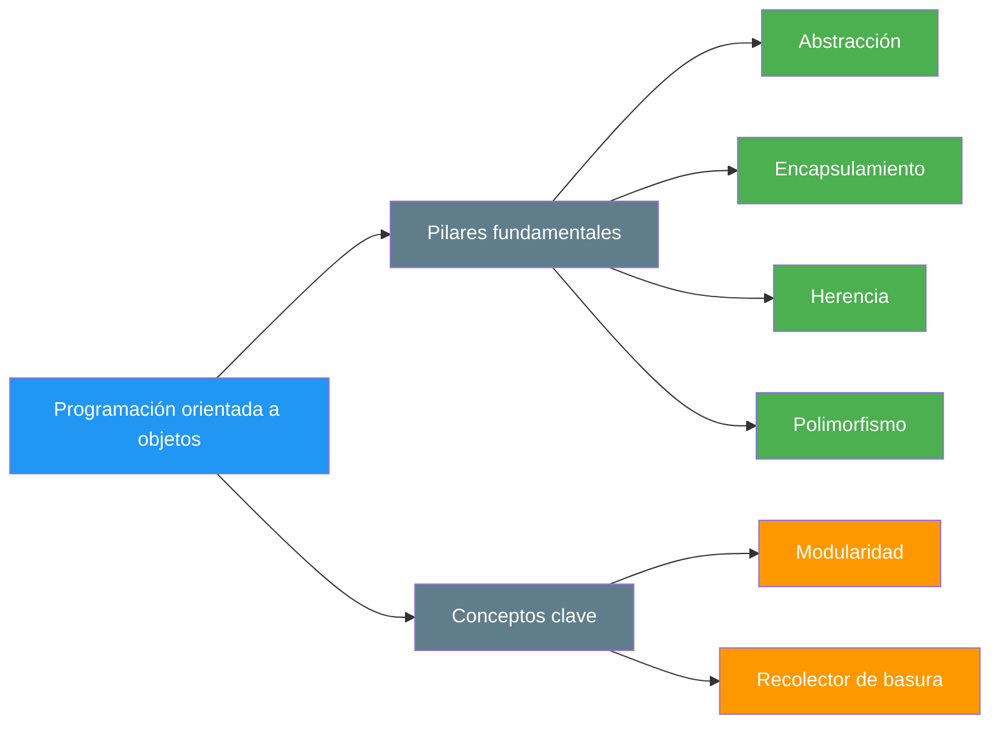

---

## Abstracción

<div class="grid grid-cols-2 gap-5 items-start">
<div>

La **abstracción** consiste en fijarnos solo en las características importantes de un objeto, dejando de lado los detalles que no importan para lo que estamos construyendo.

Al diseñar un programa para una biblioteca, por ejemplo, te interesarán el título, el autor y el número de páginas de un libro, pero probablemente no importe el tipo de papel ni el color de la portada. Si modelaras el libro "completo", tardarías una semana; con abstracción, lo tienes en una tarde.

</div>
<div>

La abstracción, en un esquema: del objeto completo solo modelamos lo que importa para nuestro programa.

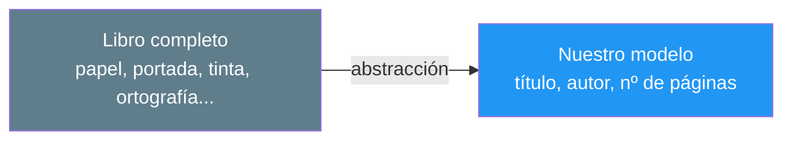

</div>
</div>

---

## Ejemplos de abstracción

<RealExample app="Netflix">

Cuando Netflix recomienda qué ver, solo mira lo importante de cada serie (género, duración, tu historial) y deja de lado detalles como la resolución del tráiler o el idioma del doblaje. Eso es abstracción: ignorar lo que no cambia la decisión.

</RealExample>

<TipBox type="analogia">

Es como mirar un coche por el retrovisor: ves lo necesario para conducir (gasolina, velocidad), no el número de tornillos que sujeta el motor.

</TipBox>

---

## Ocultación

<div class="grid grid-cols-2 gap-5 items-start">
<div>

La **ocultación** significa que cada objeto guarda sus secretos: no puedes ver ni modificar directamente sus datos internos, solo acceder a lo que te deja su interfaz pública.

Igual que con un mando de televisión: sabes que apretando el botón de encendido la tele se enciende, pero no sabes cómo funciona por dentro. Y no hace falta que lo sepas: el fabricante te oculta el circuito para que solo puedas usarlo bien.

</div>
<div>

<RealExample app="Banco">

En tu aplicación del banco, al consultar el saldo ves el resultado, pero no los movimientos internos ni la forma en que se calcula. El banco te muestra una interfaz y oculta su mecanismo.

</RealExample>

<TipBox type="advertencia">

No confundas ocultación con encapsulamiento. Son conceptos distintos que suelen ir juntos; al final del punto tienes un apartado del profesor que lo aclara con una tabla.

</TipBox>

</div>
</div>

---

## Encapsulamiento

El **encapsulamiento** junta el estado y los comportamientos de un objeto en un único contenedor (la clase), ocultando los detalles internos y controlando los cambios desde fuera. De ese modo, si mañana cambia algo por dentro del objeto, el resto del programa no se estropea.

Un automóvil decide por sí solo, según su motor y sus sensores, cuándo encender el ventilador de refrigeración; tú solo puedes conducir y revisar el panel, pero no gestionas directamente sus variables internas. Tú usas el panel (interfaz pública), él controla el motor (estado privado).

---

## Estado oculto e interfaz pública en C#

<div class="grid grid-cols-2 gap-5 items-start">
<div>

El siguiente ejemplo muestra una clase `Coche` con estado oculto y una interfaz pública controlada:

Fíjate en que `_marca` y `_velocidad` están `private`: nadie puede poner la velocidad a `-500` desde fuera, porque el único camino para tocarla es pasar por `Acelerar` y `Frenar`, que ya validan lo que hacen.

<TipBox type="consejo">

La receta de encapsulamiento en C# es siempre la misma: campos `private` + propiedades `public` que controlan el acceso. Si un campo es `public` sin control, has perdido la encapsulación.

</TipBox>

</div>
<div>

```csharp
public class Coche
{
    // Estado: campos privados (nadie de fuera
    // los toca directamente)
    private string _marca = string.Empty;
    private int _velocidad;

    // Interfaz pública: el resto del programa
    // solo pasa por aquí
    public string Marca
    {
        get => _marca;
        set => _marca = value ?? "Sin marca";
    }

    // Comportamiento: los métodos deciden
    // cómo se toca el estado
    public void Acelerar(int incremento) =>
        _velocidad += incremento;

    public void Frenar(int decremento) =>
        _velocidad = Math.Max(0,
            _velocidad - decremento);
}
```

</div>
</div>

---

## La interfaz pública es el único camino

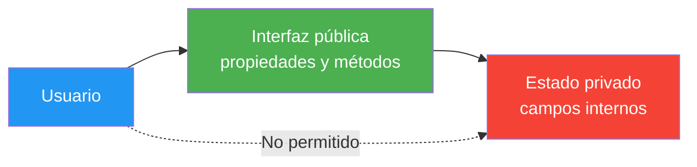

<RealExample app="Cajero automático">

Un cajero automático encapsula el dinero: tú solo pulsas "sacar dinero" e introduces el PIN (interfaz pública); el mecanismo que cuenta los billetes y descuenta de tu cuenta está oculto y solo el banco lo toca.

</RealExample>

---

## Herencia

<div class="grid grid-cols-2 gap-5 items-start">
<div>

La **herencia** permite crear clases que reutilizan características y comportamientos de otras más generales. Es como decir "todos los perros son animales": tienen patas y respiran como cualquier animal, pero además pueden ladrar.

En C#, la herencia se expresa con los dos puntos (`:`). La clase hija obtiene todo lo de la clase base y puede añadir lo suyo:

</div>
<div>

```csharp
// CocheDeportivo ES UN Coche: hereda de él
public class CocheDeportivo : Coche
{
    public bool TurboActivado { get; private set; }

    public void ActivarTurbo()
    {
        TurboActivado = true;
        Acelerar(50); // reutiliza lo heredado
    }
}
```

</div>
</div>

---

## La jerarquía de clases

`CocheDeportivo` no reescribe `Acelerar`: lo hereda y lo usa. Si mañana corriges `Acelerar` en `Coche`, todos los coches deportivos se corrigen a la vez.

La jerarquía del ejemplo, en un esquema: las hijas reutilizan todo lo del padre y solo añaden lo suyo.

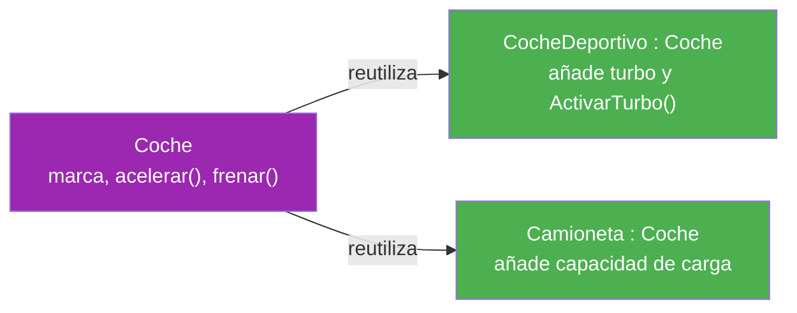

---

## Herencia: solo con relaciones "ES UN"

<RealExample app="Glovo">

En Glovo, un "pedido express" es un pedido normal al que le añades repartidor prioritario y plazo reducido. En vez de crear un sistema de pedidos desde cero, hereda todo lo que ya hace un pedido y solo añade lo que lo diferencia.

</RealExample>

<TipBox type="advertencia">

Usa herencia solo cuando exista una relación real de "ES UN" (`CocheDeportivo` es un `Coche`). Si la relación es "TIENE UN" (un coche *tiene* un motor), lo correcto es la **composición**, que verás en el punto 9. Heredar "por si acaso" produce jerarquías imposibles de mantener.

</TipBox>

---

## Polimorfismo

El **polimorfismo** da flexibilidad: diferentes objetos pueden responder a la misma orden de maneras distintas. Si le pides a tu teléfono y al televisor "encender", ambos entienden la petición, pero cada uno lo hace a su manera.

En C#, el polimorfismo se consigue con `virtual` (en la clase base) y `override` (en la clase hija): la variable decide qué método ejecuta según el objeto real que contiene, no según el tipo de la variable.

<TipBox type="consejo">

Si estás escribiendo un `if` o un `switch` que comprueba el tipo de un objeto para decidir qué hacer (`if (x is Coche)...`), casi siempre estás a punto de sustituirlo por polimorfismo. Es la señal de que toca `virtual`/`override`.

</TipBox>

---

## El polimorfismo en C#

<div class="grid grid-cols-2 gap-5 items-start">
<div>

```csharp
// En la clase Coche:
public virtual string Descripcion() =>
    $"Coche {_marca}";

// En CocheDeportivo:
public override string Descripcion() =>
    base.Descripcion() + " con turbo";

// Uso: mismo mensaje, respuesta según
// el objeto real
Coche a = new Coche();
Coche b = new CocheDeportivo();

// a.Descripcion() → Coche ...
// b.Descripcion() → Coche ... con turbo
```

</div>
<div>

Las dos líneas de `Descripcion()` son idénticas en el programa, pero salen respuestas distintas: eso es polimorfismo.

El día que añadas un `Camioneta : Coche`, tu código de llamada **no cambia**: sigue funcionando.

</div>
</div>

---

## Un mismo mensaje, tres respuestas

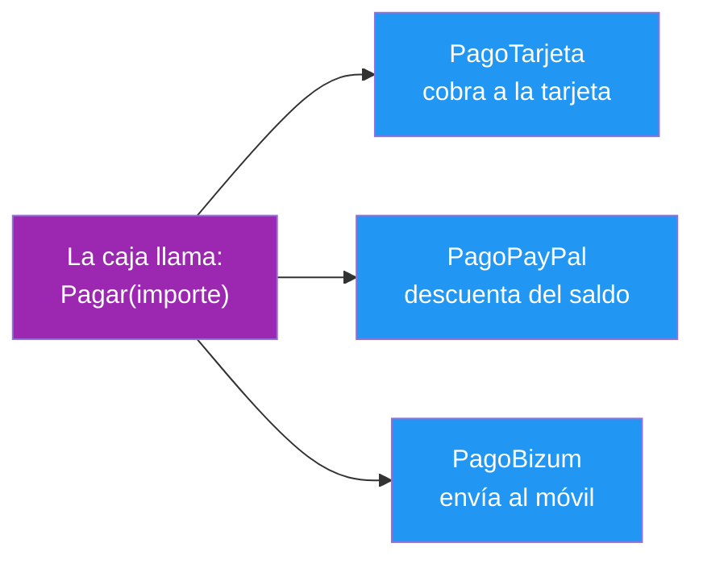

<RealExample app="Tienda online">

Las formas de pago de cualquier tienda online llaman al mismo método `Pagar(importe)`, pero con tarjeta, PayPal o Bizum cada uno ejecuta su propio código. La caja no sabe ni tiene que saber cómo paga cada cliente.

</RealExample>

---

## Modularidad

La **modularidad** es la práctica de dividir un programa en partes independientes y reutilizables llamadas módulos. Cada módulo encapsula una funcionalidad concreta y se comunica con los demás a través de interfaces bien definidas.

Los objetos, al encapsular estado y comportamiento, son módulos naturales: si el módulo de pagos falla, puedes arreglarlo sin tocar el módulo de pedidos, porque cada uno vive en su sitio y solo se hablan por sus métodos públicos.

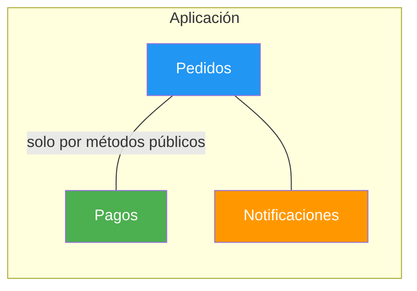

---

## Los módulos de Glovo, cada uno en su sitio

<RealExample app="Glovo">

Glovo está dividido en módulos: pedidos, restaurantes, repartidores, pagos y notificaciones. Cada equipo de desarrolladores trabaja en su módulo sin pisar el de los demás; si se cae el módulo de pagos, los pedidos siguen visualizándose.

</RealExample>

---

## El recolector de basura

El **recolector de basura** (garbage collector o GC) es un sistema automático que gestiona la memoria en C# (y en Java, Kotlin o Swift). Su función es liberar la memoria de los objetos que ya nadie referencia, evitando fugas de memoria y optimizando el rendimiento.

Funciona por referencias: mientras un objeto tiene al menos una variable apuntando a él, sigue vivo. Cuando la última referencia desaparece (por ejemplo, la variable sale de ámbito), el GC lo detecta, reclama su memoria y la deja libre para otros objetos.


---

## El GC recoge lo que ya nadie referencia

<RealExample app="Mensajería">

Una app de mensajería puede tener decenas de miles de objetos `Mensaje` en memoria. Cuando cierras el chat y ya no hay ninguna referencia a ellos, el GC los recoge y recupera esa memoria sin que tú hagas nada. En C no hay GC: si olvidas liberar, la app se queda sin memoria.

</RealExample>

<TipBox type="nota">

Por eso en C# no existe `free()` ni `delete`. Tu trabajo es no acumular referencias inútiles (por ejemplo, no guardar en una lista lo que ya no usas) y dejar que el GC haga lo suyo. Verás el heap y el stack con detalle en el punto 2.

</TipBox>

---

## Encapsulamiento u ocultación: un matiz del profesor

Es muy común confundir estos dos conceptos, y en el examen se nota. Aquí tienes la distinción definitiva:

| Concepto | Qué hace | Ejemplo en C# |
| :--- | :--- | :--- |
| **Encapsulamiento** | Agrupa estado y comportamiento en una misma unidad (la clase) | Una clase que reúne sus campos y sus métodos |
| **Ocultación** | Decide qué partes de esa cápsula se ven desde fuera y cuáles no | `private` para ocultar, `public` para exponer |

- El encapsulamiento **reúne**: pone la medicina dentro de la cápsula.
- La ocultación **protege**: decide qué lados de la cápsula son transparentes y cuáles opacos.

<TipBox type="truco">

Los cuatro pilares se memorizan con las iniciales **AEHP** (Abstracción, Encapsulamiento, Herencia, Polimorfismo). Y si te preguntan la diferencia de este apartado, la respuesta corta es: el encapsulamiento **reúne**, la ocultación **protege**.

</TipBox>

---

## Encapsulamiento y ocultación en un esquema

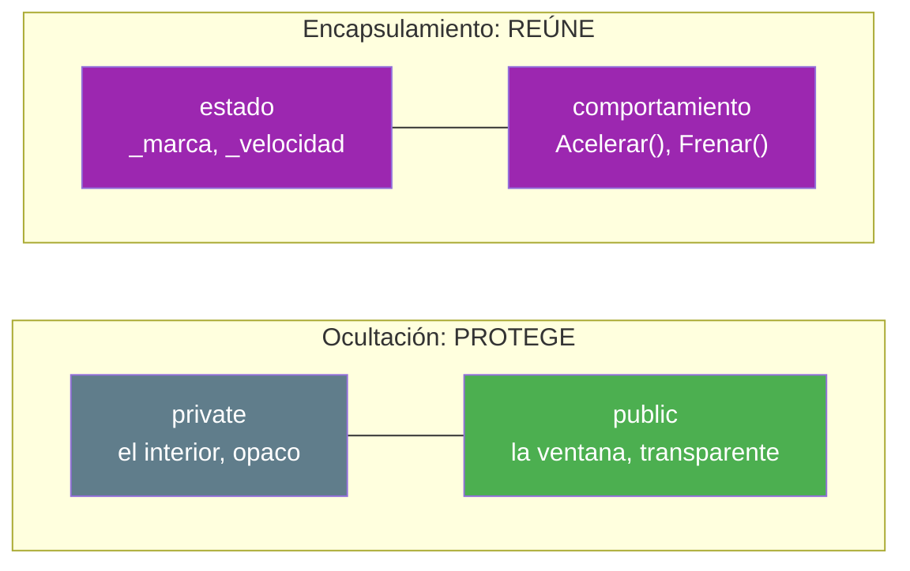

<RealExample app="App de streaming">

Una app de streaming encapsula el reproductor de vídeo (todos sus datos y métodos van juntos en una clase) y lo oculta tras unos botones: tú solo ves play, pausa y barra de progreso.

</RealExample>

---

## Resumen del punto

| Concepto | Descripción |
| :--- | :--- |
| **Objeto** | Entidad con estado, comportamiento e identidad |
| **Abstracción** | Modelar solo lo importante, ignorar el resto |
| **Ocultación** | Ocultar lo interno; solo se ve la interfaz pública |
| **Encapsulamiento** | Agrupar datos y métodos en una misma clase |
| **Herencia** | Las clases hijas reutilizan lo de la clase base (`:`) |
| **Polimorfismo** | Un mismo mensaje, respuestas distintas (`virtual`/`override`) |
| **Modularidad** | Dividir el programa en módulos independientes |
| **Recolector de basura** | Libera la memoria de los objetos a los que nadie referencia |

---

## Buenas prácticas

<ConceptCard icon="✅" title="Buenas prácticas" accent="green">

- Modelar solo lo importante antes de escribir código (abstracción)
- Mantener los campos `private` y exponerlos con propiedades públicas
- Usar herencia solo cuando exista una relación real de "ES UN"
- Preferir composición a la herencia cuando la relación sea "TIENE UN"
- Sustituir los `if` que comparan tipos por polimorfismo (`virtual`/`override`)
- No preocuparse por liberar memoria a mano: en C# lo hace el recolector de basura

</ConceptCard>

---

## ¿Qué viene después?

En el siguiente punto veremos los objetos y las clases en C#: cómo se definen, cómo se crean instancias y cómo se usan en un programa completo.
---
layout: section
---

<div class="ud-section-number">02</div>

# Objetos y clases

<div class="opacity-70">Identidad, estado, comportamiento, clases, new y memoria</div>

---

## 2 · Punto de partida

<div class="grid grid-cols-2 gap-5 items-start">
<div>

<TipBox type="consejo" title="Punto de partida">

Cuando pides una hamburguesa en una app de comida, en pantalla aparece "tu pedido": restaurante, productos, precio, estado (preparando, en camino...). Ese pedido no es un número suelto de texto: es un **objeto** con datos y con cosas que puede hacer. En este punto verás de qué se hace un objeto y cómo se fabrica uno en C#.

</TipBox>

</div>
<div>

**Objetivos de aprendizaje:**

- Diferenciar identidad, estado, comportamiento e interfaz pública de un objeto
- Explicar en qué se parecen y en qué se diferencian un objeto y un tipo simple
- Distinguir la clase (el molde) de sus instancias (los objetos fabricados)
- Crear objetos con `new` y seguir la referencia que devuelve
- Instanciar objetos a partir de clases predefinidas de la biblioteca de .NET
- Situar las variables en el stack y los objetos en el heap, y saber qué es `null`

</div>
</div>

---

## Identidad, estado y comportamiento

Un **objeto** es una representación digital de algo del mundo real o de una idea. Es como un "actor" dentro de tu programa, con personalidad (identidad), datos (estado) y capacidades (comportamiento).

<div class="flex justify-center">


</div>

---

## Identidad

La identidad es lo que hace único a cada objeto, aunque tenga la misma información que otro. En la vida real, dos carnés de identidad pueden mostrar la misma foto y los mismos datos personales, pero cada uno es una tarjeta física distinta, con su número y su dueño.

En programación, la identidad corresponde a la referencia que el ordenador guarda en memoria: cada vez que usas `new` en C#, creas un objeto con identidad propia, aunque le des exactamente los mismos datos que a otro.

<RealExample app="Instagram">

Dos bolígrafos azules nuevos pueden ser idénticos por dentro, pero uno está en Madrid y otro en Valencia: son dos unidades distintas. Igual que dos cuentas de Instagram con el mismo nombre visual: cada una tiene su identificador interno.

</RealExample>

---

## Estado

El estado de un objeto es la colección de datos que define cómo es ese objeto en un momento dado. Por ejemplo:

- Un alumno: estado = nombre, edad, nota media, curso.
- Un semáforo: estado = color actual, si está funcionando o no.

El estado puede cambiar a lo largo del tiempo si el objeto tiene comportamientos que lo permiten: el semáforo pasa de rojo a verde porque su método `avanzar()` lo decide.

---

## Comportamiento

El comportamiento es el conjunto de acciones que el objeto puede ejecutar o las respuestas que puede dar. Estas acciones pueden modificar su estado o interactuar con otros objetos. Por ejemplo:

- Una puerta: puede abrirse, cerrarse, bloquearse.
- Un reloj: puede mostrar la hora, poner la alarma, vibrar.

En programación, el comportamiento se define como los **métodos** del objeto.

---

## Interfaz pública

La interfaz pública de un objeto es el conjunto de métodos y propiedades que otras partes del programa (u otros objetos) pueden usar para interactuar con él. Es el "panel de mandos" que el objeto decide mostrar al exterior; el resto de sus miembros quedan ocultos (viene el encapsulamiento del punto anterior).

<TipBox type="analogia">

Un objeto es una nevera: el estado es lo que guarda (comida, temperatura), el comportamiento es lo que hace (enfriar, congelar), la identidad es su número de serie, y la interfaz pública son las puertas y botones que tú usas. Por dentro no ves el compresor: está oculto.

</TipBox>

---

## Objetos y tipos simples

<div class="grid grid-cols-2 gap-5 items-start">
<div>

Antes de crear tus propios objetos, observa que tipos como los números (`int`, `double`) y las cadenas (`char`, `string`) ya existen desde siempre en los lenguajes de programación:

- Un número como `42` es simplemente un valor; no necesitas rastrear su identidad, solo su estado.
- Una cadena como `"Hola"` es un pedazo de texto; puedes consultar su longitud o unirla con otras, pero no tiene una "personalidad" propia que rastrear.

El objeto va más allá: puedes definir cómo es, qué puede hacer y cómo debe comportarse en situaciones diferentes.

</div>
<div>

<RealExample app="Biblioteca">

Si tienes varios libros, cada uno tendrá un título, un autor y un número de páginas. Pero si programas una biblioteca, querrás representar cada libro como objeto para gestionarlo, buscarlo o prestarlo: ahí necesitas identidad (cada ejemplar es único, aunque la obra sea la misma).

</RealExample>

<TipBox type="nota">

En C#, tanto los tipos simples como tus clases acaban siendo "objetos" por debajo (puedes llamar `"hola".ToUpper()`), pero programarás con ellos como valores: se copian, no se comparten por referencia. Lo verás con detalle en el punto 5.

</TipBox>

</div>
</div>

---

## La clase: el molde de los objetos

En C# (y en muchos lenguajes modernos), **la clase** es la herramienta que te permite definir cómo deben ser tus objetos: qué información guardan y qué acciones pueden realizar. La clase es como el molde de una galleta: define el borde, el tamaño y la forma; luego puedes fabricar galletas diferentes, pero todas se basan en ese molde.

A cada objeto creado desde la clase se le llama **instancia**, y a todos juntas, objetos de ese tipo.

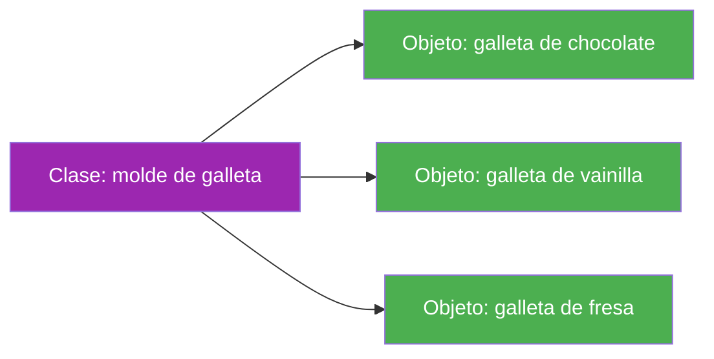

---

## Plantilla y objetos

<div class="grid grid-cols-2 gap-5 items-start">
<div class="flex justify-center">


</div>
<div class="flex justify-center">


</div>
</div>

---

## ¿Por qué tipificar los objetos?

**¿Por qué tipificar los objetos?** Tipificar significa que cada objeto tiene su propio "tipo" y que el compilador te ayuda a verificar que uses cada uno correctamente; así evitas confusiones y errores (por ejemplo, no intentas sumar una puerta a una bicicleta). Si la clase se llama `Coche`, el compilador solo dejará que trates como coche a lo que hayas creado como `Coche`.

<TipBox type="consejo">

Piensa la relación así: la clase es el **plano**, el objeto es la **casa** y la instancia es **cada casa concreta** construida con ese plano. Puedes tener mil casas del mismo plano; cada una sigue siendo una casa con su dirección.

</TipBox>

---

## Crear objetos con new

Cuando quieres utilizar un objeto en C#, lo creas a partir de una clase usando la palabra clave `new`. Esto hace tres cosas importantes:

1. **Reserva memoria** para almacenar la información del objeto.
2. **Inicializa el estado inicial** del objeto, según lo que hayas definido en la clase.
3. **Devuelve una referencia**, es decir, una "dirección" en la memoria por la que podrás localizar ese objeto para usarlo en el futuro.

¿Por qué hace falta `new`? Porque la clase **no es el objeto**: es solo el plano, guardado en los metadatos del programa. Declarar `Gato g;` no crea nada detrás: si usas la referencia sin crear el objeto, el compilador te avisa; y si la referencia acaba en `null`, el primer acceso estalla con `NullReferenceException`. Solo `new` materializa el objeto en el heap y le da a `g` una dirección real.

---

## Identidad y referencia: el programa Gato

<div class="grid grid-cols-2 gap-5 items-start">
<div>

<TipBox type="nota">

`new` no es una novedad de la POO: llevas usándolo desde la UD03 con los arrays (`new int[5]`, `new double[3, 4]`). Misma palabra, misma idea —reservar espacio en memoria—; la única diferencia es que, con una clase, al reservar se ejecuta además su constructor.

</TipBox>

Así, aunque crees dos objetos iguales (mismo estado), cada uno tendrá una referencia diferente y serán instancias distintas, con identidad propia. El siguiente programa lo demuestra con una clase `Gato`:

</div>
<div>

```csharp
// Demostración de identidad y referencia
public class Gato
{
    public string Nombre { get; set; }
    public Gato(string nombre) => Nombre = nombre;
}

// Creamos dos objetos con el MISMO estado
var gato1 = new Gato("Luna");
var gato2 = new Gato("Luna");

Console.WriteLine(gato1 == gato2);      // false
Console.WriteLine(gato1.Equals(gato2)); // false
Console.WriteLine(gato1.GetHashCode()); // distinto
Console.WriteLine(gato2.GetHashCode()); // distinto

// gato3 referencia al MISMO objeto que gato1
var gato3 = gato1;
Console.WriteLine(gato1 == gato3);      // true
Console.WriteLine(gato1.GetHashCode()); // igual
```

</div>
</div>

---

## Referencias en el stack y el heap

<div class="grid grid-cols-2 gap-5 items-start">
<div>

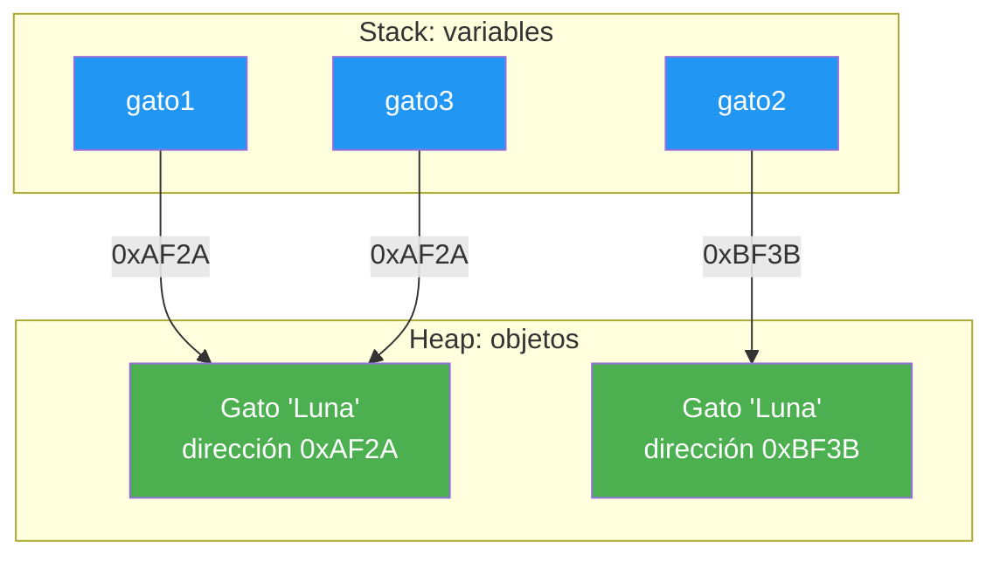

</div>
<div>

<RealExample app="Instagram">

Cuando Instagram te notifica "tu foto tiene 3 likes", actualiza el estado de un único objeto `Foto` al que apuntan muchas referencias (tu móvil, el de tus amigos, los servidores). Todos ven el mismo objeto, no copias sueltas.

</RealExample>

<TipBox type="analogia">

Un objeto es una casa y la referencia es la dirección. Cuando escribes `Gato gato1 = new Gato()`, estás: construyendo la casa (el objeto), obteniendo la dirección (la referencia `0xAF2A`) y guardando esa dirección en tu agenda (la variable `gato1`).

</TipBox>

</div>
</div>

---

## Objetos a partir de clases predefinidas

No todas las clases las escribes tú: la propia biblioteca de clases de .NET (BCL) trae cientos de clases listas para usar, y **se usan exactamente igual** que una clase que hayas definido tú: con `new`, con punto y con sus métodos.

```csharp
// Clases predefinidas de .NET, iguales que las tuyas
var azar = new Random();                  // un dado: 1..6
Console.WriteLine(azar.Next(1, 7));

var datos = new List<int> { 10, 20, 30 };
Console.WriteLine(datos.Count);           // 3

var texto = "  Hola Mundo  ";
// Trim() + ToUpper() → HOLA MUNDO
Console.WriteLine(texto.Trim().ToUpper());

var hoy = DateTime.Now;                   // fecha y hora
Console.WriteLine($"Hoy es {hoy:dd/MM/yyyy}" +
    $" y son las {hoy:HH:mm}");
```

---

## El patrón new → punto → método

El patrón es siempre el mismo: **`new` → punto → método o propiedad**. Da igual que la clase la hayas escrito tú (`Gato`) o que venga de fábrica (`Random`, `List<T>`, `DateTime`): `new Random()` crea una instancia, `azar.Next(1, 7)` llama a un método de esa instancia y `hoy.Year` lee una propiedad.

<RealExample app="Videojuegos">

Un videojuego usa `new Random()` para decidir qué objeto cae del cielo; una app de mensajería usa `new StringBuilder()` (clase de `System.Text`) para concatenar miles de mensajes sin gastar memoria; cualquier programa con fechas trabaja con objetos `DateTime` en vez de cadenas sueltas.

</RealExample>

---

## Consejos sobre las clases de fábrica

<TipBox type="consejo">

Cuando en un ejercicio necesites algo "de fábrica" (fechas, azar, texto largo, colecciones), no lo reinventes: busca si la BCL ya tiene una clase para eso. Eso es reutilizar librerías de objetos, y es como se programa de verdad.

</TipBox>

<TipBox type="nota">

`string`, `int` y `DateTime` son tipos, pero por debajo son clases con métodos: por eso `"hola".ToUpper()` funciona aunque `string` no lo hayas definido. En C# casi todo es objeto; la diferencia está en cómo se copian (punto 5).

</TipBox>

---

## Stack y heap: dónde vive cada objeto

Para un desarrollador, es vital entender qué pasa dentro del ordenador cuando escribes `Gato miGato = new Gato();`:

1. **Stack (pila):** memoria muy rápida pero pequeña. Aquí se guarda el nombre de la variable (`miGato`) y su **referencia** (la dirección del objeto).
2. **Heap (montículo):** memoria más grande donde viven los **objetos reales**. Allí es donde `new` reserva el espacio para los datos del gato.


---

## La referencia que apunta a nada

<div class="grid grid-cols-2 gap-5 items-start">
<div>

Si la variable del stack no tiene ninguna dirección (apunta a nada), su valor es **`null`**. Si intentas usarla así, el programa falla porque no sabe a qué dirección del heap ir a buscar los datos. Eso es lo que aprenderemos a gestionar como **seguridad ante nulos**.

<TipBox type="truco">

En el examen, cuando veas `new Clase()`, piensa: "se crea un objeto en el heap y se devuelve su referencia". Cuando veas `Clase objeto;` sin `new`, piensa: "solo existe una variable en el stack que apunta a `null`".

</TipBox>

</div>
<div>

<RealExample app="Mensajería">

Cuando una app de mensajería se queda sin cobertura y no puede cargar el chat, muestra "sin mensajes" en vez de romperse: está comprobando referencias `null` antes de usarlas.

</RealExample>

</div>
</div>

---

## Resumen del punto

| Concepto | Descripción |
| :--- | :--- |
| **Objeto** | Representación con identidad, estado y comportamiento |
| **Identidad** | Lo que hace único a cada objeto (su referencia en memoria) |
| **Estado** | Los datos que guarda en un momento dado |
| **Comportamiento** | Las acciones que puede ejecutar (sus métodos) |
| **Interfaz pública** | Lo que el objeto deja ver y usar desde fuera |
| **Clase** | El molde que define cómo serán sus objetos |
| **Instancia** | Cada objeto concreto fabricado desde la clase |
| **`new`** | Reserva memoria, inicializa y devuelve una referencia |
| **Referencia** | "Dirección" del objeto en el heap; `null` si apunta a nada |
| **Clases predefinidas** | Objetos de la biblioteca de .NET: se usan igual que los tuyos |
| **Stack vs. heap** | Variables y referencias en el stack; objetos en el heap |

---

## Buenas prácticas

<ConceptCard icon="✅" title="Buenas prácticas" accent="green">

- Definir la clase (el molde) antes que las instancias que fabricarás con ella
- Recordar que `new` devuelve una referencia: dos objetos iguales no son el mismo objeto
- No reinventar lo que la biblioteca de .NET ya trae (`Random`, `DateTime`, `List<T>`...)
- Comprobar las referencias contra `null` antes de usarlas
- Distinguir siempre: la variable vive en el stack, el objeto en el heap

</ConceptCard>

---

## ¿Qué viene después?

En el siguiente punto veremos cómo se organiza un proyecto en C#: espacios de nombres, soluciones, proyectos y ensamblados, y cómo crear y compilar uno desde el entorno de desarrollo.
---
layout: section
---

<div class="ud-section-number">03</div>

# Espacios de nombres y organización del proyecto

<div class="opacity-70">Namespaces, soluciones, proyectos y librerías con NuGet</div>

---

## 3 · Punto de partida

<div class="grid grid-cols-2 gap-5 items-start">
<div>

<TipBox type="consejo" title="Punto de partida">

Cuando reparto la ropa de casa en cajones y arcones, cada pieza tiene su sitio y nunca la busco debajo de la cama. En un programa pasa igual: si metes todas las clases en un único fichero sin orden, llega un momento en que no sabes dónde está nada. En este punto aprenderás a organizar tu código con **espacios de nombres**, **soluciones** y **proyectos**, y a crear y compilar un programa desde cero con Rider y con la consola.

</TipBox>

</div>
<div>

**Objetivos de aprendizaje:**

- Definir espacios de nombres con la forma *file-scoped* y usar `using` y alias para importar tipos
- Distinguir solución, proyecto y ensamblado, y saber qué archivo corresponde a cada uno
- Crear un proyecto con la CLI (`dotnet new`) y en Rider, y compilarlo y ejecutarlo en ambos
- Incorporar una librería de objetos con NuGet y usar sus tipos en tu código
- Reconocer los errores habituales al instalar paquetes y saber cómo resolverlos

</div>
</div>

---

## Namespace: una carpeta virtual

Un **namespace** (espacio de nombres) es como una carpeta virtual que agrupa tipos relacionados: clases, structs, interfaces… Te permite organizar tus clases y evitar que dos clases con el mismo nombre se mezclen o generen errores.

<RealExample app="Archivos de clase">

Es como tener los documentos de "Matemáticas" y "Historia" en carpetas distintas: ambos pueden tener un archivo llamado "Examen.docx", pero están separados y no entran en conflicto. En una app de banco, `Banco.Core.Cuenta` y `Banco.Pruebas.Cuenta` son dos clases distintas que conviven sin pisarse.

</RealExample>

---

## Namespace tradicional y file-scoped

<div class="grid grid-cols-2 gap-5 items-start">
<div>

Así se define una clase dentro de un espacio de nombres tradicional (con llaves):

```csharp
namespace MiAplicacion.Modelos
{
    public class Persona
    {
        public string Nombre { get; set; } =
            string.Empty;
    }
}
```

</div>
<div>

Desde C# 10 existe una forma más concisa y recomendada: el namespace a nivel de archivo. Se escribe una sola línea con punto y coma y **todo el archivo queda dentro** de ese espacio de nombres, sin llaves que abrir ni cerrar:

```csharp
namespace MiAplicacion.Modelos;

public class Producto
{
    public string Nombre { get; set; } =
        string.Empty;
}
```

</div>
</div>

---

## Consejos sobre el namespace

<TipBox type="consejo">

En todos los puntos de esta unidad usaremos la forma *file-scoped* (`namespace X;`), porque es la que pide la norma del proyecto. Si abres un fichero y ves `namespace X;` sin llaves, no es un error: es la sintaxis moderna.

</TipBox>

<TipBox type="advertencia">

El namespace **no** tiene por qué coincidir con la carpeta física donde vive el fichero, aunque es costumbre que sí coincida para que te sea fácil encontrar las clases al navegar por el proyecto.

</TipBox>

---

## Using: importar espacios de nombres

<div class="grid grid-cols-2 gap-5 items-start">
<div>

La instrucción **`using`** permite importar otros espacios de nombres al archivo, para poder usar sus clases sin escribir el nombre completo cada vez.

Si repites muchas veces `MiAplicacion.Modelos.Persona`, puedes importar el namespace una sola vez arriba del fichero:

```csharp
using MiAplicacion.Modelos;

// Ahora puedes escribir simplemente:
Persona p = new Persona();
```

</div>
<div>

<RealExample app="Consola">

Cuando en la consola escribes `Console.WriteLine(...)`, el `using System;` del archivo es el que te ahorra escribir `System.Console.WriteLine(...)` en cada línea. Todo programa de C# lleva `using System;` (o los *implicit usings* del proyecto) precisamente por esto.

</RealExample>

<TipBox type="truco">

Si dudas de dónde sale una clase, mira los `using` del archivo. El compilador sabe de dónde viene porque se lo dice el `using`; si falta, el error es "no se encontró el tipo o el espacio de nombres".

</TipBox>

</div>
</div>

---

## Alias: un nombre corto para un tipo

<div class="grid grid-cols-2 gap-5 items-start">
<div>

También puedes crear un **alias**, un nombre corto para un tipo o un namespace. Es muy útil cuando dos clases distintas se llaman igual:

```csharp
using M = MiAplicacion.Modelos;
using B = MiAplicacion.Biblioteca;

// Ahora puedes distinguirlas por el alias:
M.Persona p = new M.Persona();
B.Persona b = new B.Persona();
```

</div>
<div>

El mapa de los alias, de un vistazo: dos `Persona` distintas conviven sin pisarse porque cada una vive en su namespace, y el alias es el nombre corto con el que las llamas.

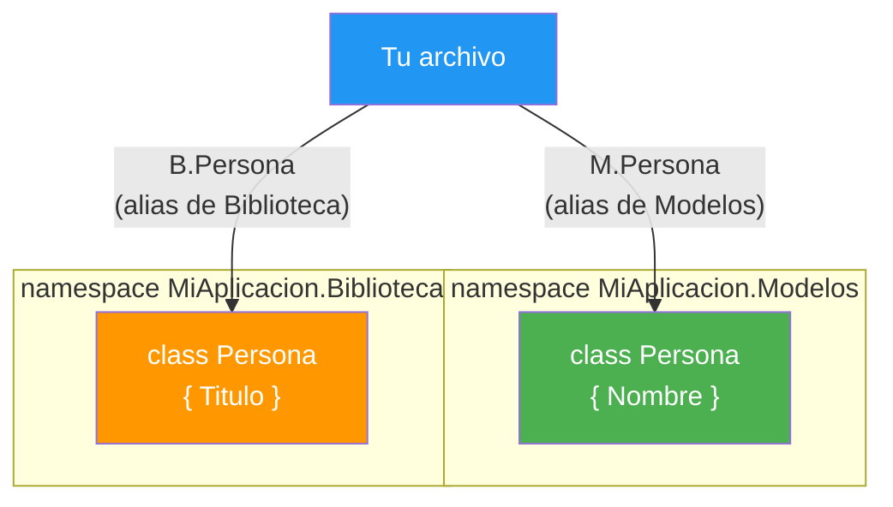

</div>
</div>

---

## Using static

Y con **`using static`** importas los miembros estáticos de una clase concreta para usarlos directamente, sin poner el nombre de la clase:

```csharp
using static System.Math;

// Sqrt(25) es igual que Math.Sqrt(25)
double resultado = Sqrt(25);
Console.WriteLine(resultado); // 5
```

---

## Soluciones, proyectos y ensamblados

Antes de escribir código conviene tener claro el mapa de carpetas que usarás en todos tus proyectos. Se estructura en tres niveles:

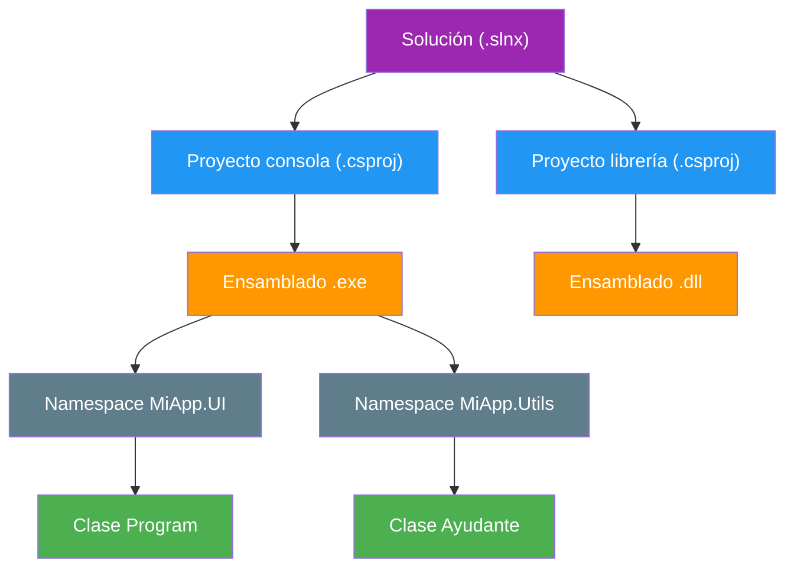

---

## Los tres niveles, uno a uno

<div class="grid grid-cols-3 gap-4 items-start">
<div>

<ConceptCard icon="🗂️" title="Solución (.slnx)" accent="purple">

Contenedor que agrupa uno o más **proyectos** relacionados. En .NET 10 el formato por defecto es el fichero **`.slnx`** (XML); si encuentras un `.sln` antiguo, puedes migrarlo con `dotnet sln migrate`.

</ConceptCard>

</div>
<div>

<ConceptCard icon="📦" title="Proyecto (.csproj)" accent="blue">

Unidad que se compila en un ensamblado (EXE o DLL). Define sus propias dependencias, referencias y configuración en un fichero `.csproj`.

</ConceptCard>

</div>
<div>

<ConceptCard icon="⚙️" title="Ensamblado" accent="green">

Resultado de compilar un proyecto: un `.exe` ejecutable o una biblioteca `.dll`. Contiene el código compilado, los metadatos y los recursos del proyecto.

</ConceptCard>

</div>
</div>

<TipBox type="analogia">

Piensa en una fábrica de muebles: la **solución** es el polígono industrial completo, cada **proyecto** es una nave con su máquina (el ensamblador) y el **ensamblado** es la caja final que sale por la puerta, lista para usar.

</TipBox>

---

## Relación práctica

Los cuatro conceptos se relacionan así:

- Una **solución** puede tener varios proyectos.
- Cada **proyecto** genera su propio ensamblado y puede tener diferentes namespaces.
- Un **ensamblado** es el resultado de compilar un proyecto.
- Los **namespaces** organizan los tipos dentro de los proyectos y pueden coincidir o no con la estructura de carpetas reales.

<RealExample app="TiendaDawApi-NetCore">

En la TiendaDawApi-NetCore hay una solución con varios proyectos: la API, la librería de dominio y los tests. Cada uno compila a su propio `.dll` y se comunican entre sí por referencias y namespaces.

</RealExample>

---

## Crear y compilar con la CLI

Para crear un programa simple no hace falta más que dos cosas: crear el proyecto y compilarlo. Desde cualquier carpeta, la consola crea un proyecto de consola llamado `MiPrimerPrograma`:

```bash
# Crear un proyecto de consola en una carpeta nueva
dotnet new console -n MiPrimerPrograma
cd MiPrimerPrograma

# Compilar (genera el ensamblado en bin/)
dotnet build

# Compilar y ejecutar en un solo paso
dotnet run

# Crear una solución e incorporar el proyecto
dotnet new sln -n MiSolucion
dotnet sln add MiPrimerPrograma/MiPrimerPrograma.csproj
```

---

## Qué hacen los comandos

`dotnet new console` genera el `.csproj` y el `Program.cs` con *Top-Level Statements*, listos para escribir. `dotnet build` comprueba el código y, si no hay errores, crea el ensamblado en la carpeta `bin/`; `dotnet run` compila (si hace falta) y lo ejecuta.

<RealExample app="Integración continua">

Todo el material de esta asignatura se puede crear y compilar así sin abrir ningún IDE: es exactamente lo que hace un *pipeline* de integración continua en una empresa antes de aprobar una versión.

</RealExample>

---

## Crear y compilar en JetBrains Rider

En Rider el flujo es el mismo, pero con botones:

1. **File → New Solution** (o `Ctrl+Alt+Shift+N`) y eliges **Console Application** con nombre y carpeta.
2. Rider genera la solución, el `.csproj` y el `Program.cs`.
3. Escribes tu código en el editor.
4. Pulsas **Run** (el triángulo verde) o `Shift+F10`: Rider compila y ejecuta.
5. Para compilar sin ejecutar: **Build → Build Solution** o `Ctrl+F9`.

La salida se ve en la consola inferior del IDE, con los errores señalados en el editor con un subrayado rojo: si hay un error de compilación, no llega a generarse el ensamblado.

---

## El IDE usa los mismos comandos

<TipBox type="nota">

Da igual dónde lo hagas: el IDE usa exactamente los mismos comandos (`dotnet new`, `dotnet build`, `dotnet run`) que escribiste a mano en la CLI. Por eso los profesionales y los entornos automatizados prefieren la CLI: funciona en cualquier ordenador sin instalar un IDE.

</TipBox>

<TipBox type="consejo">

Si Rider no te compila, mira primero la pestaña **Errors**: el 90 % de los errores de principiante son de sintaxis (falta un `;` o una llave). Compilar a menudo (en vez de al final) te ahorra horas: cuanto antes salte el error, más fácil es encontrarlo.

</TipBox>

---

## NuGet: el gestor de paquetes

Casi nada se escribe de cero: los programas reales se construyen **encima de librerías**, conjuntos de clases ya probadas que resuelven problemas habituales. **NuGet** es el gestor de paquetes de .NET: un almacén en línea con cientos de miles de librerías que se descargan y referencian desde tu proyecto. La forma más cómoda de instalar un paquete es la CLI, **desde la carpeta que contiene el `.csproj`**:

```bash
# Añadir una librería al proyecto actual
dotnet add package Spectre.Console

# Ver los paquetes instalados y sus versiones
dotnet list package

# Restaurar paquetes (lo hace build automáticamente)
dotnet restore
```

---

## La instalación versionada en el .csproj

Al instalar, .NET escribe una referencia en el fichero `.csproj`. Esa línea **es la instalación hecha y versionada**: quien clone el proyecto la restaura automáticamente.

```xml
<ItemGroup>
  <PackageReference
    Include="Spectre.Console"
    Version="0.53.0" />
</ItemGroup>
```

---

## El recorrido de un paquete

<div class="grid grid-cols-2 gap-5 items-start">
<div>

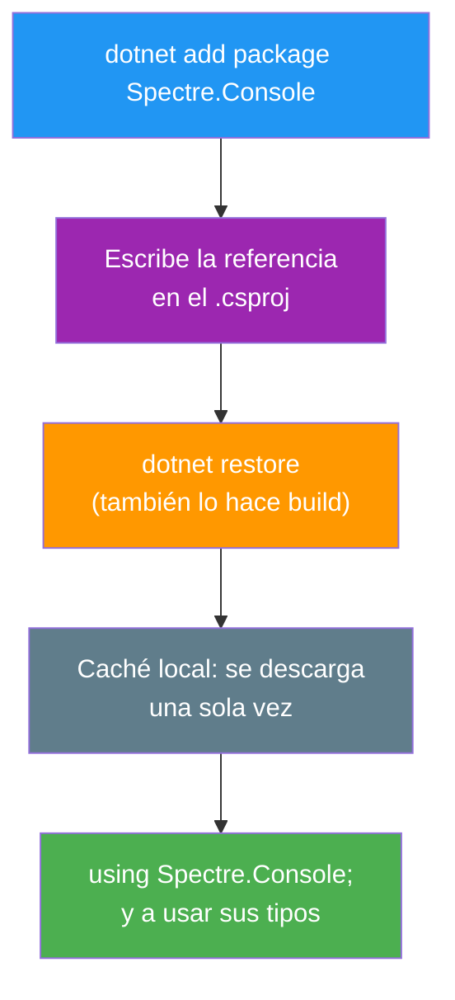

</div>
<div>

<RealExample app="Rider">

Rider tiene un panel gráfico de **NuGet** para instalar con un clic (click derecho en el proyecto → Manage NuGet Packages), pero en el ámbito profesional se prefiere la CLI: queda en los *scripts*, en la documentación y en los pipelines de integración continua sin depender de un IDE.

</RealExample>

</div>
</div>

---

## Versiones fijas y carpeta correcta

<TipBox type="nota">

La versión del paquete se fija en el `.csproj`. No compites "la última" a ciegas: se usa la versión con la que se probó el código, para que mañana el ejemplo siga compilando igual.

</TipBox>

<TipBox type="advertencia">

Los comandos `dotnet add package` se ejecutan **dentro de la carpeta del proyecto** (la que tiene el `.csproj`), no en la carpeta de la solución. Si los lanzas donde no toca, el paquete no se añade a ningún sitio.

</TipBox>

---

## Usar una librería en tu código

Instalar el paquete solo te da los tipos: para usarlos, importa su espacio de nombres con `using` y trátalos como cualquier otra clase. Este programa usa `Spectre.Console` (una librería externa) junto con clases de la BCL:

```csharp
using Spectre.Console; // librería externa (NuGet)

// Texto con color con etiquetas [color]...[/]
AnsiConsole.MarkupLine("[green]Aprobados:[/] 4 de 5");

// Una tabla: objeto de una clase de la librería
var tabla = new Table()
    .Border(TableBorder.Rounded)
    .AddColumn(new TableColumn("Alumno").Centered())
    .AddColumn(new TableColumn("Nota").Centered());

tabla.AddRow("Lucía", "7,5");
tabla.AddRow("Marcos", "4,0");
AnsiConsole.Write(tabla);
```

---

## El patrón es idéntico

Fíjate en que el patrón es **idéntico** al de cualquier clase: `new Table()` crea un objeto, `.AddColumn(...)` llama a sus métodos y `AnsiConsole` agrupa operaciones estáticas. Da igual que la clase la hayas escrito tú o que venga de una librería: la usas igual.

<RealExample app="Spotify">

Cuando una app de Spotify muestra tablas y colores en consola, o cuando un servicio de Netflix escribe sus registros de actividad en fichero, está usando librerías instaladas igual: `dotnet add package` y un `using`. Nadie reescribe un motor de log ni un generador de tablas.

</RealExample>

<TipBox type="consejo">

Antes de escribir una utilidad a mano, pregunta: "¿hay un paquete para esto?". Buscar y reutilizar librerías es señal de un profesional, no de pereza.

</TipBox>

---

## Errores comunes al instalar paquetes

| Error | Por qué ocurre | Cómo evitarlo |
| :--- | :--- | :--- |
| **`NU1101: no se encuentra el paquete`** | Error en el nombre o falta el *restore* | Revisa el nombre y ejecuta `dotnet restore` |
| **Versión incompatible con el framework** | El paquete no soporta `net10.0` | Comprueba la versión con `dotnet list package` |
| **Olvidar el `using`** | El paquete está instalado pero no se importa | Añade `using Spectre.Console;` (o el que corresponda) |
| **Comando en la carpeta equivocada** | Se lanzó fuera de la carpeta del `.csproj` | Entra en la carpeta del proyecto antes de `dotnet add package` |

---

## La estructura de trabajo en el explorador

Este es el mapa completo que verás en el explorador de Rider al crear un proyecto con solución:

- La **solución** (`.slnx`) agrupa uno o más **proyectos** (`.csproj`).
- Cada proyecto, al compilar, genera su **ensamblado** (`.exe` o `.dll`) en `bin/`.
- Dentro de cada proyecto, los tipos se agrupan en **namespaces** (`MiApp.UI`, `MiApp.Utils`…).
- Y dentro de cada namespace viven tus **clases** (`Program`, `Ayudante`…).

---

## Resumen del punto

| Concepto | Descripción |
| :--- | :--- |
| **Namespace** | Carpeta virtual que agrupa clases y evita conflictos de nombres |
| **File-scoped namespace** | Forma moderna (C# 10+): `namespace X;` sin llaves |
| **`using`** | Importa un namespace al archivo para usar sus tipos a corto |
| **`using static`** | Importa los miembros estáticos de una clase (`Sqrt(...)` en vez de `Math.Sqrt`) |
| **Solución (.slnx)** | Contenedor de proyectos relacionados; formato XML por defecto en .NET 10 |
| **Proyecto (.csproj)** | Unidad que se compila a un ensamblado con sus dependencias |
| **Ensamblado** | Resultado de compilar: `.exe` ejecutable o `.dll` biblioteca |
| **`dotnet new / build / run`** | Crear, compilar y ejecutar un proyecto desde la CLI |
| **NuGet** | Gestor de paquetes; `dotnet add package` añade la referencia al `.csproj` |
| **Paquete** | Librería externa que se instala y se usa con `using` como cualquier clase |

---

## Buenas prácticas

<ConceptCard icon="✅" title="Buenas prácticas" accent="green">

- Nombrar los namespaces para que reflejen la estructura lógica del proyecto (`MiEmpresa.MiApp.Servicios`)
- Usar la forma *file-scoped* (`namespace X;`) de forma consistente
- No mezclar tipos sin relación en el mismo namespace
- Compilar a menudo (`dotnet build` o `Ctrl+F9`) para cazar errores pronto
- Instalar paquetes por CLI desde la carpeta del `.csproj` y fijar su versión
- Recordar el `using` de la librería antes de usar sus tipos

</ConceptCard>

---

## ¿Qué viene después?

En el siguiente punto veremos cómo se define una clase en C#: sus miembros, modificadores de acceso y la sintaxis completa con la que construirás tus propios objetos.
---
layout: section
---

<div class="ud-section-number">04</div>

# Definición de clases y miembros

<div class="opacity-70">Sintaxis, estado, comportamiento, visibilidad y modificadores</div>

---

## 4 · Punto de partida

<div class="grid grid-cols-2 gap-5 items-start">
<div>

<TipBox type="consejo" title="Punto de partida">

Si abres la capucha de una máquina de café, verás cables, bombas y sensores que no quieres tocar; tú solo usas la pantalla y el botón. Una clase funciona igual: por dentro guarda sus datos y su lógica, y por fuera solo deja ver un panel de mandos. En este punto aprenderás a definir esa clase, a decidir qué se ve y qué no, y a leerlo en un diagrama UML.

</TipBox>

</div>
<div>

<div class="flex justify-center">
  
</div>

</div>
</div>

---

## Qué aprenderás en este punto

- Escribir la sintaxis de una clase en C#
- Separar estado (propiedades) de comportamiento (métodos)
- Usar parámetros en la llamada a métodos: por valor, `ref`, `out` y argumentos con nombre
- Controlar la visibilidad de cada miembro con los modificadores de acceso
- Representar la clase en un diagrama UML

<RealExample app="App de mensajería">

Cualquier app de mensajería modela un `Mensaje` como clase: su estado es el texto, el remitente y la hora; su comportamiento es enviarse o archivarse; y su visibilidad decide que nadie desde fuera pueda borrar el texto directamente sin pasar por las reglas de la clase.

</RealExample>

---

## Sintaxis básica de una clase

La estructura mínima de una clase se escribe con la palabra clave `class`, seguida del nombre y un bloque de llaves `{}` que contiene sus miembros. El nombre va siempre en **PascalCase** (mayúscula inicial en cada palabra).

<div class="grid grid-cols-2 gap-5 items-start">
<div>

```csharp
public class Gato
{
    // Atributos (estado)
    public string Nombre;
    public int Edad;
    // Método (comportamiento)
    public void Maullar()
    {
        Console.WriteLine(
            $"{Nombre} está maullando.");
    }
}
```

</div>
<div>

`Nombre` y `Edad` son el **estado**, y `Maullar()` es el **comportamiento**. Con `new Gato()` fabricas un objeto concreto a partir de ese molde.

<TipBox type="nota">

Una clase puede tener tanto atributos como métodos, y también otros miembros (propiedades, eventos, constructores) que iremos añadiendo punto a punto.

</TipBox>

</div>
</div>

---

## Estado definido por propiedades

Las **propiedades** son las que guardan los datos del objeto. Permiten leer y modificar el estado de forma segura, y por eso se usan **preferiblemente en lugar de los campos públicos**: si mañana necesitas validar o proteger el dato, no tienes que cambiar el resto del programa.

<div class="grid grid-cols-2 gap-5 items-start">
<div>

```csharp
public class Pelota
{
    public string Color { get; set; } =
        string.Empty;
}
```

</div>
<div>

La propiedad `Color` almacena el estado de cada pelota, y cualquier parte del programa puede leerla o cambiarla por la puerta pública.

<TipBox type="advertencia">

Un campo `public string Color;` «funciona» igual, pero deja que cualquiera le ponga cualquier cosa (`Color = null` o `Color = "7"`). La propiedad es el paso previo para controlar eso, como verás en el punto 7.

</TipBox>

</div>
</div>

---

## Comportamiento definido por métodos

Los **métodos** de la clase representan acciones o respuestas: son lo que el objeto *hace*. Se escriben en PascalCase, igual que el nombre de la clase.

<div class="grid grid-cols-2 gap-5 items-start">
<div>

```csharp
public class Pelota
{
    public string Color { get; set; } =
        string.Empty;
    public void Botar()
    {
        Console.WriteLine(
            "¡La pelota ha botado!");
    }
}
```

</div>
<div>

<RealExample app="App de reparto">

En una app de reparto, el objeto `Pedido` tiene métodos como `Cancelar()` o `MarcarComoEntregado()`: nadie de fuera «marca a mano» el estado del pedido; se hace a través de su comportamiento, que aplica las reglas de negocio.

</RealExample>

</div>
</div>

---

## Cómo pasar datos a un método

Los métodos casi nunca trabajan siempre con los mismos datos: reciben **parámetros** que le dicen qué usar en cada llamada. Al llamar a un método le pasas **argumentos**, y en C# se pueden pasar de varias formas.

<div class="grid grid-cols-2 gap-5 items-start">
<div>

```csharp
public class Calculadora
{
    // 1. Paso por valor: recibe una COPIA
    public int Duplicar(int numero) =>
        numero * 2;
    // 2. ref: MODIFICA el original
    public void Redondear(ref double valor)
        => valor = Math.Round(valor);
    // 3. out: DEBE asignarlo antes de terminar
    public void Dividir(int a, int b,
        out int cociente, out int resto)
    {
        cociente = a / b;
        resto = a % b;
    }
}
```

</div>
<div>

- **Por valor**: el método recibe una **copia**
- **`ref`**: recibe la referencia y puede **modificar** el original
- **`out`**: el método **debe** asignar el valor antes de terminar

</div>
</div>

---

## Llamar a los tres, con sus consecuencias

Así se llaman los tres modos, cada uno con su efecto en los datos del llamante:

```csharp
var calc = new Calculadora();
// Por valor: el original no se entera
int resultado = calc.Duplicar(5);  // resultado = 10
// ref: el original SÍ cambia
double precio = 4.999;
calc.Redondear(ref precio);        // precio = 5.0
// out: el método devuelve dos resultados a la vez
calc.Dividir(17, 5,
    out int cociente, out int resto);
// cociente = 3, resto = 2
```

<TipBox type="truco">

Si un método necesita devolver **varios resultados**, un `out` suele ser más cómodo que crear una clase entera solo para eso. Y si necesitas modificar el dato original del llamante, ese es `ref`; si el dato no cambia nunca, mejor `in` o nada (paso por valor).

</TipBox>

---

## Argumentos con nombre y parámetros opcionales

También puedes facilitar las llamadas con **argumentos con nombre** y **parámetros opcionales**, para que quien llame solo indique lo que le interese.

<div class="grid grid-cols-2 gap-5 items-start">
<div>

```csharp
public void Registrar(string nombre,
    string rol = "cliente", int intentos = 0)
{
    // ...
}
Registrar("Ana");
// rol e intentos usan sus valores por defecto
Registrar("Luis", intentos: 3);
// argumento con nombre: salta el
// parámetro intermedio
```

</div>
<div>

<TipBox type="nota">

Los modificadores `ref`, `out` e `in` se estudiaron en la **UD02** (programación modular, tabla de modificadores de parámetros). Aquí los aplicas a los métodos de tus propias clases: mismo concepto, nuevo contexto.

</TipBox>

<RealExample app="App de fotos">

Cuando una app te deja subir una foto sin indicar la descripción (parámetro opcional) o al revés, escribiendo solo `descripcion: "playa"` sin tocar el resto (argumento con nombre), están usando estas formas de llamada. El `out` es el que usas con `int.TryParse` para devolver el número y a la vez decir si ha ido bien.

</RealExample>

</div>
</div>

---

## Visibilidad: cuándo usar cada uno

Un **atributo o campo** es una variable interna a la clase. Elegir bien su visibilidad es la esencia del encapsulamiento:

<div class="grid grid-cols-2 gap-5 items-start">
<div>

- **Campos privados** (`private`): solo visibles dentro de la clase. Almacenan datos internos que no deben tocarse desde fuera y se manipulan mediante métodos o propiedades. Se suelen nombrar con guion bajo inicial (`_miCampo`).
- **Campos públicos** (`public`): visibles desde fuera… ¡evítalos! Mejor expón propiedades con acceso controlado.
- **Métodos privados**: operaciones internas que no deben ser accesibles desde fuera. Sirven para organizar la lógica dentro de la clase.
- **Métodos públicos**: la interfaz del objeto, lo que otros objetos pueden hacer con él.

</div>
<div>

```csharp
public class Caja
{
    // solo accesible desde métodos de Caja
    private string _contenido = string.Empty;
    // accesible desde fuera
    public string Tipo { get; set; } =
        string.Empty;
    // Método privado: lógica interna
    private int CalcularPeso() =>
        _contenido.Length * 2;
    // Método público: la puerta de entrada
    public void Guardar(string item) =>
        _contenido = item;
}
```

</div>
</div>

---

## La caja desde fuera

Este es el uso de esa clase desde fuera: solo se llega a lo público, y por los caminos que la clase decide.

```csharp
var miCaja = new Caja();
miCaja.Tipo = "Madera";     // OK: propiedad pública
// miCaja._contenido = "Juguetes";
// ERROR: campo privado
miCaja.Guardar("Juguetes"); // OK: método público
// miCaja.CalcularPeso();
// ERROR: método privado
```

<RealExample app="Cajero automático">

Un cajero automático tiene partes públicas (pantalla, ranura de tarjeta) y partes privadas (el mecanismo que cuenta billetes). Si el mecanismo fuera público, cualquiera podría pedirle que sacara dinero sin PIN.

</RealExample>

---

## Cuatro modificadores de acceso

Los modificadores de acceso deciden quién puede ver cada tipo o miembro:

<div class="grid grid-cols-2 gap-5 items-start">
<div>

| Modificador | ¿Quién tiene acceso? |
| :--- | :--- |
| **`public`** | Cualquier código que tenga una referencia al tipo; crea la interfaz pública del objeto |
| **`internal`** | Solo desde el mismo proyecto o ensamblado |
| **`private`** | Solo dentro de la propia clase (es el por defecto) |
| **`protected`** | La clase y sus subclases (herencia) |

</div>
<div>

```csharp
public class Configuracion
{
    // solo dentro de Configuracion
    private string _clavePrivada = "1234";
    // para todo el mundo
    public string NombreUsuario { get; set; } =
        string.Empty;
    // para este proyecto
    internal int NivelAcceso { get; set; }
}
```

</div>
</div>

---

## Del más cerrado al más abierto

Cada modificador abre un alcance distinto, del más cerrado al más abierto:

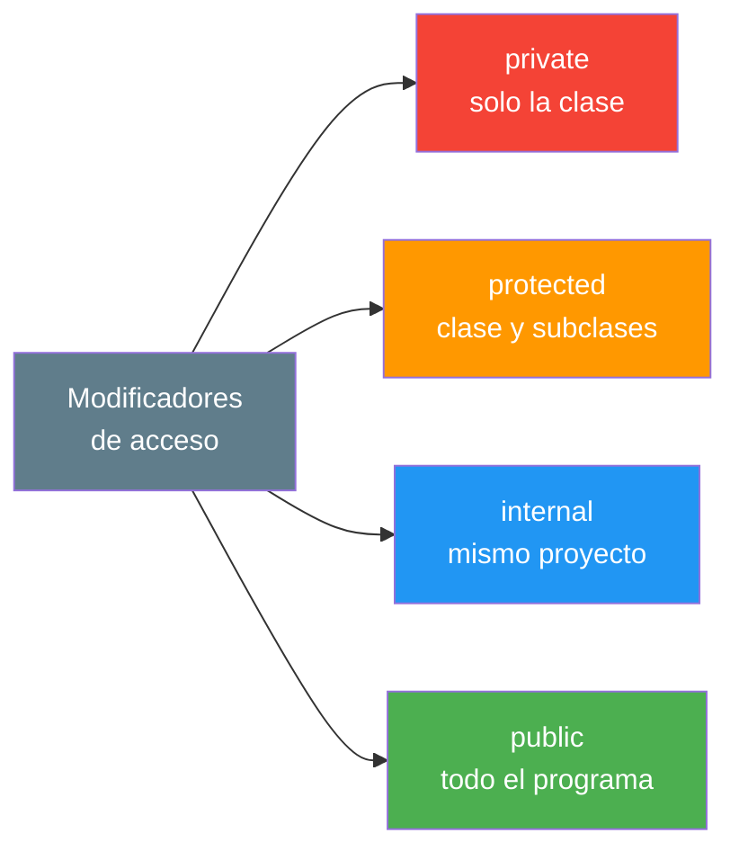

<TipBox type="truco" title="Truco para el examen">

Empieza siempre por `private` y solo aumenta la visibilidad si es estrictamente necesario. Es la «regla de oro» del encapsulamiento: si todo es público, cualquier línea puede romper tu objeto.

</TipBox>

---

## Otros modificadores: restricciones útiles

Además de la visibilidad, C# ofrece modificadores que restringen cómo se usa un tipo o un miembro:

- **`sealed`**: la clase no se puede heredar (impide crear subclases).
- **`const`**: valor fijo en tiempo de compilación; solo para tipos simples.
- **`readonly`**: valor que solo puede asignarse en la declaración o en el constructor; después no cambia.
- **`static readonly`**: igual que `readonly` pero compartido por todas las instancias.
- **`required`** (C# 11+): la propiedad debe establecerse al crear el objeto, usando inicializadores o constructores.

<RealExample app="BCL de .NET">

`DateTime.Now` o `Math.PI` son miembros predefinidos de la BCL con estos mismos modificadores: `Pi` es `const` porque nunca cambia, y `FechaInicio` es `static readonly` porque es única para toda la clase pero no de cada objeto.

</RealExample>

---

## Los cinco en una sola clase

Este ejemplo los reúne todos en una misma clase:

```csharp
public sealed class Utilidades
{
    // fija en compilación
    public const double Pi = 3.1416;
    // compartida
    public static readonly DateTime FechaInicio =
        DateTime.UtcNow;
    // obligatoria al crear
    public required string Nombre { get; set; }
}
```

---

## Partial: una clase en varios ficheros

El modificador **`partial`** permite dividir una clase en varios ficheros. Es útil cuando una parte del código se genera automáticamente o en proyectos grandes donde varios desarrolladores trabajan en la misma clase.

<div class="grid grid-cols-2 gap-5 items-start">
<div>

**Archivo 1**

```csharp
public partial class Producto
{
    public string Nombre { get; set; } =
        string.Empty;
}
```

</div>
<div>

**Archivo 2**

```csharp
public partial class Producto
{
    public int Stock { get; set; }
}
```

</div>
</div>

Al compilar, ambos ficheros forman **una única clase** `Producto` con sus cuatro miembros.

<TipBox type="nota">

No lo necesitas en estos momentos; basta con reconocerlo. Si un día ves `partial class` en un fichero generado, sabrás que es la mitad de una clase que está en otro sitio.

</TipBox>

---

## Comprobar y convertir tipos con is y as

El operador **`is`** verifica si un objeto es de un tipo concreto, y el operador **`as`** intenta convertir un objeto a un tipo determinado devolviendo `null` si no es posible. Son la forma segura de trabajar cuando no sabes qué tipo real lleva una referencia.

<div class="grid grid-cols-2 gap-5 items-start">
<div>

```csharp
object obj = "Hola Mundo";
// is: comprueba el tipo y deja el valor
// ya convertido si coincide
if (obj is string mensaje)
{
    Console.WriteLine(mensaje); // si es string
}
// as: intenta convertir; si no puede,
// devuelve null en vez de lanzar error
string? texto = obj as string;
if (texto is not null)
{
    Console.WriteLine(texto); // si fue exitosa
}
```

</div>
<div>

**`is`** comprueba y deja el valor ya convertido; **`as`** intenta convertir y, si no puede, devuelve `null` en vez de lanzar error.

</div>
</div>

---

## Cuándo compensa usar is y as

<RealExample app="App de archivos">

Cuando tu app de archivos arrastra un archivo y no sabe si es una imagen o un vídeo, comprueba el tipo antes de decidir qué reproductor abrir. Si el tipo no encaja, `as` devuelve `null` y la app muestra un mensaje de error amable en vez de romperse.

</RealExample>

<TipBox type="consejo">

`is` es preferible a un `try { (Tipo)x } catch { }`: es más limpio, más rápido y no lanza excepciones. Si solo necesitas comprobar, usa `is`; si necesitas el valor convertido, combínalo: `if (obj is string s)`.

</TipBox>

---

## Dos nombres para el mismo objeto

Las clases en C# son **tipos por referencia**: cuando asignas un objeto a otra variable, ambas variables apuntan **al mismo objeto** en memoria. Si modificas el objeto a través de una variable, el cambio se ve también desde la otra.

<div class="grid grid-cols-2 gap-5 items-start">
<div>

```csharp
public class Persona
{
    public string Nombre { get; set; } =
        string.Empty;
}
var persona1 = new Persona { Nombre = "Ana" };
// persona2 apunta al MISMO objeto que persona1
var persona2 = persona1;
persona2.Nombre = "Luis";
Console.WriteLine(persona1.Nombre);  // "Luis"
// ambas ven el mismo objeto
```

</div>
<div>

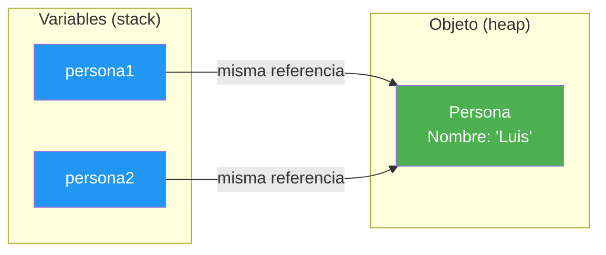

</div>
</div>

---

## Cambiar la referencia con ref

También se puede cambiar a qué objeto apunta una variable, pasándola por `ref`:

<div class="grid grid-cols-2 gap-5 items-start">
<div>

```csharp
void CambiarReferencia(ref Persona p)
{
    p = new Persona { Nombre = "Carlos" };
}
CambiarReferencia(ref persona1);
Console.WriteLine(persona1.Nombre); // "Carlos"
// ahora apunta a un objeto nuevo
```

</div>
<div>

<RealExample app="Google Docs">

Cuando compartes un documento en Google Docs con un compañero, ambos estáis viendo **el mismo** documento: si él escribe, lo ves tú también. No es una copia, es la misma referencia.

</RealExample>

<TipBox type="advertencia">

Este comportamiento es la causa número uno de «efectos secundarios» raros en los principiantes: modificas una variable «por casualidad» y cambian otras. Verás cómo funciona por dentro (stack y heap) en el punto 2 y cómo dominarlo en el punto 5.

</TipBox>

</div>
</div>

---

## Objetos nulos: el peligro de apuntar a nada

En C#, las variables de tipo clase pueden contener una referencia nula (`null`): no apuntan a ningún objeto en memoria. Intentar acceder a miembros de un objeto nulo provoca una excepción `NullReferenceException` y el programa se para.

<div class="grid grid-cols-2 gap-5 items-start">
<div>

```csharp
Persona? persona = null;
// Opción 1: comprobación explícita
if (persona is not null)
{
    Console.WriteLine(persona.Nombre);
    // evita NullReferenceException
}
else
{
    Console.WriteLine("La persona es nula.");
}
// Opción 2: acceso seguro con ?.
// Si es null, no falla: devuelve null
Console.WriteLine(persona?.Nombre ?? "Sin nombre");
```

</div>
<div>

A diferencia de los tipos valor (structs), las referencias no tienen `.Value` ni `.HasValue`: para acceder a sus miembros debemos asegurarnos de que la referencia no es nula o usar el operador de acceso seguro `?.`.

</div>
</div>

---

## Protegerse de la NullReferenceException

<RealExample app="App de mensajería">

Cuando una app de mensajería no puede cargar tu lista de contactos y muestra «sin contactos» en vez de cerrarse en bandeja, está comprobando referencias `null` antes de usarlas.

</RealExample>

<TipBox type="nota">

La **gestión estricta de nulos** está activada en todos los proyectos de este ciclo (`<Nullable>enable</Nullable>`), así que el compilador te avisará con un warning cada vez que te olvides de comprobar una referencia. Es tu primer ayudante contra las excepciones.

</TipBox>

---

## Representación en diagramas de clases (UML)

Para diseñar software usamos el lenguaje visual **UML**. Es vital que aprendas a leer y escribir la visibilidad de los miembros sin mirar el código:

| Visibilidad | Símbolo UML | Modificador C# |
| :--- | :---: | :--- |
| **Público** | `+` | `public` |
| **Privado** | `-` | `private` |
| **Protegido** | `#` | `protected` |
| **Interno** | `~` | `internal` |

---

## Ejemplo: una clase en UML

La clase `Gato` del inicio del punto, dibujada como diagrama de clases:

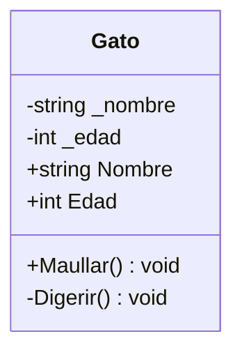

Fíjate en que `_nombre` y `_edad` llevan `-` (privados) y `Nombre`, `Edad` y `Maullar` llevan `+` (públicos): el diagrama dice exactamente lo mismo que el código.

---

## Ejemplo completo: estado y constructor

Este ejemplo reúne todo lo visto en el punto: encapsulamiento, visibilidad, propiedades con validación y métodos públicos. Empieza por el estado interno:

```csharp
public class CuentaBancaria
{
    // Campos privados (estado interno)
    private decimal _saldo;
    private readonly string _numeroCuenta;
    // solo asignable en el constructor

    // Constructor
    public CuentaBancaria(
        string numeroCuenta, decimal saldoInicial = 0)
    {
        _numeroCuenta = numeroCuenta;
        _saldo = saldoInicial;
    }
}
```

---

## Ejemplo completo: propiedades con validación

La parte pública del objeto: una propiedad de solo lectura y otra con validación en el *setter*:

```csharp
public class CuentaBancaria
{
    public string NumeroCuenta =>
        _numeroCuenta; // solo lectura
    public decimal Saldo
    {
        get => _saldo; // getter público
        private set
        // setter privado:
        // solo la clase puede modificar
        {
            if (value < 0)
                throw new ArgumentException(
                    "El saldo no puede ser negativo");
            _saldo = value;
        }
    }
}
```

---

## Ejemplo completo: comportamiento

Y los métodos públicos, que aplican las reglas de negocio sobre ese estado:

```csharp
public class CuentaBancaria
{
    public void Depositar(decimal cantidad)
    {
        if (cantidad <= 0)
            throw new ArgumentException(
                "La cantidad debe ser positiva");
        Saldo += cantidad;
    }
    public bool Retirar(decimal cantidad)
    {
        if (cantidad <= 0 || cantidad > Saldo)
            return false;
        Saldo -= cantidad;
        return true;
    }
}
```

---

## Uso correcto, uso imposible

Así se usa la clase desde fuera, y lo que el encapsulamiento hace imposible:

```csharp
var cuenta = new CuentaBancaria("ES123456789", 1000);
cuenta.Depositar(500);    // OK
cuenta.Retirar(200);      // OK
Console.WriteLine(cuenta.Saldo);  // 1300

// Esto es IMPOSIBLE por el encapsulamiento:
// cuenta.Saldo = -100;  // Error: setter privado
// cuenta._saldo = 0;    // Error: campo privado
```

---

## El flujo del encapsulamiento

El usuario externo solo toca lo público; la validación protege los campos internos:

<div class="grid grid-cols-2 gap-5 items-start">
<div>

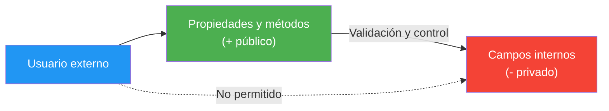

</div>
<div>

<TipBox type="analogia" title="Analogía del banco">

La cuenta bancaria es como una caja fuerte: el saldo (`_saldo`) está dentro, protegido. Tú solo puedes usar los métodos públicos (`Depositar`, `Retirar`) que aplican las reglas. No puedes meter dinero negativo ni sacar dinero directamente.

</TipBox>

<TipBox type="nota">

Los modificadores de acceso no son para esconder información por esconderla, son para **evitar accidentes**. Si todo fuera público, cualquier línea podría escribir `cuenta.Saldo = -99999999` y tu programa fallaría.

</TipBox>

</div>
</div>

---

## Resumen del punto 4

| Concepto | Descripción |
|----------|-------------|
| **Clase** | Molde que define el estado (propiedades) y el comportamiento (métodos) de sus objetos |
| **PascalCase** | Nomenclatura obligatoria para clases, propiedades y métodos en C# |
| **`public` / `private`** | Visible para todos / solo dentro de la clase (por defecto) |
| **`internal` / `protected`** | Solo en el mismo ensamblado / en la clase y sus hijas |
| **`sealed`** | Impide heredar de la clase |
| **`const` / `readonly`** | Valor fijo en compilación / solo asignable una vez |
| **`required`** | La propiedad es obligatoria al crear el objeto |
| **`partial`** | Reparte una clase en varios ficheros |
| **`is` / `as`** | Comprobar el tipo / convertir devolviendo `null` si no encaja |
| **Parámetros** | Por valor (copia), `ref` (modifica el original), `out` (resultado), argumentos con nombre |
| **Tipos por referencia** | Asignar una variable a otra hace que apunten al mismo objeto |
| **`null` y `?.`** | Referencia a nada; el acceso seguro evita la `NullReferenceException` |
| **UML** | `+` público, `-` privado, `#` protegido, `~` interno |

---

## Buenas prácticas

<div class="grid grid-cols-2 gap-5 items-start">
<div>

<ConceptCard icon="✅" title="Buenas prácticas" accent="green">

- Empezar siempre por `private` y ampliar la visibilidad solo cuando sea imprescindible
- Usar propiedades en lugar de campos públicos para poder validar el estado
- Nombrar en PascalCase las clases, propiedades y métodos; `_camelCase` los campos privados
- Comprobar las referencias con `is not null` o acceder con `?.` antes de usarlas
- Preferir `is` y `as` a las conversiones con `try/catch`
- Marcar como `sealed` las clases de las que nadie deba heredar

</ConceptCard>

</div>
<div>

<TipBox type="truco" title="Truco del examen">

Pregunta típica: «¿Por qué usar propiedades en lugar de campos públicos?» **Respuesta:** las propiedades permiten control (validación, solo lectura, lógica), mientras que un campo público puede modificarse libremente.

</TipBox>

<div class="mt-3">

**⏭️ ¿Qué viene después?** En el siguiente punto veremos cómo se crean y se usan los objetos: instanciación, referencias, igualdad entre objetos y el método `ToString`.

</div>

</div>
</div>
---
layout: section
---

<div class="ud-section-number">05</div>

# Instanciación, referencias, igualdad y ToString

<div class="opacity-70">Crear con new, usar this, convertir a texto y comparar objetos</div>

---

## 5 · Punto de partida

<div class="grid grid-cols-2 gap-5 items-start">
<div>

<TipBox type="consejo" title="Punto de partida">

¿Alguna vez has visto dos fotos de Instagram con el mismo contenido y has preguntado «¿es la misma foto o son dos copias?» En programación pasa igual con los objetos: dos objetos pueden tener el mismo estado y seguir siendo distintos. En este punto aprenderás a crearlos, a compararlos correctamente y a convertirlos en texto para mostrarlos.

</TipBox>

</div>
<div>

En este punto aprenderás a crear instancias con `new` y sus variantes, a usar la referencia `this`, a convertir tus objetos a cadenas con `ToString` y a distinguir identidad de igualdad al comparar objetos.

**Ideas clave del punto:**

- Crear objetos: `new`, *object initializers*, `init` y *target-typed new*
- Usar `this` para resolver ambigüedades y encadenar constructores
- Sobrescribir `ToString()` para representar el objeto como texto
- Diferenciar identidad (misma referencia) de igualdad (mismo estado)

</div>
</div>

---

## Crear e instanciar objetos

Crear o **instanciar** un objeto es el proceso de obtener una unidad concreta de una clase. Hay varias formas de hacerlo, y todas acaban en lo mismo: un objeto nuevo en el heap y una referencia en tu variable.

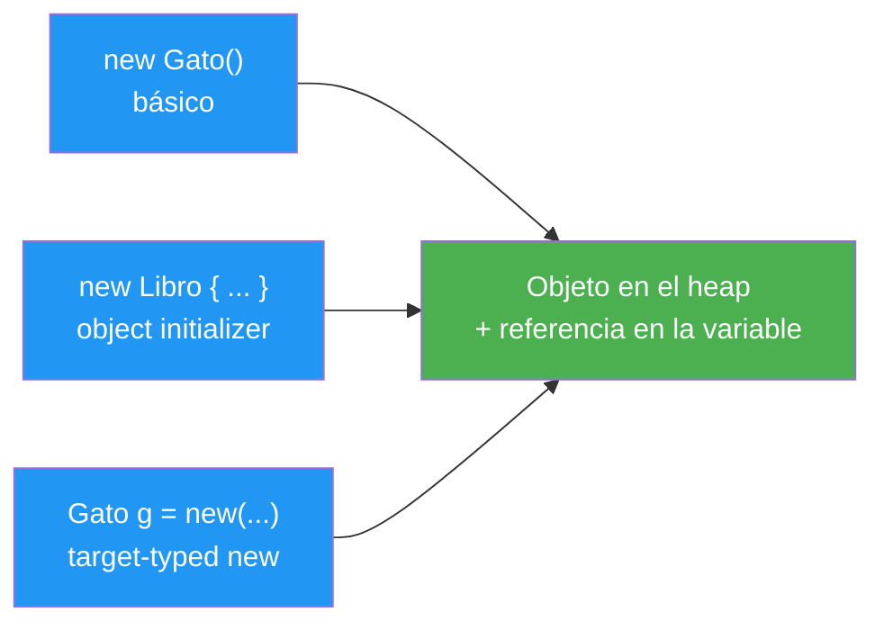

---

## La forma básica: new

Cuando usas `new`, le pides al sistema que cree un objeto nuevo conforme a la definición de su clase. Este es el uso básico:

```csharp
var miGato = new Gato();
miGato.Nombre = "Felix";
miGato.Edad = 3;
```

Cada vez que usas `new` se crea una **referencia nueva** en memoria para ese objeto. El objeto se almacena en el heap, y la variable (`miGato`) contiene la referencia a esa ubicación.

<TipBox type="consejo">

`var` es solo azúcar sintáctico: el compilador deduce el tipo (`Gato`). No confundas con `var` de JavaScript, que es de tipo dinámico: aquí el tipo se fija en compilación.

</TipBox>

---

## Object initializers y propiedades init

Los **object initializers** permiten asignar propiedades en el mismo momento de crear el objeto, sin llamadas largas al constructor.

<div class="grid grid-cols-2 gap-5 items-start">
<div>

```csharp
var miLibro = new Libro {
    Titulo = "1984", Autor = "Orwell" };
public class Usuario
{
    public string Nombre { get; init; } =
        string.Empty;
}
var usuario = new Usuario { Nombre = "Marta" };
// usuario.Nombre = "Ana";
// ERROR: solo puede fijarse al crearse
```

</div>
<div>

Si la propiedad se declara con `init` en lugar de `set`, solo puede establecerse en el initializer o en el constructor: no podrá modificarse después.

<RealExample app="Pedidos inmutables">

Los objetos `record` de C# (como los datos de un pedido inmutables) usan `init` para que nadie pueda cambiar un pedido ya creado: así se evitan errores de datos «a medias».

</RealExample>

</div>
</div>

---

## Target-typed new

Desde C# 9 puedes acortar el código indicando el tipo a la izquierda y dejando que el compilador complete el `new`:

```csharp
Gato miGato = new("Miau", 2);
// existe un constructor Gato(string, int)
```

Es muy legible cuando la variable es de tipo explícito y se lee de corrido: `Gato miGato = new(...)`.

---

## Constructor u object initializer

Usa **constructores** cuando necesitas garantizar algún valor sí o sí al crear el objeto, y **initializers** cuando quieres flexibilidad y claridad.

```csharp
// Constructor: no puedes olvidar la edad,
// es obligatorio
var gato = new Gato("Felix", 2);
// Initializer: puedes dejar campos sin poner
// (no recomendado si son importantes)
var libro = new Libro {
    Titulo = "1984", Autor = "Orwell" };
```

<TipBox type="advertencia">

Si el objeto no puede existir sin ciertos datos (un pedido sin cliente no tiene sentido), ese dato va en el **constructor**, no en un initializer opcional. El compilador no te dejará crear el objeto incompleto.

</TipBox>

---

## Constructores secundarios con this

Puedes definir varios constructores en una clase para las distintas formas de crear objetos. Usa `this(...)` para llamar a otro constructor y evitar repetir código; lo verás en detalle en el punto 6.

```csharp
public class Coche
{
    public string Marca { get; set; } = string.Empty;
    public string Modelo { get; set; } = string.Empty;
    public int Año { get; set; }
    // Constructor secundario: delega en el principal
    public Coche(string marca, string modelo)
        : this(marca, modelo, 0) { }
    public Coche(string marca, string modelo,
        int año)
    {
        Marca = marca;
        Modelo = modelo;
        Año = año;
    }
}
```

---

## La referencia this

La palabra clave **`this`** en C# siempre se refiere al **objeto actual**, es decir, la instancia sobre la que se está ejecutando el código. Sirve sobre todo para distinguir los atributos del objeto de los parámetros cuando se llaman igual.

<div class="grid grid-cols-2 gap-5 items-start">
<div>

```csharp
public class Punto
{
    private int _x;
    public void SetX(int x)
    {
        // sin ambigüedad: _x es el atributo,
        // x es el parámetro
        _x = x;
    }
    // Con this (también válido y más explícito)
    public void SetXConThis(int x)
    {
        // "this._x" es el atributo de la instancia
        this._x = x;
    }
}
```

</div>
<div>

Este ejemplo muestra el caso clásico: el parámetro `x` y el atributo `x` con el mismo nombre.

<RealExample app="Formulario de registro">

En cualquier formulario de registro, el parámetro `nombre` llega del campo de la pantalla y el atributo `nombre` es el del objeto usuario: `this.nombre = nombre` guarda lo que escribió el usuario dentro de su propio objeto.

</RealExample>

</div>
</div>

---

## Encadenamiento de constructores

Con `this` puedes llamar a otro constructor de la misma clase y reutilizar su lógica en lugar de duplicarla:

```csharp
public class Persona
{
    public string Nombre { get; set; } =
        string.Empty;
    public int Edad { get; set; }
    public Persona(string nombre)
        : this(nombre, 0) { }
    public Persona(string nombre, int edad)
    {
        Nombre = nombre;
        Edad = edad;
    }
}
```

---

## Pasar this como argumento

En métodos, `this` te permite referenciar la instancia actual, e incluso puedes **pasar `this` como argumento** a otros métodos que necesiten trabajar con el objeto completo.

<div class="grid grid-cols-2 gap-5 items-start">
<div>

```csharp
public class Gato
{
    public string Nombre { get; set; } =
        string.Empty;
    public void RegistrarEn(
        ClinicaVeterinaria clinica)
    {
        clinica.Anotar(this);
        // paso el objeto completo a otro método
    }
}
```

</div>
<div>

<TipBox type="nota">

Con las propiedades autoimplementadas (`{ get; set; }`) ya no necesitas `this.nombre = nombre` en los constructores modernos; el encadenamiento y las ambigüedades siguen siendo los usos principales.

</TipBox>

</div>
</div>

---

## Representación como cadena: ToString

Es muy útil que tus objetos puedan convertirse a texto para mostrar información, depurar o guardarla en un fichero. Puedes sobrescribir el método `ToString()` en tu clase para devolver una representación legible del objeto:

<div class="grid grid-cols-2 gap-5 items-start">
<div>

```csharp
public class Persona
{
    public string Nombre { get; set; } =
        string.Empty;
    public int Edad { get; set; }
    public override string ToString() =>
        $"Persona: {Nombre}, {Edad} años";
}
```

</div>
<div>

Ahora, si imprimes el objeto, verás ese texto en consola: `Console.WriteLine(persona)` mostrará `Persona: Jose, 20 años`.

<RealExample app="Consola de Windows">

Cuando la consola de Windows o un visor de logs muestra un objeto completo en vez de `Namespace.Clase`, alguien ha reescrito `ToString` para que dé información útil. Sin ese override, solo verías el nombre del tipo.

</RealExample>

</div>
</div>

---

## Interpolación de cadenas

La interpolación con `$` permite mezclar variables y texto de forma cómoda, y es la forma habitual de construir el resultado de `ToString`:

```csharp
var nombre = "Jose";
var mensaje = $"Hola, {nombre}!";  // "Hola, Jose!"
Console.WriteLine(mensaje);
```

Dentro de las llaves puedes poner expresiones completas: `$"Tienes {lista.Count} elementos y el total es {precio * 1.21m}"`.

<TipBox type="truco">

En la interpolación puedes poner formato: `$"Nota: {nota:F1}"` muestra `Nota: 7,5`. Muy útil en `ToString` para fechas (`{fecha:dd/MM/yyyy}`) y monedas.

</TipBox>

---

## Identidad e igualdad

Cuando trabajas con objetos es fundamental distinguir entre comparar si son **el mismo objeto** (identidad) o si solo tienen **el mismo estado** (igualdad). Es la diferencia entre «¿es la misma foto?» y «¿son dos fotos iguales?».

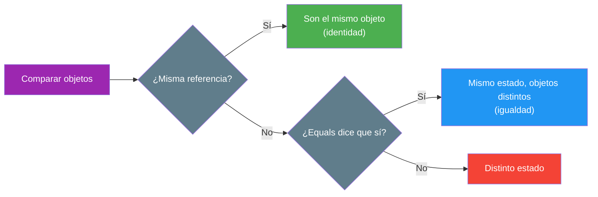

---

## ReferenceEquals: la identidad

Una comparación por **identidad** verifica si dos referencias apuntan al mismo objeto en memoria:

```csharp
var a = new Libro { Titulo = "1984" };
var b = new Libro { Titulo = "1984" };
Console.WriteLine(object.ReferenceEquals(a, b));
// False: son objetos distintos
var c = a;
Console.WriteLine(object.ReferenceEquals(a, c));
// True: misma referencia
```

---

## Igualdad por valor y por referencia

Por defecto, en C# la comparación `==` entre objetos de tipo clase compara **la referencia** (identidad), no el contenido. Para comparar el **estado** debes:

- Sobrescribir el método `Equals(object?)`
- Sobrescribir también `GetHashCode()` (deben ir siempre juntos)

<TipBox type="advertencia">

Sobrescribir `Equals` **no** cambia el comportamiento de `==`: el operador sigue comparando referencias. Si quieres que `==` compare por estado, además debes sobrecargar el operador `==` con `operator ==`.

</TipBox>

---

## Sobrescribir Equals y GetHashCode

Esta es la clase `Libro` con igualdad por estado definida a mano:

```csharp
public class Libro
{
    public string Titulo { get; set; } =
        string.Empty;
    public override bool Equals(object? obj)
    {
        if (obj is Libro otro)
            return Titulo == otro.Titulo;
        return false;
    }
    public override int GetHashCode() =>
        Titulo.GetHashCode();
}
```

---

## Al comparar, el resultado

Y así se comporta esa clase al compararla:

```csharp
var libro1 = new Libro { Titulo = "1984" };
var libro2 = new Libro { Titulo = "1984" };
// True: mismo estado
Console.WriteLine(libro1.Equals(libro2));
// False: distinta referencia
Console.WriteLine(
    object.ReferenceEquals(libro1, libro2));
// False: == compara referencias
Console.WriteLine(libro1 == libro2);
```

<TipBox type="consejo" title="Consejo para el examen">

Memoriza la pareja: **`Equals` y `GetHashCode` siempre se sobrescriben juntos**. Y recuerda: `==` compara referencias, `Equals` compara estado (si lo has sobrescrito).

</TipBox>

---

## Si la clase tiene varios campos

Si la clase tiene varios campos, se comparan todos en `Equals` y se combinan en `GetHashCode`:

```csharp
public override int GetHashCode() =>
    HashCode.Combine(Nombre, Edad, Raza, EsDomestico);
public override bool Equals(object? obj) =>
    obj is Gato otro &&
    otro.Nombre == Nombre &&
    otro.Edad == Edad &&
    otro.Raza == Raza &&
    otro.EsDomestico == EsDomestico;
```

<RealExample app="App de biblioteca">

Tu app de biblioteca guarda en un diccionario los libros por título: para que `diccionario[libro]` encuentre el libro, la clave necesita un `GetHashCode` y un `Equals` correctos. Sin ellos, cada consulta «pierde» el libro aunque tenga los mismos datos.

</RealExample>

---

## Resumen del punto 5

| Concepto | Descripción |
|----------|-------------|
| **`new`** | Crea el objeto en el heap y devuelve su referencia |
| **Object initializer** | `new Tipo { Prop = valor }`: asigna propiedades al crear |
| **`init`** | Propiedad que solo puede fijarse al crear el objeto |
| **Target-typed new** | `Gato g = new(...)`: el tipo lo da la variable |
| **`this`** | Referencia a la instancia actual (ambigüedades y encadenamiento) |
| **`ToString()`** | Convierte el objeto a texto; se sobrescribe con `override` |
| **Interpolación** | `$"Hola {nombre}"`: mezcla texto y expresiones |
| **Identidad** | ¿Es el mismo objeto? `ReferenceEquals` y `==` |
| **Igualdad** | ¿Tiene el mismo estado? `Equals` + `GetHashCode` |

---

## Buenas prácticas

<div class="grid grid-cols-2 gap-5 items-start">
<div>

<ConceptCard icon="✅" title="Buenas prácticas" accent="green">

- Usar el constructor para los datos imprescindibles y los initializers para los opcionales
- Marcar como `init` las propiedades que no deben cambiar tras crearse el objeto
- Sobrescribir `ToString` en cualquier clase que muestres en consola o en logs
- Sobrescribir `Equals` y `GetHashCode` siempre juntos, nunca uno solo
- No olvidar que `==` compara referencias: para estado, usar `Equals`
- Usar `this` solo cuando haya ambigüedad o para encadenar constructores

</ConceptCard>

</div>
<div>

<div class="mt-3">

**⏭️ ¿Qué viene después?** En el siguiente punto veremos los constructores e inicialización: cómo garantizar que un objeto nace con sus datos correctos, parámetros por defecto y validación desde el primer momento.

</div>

</div>
</div>
---
layout: section
---

<div class="ud-section-number">06</div>

# Constructores e inicialización

<div class="opacity-70">El ritual de bienvenida que garantiza el estado inicial</div>

---

## 6 · Punto de partida

<div class="grid grid-cols-2 gap-5 items-start">
<div>

<TipBox type="consejo" title="Punto de partida">

Cuando compras un móvil nuevo, de fábrica ya viene configurado: idioma, hora, cuentas de ejemplo. Si te lo entregaran «en blanco y roto», no serviría de nada. Los objetos también: un constructor es el «ritual de bienvenida» que garantiza que cada objeto nace con sus datos correctos y listo para usar.

</TipBox>

</div>
<div>

En este punto aprenderás qué son los constructores, sus distintos tipos (por defecto, parametrizados, estáticos, privados, de copia), cómo validar datos desde el primer instante y a usar los constructores primarios de C# 12+.

**Ideas clave del punto:**

- Diferenciar un constructor de un método normal
- Constructores por defecto, parametrizados y la sobrecarga con `this(...)`
- Constructores estáticos, privados y de copia en sus contextos
- Validar argumentos desde el primer momento

</div>
</div>

---

## Propósito de un constructor

Un **constructor** es el método especial que se llama al crear un objeto y que establece su estado inicial. En el fondo es una función con el mismo nombre que la clase, **sin tipo de retorno** (ni siquiera `void`), encargada de preparar el objeto para su uso.

Los constructores te obligan a definir el estado inicial de cada objeto, asegurando que todos empiecen bien configurados: nadie puede crear un `CuentaBancaria` sin saldo, ni un `Pedido` sin cliente.

<div class="grid grid-cols-2 gap-5 items-start">
<div>

```mermaid
graph LR
    N["new Animal('Rex')"] --> C["Constructor<br/>Animal(string)"]
    C --> O["Objeto listo<br/>estado inicial correcto"]
    style N fill:#2196F3,color:#fff
    style C fill:#FF9800,color:#fff
    style O fill:#4CAF50,color:#fff
```

</div>
<div>

<RealExample app="Instagram">

Cuando Instagram crea tu cuenta, no te deja existir «a medias»: el proceso de registro garantiza que haya nombre, usuario y correo desde el primer segundo. Eso es lo que hace un constructor por tu cuenta.

</RealExample>

</div>
</div>

---

## Constructor por defecto

Si no defines ningún constructor, C# crea uno sin parámetros que inicializa los atributos a sus valores por defecto (`null` para las referencias, `0` para los números, `false` para los booleanos).

<div class="grid grid-cols-2 gap-5 items-start">
<div>

```csharp
public class Animal
{
    public string Nombre { get; set; } =
        string.Empty; // "" por defecto (no null)
    public int Edad { get; set; }  // 0 por defecto
}
var perro = new Animal();
// usa el constructor por defecto
```

</div>
<div>

Este ejemplo es una clase sin constructores explícitos: basta con llamar a `new Animal()`.

<TipBox type="advertencia">

En cuanto defines **un** constructor cualquiera, C# deja de ofrecer el por defecto: si luego escribes `new Animal()` sin parámetros, recibirás un error de compilación. Tendrás que definirlo tú si lo necesitas.

</TipBox>

</div>
</div>

---

## Constructores parametrizados

Los constructores parametrizados permiten pasar información para personalizar el estado al crear el objeto. Así no hay que rellenar los datos a posteriori, campo a campo.

<div class="grid grid-cols-2 gap-5 items-start">
<div>

```csharp
public class Animal
{
    public string Nombre { get; set; } =
        string.Empty;
    public int Edad { get; set; }
    public Animal(string nombre)
    {
        Nombre = nombre;
    }
}
var perro = new Animal("Rex");
// nace con nombre ya puesto
```

</div>
<div>

<RealExample app="App de reservas">

En una app de reservas, crear un `Hotel` sin ciudad ni categoría no tiene sentido; por eso su constructor recibe esos datos obligatorios y el resto de la app puede confiar en que siempre estarán.

</RealExample>

</div>
</div>

---

## Sobrecarga de constructores

Puedes definir varios constructores para permitir distintos modos de inicialización. Con la **sobrecarga**, cada constructor tiene una firma diferente (número o tipo de parámetros).

<div class="grid grid-cols-2 gap-5 items-start">
<div>

```csharp
public class Animal
{
    public string Nombre { get; set; } =
        string.Empty;
    public int Edad { get; set; }
    // Si nos pasan solo el nombre, la edad será 0
    public Animal(string nombre)
        : this(nombre, 0) { }
    // Constructor principal (el más completo)
    public Animal(string nombre, int edad)
    {
        Nombre = nombre;
        Edad = edad;
    }
}
var perro = new Animal("Rex");     // edad 0
var gato = new Animal("Miau", 3);  // edad 3
```

</div>
<div>

<TipBox type="consejo">

Usa `this(...)` para que la sobrecarga **delegue** en el constructor más completo, en vez de repetir el mismo código en cada uno. Así solo hay una fuente de verdad.

</TipBox>

</div>
</div>

---

## Encadenamiento de constructores con this(...)

El encadenamiento reutiliza lógica y evita errores. Aquí la versión completa con un `Libro`:

```csharp
public class Libro
{
    public string Titulo { get; set; } = string.Empty;
    public string Autor { get; set; } = string.Empty;
    public int Paginas { get; set; }
    // Constructor secundario: delega en el principal
    public Libro(string titulo)
        : this(titulo, "Desconocido", 0) { }
    // Constructor principal
    public Libro(string titulo, string autor,
        int paginas)
    {
        Titulo = titulo;
        Autor = autor;
        Paginas = paginas;
    }
}
```

---

## El encadenamiento en la práctica

El constructor corto no repite código, se apoya en el largo:

<div class="grid grid-cols-2 gap-5 items-start">
<div>

```csharp
var libro1 = new Libro("1984");
// Autor="Desconocido", Paginas=0
var libro2 = new Libro("1984", "Orwell", 328);
// todo completo
```

</div>
<div>

```mermaid
graph LR
    S["Libro(titulo)<br/>constructor secundario"] -->|"this(...) delega en"| P["Libro(titulo, autor, paginas)<br/>constructor principal"]
    P --> O["Objeto completo<br/>con una sola fuente de verdad"]
    style S fill:#FF9800,color:#fff
    style P fill:#2196F3,color:#fff
    style O fill:#4CAF50,color:#fff
```

</div>
</div>

<RealExample app="Compra online">

Los formularios de compra online suelen tener «envío estándar» por defecto y «envío exprés» opcional: el segundo construye el pedido completo y el primero delega en él poniendo los valores por defecto. Mismo patrón.

</RealExample>

---

## Constructor estático

Un constructor **`static`** se ejecuta una sola vez, antes de que se use la clase por primera vez, para inicializar datos compartidos por todas sus instancias.

<div class="grid grid-cols-2 gap-5 items-start">
<div>

```csharp
public class Configuracion
{
    public static string RutaConfig { get; set; } =
        string.Empty;
    static Configuracion()
    {
        RutaConfig = "/etc/config";
        // se ejecuta una única vez
    }
}
```

</div>
<div>

<TipBox type="nota">

Un constructor estático no tiene parámetros y no puede ser `public`: solo prepara lo que es **de la clase** (datos estáticos), no lo de cada objeto. Lo verás con más detalle en el punto 7, junto a los miembros estáticos.

</TipBox>

</div>
</div>

---

## Constructores privados

Los constructores **`private`** sirven para controlar cómo se instancian los objetos: nadie desde fuera puede hacer `new`, solo la propia clase decide cuántos y cuándo. Es la base de patrones como el **singleton** (una única instancia) o las fábricas.

<div class="grid grid-cols-2 gap-5 items-start">
<div>

```csharp
public class Singleton
{
    private static Singleton? _instancia;
    private Singleton() { }
    // nadie puede crearlo desde fuera
    public static Singleton ObtenerInstancia()
    {
        // Lazy: se crea solo si hace falta
        // (y solo una vez)
        _instancia ??= new Singleton();
        return _instancia;
    }
}
```

</div>
<div>

<RealExample app="Gestor de conexiones">

Tu app tiene un único gestor de conexión a la base de datos o un único reloj de sistema: si cada módulo pudiera crear el suyo, tendrías diez conexiones abiertas sin querer. El constructor privado impide ese desastre.

</RealExample>

</div>
</div>

---

## Constructor de copia

El **constructor de copia** crea una nueva instancia **copiando el estado** de otro objeto, lo que permite duplicar objetos sin compartir la referencia entre ambos.

<div class="grid grid-cols-2 gap-5 items-start">
<div>

```csharp
public class Punto
{
    public int X { get; set; }
    public int Y { get; set; }
    // Constructor de copia
    public Punto(Punto otro)
    {
        X = otro.X;
        Y = otro.Y;
    }
}
var p1 = new Punto { X = 5, Y = 10 };
var p2 = new Punto(p1);
// p2 es una COPIA: p2.X = 5, p2.Y = 10
p2.X = 99;
Console.WriteLine(p1.X);
// 5: p1 no se entera del cambio
```

</div>
<div>

<TipBox type="advertencia">

No confundas copia con referencia: `var p3 = p1` hace que apunten al **mismo** objeto; `var p3 = new Punto(p1)` crea uno **nuevo y separado**. Es la misma distinción del punto anterior.

</TipBox>

</div>
</div>

---

## Parámetros opcionales y argumentos con nombre

Puedes facilitar distintos modos de uso con parámetros por defecto y argumentos con nombre, igual que en los métodos normales.

<div class="grid grid-cols-2 gap-5 items-start">
<div>

```csharp
public class Rectangulo
{
    public int Alto { get; set; }
    public int Ancho { get; set; }
    public Rectangulo(int alto = 10,
        int ancho = 5)
    {
        Alto = alto;
        Ancho = ancho;
    }
}
var r1 = new Rectangulo();
// alto=10, ancho=5
var r2 = new Rectangulo(ancho: 15);
// alto=10, ancho=15 (argumento con nombre)
var r3 = new Rectangulo(20);
// alto=20, ancho=5
```

</div>
<div>

<RealExample app="Alta de usuario">

Un constructor de `Usuario` con `rol = "cliente"` por defecto deja que la mayoría de registros no tengan que pensarlo, mientras que un administrador lo indica explícitamente con `rol: "admin"`.

</RealExample>

</div>
</div>

---

## Inicialización de campos readonly

Los campos **`readonly`** pueden fijarse solo una vez: en la declaración o dentro del constructor. Ayudan a crear objetos inmutables que no se pueden modificar después de ser creados.

<div class="grid grid-cols-2 gap-5 items-start">
<div>

```csharp
public class Circulo
{
    public readonly double Radio;
    public Circulo(double radio)
    {
        Radio = radio;
    }
}
var c = new Circulo(5.0);
// c.Radio = 10.0;
// ERROR de compilación: no se puede
// modificar después
```

</div>
<div>

<TipBox type="truco">

`readonly` es tu forma de decir «este dato no cambia jamás» sin necesidad de propiedades complejas. Si alguien intenta tocarlo fuera del constructor, el compilador lo para antes de ejecutar nada.

</TipBox>

</div>
</div>

---

## Constructores en structs y records

Cada tipo tiene sus particularidades:

- **Structs:** debes inicializar **todos** los campos en el constructor; si no defines ninguno, existe uno por defecto que los pone a cero.
- **Records:** suelen tener constructores posicionales (`record Persona(string Nombre, int Edad)`) y soportan la inicialización con `with` para crear copias modificadas.

<div class="grid grid-cols-2 gap-5 items-start">
<div>

```csharp
// Record con constructor positional
record Persona(string Nombre, int Edad);
var ana = new Persona("Ana", 30);
var ana2 = ana with { Edad = 31 };
// copia con un cambio
```

</div>
<div>

<RealExample app="Líneas de factura">

Los `record` son ideales para datos inmutables como líneas de factura: `linea with { Cantidad = 2 }` te devuelve una línea nueva sin tocar la original.

</RealExample>

</div>
</div>

---

## Manejo de errores en constructores

Lanza excepciones si los argumentos son inválidos, para asegurar objetos consistentes desde el principio: mejor un error en el `new` que un objeto roto escondido por el programa. Así queda el constructor de `CuentaBancaria`:

<div class="grid grid-cols-2 gap-5 items-start">
<div>

```csharp
public CuentaBancaria(decimal saldoInicial)
{
    if (saldoInicial < 0)
        throw new ArgumentException(
            "El saldo inicial no puede ser negativo.");
    Saldo = saldoInicial;
}
var cuenta = new CuentaBancaria(-100);
// lanza ArgumentException
```

</div>
<div>

<RealExample app="Banca online">

Cuando una app de banca online te rechaza un alta con datos incorrectos en el primer paso, es el constructor (o su validación equivalente) el que se niega a crear un objeto inválido. Es preferible que falle ahí a que el problema aparezca tres pantallas después.

</RealExample>

<TipBox type="nota">

Las excepciones y sus tipos (`ArgumentException`, `NullReferenceException`...) las estudiaremos en el punto 11.

</TipBox>

</div>
</div>

---

## Constructores primarios y secundarios

Los **constructores primarios** permiten definir parámetros directamente en la declaración de la clase, simplificando la sintaxis para clases simples. Están disponibles desde C# 12.

```csharp
public class Persona(string nombre, int edad)
{
    public string Nombre { get; } = nombre;
    public int Edad { get; } = edad;
}
var p = new Persona("Ana", 30);
```

---

## El constructor primario en servicios

Esta forma es ideal para la **inyección de dependencias** y para simplificar clases con campos `readonly`, como este servicio de correo:

<div class="grid grid-cols-2 gap-5 items-start">
<div>

```csharp
public class ServicioCorreo(
    string servidorSmtp, int puerto)
{
    private readonly string _servidorSmtp =
        servidorSmtp;
    private readonly int _puerto = puerto;
    public void EnviarCorreo(string destinatario,
        string asunto, string cuerpo)
    {
        // Lógica para enviar el correo
        // usando _servidorSmtp y _puerto
    }
}
```

</div>
<div>

<TipBox type="consejo">

En este ciclo usamos el constructor primario con **inyección de dependencias** en los servicios (como el patrón de la TiendaDawApi): los parámetros del constructor son las dependencias que la clase necesita para funcionar.

</TipBox>

</div>
</div>

---

## Secundarios sobre el primario

Los constructores secundarios pueden seguir definiéndose como antes, y pueden llamar al constructor primario usando `this(...)`:

```csharp
public class Producto(string nombre, decimal precio)
{
    public string Nombre { get; } = nombre;
    public decimal Precio { get; } = precio;
    // Constructor secundario: precio por defecto 0
    public Producto(string nombre)
        : this(nombre, 0.0m) { }
}
```

---

## Resumen del punto 6

| Concepto | Descripción |
|----------|-------------|
| **Constructor** | Método especial que inicializa el objeto al crearlo; sin tipo de retorno |
| **Por defecto** | El sin parámetros que pone valores por defecto; desaparece si defines otro |
| **Parametrizado** | Recibe datos obligatorios para que el objeto nazca completo |
| **Sobrecarga** | Varios constructores con firmas distintas; delegan con `this(...)` |
| **Estático** | Se ejecuta una vez para inicializar datos de la clase |
| **Privado** | Controla la creación: singleton y fábricas |
| **Copia** | Duplica el estado de otro objeto sin compartir referencia |
| **`readonly`** | Campo fijable solo en la declaración o el constructor |
| **Validación** | Lanzar excepciones si los argumentos no son válidos |
| **Primario (C# 12+)** | Parámetros en la declaración de la clase; ideal para DI |

---

## Buenas prácticas

<div class="grid grid-cols-2 gap-5 items-start">
<div>

<ConceptCard icon="✅" title="Buenas prácticas" accent="green">

- Hacer los constructores simples: delega los procesos largos en métodos o fábricas
- Mantener siempre los invariantes del objeto (nunca dejarlo en un estado inválido)
- Usar excepciones para validar argumentos desde el primer momento
- Preferir constructores parametrizados a rellenar setters después de crear el objeto
- Usar parámetros con valores por defecto para evitar sobrecargas innecesarias
- Empezar por constructores primarios y `with` en lugar de montones de constructores secundarios

</ConceptCard>

</div>
<div>

<div class="mt-3">

**⏭️ ¿Qué viene después?** En el siguiente punto veremos la encapsulación en profundidad: propiedades completas, miembros estáticos y cómo proteger el estado de tus objetos.

</div>

</div>
</div>
---
layout: section
---

<div class="ud-section-number">07</div>

# Encapsulación, propiedades y miembros estáticos

<div class="opacity-70">Propiedades para proteger el estado y miembros static de clase</div>

---

## 7 · Punto de partida

<div class="grid grid-cols-2 gap-5 items-start">
<div>

<TipBox type="consejo" title="Punto de partida">

En un coche, el velocímetro te muestra la velocidad pero no te deja cambiarla a mano: hay un dato interno que solo el coche toca, y tú accedes a él por un instrumento controlado. Eso es encapsulación con propiedades. En este punto verás cómo proteger el estado de tus objetos con `get`, `set` e `init`, y cómo definir miembros que pertenecen a la clase entera (`static`).

</TipBox>

</div>
<div>

En este punto aprenderás a encapsular el estado con getters y setters, a usar todos los tipos de propiedades de C# (autoimplementadas, de solo lectura, `init`, calculadas y con *backing field*), y a trabajar con miembros estáticos y clases estáticas.

</div>
</div>

---

## Getters y setters: la forma clásica

Los **getters** y **setters** son métodos especiales que permiten acceder y modificar los atributos privados de una clase de forma controlada. Recuerda el principio de ocultación: los atributos deben ser privados y no accesibles directamente desde fuera.

La forma clásica (heredada de Java) consiste en un método para leer y otro para escribir:

```csharp
public class Perro
{
    private int _edad;

    public int GetEdad() => _edad;
    public void SetEdad(int valor) => _edad = valor;
}
```

Con estos métodos nadie toca `_edad` directamente: todo pasa por `GetEdad` y `SetEdad`.

---

## Validación dentro del setter

La gran ventaja de este patrón es que puedes **controlar** cómo se accede y cambia el estado, por ejemplo añadiendo validaciones dentro del *setter*:

```csharp
public class Persona
{
    private int _edad;

    public int GetEdad() => _edad;

    public void SetEdad(int valor)
    {
        if (valor < 0)
            throw new ArgumentException(
                "La edad no puede ser negativa");
        _edad = valor;
    }
}
```

<RealExample app="App de citas">

Cuando una app de citas te impide poner una edad negativa o superior a 150, hay una validación escondida en el método de escritura. Sin esa comprobación, cualquier dato corrupto entraría sin más.

</RealExample>

---

## De getters y setters a propiedades

Las **propiedades** (`get`/`set`) de C# son más limpias y potentes: se usan con la sintaxis de un campo (`.Edad`), pero por dentro tienen la seguridad y el control de un método. Es por eso que C# las prefiere desde su primera versión.

```csharp
public class Persona
{
    public int Edad { get; set; }
}

var p = new Persona();
p.Edad = 25; // sintaxis de campo, control de método
```

<TipBox type="consejo">

Usa `GetEdad`/`SetEdad` solo si mantienes código heredado de Java o de versiones muy antiguas. En C#, el camino es **propiedades**.

</TipBox>

---

## Los cinco tipos de propiedades

Las **propiedades** son una de las características más útiles de C#: combinan la sencillez de los campos y la seguridad de los métodos. Este es el mapa de los cinco tipos de propiedades que verás en este apartado:

```mermaid
graph LR
    P["Propiedades<br/>en C#"] --> A["Autoimplementada<br/>{ get; set; }"]
    P --> B["Solo lectura<br/>{ get; }"]
    P --> C["init<br/>{ get; init; }"]
    P --> D["Calculada<br/>=> expresión"]
    P --> E["Full property<br/>con backing field"]
    style P fill:#9C27B0,color:#fff
    style A fill:#4CAF50,color:#fff
    style B fill:#4CAF50,color:#fff
    style C fill:#4CAF50,color:#fff
    style D fill:#4CAF50,color:#fff
    style E fill:#4CAF50,color:#fff
```

---

## Por fuera un campo, por dentro la lógica

Permiten exponer la información interna del objeto de forma controlada, pudiendo añadir validación, lógica o notificaciones. El objetivo es crear una interfaz clara y segura: por fuera parece un campo, por dentro pasa por la lógica que tú decidas.

```mermaid
graph LR
    U[Usuario] -->|".Edad"| P[Propiedad Edad]
    subgraph S[Interior de la clase]
        P --> L{Validación / lógica}
        L -->|Correcto| F[_edad]
        L -->|Error| E[Lanzar excepción]
    end
    style U fill:#2196F3,color:#fff
    style P fill:#4CAF50,color:#fff
    style F fill:#607D8B,color:#fff
    style E fill:#f44336,color:#fff
```

---

## Propiedades autoimplementadas

Son propiedades que el compilador gestiona automáticamente, ideales para objetos de datos: no escribes campo ni lógica.

```csharp
public class Producto
{
    public string Nombre { get; set; } = string.Empty;
    public decimal Precio { get; set; }
}
```

Puedes inicializar el valor por defecto en la propia declaración:

```csharp
public string Descripcion { get; set; } = "Sin descripción";
```

<TipBox type="advertencia">

Con la gestión estricta de nulos activada, una propiedad `string` sin inicializar genera un *warning*: inicialízala (`= string.Empty`) o declárala `string?` si admite que no haya valor.

</TipBox>

---

## Propiedades de solo lectura

No tienen `set`, o solo lo tienen privado/interno: el usuario no puede modificarlas después de crear el objeto. Este ejemplo calcula el área a partir de un radio inmutable:

```csharp
public class Circulo
{
    public double Radio { get; }
    public double Area => Math.PI * Radio * Radio;

    public Circulo(double radio)
    {
        Radio = radio;
    }
}
```

---

## Propiedades calculadas

Las propiedades *expression-bodied* usan la sintaxis corta con `=>` para devolver un valor calculado, como el nombre completo a partir de nombre y apellidos:

```csharp
public int Area => Alto * Ancho;

public string NombreCompleto =>
    $"{Nombre} {Apellidos}";
```

<TipBox type="truco">

Una propiedad calculada **no guarda nada**: cada vez que la consultas se recalcula. Es perfecta para datos derivados, pero no para datos costosos de calcular (esos van con caché, como verás con `Lazy<T>`).

</TipBox>

---

## Propiedades init

Solo pueden asignarse durante la inicialización (en el constructor o en el `new { ... }`). Aumentan la inmutabilidad y la seguridad del objeto.

```csharp
public class Usuario
{
    public string Nombre { get; init; } = string.Empty;
    public int Edad { get; init; }
}

var usuario = new Usuario { Nombre = "Ana", Edad = 25 };
// usuario.Edad = 30; // ERROR: solo puede fijarse al crearse
```

<TipBox type="nota">

Los objetos `record` que modelan datos de solo lectura (una línea de factura, un mensaje recibido) usan `init` para que nadie pueda alterarlos después de crearlos: si el dato estaba bien, sigue bien.

</TipBox>

---

## Accesibilidad diferenciada en accesores

Puedes decidir quién puede leer o escribir cada propiedad por separado, siempre que el accesor sea **más restrictivo** que la propiedad:

```csharp
public class Cuenta
{
    // Todo el mundo lee; solo la clase modifica
    public string Clave { get; private set; }
        = string.Empty;
}
```

---

## Backing field: lógica en la propiedad

Cuando necesitas lógica, validación o transformar los datos antes de guardarlos, usas la propiedad completa con su **campo de respaldo** (*backing field*). Son fundamentales para mantener la integridad del estado del objeto.

```csharp
private int _edad;

public int Edad
{
    get => _edad;
    set
    {
        if (value < 0)
            throw new ArgumentException(
                "La edad no puede ser negativa");
        _edad = value;
    }
}
```

Fíjate en que `value` es el valor que llega al `set`: la propiedad decide si lo acepta o lanza una excepción.

---

## El campo `field` en C# 14

Desde **C# 14** puedes usar contextualmente **`field`** para referirte al campo de respaldo sin declararlo explícitamente:

```csharp
public class Empleado
{
    public decimal Salario
    {
        get;
        set => field = (value >= 0)
            ? value
            : throw new ArgumentOutOfRangeException(
                nameof(value),
                "El salario no puede ser negativo.");
    }
}
```

---

## Para qué sirve un backing field

**Usos comunes de los campos de respaldo:**

<div class="grid grid-cols-2 gap-5 items-start">
<div>

- **Validación en `set`:** comprueba y lanza excepción si el valor no es válido.
- **Encapsulación de invariantes:** asegura que siempre se cumplen las reglas del objeto.
- **Inicialización diferida:** se inicializa solo cuando hace falta (ideal para objetos costosos).

</div>
<div>

- **Normalización de entradas:** ajusta los valores antes de guardarlos (por ejemplo, nombres a mayúsculas).
- **Notificación de cambios:** útil en interfaces; puedes avisar cuando una propiedad cambia (`INotifyPropertyChanged`).

<TipBox type="consejo">

Usa **PascalCase** para los nombres de las propiedades, prefiere las **autoimplementadas** salvo que necesites lógica y reserva los **campos de respaldo** solo si hay validación, transformación o control especial.

</TipBox>

</div>
</div>

---

## Miembros estáticos: pertenecen a la clase

Los **miembros estáticos** pertenecen a la clase, no a una instancia concreta: puedes acceder a ellos **sin crear un objeto** de esa clase. Son elementos **compartidos** por todas las instancias.

Este ejemplo define un método estático que se usa sin instanciar nada:

```csharp
public class Matematica
{
    public static double Sumar(double a, double b)
        => a + b;
}

double resultado = Matematica.Sumar(3, 5); // 8
```

<RealExample app=".NET">

`Math.Sqrt(25)` o `Console.WriteLine(...)` son métodos estáticos: funcionan sin hacer `new Math()` ni `new Console()`, porque pertenecen a la clase, no a un objeto.

</RealExample>

---

## Valores fijos: const y static readonly

Hay dos formas de definir valores fijos a nivel de clase:

- **`const`:** valor fijo en **tiempo de compilación**; solo para tipos simples.
- **`static readonly`:** valor fijo en **tiempo de ejecución**, que puede inicializarse en el constructor estático.

```csharp
public class Iva
{
    // Fijo en compilación
    public const double TipoGeneral = 0.21;

    // Fijo en ejecución
    public static readonly double TipoReducido = 0.10;
}
```

<TipBox type="nota">

`const` es como pegar el número en cada punto donde se usa (por eso solo vale para tipos simples); `static readonly` sí es un valor en memoria de la clase que se puede calcular al arrancar.

</TipBox>

---

## Constructor estático

El constructor estático se usa para inicializar datos compartidos de la clase **antes de que se use cualquier miembro**:

```csharp
public class Configuracion
{
    public static readonly string RutaConfig;

    static Configuracion()
    {
        // Se ejecuta una sola vez
        RutaConfig = "/etc/config";
    }
}

var ruta = Configuracion.RutaConfig;
Console.WriteLine(ruta); // Imprime: /etc/config
```

---

## Contadores de clase

Un uso clásico es contar cuántos objetos se han creado de una clase:

```csharp
public class Ejemplo
{
    public static int ContadorInstancias
        { get; private set; }

    public Ejemplo() => ContadorInstancias++;
}

var e1 = new Ejemplo();
var e2 = new Ejemplo();
// Imprime: 2
Console.WriteLine(Ejemplo.ContadorInstancias);
```

<RealExample app="Sistema de tickets">

Un sistema de tickets usa un contador estático para numerar los pedidos: aunque cada pedido es un objeto distinto, el número siguiente es **uno solo** para toda la clase.

</RealExample>

---

## Clases estáticas

Una clase **estática** solo puede tener miembros estáticos y no puede instanciarse. Es la forma correcta de agrupar métodos de utilidad.

```csharp
public static class Utilidades
{
    public static int Max(int a, int b)
        => (a > b) ? a : b;
}

var maximo = Utilidades.Max(10, 20); // 20
```

<TipBox type="advertencia">

Si intentas hacer `new Utilidades()`, recibirás un error de compilación: las clases estáticas no se instancian, solo se usan a través de sus miembros estáticos.

</TipBox>

---

## Modificadores de acceso

Las **propiedades** son miembros de una clase o *struct* que proporcionan un mecanismo flexible para acceder a campos privados, exponiendo el dato a través de **accesores** (`get`, `set`, `init`). Estos modificadores controlan qué partes del código pueden interactuar con la propiedad:

| Modificador | Alcance | Descripción | Ejemplo |
| :--- | :--- | :--- | :--- |
| **`public`** | Todo el código | Acceso sin restricciones desde cualquier parte del programa | `public string Nombre { get; set; }` |
| **`private`** | Solo la clase o *struct* contenedora | Solo los métodos y miembros de la clase donde está declarada | `private decimal CostoInterno { get; set; }` |
| **`internal`** | Solo el ensamblado (proyecto) actual | Limitado a los tipos definidos dentro del mismo ensamblado | `internal bool EstaEnOferta { get; set; }` |
| **`protected`** | La clase y las clases derivadas | Se permite en la base y en cualquier clase que herede de ella | `protected DateTime FechaCreacion { get; set; }` |

---

## Propiedades static: una sola copia

**`static`:** la propiedad pertenece a la **clase**, no a una instancia individual. Hay una única copia compartida por todos los objetos. Uso común: contadores, constantes o registros de actividad de la clase.

```csharp
public class Pedido
{
    // Contador global para todos los pedidos
    public static int TotalPedidos
        { get; private set; }

    public Pedido() => TotalPedidos++;
}

// Acceso a través de la clase, no de una instancia
Console.WriteLine(Pedido.TotalPedidos); // 0
var p1 = new Pedido();
var p2 = new Pedido();
Console.WriteLine(Pedido.TotalPedidos); // 2
```

---

## Campos readonly: una sola asignación

**`readonly`:** garantiza que un campo solo se pueda asignar una vez: en la **declaración** o en el **constructor**. Sirve para la inmutabilidad y para saber que un valor no cambiará después de la construcción.

```csharp
public class Config
{
    private readonly string _nombreServidor;

    // Propiedad de solo lectura que expone el campo
    public string NombreServidor => _nombreServidor;

    public Config(string nombre)
    {
        // Único lugar fuera de la declaración
        // donde se puede asignar
        _nombreServidor = nombre;
    }

    // public void IntentarCambiar()
    //     { _nombreServidor = "otro"; }
    // ERROR: es readonly
}
```

---

## Los tres accesores

Los **accesores** definen cómo se lee (`get`) y cómo se escribe (`set`/`init`) el valor de la propiedad:

| Accesor | Propósito | Comportamiento |
| :--- | :--- | :--- |
| **`get`** | Lectura de valor | Contiene la lógica para devolver el valor de la propiedad |
| **`set`** | Escritura de valor (mutable) | Permite cambiar el valor en cualquier momento después de crear el objeto |
| **`init`** | Escritura de valor (solo inicialización) | Solo permite cambiar el valor durante la inicialización (C# 9); después es de solo lectura |

---

## Los tres accesores en una clase

Este ejemplo combina los tres accesores en una misma clase:

```csharp
public class Empleado
{
    // 'set': se puede modificar en cualquier momento
    public string Puesto { get; set; } = "Junior";

    // 'init': solo se puede establecer al crear el objeto
    public int IdEmpleado { get; init; }

    // Solo 'get', asignado en el constructor
    public string NombreCompleto { get; }

    public Empleado(string nombreCompleto)
    {
        NombreCompleto = nombreCompleto;
    }
}
```

<TipBox type="advertencia">

Si intentas cambiar `IdEmpleado` después de crear el objeto, el compilador da error: `init` solo admite escritura durante la inicialización. En cambio, `e.Puesto = "Senior";` es válido porque tiene `set`.

</TipBox>

---

## Inicialización obligatoria con required

**`required`** obliga al código cliente a inicializar la propiedad: el compilador genera un error si no se establece durante la creación del objeto. Su propósito es garantizar que un objeto siempre se encuentre en un estado válido.

**La diferencia clave entre `required` e `init`:** `init` controla **cuándo** se puede asignar (solo al inicio), pero no obliga a que se asigne; `required` controla **si** se debe asignar y obliga a que tenga valor.

| Propiedad | ¿Es required? | ¿Obliga a inicializar? | ¿Permite cambiar luego? |
| :--- | :--- | :--- | :--- |
| `public string A { get; set; }` | No | No | Sí |
| `public string B { get; init; }` | No | No | No |
| `public required string C { get; set; }` | Sí | Sí | Sí |
| `public required string D { get; init; }` | Sí | Sí | No |

---

## required en una configuración

Y este es un uso real de `required` en una configuración de base de datos:

```csharp
public class ConfiguracionBBDD
{
    // OBLIGATORIO: la cadena de conexión
    // debe proporcionarla el usuario
    public required string CadenaConexion { get; init; }

    // OPCIONAL: tiene valor por defecto
    public int Timeout { get; init; } = 30;
}

// Uso correcto:
var config1 = new ConfiguracionBBDD
    { CadenaConexion = "Server=LocalDB" };

// Uso INCORRECTO:
// var config2 = new ConfiguracionBBDD { Timeout = 60 };
// ERROR: la propiedad 'CadenaConexion' es required
// y no se ha inicializado.
```

---

## Lazy&lt;T&gt;: carga perezosa

**`Lazy<T>`** implementa la **inicialización diferida** (*lazy loading* o carga perezosa): el código de inicialización solo se ejecuta cuando se accede a la propiedad por primera vez. Sirve para cargar recursos pesados o complejos solo si son estrictamente necesarios.

```csharp
public class Dashboard
{
    // El objeto NO se crea al crear el Dashboard
    private readonly Lazy<ReporteMensual> _reporteLazy =
        new(() => new ReporteMensual());

    // La propiedad activa la creación
    // en el primer acceso
    public ReporteMensual DatosReporte
        => _reporteLazy.Value;

    public void MostrarResumen()
    {
        Console.WriteLine("Mostrando resumen rápido...");
        // El reporte NO se ha creado todavía
    }
}
```

---

## Lazy&lt;T&gt; en acción

`MostrarResumen()` imprime el resumen sin crear el reporte todavía. Solo al acceder a `DatosReporte` por primera vez se ejecuta el constructor de `ReporteMensual` (tarda 5 segundos e imprime «Reporte creado.»):

```csharp
var dash = new Dashboard();
dash.MostrarResumen(); // inmediato

// SOLO aquí, por primera vez, se ejecuta
// el constructor de ReporteMensual
var datos = dash.DatosReporte;
// tarda 5 segundos e imprime "Reporte creado."
```

<RealExample app="App de vídeo">

Una app de vídeo carga las miniaturas mientras navegas, pero el reproductor completo solo se construye cuando pulsas «play». Eso es `Lazy<T>`: pagar el coste solo cuando de verdad hace falta.

</RealExample>

---

## Truco del examen: static o instancia

<TipBox type="truco" title="Truco del examen">

Pregunta típica: «¿Cuándo usar `static` y cuándo instancia?» **Respuesta:** `static` para datos y métodos que pertenecen a la **clase** (contadores, utilidades, configuración global); instancia para datos y métodos específicos de cada **objeto** (el nombre de una persona, la edad de un gato). Regla nemotécnica: *«lo estático se queda en la clase, lo de instancia viaja con el objeto»*.

</TipBox>

La siguiente imagen resume esa diferencia:

```mermaid
graph LR
    subgraph S1["Instancia (por objeto)"]
        O1["Objeto 1<br/>Nombre: 'Ana'"]
        O2["Objeto 2<br/>Nombre: 'Luis'"]
        O3["Objeto 3<br/>Nombre: 'María'"]
    end
    subgraph S2["Clase (compartido)"]
        CL["Clase Ejemplo"]
        ES["Miembro estático<br/>Contador: 3"]
    end
    O1 -->|"Miembro de instancia"| N1["Ana"]
    O2 -->|"Miembro de instancia"| N2["Luis"]
    CL -->|"Miembro estático"| ES
    O1 -.-> ES
    O2 -.-> ES
    O3 -.-> ES
    style O1 fill:#2196F3,color:#fff
    style O2 fill:#2196F3,color:#fff
    style O3 fill:#2196F3,color:#fff
    style CL fill:#9C27B0,color:#fff
    style ES fill:#FF9800,color:#fff
    style N1 fill:#4CAF50,color:#fff
    style N2 fill:#4CAF50,color:#fff
```

---

## Analogía del hotel

<TipBox type="analogia">

Imagina un hotel con recepción global (`static`) y habitaciones individuales (instancia). El mostrador de recepción es único para todos (contador de huéspedes), pero cada habitación tiene sus propios datos (nombre del huésped, fecha de entrada).

</TipBox>

<TipBox type="nota">

El principio de encapsulamiento se resume en *«oculta lo que no necesito mostrar, protege lo que no quiero que cambie»*. Las propiedades son la herramienta perfecta para esto.

</TipBox>

---

## Comparativa rápida de modificadores

Estos son los modificadores que has ido viendo, resumidos de un vistazo:

| Modificador | ¿Pertenece a...? | ¿Cuándo inicializar? | ¿Se puede cambiar? |
| :--- | :--- | :--- | :--- |
| `const` | Clase | Compilación | Nunca |
| `static readonly` | Clase | Tiempo de ejecución | Nunca |
| `readonly` (campo) | Instancia | Constructor | Nunca |
| `get; set;` | Instancia | Cuando quieras | Sí |
| `get; init;` | Instancia | Solo al crear | No |
| `static` | Clase | Cuando se usa | Sí |

---

## Resumen del punto 7

| Concepto | Descripción |
| :--- | :--- |
| **Getter / setter** | Método de lectura / escritura de un atributo privado (forma clásica) |
| **Propiedad** | Sintaxis de campo con control de método; la forma idiomática en C# |
| **Autoimplementada** | `{ get; set; }`: la gestiona el compilador, sin lógica propia |
| **`get`-only** | Solo lectura; útil con propiedades calculadas |
| **`init`** | Solo permite escribir al crear el objeto |
| **Backing field** | Campo privado con lógica de validación en los accesores |
| **`static`** | Miembro compartido por la clase entera; se accede sin `new` |
| **`const` / `static readonly`** | Valor fijo en compilación / fijo en ejecución |
| **Clase estática** | Solo miembros estáticos; no se puede instanciar |
| **`required`** | Obliga a inicializar la propiedad al crear el objeto |
| **`Lazy<T>`** | Inicialización diferida: se construye en el primer acceso |

---

## Buenas prácticas del punto 7

<div class="grid grid-cols-2 gap-5 items-start">
<div>

<ConceptCard icon="✅" title="Buenas prácticas" accent="green">

- Exponer el estado con propiedades, nunca con campos públicos
- Usar propiedades autoimplementadas salvo que haya lógica que aplicar
- Validar en el `set` (o con `field` en C# 14) y lanzar excepciones con mensajes claros
- Marcar como `init` lo que no debe cambiar tras crearse el objeto
- Reservar `static` para lo que es de la clase: contadores, utilidades, configuración
- Usar `required` para los datos imprescindibles y `Lazy<T>` para lo costoso

</ConceptCard>

</div>
<div>

<div class="mt-3">

**⏭️ ¿Qué viene después?** En el siguiente punto veremos enums, structs y records: tres formas de definir tipos propios que resuelven problemas distintos a los de las clases.

</div>

</div>
</div>
---
layout: section
---

<div class="ud-section-number">08</div>

# Enums, structs y records

<div class="opacity-70">Tres formas de definir tipos propios: enums, structs y records</div>

---

## 8 · Punto de partida

<div class="grid grid-cols-2 gap-5 items-start">
<div>

<TipBox type="consejo" title="Punto de partida">

Cuando juegas a un videojuego y eliges personaje, las opciones son «guerrero, mago, pícaro»: ni una más ni una menos. Para eso existen los **enums**. Y cuando guardas un dato pequeño como unas coordenadas, ¿merece la pena todo el peso de un objeto? Aquí entran los **structs** y los **records**.

</TipBox>

</div>
<div>

En este punto aprenderás a definir enums con valores concretos y combinables, a diferenciar los tipos por valor (structs) de los tipos por referencia, y a usar los records para modelar datos inmutables con igualdad automática.

</div>
</div>

---

## Enums: un conjunto fijo de opciones

Los **enums** te permiten definir un conjunto de valores posibles para un tipo. Se usan para representar opciones limitadas y conocidas. En el fondo, son números enteros con nombres legibles para los humanos.

<RealExample app="App de pedidos">

Cuando en una app eliges el estado de un pedido («pendiente», «enviado», «entregado»), hay un enum detrás. Nadie puede escribir «casi entregado»: o estás en uno de los valores definidos o no estás en ninguno.

</RealExample>

---

## Definición básica y uso

Definir un enum es declarar sus miembros y usarlos como si fueran constantes con nombre:

```csharp
public enum Color { Rojo, Verde, Azul }

Color miColor = Color.Azul;
```

En cuanto lo tienes, el compilador solo acepta esos valores: `miColor = "Azul"` no compila, porque `Color` no es un texto.

---

## Asignar valores numéricos

Puedes asignar valores numéricos concretos a cada miembro. Si no se asignan, empiezan en `0` y aumentan en `1`:

```csharp
public enum DiaSemana
{
    Lunes = 1,
    Martes = 2,
    Miercoles = 3,
    Jueves = 4,
    Viernes = 5,
    Sabado = 6,
    Domingo = 7
}
```

<TipBox type="consejo">

Si el enum se va a guardar en una base de datos o en un fichero, fija siempre los valores a mano (`= 1`, `= 2`...). Si mañana añades un miembro al principio, los números de los demás no se mueven y tu información guardada sigue siendo válida.

</TipBox>

---

## Convertir un enum: números y cadenas

También puedes pasar de un enum a un número mediante *casting*, convertirlo a cadena con `ToString()` y volver a convertir un texto en un enum con `Enum.Parse`:

```csharp
DiaSemana hoy = DiaSemana.Miercoles;
int valor = (int)hoy; // valor será 3

// También se puede convertir un número
// a enum mediante casting
DiaSemana dia = (DiaSemana)5;
// dia será DiaSemana.Viernes

Color color = Color.Rojo;
string nombreColor = color.ToString(); // "Rojo"

// Convertir string a enum (parsing)
Color color2 = (Color)Enum.Parse(
    typeof(Color), "Verde");
```

---

## De texto a enum: Enum.Parse

Cuando el usuario escribe texto, tu app tiene que traducirlo a un valor del enum:

<RealExample app="Formulario de colores">

Cuando el usuario escribe «Verde» en un formulario y tu app lo guarda como `Color.Verde` en la base de datos, hay un `Enum.Parse` haciendo de traductor entre el texto humano y el valor del enum.

</RealExample>

<TipBox type="advertencia">

`Enum.Parse` lanza una excepción si el texto no es válido. En código de producción se prefiere `Enum.TryParse<Color>("Verde", out var c)`, que devuelve `false` en vez de romper el programa.

</TipBox>

---

## Enums con [Flags]

Con el atributo `[Flags]` puedes **combinar valores** para indicar varias opciones simultáneamente. Es muy útil para permisos o configuraciones. Así se combina el permiso de lectura y el de escritura:

```mermaid
graph LR
    L["Leer<br/>1"] --> P["Permiso final<br/>3 = Leer | Escribir"]
    E["Escribir<br/>2"] --> P
    X["Ejecutar<br/>4"]
    style L fill:#2196F3,color:#fff
    style E fill:#2196F3,color:#fff
    style P fill:#4CAF50,color:#fff
    style X fill:#607D8B,color:#fff
```

---

## El enum Permiso

Y este es el enum con sus combinaciones:

```csharp
[Flags]
public enum Permiso
{
    Ninguno = 0,
    Leer = 1,
    Escribir = 2,
    Ejecutar = 4
}
```

<TipBox type="truco">

Los valores deben ser potencias de dos (`1, 2, 4, 8...`) para que cada uno ocupe un «bit» distinto y las combinaciones no se solapen.

</TipBox>

---

## Combinar y verificar permisos

Se combinan permisos con el operador OR (`|`) y se comprueban con `HasFlag`:

```csharp
// Combinar permisos con el operador OR (|)
Permiso p = Permiso.Leer | Permiso.Escribir;

// Verificar permisos con .HasFlag
// (o con AND bitwise: p & Permiso.Escribir)
bool puedeEscribir = p.HasFlag(Permiso.Escribir); // true
bool puedeEjecutar = p.HasFlag(Permiso.Ejecutar); // false
```

<RealExample app="Permisos de un sistema de ficheros">

Los permisos de un sistema de ficheros (leer, escribir, ejecutar) o los roles de una app se modelan con `[Flags]`: un usuario puede tener varios a la vez, y `HasFlag` comprueba si tiene uno concreto.

</RealExample>

---

## Structs: tipos por valor

Los **structs** son tipos por **valor**. A diferencia de las clases, cuando copias un struct creas una copia **independiente** de todos sus datos.

<div class="grid grid-cols-2 gap-5 items-start">
<div>

- Se usan para datos pequeños e inmutables (puntos, colores, coordenadas).
- Representan valores que tienen un significado propio sin identidad única.
- No pueden heredar de otros structs ni de clases (ni tener herencia ellos mismos).
- Se almacenan normalmente en la pila (**stack**), lo que los hace muy rápidos.

</div>
<div>

```csharp
public struct Punto
{
    public int X { get; }
    public int Y { get; }

    public Punto(int x, int y)
        => (X, Y) = (x, y);
}
```

</div>
</div>

---

## Paso por valor y paso por referencia

Es crucial entender cómo se comportan al pasarlos a métodos:

- **Struct:** se pasa una **copia** (por valor). Si lo modificas dentro del método, el original no cambia.
- **Clase:** se pasa una **referencia**. Si lo modificas dentro del método, el objeto original cambia.

```mermaid
graph LR
    subgraph S1["Stack: struct"]
        V1["Variable A"] --> V2["Copia independiente"]
    end
    subgraph S2["Heap: clase"]
        C1["Objeto B"]
    end
    R1["Referencia 1"] --> C1
    R2["Referencia 2"] --> C1
    style V1 fill:#2196F3,color:#fff
    style V2 fill:#FF9800,color:#fff
    style C1 fill:#4CAF50,color:#fff
    style R1 fill:#9C27B0,color:#fff
    style R2 fill:#9C27B0,color:#fff
```

Fíjate en que las dos referencias de la derecha apuntan al **mismo** objeto, mientras que a la izquierda cada variable tiene sus propios datos: datos independientes a un lado, sitio común al otro.

---

## Valor frente a referencia en la práctica

<RealExample app="Dirección postal">

Tu dirección postal es un valor: si se la pasas a un amigo por copia y luego la cambias, la de él no se entera. En cambio, un documento compartido es una referencia: si tú lo editas, él ve los cambios.

</RealExample>

<TipBox type="advertencia">

Aunque un struct se almacene en el stack por defecto, si es grande (más de unos bytes) o está dentro de un array, el compilador puede moverlo al heap. No escribas código que dependa de esa decisión.

</TipBox>

---

## Record class

Los **records** son tipos por referencia que introducen la **igualdad por valor**: dos records son iguales si sus datos coinciden, aunque sean objetos distintos. Son ideales para modelos de datos inmutables (DTO).

- Generan automáticamente `Equals`, `GetHashCode` y `ToString`.
- Soportan la expresión `with` para crear copias modificadas.

```csharp
public record Persona(string Nombre, int Edad);

var p1 = new Persona("Juan", 30);
var p2 = p1 with { Edad = 31 };
// copia con la edad cambiada

Console.WriteLine(p1 == p2); // False: los datos difieren
Console.WriteLine(p1);
// Persona { Nombre = Juan, Edad = 30 }
```

<RealExample app="API web">

En una API web, los datos que viajan en JSON (un producto, un usuario) suelen ser `record`: si llegan dos respuestas con los mismos campos, son «el mismo dato» para la aplicación, sin importar cuántos objetos se hayan creado.

</RealExample>

---

## Record struct

Son como los records, pero son tipos por **valor**. Se recomiendan para datos pequeños que necesiten la comodidad de los records (igualdad automática y representación en texto) pero la gestión de memoria de los structs.

```csharp
public record struct Coordenada(double Lat, double Lon);

var c1 = new Coordenada(40.4, -3.7);
var c2 = c1 with { Lon = -0.4 };

Console.WriteLine(c1 == c2); // False: valores distintos
```

---

## Class, struct o record

Para decidir con rapidez, esta tabla resume las diferencias:

| Característica | Class | Struct | Record |
| :--- | :--- | :--- | :--- |
| **Semántica** | Entidad con identidad única | Valor simple / dato | Dato / modelo inmutable |
| **Memoria** | Referencia (heap) | Valor (stack) | Referencia (record class) o valor (record struct) |
| **Copia** | Copia de referencia | Copia de todos los datos | Copia profunda (`with`) |
| **Igualdad** | Por identidad (referencia) | Por valor (campos) | Por valor (automática) |

---

## ¿Cuándo usar cada uno?

- **`class`:** para objetos con «vida» y comportamiento complejo (factura, usuario, pedido).
- **`struct`:** para valores matemáticos o datos muy pequeños que se crean y destruyen rápido (coordenadas, dinero).
- **`record`:** para contenedores de datos que solo sirven para transportar información (DTO, respuestas de API).

---

## La pregunta clave: ¿tiene identidad propia?

La decisión, en un árbol: la pregunta clave primero y luego la elección entre `struct` y `record`.

```mermaid
graph LR
    Q{"¿Tiene identidad propia?"}
    Q -->|"Sí: entidades con<br/>vida y comportamiento"| CL["class<br/>usuario, factura, pedido"]
    Q -->|"No: solo importan los valores"| V{"¿Necesitas igualdad<br/>automática?"}
    V -->|"Sí: dato de transporte"| RC["record<br/>DTO, respuestas de API"]
    V -->|"No: valor pequeño"| ST["struct<br/>coordenadas, dinero"]
    style Q fill:#607D8B,color:#fff
    style V fill:#607D8B,color:#fff
    style CL fill:#2196F3,color:#fff
    style RC fill:#9C27B0,color:#fff
    style ST fill:#FF9800,color:#fff
```

<TipBox type="consejo" title="Consejo para el examen">

La pregunta clave es *«¿tiene identidad propia?»*. Si dos entidades con los mismos datos pueden ser la misma o no (dos usuarios distintos con el mismo nombre), es `class`. Si solo importan los valores (2 + 2 = 4 sea quien sea), es `struct` o `record`.

</TipBox>

---

## Tipos anónimos y tuplas

Permiten agrupar datos de forma rápida sin definir una clase o struct formal:

```csharp
// Tipos anónimos
var anon = new { Nombre = "Juan", Edad = 30 };
Console.WriteLine(anon.Nombre); // Juan

// Tuplas (ValueTuples), con nombres opcionales
var tupla = (Nombre: "Ana", Edad: 25);
Console.WriteLine(tupla.Nombre); // Ana
```

<RealExample app="Notas e intentos">

Cuando devuelves de un método la nota media y el número de intentos a la vez, sin querer crear una clase entera para eso, usas una tupla: rápida, anónima y suficiente para el caso.

</RealExample>

<TipBox type="advertencia">

Los tipos anónimos no se pueden devolver de un método con tipo explícito (el compilador no sabe escribir su tipo). Para eso existen los `record` o las clases: si el dato viaja por la aplicación, dale nombre propio.

</TipBox>

---

## Resumen del punto 8

| Concepto | Descripción |
| :--- | :--- |
| **Enum** | Conjunto fijo de valores con nombre; números enteros legibles |
| **`[Flags]`** | Enum combinable con `\|` y `HasFlag` (potencias de dos) |
| **`Enum.Parse` / `TryParse`** | Texto → enum; `TryParse` no lanza excepciones |
| **Struct** | Tipo por valor: al copiarlo, los datos se duplican |
| **Record class** | Tipo por referencia con igualdad por valor y `with` |
| **Record struct** | Tipo por valor con igualdad automática |
| **`with`** | Crea una copia del record con algún campo cambiado |
| **Tipo anónimo** | Objeto sin nombre (`new { ... }`); no se puede devolver de un método |
| **Tupla** | Varios valores en uno, con nombres opcionales: `(Nombre: "Ana")` |

---

## Buenas prácticas del punto 8

<div class="grid grid-cols-2 gap-5 items-start">
<div>

<ConceptCard icon="✅" title="Buenas prácticas" accent="green">

- Usar enums para todo lo que sea un conjunto fijo de opciones (estados, roles, colores)
- Fijar los valores numéricos de los enums a mano si van a persistirse
- Usar `Enum.TryParse` en vez de `Enum.Parse` con datos de entrada del usuario
- Reservar los structs a datos pequeños e inmutables, sin identidad propia
- Usar `record` para DTOs y datos de transporte; `class` para entidades con comportamiento
- No abusar de los tipos anónimos: si el dato viaja, ponerle nombre (`record`)

</ConceptCard>

</div>
<div>

<div class="mt-3">

**⏭️ ¿Qué viene después?** En el siguiente punto veremos las clases anidadas y la composición: cómo organizar clases dentro de otras y cuándo usar «tiene un» en lugar de «es un».

</div>

</div>
</div>
---
layout: section
---

<div class="ud-section-number">09</div>

# Clases anidadas y composición

<div class="opacity-70">Clases dentro de otras y la relación «tiene un» frente a «es un»</div>

---

## 9 · Punto de partida

<div class="grid grid-cols-2 gap-5 items-start">
<div>

<TipBox type="consejo" title="Punto de partida">

Si abres un coche, verás que dentro tiene un motor, y dentro del motor hay piezas que solo tienen sentido estando ahí: nadie usa un pistón suelto en la cocina. En POO pasa igual: a veces una clase solo tiene sentido dentro de otra, y a veces lo mejor es construir un objeto **juntando otros objetos**.

</TipBox>

</div>
<div>

En este punto aprenderás a definir clases dentro de otras, y a construir objetos complejos a partir de piezas más simples aplicando el principio de «reutilización sobre herencia».

</div>
</div>

---

## Clases dentro de otras clases

Las **clases anidadas** son clases definidas dentro de otras clases. Son útiles para agrupar tipos relacionados que solo tienen sentido dentro del contexto de la clase contenedora.

Una clase interna puede acceder a los miembros de la clase externa si estos son accesibles, lo que permite una encapsulación más estrecha. Este ejemplo define `Documento` dentro de `Persona`:

```csharp
public class Persona
{
    public string Nombre { get; set; } = string.Empty;

    // Clase anidada: solo tiene sentido dentro de Persona
    public class Documento
    {
        // DNI, pasaporte, etc.
        public string Tipo { get; set; } = string.Empty;
        public string Numero { get; set; } = string.Empty;
    }
}

// Uso: se referencia como Persona.Documento
var p = new Persona { Nombre = "José" };
var doc = new Persona.Documento
    { Tipo = "DNI", Numero = "12345678Z" };
```

---

## Documento dentro de Persona

En un esquema, la clase `Documento` es una caja dentro de la caja `Persona`:

```mermaid
graph LR
    subgraph PER["class Persona"]
        N["Nombre"]
        subgraph DOC["class Documento (anidada)"]
            T["Tipo, Numero"]
        end
    end
    U["Uso: new Persona.Documento()"] -.-> DOC
    style N fill:#2196F3,color:#fff
    style T fill:#4CAF50,color:#fff
    style U fill:#607D8B,color:#fff
```

<RealExample app="App de biblioteca">

En una app de biblioteca, la clase `Prestamo` puede anidar su clase `Devolucion`: un tipo de devolución suelto no tiene sentido sin un préstamo que lo origine.

</RealExample>

---

## Cuándo conviene anidar clases

<TipBox type="consejo">

Las clases anidadas **estáticas** no necesitan referencia a la externa (son como módulos internos); las de **instancia** pueden usar `new Persona.Documento()` y hasta acceder a miembros de la instancia de `Persona`. Elige la estática por defecto: es más simple y no arrastra estado.

</TipBox>

Úsalas para agrupar tipos que solo tienen sentido dentro de otro, o para evitar crear ficheros extra para clases de utilidad muy pequeñas. Es especialmente útil en patrones como el **Builder**, donde la clase Builder suele estar anidada dentro de la clase que se construye.

<RealExample app=".NET">

El patrón `StringBuilder` de .NET, o los *builders* de configuración (`new LoggerConfiguration()...`), montan su resultado paso a paso con clases internas que solo importan durante la construcción.

</RealExample>

---

## Composición: objetos que contienen objetos

La **composición** es un patrón fundamental en POO: consiste en construir objetos que contienen otros objetos como parte de su estado. Representa una relación de **«tiene un»** o **«es parte de»**.

<TipBox type="analogia">

Un coche **tiene un** motor (composición), pero un coche deportivo **es un** coche (herencia). Si borras el motor, el coche deja de ser coche; si cambias el motor, el coche sigue siendo coche: la composición es intercambiable, la herencia no.

</TipBox>

---

## La clase Motor

Cuando una clase contiene a otra, decimos que la clase principal depende de la clase contenida. Este ejemplo compone un `Coche` con su `Motor`. Empieza por la pieza:

```csharp
public class Motor
{
    public string Tipo { get; }

    public Motor(string tipo) => Tipo = tipo;

    public void Encender() =>
        Console.WriteLine("Motor encendido");
}
```

---

## La clase Coche

Aquí la clase `Coche` se compone de un `Motor`. Esto permite reutilizar la clase `Motor` en otros contextos (un camión, una lancha) y facilita el mantenimiento:

```csharp
public class Coche
{
    public Motor Motor { get; }

    // Inyectamos el motor en el constructor
    public Coche(Motor motor)
    {
        Motor = motor;
    }

    public void Arrancar() => Motor.Encender();
}
```

<TipBox type="nota">

Este patrón de pasar las piezas por el constructor es el mismo que usas con la inyección de dependencias en los servicios: la clase no fabrica sus piezas, recibe las que necesita y solo se preocupa de usarlas.

</TipBox>

---

## Uso y diagrama de clases

En este diseño el `Coche` tiene una dependencia hacia el `Motor`, por lo que debemos **«inyectar»** el objeto `Motor` en el constructor de `Coche`. Y así se usa:

```csharp
var motorV8 = new Motor("V8");
var miCoche = new Coche(motorV8);
miCoche.Arrancar(); // Imprime: Motor encendido
```

```mermaid
classDiagram
    class Coche {
        +Motor Motor
        +Coche(Motor motor)
        +Arrancar() void
    }
    class Motor {
        +string Tipo
        +Motor(string tipo)
        +Encender() void
    }
    Coche *-- Motor : tiene un
```

---

## Ventajas frente a la herencia

Aunque la herencia es potente, la composición suele ser preferible en muchos diseños de software (principio *«favor composition over inheritance»*). Estas son sus ventajas:

| Ventaja | Por qué ocurre |
| :--- | :--- |
| **Más flexible** | Puedes cambiar el motor de un coche en tiempo de ejecución, pero no puedes cambiar la clase de la que hereda un objeto |
| **Menos acoplamiento** | Las clases son más independientes: el coche no necesita saber cómo funciona el motor por dentro, solo cómo encenderlo |
| **Más fácil de extender** | Añades un motor nuevo sin tocar la clase `Coche` |
| **Más fácil de testear** | Puedes probar la clase `Motor` por separado antes de usarla en `Coche` |

---

## Las dos relaciones, lado a lado

Las dos relaciones, lado a lado en un diagrama de clases: la flecha de herencia (`<|`) es «es un» y la composición (`*--`) es «tiene un»:

```mermaid
classDiagram
    class Coche {
        +Arrancar()
    }
    class CocheDeportivo {
        +ActivarTurbo()
    }
    class Motor {
        +Encender()
    }
    Coche <|-- CocheDeportivo : es un
    Coche *-- Motor : tiene un
```

---

## Netflix compone su reproductor

<RealExample app="Netflix">

Netflix no hereda de cada tipo de dispositivo para verlo en la tele, el móvil o la consola: **compone** su reproductor con distintos motores de decodificación que puede cambiar sin reescribir la app. Si la herencia hubiera sido la base, cada nuevo dispositivo obligaría a crear una subclase nueva.

</RealExample>

<TipBox type="advertencia">

La herencia no es mala: es la base del polimorfismo (`virtual`/`override`, punto 1). La regla es usar herencia solo para relaciones reales de «es un» y composición para las de «tiene un».

</TipBox>

---

## Resumen del punto 9

| Concepto | Descripción |
| :--- | :--- |
| **Clase anidada** | Clase definida dentro de otra; se accede como `Externa.Interna` |
| **Clase anidada estática** | No necesita referencia a la externa; la opción por defecto |
| **Composición** | Relación «tiene un»: el objeto contiene a otros como estado |
| **Inyección** | Pasar las piezas por el constructor en lugar de fabricarlas dentro |
| **«Es un» vs. «tiene un»** | Herencia para lo primero, composición para lo segundo |
| **Favor composition over inheritance** | Principio: preferir composición por flexibilidad y bajo acoplamiento |

---

## Buenas prácticas del punto 9

<div class="grid grid-cols-2 gap-5 items-start">
<div>

<ConceptCard icon="✅" title="Buenas prácticas" accent="green">

- Anidar clases solo cuando el tipo interior no tiene sentido fuera de su contenedor
- Preferir composición a la herencia cuando la relación sea «tiene un»
- Inyectar las piezas por el constructor en lugar de fabricarlas dentro de la clase
- Mantener la herencia para relaciones reales de «es un» que usen polimorfismo
- Diseñar las clases para poder testearlas por separado (bajo acoplamiento)

</ConceptCard>

</div>
<div>

<div class="mt-3">

**⏭️ ¿Qué viene después?** En el siguiente punto veremos el diseño orientado a objetos: cómo traducir un diagrama E/R a clases, con sus cardinalidades (1-1, 1-N y N-M) y la decisión de si el enlace se pone en el constructor o en el setter.

</div>

</div>
</div>
---
layout: section
---

<div class="ud-section-number">10</div>

# Diseño orientado a objetos: del diagrama E/R a las clases

<div class="opacity-70">Cardinalidades, navegabilidad y enlaces con arrays y structs</div>

---

## 10 · Punto de partida

<TipBox type="consejo" title="Punto de partida">

En bases de datos ya has dibujado un diagrama E/R: entidades, atributos y cardinalidades sobre un papel. Pero llega el momento de programar y el papel no compila. ¿Cómo se traduce cada entidad, cada relación y cada "1 a muchos" del diagrama a código C#? Ese es justo el trabajo de este punto: la fase de **diseño** que va antes del código.

</TipBox>

En este punto aprenderás a pasar un diagrama E/R a un modelo de clases equivalente:

- Traducir entidades y atributos a tipos `struct` y campos en C#
- Diseñar relaciones uno a uno, uno a muchos y muchos a muchos sin colecciones dinámicas
- Entender por qué la cardinalidad "muchos" es la que condiciona todo el diseño
- Entender la navegabilidad de cada relación
- Decidir si el enlace se pasa por constructor o por setter

---

## Del diagrama E/R al modelo de clases

El diagrama E/R es tu **plano de arquitecto**: te dice qué cosas existen (entidades), qué datos las describen (atributos) y cómo se relacionan (cardinalidades). Programar sin ese plano es construir a ciegas. El flujo correcto siempre es el mismo: **análisis → diseño (papel) → codificación**.

| En el diagrama E/R | En C# con `struct` y arrays | En C# con `class` |
| :--- | :--- | :--- |
| **Entidad** | Un `struct` (tipo por valor) | Una `class` |
| **Atributo** | Un campo (`public string Nombre;`) | Una propiedad (`string Nombre { get; set; }`) |
| **Clave primaria** | Un campo `Id` que identifica al registro | Una propiedad `Id` |
| **Relación** | Un campo que guarda el enlace: un valor, un array, una matriz... | Un campo de referencia al otro objeto |
| **Cardinalidad** | El **tipo** del campo del enlace: simple, array o tabla | Igual, pero con colecciones (UD07) |

<TipBox type="nota">

Los `struct` son tipos por valor: si copias un `Alumno`, copias todos sus datos, incluido su enlace. Si cambias el `struct` por una `class`, el enlace pasa a ser una referencia: mismo diseño, distinta semántica de copia.

</TipBox>

---

## La cardinalidad "muchos" es la que rompe el diseño

Cambiar una cardinalidad en el diagrama cuesta un segundo: mueves un símbolo. Cambiarla en el código, en cambio, cambia el diseño entero: el lado "muchos" necesita una estructura de datos nueva (un array, una matriz, un array de tuplas), con su tamaño, sus recorridos y sus errores.

En esta unidad no hay colecciones dinámicas (llegan en la **UD07**), así que todo "muchos" choca con el **tamaño fijo** de los arrays. Diseñar el "muchos" mal es el error de diseño más caro de todos.

<TipBox type="consejo">

Cuando traduzcas un diagrama, pregúntate siempre por el lado "muchos" de cada relación: ¿cuántos caben?, ¿qué pasa si llega uno más?, ¿y si no llega ninguno? Esas tres preguntas te ahorran medio programa de arreglos.

</TipBox>

<RealExample app="Netflix">

Netflix modela cada serie con sus episodios: la serie es el "uno" y los episodios el "muchos". Si al diseñar dimensionas el array de episodios a 20 y la serie resulta tener 60, el código fallará en el primer episodio extra. En el papel eso se ve de un vistazo; en código, tarde.

</RealExample>

---

## Cardinalidad uno a uno (1-1)

En una relación **uno a uno**, cada elemento de una entidad tiene exactamente un elemento de la otra, y viceversa: ni más ni menos. Es la cardinalidad más sencilla de llevar a código, porque el enlace es un valor único. Este es el diagrama E/R de un alumno con su matrícula única:

```mermaid
erDiagram
    ALUMNO ||--|| MATRICULA : tiene
    ALUMNO {
        int id PK
        string nombre
    }
    MATRICULA {
        string numero PK
        string fecha
    }
```

<RealExample app="Matrícula del centro">

En la aplicación de matrícula del centro, cada alumno (1) tiene una matrícula (1). Si el programa crea alumnos sin asignarles matrícula, aparecen "alumnos sin expediente" que no se pueden facturar ni evaluar: un enlace 1-1 olvidado es un registro a medias.

</RealExample>

---

## El 1-1 en el modelo de clases

El equivalente en clases es igual de directo: la clase "uno" guarda dentro un campo del tipo de la otra. Un campo, una matrícula:

```mermaid
classDiagram
    class Alumno {
        +int Id
        +string Nombre
        +Matricula Matricula
    }
    class Matricula {
        +string Numero
        +string Fecha
    }
    Alumno "1" --> "1" Matricula : tiene
```

---

## 1-1 en C#: un campo, una matrícula

Y así se ve en C#: el enlace es simplemente un campo más dentro del `struct`.

```csharp
struct Matricula
{
    public string Numero;
    public string Fecha;
}

struct Alumno
{
    public int Id;
    public string Nombre;
    public Matricula Matricula; // el enlace 1-1:
                                // cada alumno, SU matrícula
}
```

---

## 1-1: el enlace se pone al crear

El enlace se puede poner de dos formas: crear el alumno ya con su matrícula, o crearlo "en pelotas" y asignársela después. Esta es la primera versión:

```csharp
// ✅ "Nace completo": el enlace se pone al crear
//    el objeto
Alumno ana = new Alumno
{
    Id = 1,
    Nombre = "Ana",
    Matricula = new Matricula
    { Numero = "M-1024", Fecha = "12/09/2026" }
};
```

---

## 1-1: el "setter" llega después

La segunda versión nace sin enlace y se lo pone después:

```csharp
// ⚠️ "Setter": primero nace sin enlace,
//    después se le pone
Alumno luis = new Alumno { Id = 2, Nombre = "Luis" };
// Aquí luis.Matricula vale default(Matricula):
//    Numero == null
luis.Matricula = new Matricula
{ Numero = "M-1025", Fecha = "12/09/2026" };
```

<TipBox type="advertencia">

Con los `struct`, "olvidar el enlace" **no lanza ningún error**: se crea un valor por defecto (campos `null` y `0`) que parece un dato real. El problema aparece mucho después, cuando alguien intenta usar esa matrícula fantasma.

</TipBox>

---

## Cardinalidad uno a muchos (1-N)

En una relación **uno a muchos**, un elemento de una entidad se asocia con varios de la otra (cero, uno o muchos), pero cada elemento del lado "muchos" pertenece a uno solo del lado "uno". Aquí empieza lo interesante: el enlace ya no es un valor, es **una colección**. Este es el diagrama E/R de un aula con sus alumnos:

```mermaid
erDiagram
    AULA ||--o{ ALUMNO : tiene
    AULA {
        string nombre PK
    }
    ALUMNO {
        int id PK
        string nombre
    }
```

El símbolo `o{` significa "cero o muchos": un aula puede tener alumnos o no tener ninguno.

---

## El 1-N en el modelo de clases

El equivalente en clases traduce ese "muchos" a un array dentro de la clase "uno": el array es el campo que materializa el "muchos" del diagrama.

```mermaid
classDiagram
    class Aula {
        +string Nombre
        +Alumno[] Alumnos
    }
    class Alumno {
        +int Id
        +string Nombre
    }
    Aula "1" --> "*" Alumno : contiene
```

---

## 1-N en C#: un array por cada aula

En C#, cada aula lleva dentro su propio array de alumnos:

```csharp
struct Alumno
{
    public int Id;
    public string Nombre;
}

struct Aula
{
    public string Nombre;
    public Alumno[] Alumnos; // el enlace 1-N:
                             // un array por cada aula
}
```

---

## 1-N: el aula nace con sus alumnos

Con las dos formas de poner el enlace, esta es la versión "nace completo":

```csharp
// ✅ "Nace completo": el aula nace con sus alumnos
Alumno[] clase1 =
{
    new Alumno { Id = 1, Nombre = "Ana" },
    new Alumno { Id = 2, Nombre = "Luis" }
};
Aula aula1 = new Aula
{
    Nombre = "1ºA",
    Alumnos = clase1
};
```

---

## 1-N: el "setter" se complica

Y esta es la versión con "setter": hay que acertar con el tamaño del array, y si se olvida, el aula queda sin alumnos de verdad:

```csharp
// ⚠️ "Setter": se crea el aula y el array
//    se pone después (o no)
Aula aula2 = new Aula { Nombre = "1ºB" };
// aula2.Alumnos == null → quien acceda a
// aula2.Alumnos[0] estalla
aula2.Alumnos = new Alumno[2];
// array de huecos: todos los Nombre == null
```

---

## Tres problemas típicos del 1-N

Tres problemas típicos viven en el 1-N:

- **Nulo olvidado:** sin el `setter`, `aula2.Alumnos` es `null` y el primer acceso lanza `NullReferenceException`.
- **Tamaño fijo:** el array se crea con `new Alumno[2]`; si en octubre entra un tercer alumno, no cabe.
- **Alias:** `Aula copia = aula1;` copia el struct, pero **no** el array: ambas apuntan al mismo sitio y cambiar uno cambia al otro.

<TipBox type="truco">

Antes de dar por bueno un 1-N, comprueba tres cosas: que el enlace no sea `null`, que el array tenga sitio de sobra y que nadie esté compartiendo el mismo array sin querer.

</TipBox>

<RealExample app="Instagram">

En Instagram, cada usuario (1) publica muchas fotos (N). Si la app almacenara las fotos en un array fijo creado al abrir la cuenta, el usuario que sube la foto número 101 se quedaría sin poder publicar: el "muchos" mal dimensionado se rompe en producción, no en el diseño.

</RealExample>

---

## Cardinalidad muchos a muchos (N-M)

En una relación **muchos a muchos**, ambos lados tienen "muchos": cada alumno cursa varias asignaturas y cada asignatura tiene varios alumnos. Es la cardinalidad más difícil de las tres, y la que más diseños arruina. Este es el diagrama E/R de la matrícula de un alumno en asignaturas:

```mermaid
erDiagram
    ALUMNO }o--o{ ASIGNATURA : cursa
    ALUMNO {
        int id PK
        string nombre
    }
    ASIGNATURA {
        int id PK
        string nombre
    }
```

---

## El N-M en el modelo de clases

En el papel, la relación N-M es una simple línea con rombos. En el equivalente de clases, la relación **no puede vivir dentro de una sola de las dos clases**: hace falta una estructura intermedia que diga quién cursa qué.

```mermaid
classDiagram
    class Alumno {
        +int Id
        +string Nombre
    }
    class Asignatura {
        +int Id
        +string Nombre
    }
    Alumno "1..*" --> "1..*" Asignatura : cursa
```

---

## N-M en C#: matriz de booleanos

Esa estructura intermedia se resuelve de dos formas. La primera: una **matriz** de booleanos (fila = alumno, columna = asignatura).

```csharp
// Opción A: matriz de booleanos —
// fila = alumno, columna = asignatura
string[] alumnos = { "Ana", "Luis", "María" };
string[] asignaturas = { "Mates", "Lengua" };
bool[,] cursa = new bool[3, 2];

cursa[0, 0] = true; // Ana cursa Mates
cursa[1, 1] = true; // Luis cursa Lengua
cursa[2, 0] = true; // María cursa Mates
```

---

## N-M en C#: array de tuplas

La segunda opción es un **array de tuplas** que hace de tabla de relación: es literalmente la tabla intermedia del E/R dibujada con datos.

```csharp
// Opción B: array de tuplas —
// la "tabla de relación" del E/R
(int IdAlumno, string Asignatura)[] matriculas =
{
    (1, "Mates"),
    (1, "Lengua"),
    (2, "Lengua")
};
```

---

## N-M: los problemas del "muchos" por dos

Los problemas del N-M son los del "muchos" multiplicados por dos: la matriz se dimensiona para el máximo de filas y columnas (sobra hueco y sobran límites), y el array de tuplas tiene capacidad fija: cuando se llena, no entra ni una relación más. Sin colecciones dinámicas, el N-M siempre termina estrellándose contra el tamaño fijo.

<TipBox type="consejo">

Regla práctica para el examen: si la relación tiene "muchos" en **los dos** lados, en el código hará falta una estructura intermedia. En bases de datos será una tabla; aquí, una matriz o un array de tuplas. Un solo campo nunca puede guardar un "muchos a muchos".

</TipBox>

<RealExample app="Spotify">

En Spotify, cada usuario sigue a muchos artistas y cada artista tiene muchos seguidores. Esa relación no está ni en la tabla de usuarios ni en la de artistas: vive en una tabla aparte (`seguidores`), justo la tabla intermedia que aquí representas con tuplas.

</RealExample>

---

## Navegabilidad: quién guarda el enlace navega

La **navegabilidad** de una relación es la dirección en la que puedes llegar de un objeto al otro: dónde vive el enlace. Se dibuja con la punta de la flecha y en el código se decide con **en qué clase pones el campo**.

En el 1-N la flecha va del "uno" al "muchos" **porque el campo está en el uno**: `Aula` guarda el array de `Alumno`, así que desde un aula llegas a sus alumnos en un salto; pero desde un alumno **no** hay forma de saber a qué aula pertenece, porque el enlace no vive en él.

```mermaid
classDiagram
    class Aula {
        +string Nombre
        +Alumno[] Alumnos
    }
    class Alumno {
        +int Id
        +string Nombre
    }
    Aula "1" --> "*" Alumno : navega
```

---

## Navegación de las tres cardinalidades

Esta es la navegabilidad de las tres cardinalidades tal como las has diseñado:

| Cardinalidad | Navegación posible | Cómo se consigue |
| :--- | :--- | :--- |
| **1-1** | De la clase que guarda el campo, hacia la otra | Un salto: `alumno.Matricula` |
| **1-N** | Del "uno" al "muchos" | Un salto: `aula.Alumnos[0]` |
| **1-N al revés** | Del "muchos" al "uno" | **Sin enlace**: recorrer todas las aulas o añadir la referencia inversa |
| **N-M** | De cualquier lado al otro | A través de la estructura intermedia (matriz o tuplas) |

---

## Navegar al revés: dos caminos

¿Y si necesitas navegar al revés? Hay dos caminos:

1. **Búsqueda:** recorrer el lado "uno" hasta encontrar el que contiene al elemento. Funciona, pero es lineal: en el peor caso recorres todo.
2. **Referencia inversa:** añadir en `Alumno` un campo `Aula` con el enlace de vuelta. Navegas en un salto en las dos direcciones... pero introduces **redundancia**: si cambias el aula de un alumno por un lado y olvidas actualizar el otro, los datos se contradicen.

<RealExample app="Glovo">

En Glovo, desde un `Pedido` llegas a sus líneas de un salto, pero responder "todos los pedidos de este repartidor" exige buscar uno a uno... o guardar en cada repartidor un enlace de vuelta. Elegir entre buscar y redundar es una decisión de diseño, no de código.

</RealExample>

---

## Pregunta en el diseño: ¿desde qué lado se mira?

<TipBox type="consejo">

Pregunta en el diseño: "¿desde qué lado necesito preguntar?". Si solo se mira en una dirección, el enlace vive ahí y el otro lado no se toca; si se mira en las dos, decide a propósito si pagas la redundancia o la búsqueda.

</TipBox>

<TipBox type="nota">

En bases de datos lo haces todo el tiempo con la clave externa: `alumno.aula_id` pone el enlace en el "muchos" y navega del alumno a su aula. Fíjate que ahí la dirección es la contraria a la de este ejemplo: la regla no cambia — **navega quien guarda el enlace** —, cambia dónde decides guardarlo.

</TipBox>

---

## ¿Quién pone el enlace? Constructor o setter

El diagrama E/R te dice **qué** relación hay; falta decidir **cuándo** recibe el objeto su enlace. Aquí hay dos candidatos:

- **Constructor:** el código que se ejecuta cuando creas el objeto. En los ejemplos de este punto se usa el inicializador (`new Aula { ... }`), que cumple la misma función al crear.
- **Setter:** la propiedad `set` pone un valor **después** de creado el objeto. En estos ejemplos con `struct` se ve como una asignación normal (`aula.Alumnos = ...`), pero el criterio es el mismo: el `set` puede validar antes de aceptar.

| | El enlace se pone... | Ventaja | Problema |
| :--- | :--- | :--- | :--- |
| **Constructor** | Al crear el objeto | Nace completo: nada queda a medias | Hay que saber los datos al crear; si llegan después, hay que recrear el objeto |
| **Setter** | Después, cuando llegan los datos | Completa el objeto cuando tengas la información | Si olvidas llamarlo, queda `null` o `default`: estado a medias |

---

## En la práctica: la elección la dicta el diseño

En la práctica, la elección la dicta la naturaleza del enlace: el estable se pone al crear y el que llega después, con comprobación detrás.

```csharp
// ✅ Enlace estable (no cambia nunca):
//    mejor al crear. La matrícula de un alumno
//    se asigna una vez y para siempre
Alumno ana = new Alumno
{
    Id = 1, Nombre = "Ana",
    Matricula = new Matricula
    { Numero = "M-1024", Fecha = "12/09/2026" }
};

// ⚠️ Enlace que llega después: setter,
//    pero con comprobación detrás
Aula aula = new Aula { Nombre = "1ºC" };
if (aula.Alumnos == null)
    aula.Alumnos = new Alumno[0];
// nunca lo dejes sin definir
```

---

## Problemas de cada opción

Los problemas de cada opción, resumidos para que los tengas claros:

- **Problemas del setter:** nadie te obliga a llamarlo (olvido → `null` silencioso); el objeto pasa por un estado a medias entre que nace y se completa; y quien lo recibe debe usarlo **en el orden correcto** (acoplamiento temporal).
- **Problemas del constructor:** obliga a conocer los datos y los tamaños en el momento de crear; con arrays de tamaño fijo, si los datos llegan después, no puedes crear el objeto "bien" desde el primer momento.

<TipBox type="nota">

La pregunta "¿constructor o setter?" no la resuelve el lenguaje, la resuelve el **diseño**: si el enlace es estable y nace con el objeto, va en el constructor; si puede cambiar o llegar tarde, va en un setter con validación detrás.

</TipBox>

---

## Nunca entregues un objeto a medias

<TipBox type="consejo" title="Buena práctica">

Nunca entregues un objeto a medias: o lo creas completo, o compruebas el enlace (`if (x == null)`) antes de usarlo. Ese hábito evita la mayoría de las `NullReferenceException` de tus programas.

</TipBox>

<RealExample app="Glovo">

En Glovo, un pedido nace con su dirección y su importe (constructor), pero el repartidor se le asigna después (setter) cuando alguien lo acepta. Si ningún repartidor lo acepta y nadie comprueba ese "setter", el pedido circula sin repartidor: el estado a medias, en una app real, es un pedazo de pan.

</RealExample>

---

## Errores típicos de diseño

Estos son los fallos que aparecen una y otra vez al pasar del diagrama E/R al código, con su arreglo:

| Error | Por qué está mal | Cómo evitarlo |
| :--- | :--- | :--- |
| **No traducir el lado "muchos"** | Tamaños de array improvisados a última hora | Decidir en el diseño el tipo del enlace: valor, array, matriz o tuplas |
| **Crear el objeto sin su enlace** | `null` o `default` silencioso que parece un dato | Crear el objeto completo o comprobar el enlace antes de usarlo |
| **Dimensionar el array "a ojo"** | Un elemento más y `IndexOutOfRangeException` | Dejar margen en el diseño y planear el paso a colecciones (UD07) |
| **Compartir el array entre dos structs** | Alias: cambiar uno cambia al otro sin querer | Clonar el array cuando el enlace deba ser independiente |
| **Modelar un N-M con un solo campo** | Un valor simple no puede guardar "muchos a muchos" | Usar una estructura intermedia: matriz o array de tuplas |
| **Saltarse el diseño en papel** | Codificar a ciegas y rehacer la estructura entera | Seguir el flujo: análisis → diseño → codificación |

---

## Resumen del punto

| Concepto | Descripción |
| :--- | :--- |
| **Entidad → `struct` / `class`** | Cada entidad del E/R se convierte en un tipo del código |
| **Atributo → campo / propiedad** | Cada atributo pasa a ser un dato interno del tipo |
| **Cardinalidad → tipo del enlace** | El "uno" es un valor simple; el "muchos" exige una estructura |
| **1-1** | Un campo dentro del struct: cada alumno, su matrícula |
| **1-N** | Un array dentro del struct: cada aula, sus alumnos |
| **N-M** | Estructura intermedia: matriz de booleanos o array de tuplas |
| **Navegabilidad** | Dirección en la que vive el enlace: quien guarda el campo es quien navega |
| **La cardinalidad "muchos"** | Condiciona todo el diseño y choca con el tamaño fijo de los arrays |
| **Constructor** | El enlace se pone al crear: el objeto nace completo |
| **Setter** | El enlace se pone después: riesgo de olvido y de estado a medias |
| **Aliasing** | Dos structs compartiendo el mismo array: cambiar uno cambia al otro |

---

## Buenas prácticas

<ConceptCard icon="✅" title="Buenas prácticas" accent="green">

- Dibujar siempre el diagrama E/R antes de escribir la primera línea de código
- Traducir cada entidad a un tipo y cada atributo a un campo, sin inventarse nada
- Revisar el lado "muchos" de cada relación antes de programar: ¿cuántos caben?
- Decidir en el diseño si el enlace va en el constructor o en el setter
- Nunca dejar un objeto a medias: crearlo completo o comprobar el enlace antes de usarlo
- Comprobar `null` antes de recorrer cualquier array que llegue de un enlace
- Clonar el array cuando dos objetos no deban compartir los mismos datos

</ConceptCard>

<div class="mt-3">

**⏭️ ¿Qué viene después?** En el siguiente punto veremos los **patrones básicos de diseño**: soluciones probadas a problemas recurrentes como Singleton, Builder, Lazy o Fachada.

</div>
---
layout: section
---

<div class="ud-section-number">11</div>

# Patrones básicos de diseño

<div class="opacity-70">Soluciones probadas a problemas recurrentes</div>

---

## 11 · Punto de partida

<TipBox type="consejo" title="Punto de partida">

Si en una receta de cocina repites siempre los mismos pasos para hacer un bizcocho, terminas memorizando la receta: eso es un patrón. En software pasa igual: los **patrones de diseño** son soluciones probadas a problemas comunes, escritas una vez y reutilizadas mil.

</TipBox>

En este punto aprenderás los patrones fundamentales para construir objetos:

- Explicar qué es un patrón de diseño y por qué conviene reutilizar soluciones probadas
- Implementar Singleton y carga perezosa (`Lazy<T>`) correctamente en C#
- Crear objetos con métodos fábrica y constructores privados
- Encadenar configuraciones con la API fluida y el patrón Builder
- Agrupar subsistemas complejos tras una Fachada
- Aplicar la composición con inyección de dependencias por constructor

---

## Singleton: una sola instancia

El **Singleton** asegura que solo haya **una instancia** de una clase en todo el programa, y que todos accedan a ella por un único punto. Es como el único servidor de correos de una oficina: todos los departamentos usan el mismo.

```mermaid
graph TD
    C1[Cliente A] --> S[("Instancia única<br/>(Singleton)")]
    C2[Cliente B] --> S
    C3[Cliente C] --> S
    style C1 fill:#2196F3,color:#fff
    style C2 fill:#2196F3,color:#fff
    style C3 fill:#2196F3,color:#fff
    style S fill:#9C27B0,color:#fff
```

---

## Singleton en C#: constructor privado

Este es el ejemplo clásico, con constructor privado y creación perezosa:

```csharp
public sealed class Config
{
    private static Config? _instancia;

    private Config() { } // nadie puede hacer new
                         // desde fuera

    public static Config ObtenerInstancia()
    {
        _instancia ??= new Config(); // se crea
                                     // solo si hace falta
        return _instancia;
    }
}
```

<RealExample app="Tu app">

Tu app tiene un único gestor de conexión a la base de datos o un único reloj de sistema: si cada módulo creara el suyo, tendrías diez conexiones abiertas sin querer. El Singleton evita exactamente eso.

</RealExample>

---

## Otra forma: inicialización directa

Otra forma más sencilla y segura en C# es usar un campo estático con inicialización directa:

```csharp
public sealed class Config
{
    private static readonly Config _instancia =
        new Config();

    private Config() { }

    public static Config ObtenerInstancia() =>
        _instancia;
}
```

<TipBox type="advertencia">

Úsalo con moderación: un Singleton global complica los tests (su estado vive entre pruebas). En proyectos con inyección de dependencias se registra como "una sola instancia" en el contenedor, sin código Singleton a mano.

</TipBox>

---

## Lazy: crear solo cuando hace falta

El patrón **lazy** retrasa la creación de un objeto hasta que se necesite de verdad. Optimiza recursos: si el objeto nunca se usa, nunca se crea, ahorrando tiempo y memoria. Es especialmente útil cuando la creación es costosa.

- **Pros:** ahorra recursos y mejora el rendimiento inicial.
- **Contras:** añade complejidad y puede ser más lento la primera vez que se accede.

```mermaid
graph TD
    A[Acceso a la propiedad] --> B{¿Está creado?}
    B -->|No| C[Instanciar objeto]
    C --> D[Devolver instancia]
    B -->|Sí| D
    style A fill:#2196F3,color:#fff
    style B fill:#607D8B,color:#fff
    style C fill:#FF9800,color:#fff
    style D fill:#4CAF50,color:#fff
```

---

## Lazy en C#: Lazy&lt;T&gt;

La implementación más cómoda en C# es `Lazy<T>`:

```csharp
public class RecursoCostoso
{
    private static readonly Lazy<RecursoCostoso>
        _instancia = new(() => new RecursoCostoso());

    private RecursoCostoso() { }

    public static RecursoCostoso Instancia =>
        _instancia.Value;
}
```

<RealExample app="Edición de imágenes">

Una app de edición de imágenes carga el motor de reconocimiento facial solo cuando abres esa función; si nunca la usas, ese motor jamás ocupa memoria. Netflix precarga los reproductores de las series que vas a ver, pero no de las 5.000 que tienes en la lista.

</RealExample>

---

## Métodos fábrica

Los **métodos fábrica** encapsulan la lógica de creación de objetos. Con ellos controlas cómo se crean, aplicas validaciones o devuelves distintos tipos según un valor (por ejemplo, un enum).

```mermaid
graph LR
    C[Código cliente] --> F["Método fábrica<br/>(Crear)"]
    F -->|new| O[Objeto nuevo]
    style C fill:#2196F3,color:#fff
    style F fill:#FF9800,color:#fff
    style O fill:#4CAF50,color:#fff
```

<RealExample app="Pagos">

Cuando tu app decide crear un `PagoTarjeta`, `PagoPayPal` o `PagoBizum` según la opción elegida, hay un método fábrica devolviendo el tipo adecuado: la caja no sabe qué clase concreta usa, solo que puede `Pagar()`.

</RealExample>

---

## Método fábrica en C#: una sola puerta

Este ejemplo combina constructor privado con método fábrica:

```csharp
public class Usuario
{
    public string Nombre { get; }

    private Usuario(string nombre) =>
        Nombre = nombre;

    // Método fábrica: única puerta de creación
    public static Usuario Crear(string nombre)
    {
        if (string.IsNullOrWhiteSpace(nombre))
            throw new ArgumentException(
                "El nombre no puede estar vacío");
        return new Usuario(nombre);
    }
}
```

<TipBox type="consejo">

Si ves `new` por todas partes queriendo centralizar reglas de creación, toca convertirlo en un método fábrica estático.

</TipBox>

---

## Inicializadores estáticos

Los **constructores estáticos** inicializan datos compartidos de la clase antes de que se use cualquier miembro, y se ejecutan una sola vez. Ya los viste en el punto 6; aquí cuentan como patrón porque resuelven un problema concreto: **inicialización perezosa y segura de datos de clase**.

<RealExample app="Localización">

Una clase que carga los datos de localización de una app (idioma, moneda, formato de fecha) los prepara en su constructor estático: la primera vez que alguien toca la clase, ya está todo listo.

</RealExample>

---

## Ejemplo: inicializador estático

Así se ve un constructor estático preparando un dato compartido:

```csharp
public class Configuracion
{
    public static readonly string RutaConfig;

    static Configuracion()
    {
        RutaConfig = "/etc/config";
        // se ejecuta una única vez
    }
}

var ruta = Configuracion.RutaConfig;
Console.WriteLine(ruta); // Imprime: /etc/config
```

---

## Records y structs: nacen correctos

Para records y structs conviene **preferir la inmutabilidad, inicializar todo al crear el objeto y evitar valores nulos**. Con eso, el objeto nace correcto y ya no cambia.

```csharp
public record Persona(string Nombre, int Edad);

var p = new Persona("Juan", 30);
var p2 = p with { Edad = 31 };
// copia modificada, el original intacto
```

<RealExample app="API">

Los mensajes que viajan por una API (`record`) se crean una vez con todos sus campos y se propagan sin miedo a que alguien los modifique por sorpresa en mitad del camino.

</RealExample>

<TipBox type="truco">

Si un record admite `null` en algún campo, decláralo `string?` explícitamente. La gestión estricta de nulos te obliga a decidirlo, en vez de descubrirlo en producción.

</TipBox>

---

## API fluida

La **API fluida** permite encadenar métodos para configurar objetos de forma cómoda: cada método de configuración devuelve `this`, de modo que la llamada siguiente puede seguir justo detrás.

```mermaid
graph LR
    A[Inicio] --> B[Método 1]
    B -->|return this| C[Método 2]
    C -->|return this| D[Método 3]
    D -->|resultado| E[Objeto configurado]
    style A fill:#607D8B,color:#fff
    style B fill:#2196F3,color:#fff
    style C fill:#2196F3,color:#fff
    style D fill:#2196F3,color:#fff
    style E fill:#4CAF50,color:#fff
```

<RealExample app="Entity Framework">

Entity Framework, Serilog y el propio FluentValidation de .NET se configuran así: `new LoggerConfiguration().WriteTo.Console().CreateLogger()`. La lectura encadenada indica el orden de los pasos.

</RealExample>

---

## API fluida en C#: la clave es return this

Este ejemplo construye una consulta SQL encadenando `From` y `Where`:

```csharp
public class Consulta
{
    private string _tabla = string.Empty;
    private string _condicion = string.Empty;

    public Consulta From(string tabla)
    {
        _tabla = tabla;
        return this; // clave del patrón fluido
    }

    public Consulta Where(string condicion)
    {
        _condicion = condicion;
        return this;
    }
}
```

---

## Encadenar la consulta

El método `Build()` cierra la cadena y devuelve el resultado:

```csharp
public string Build() =>
    $"SELECT * FROM {_tabla} WHERE {_condicion}";

var consulta = new Consulta()
    .From("Usuarios")
    .Where("Edad > 18")
    .Build();

Console.WriteLine(consulta);
// SELECT * FROM Usuarios WHERE Edad > 18
```

---

## Builder: construir paso a paso

El **Builder** ayuda a construir objetos complejos paso a paso. Así creas objetos con muchas opciones sin necesidad de constructores con decenas de parámetros ni parámetros opcionales por todas partes.

```mermaid
graph LR
    C[Cliente] --> B[PersonaBuilder]
    B --> N[SetNombre]
    B --> E[SetEdad]
    N --> F["Build()"]
    E --> F
    F --> P[Persona completa]
    style C fill:#2196F3,color:#fff
    style B fill:#FF9800,color:#fff
    style N fill:#607D8B,color:#fff
    style E fill:#607D8B,color:#fff
    style F fill:#9C27B0,color:#fff
    style P fill:#4CAF50,color:#fff
```

---

## Los setters del Builder

Cada opción añade un paso y devuelve el builder para seguir encadenando:

```csharp
public class PersonaBuilder
{
    private string _nombre = string.Empty;
    private int _edad;

    public PersonaBuilder SetNombre(string nombre)
    {
        _nombre = nombre;
        return this;
    }

    public PersonaBuilder SetEdad(int edad)
    {
        _edad = edad;
        return this;
    }
}
```

---

## Build(): el objeto completo

El método `Build()` entrega el objeto terminado, y así se usa:

```csharp
public Persona Build() => new(_nombre, _edad);

var persona = new PersonaBuilder()
    .SetNombre("Ana")
    .SetEdad(22)
    .Build();
```

<RealExample app="Configurador de coches">

Cuando configuras un coche en una web (color, motor, llantas, techo solar), cada paso añade una opción y al final confirmas: eso es un Builder montando un objeto complejo a la vista del usuario.

</RealExample>

---

## Fachada: una interfaz simple

La **Fachada** agrupa múltiples operaciones complejas tras una interfaz simple. Encapsula la complejidad y facilita el uso de los subsistemas: el cliente solo llama a un método y la fachada orquesta lo demás.

```mermaid
graph TD
    C[Cliente] --> F[Fachada: Casa]
    subgraph S[Subsistemas complejos]
        F --> S1[Sistema de luces]
        F --> S2[Sistema de clima]
        F --> S3[Sistema de seguridad]
    end
    style C fill:#2196F3,color:#fff
    style F fill:#9C27B0,color:#fff
    style S1 fill:#607D8B,color:#fff
    style S2 fill:#607D8B,color:#fff
    style S3 fill:#607D8B,color:#fff
```

<RealExample app="Google">

Cuando entras a una web con "Iniciar sesión con Google", la fachada de autenticación orquesta validación, token, permisos y registro de sesión detrás de un único botón: tú no ves ni la mitad de los subsistemas que se activan.

</RealExample>

---

## Fachada en C#: Casa orquesta sus subsistemas

Este ejemplo implementa la fachada `Casa` sobre sus subsistemas:

```csharp
public class Casa
{
    private readonly Puerta _puerta = new();
    private readonly Ventana _ventana = new();

    // Una sola llamada que coordina
    // varios subsistemas
    public void AbrirTodo()
    {
        _puerta.Abrir();
        _ventana.Abrir();
    }

    public void CerrarTodo()
    {
        _puerta.Cerrar();
        _ventana.Cerrar();
    }
}
```

---

## Composición e inyección de dependencias

La composición facilita la **inyección de dependencias**: en lugar de fabricar dentro los objetos que tu clase necesita, se los pasas por el constructor. Así el código es más flexible, más fácil de cambiar y de testear.

```mermaid
classDiagram
    class Coche {
        -Motor _motor
        +Coche(Motor motor)
        +Arrancar()
    }
    class Motor {
        +Encender()
    }
    Coche o-- Motor : inyección por constructor
```

---

## La dependencia llega de fuera

Primero está la dependencia que el coche necesitará, con su propia responsabilidad:

```csharp
public class Motor
{
    public string Tipo { get; }

    public Motor(string tipo) => Tipo = tipo;

    public void Encender() =>
        Console.WriteLine("Motor encendido");
}
```

---

## Coche recibe su Motor por constructor

La dependencia llega de fuera: no hay `new` escondido dentro de la clase.

```csharp
public class Coche
{
    private readonly Motor _motor;

    // La dependencia llega de fuera:
    // no hay new escondido dentro
    public Coche(Motor motor) => _motor = motor;

    public void Arrancar() => _motor.Encender();
}

var motorV8 = new Motor("V8");
var miCoche = new Coche(motorV8);
miCoche.Arrancar(); // Imprime: Motor encendido
```

---

## Inyección de dependencias en la práctica

<RealExample app="TiendaDawApi">

En la TiendaDawApi, los servicios reciben sus repositorios por el constructor (`public class ProductosService(IProductosRepository repo)`). En los tests se les pasa un doble falso y el servicio funciona sin base de datos: eso es inyección de dependencias.

</RealExample>

<TipBox type="consejo">

Esta es la base de la Inyección de Dependencias de .NET que usarás en todos los proyectos web del ciclo: `builder.Services.AddScoped<...>` registra qué objeto entrega el contenedor cuando se lo pidan por constructor.

</TipBox>

---

## Resumen del punto

| Concepto | Descripción |
| :--- | :--- |
| **Patrón de diseño** | Solución probada y reutilizable a un problema recurrente |
| **Singleton** | Una única instancia en toda la aplicación; constructor privado |
| **Lazy** | Creación diferida hasta el primer uso; `Lazy<T>` en C# |
| **Método fábrica** | Centraliza la creación y aplica reglas antes del `new` |
| **Constructor estático** | Inicializa datos compartidos antes del primer uso |
| **API fluida** | Métodos que devuelven `this` para encadenar configuración |
| **Builder** | Construye objetos complejos paso a paso |
| **Fachada** | Interfaz simple sobre varios subsistemas complejos |
| **Inyección por constructor** | Las dependencias llegan de fuera; código flexible y testeable |

---

## Buenas prácticas

<ConceptCard icon="✅" title="Buenas prácticas" accent="green">

- Usar Singleton solo cuando el problema lo exija (un recurso único), no por costumbre
- Aplicar carga perezosa a lo costoso que puede no usarse nunca
- Centralizar reglas de creación en métodos fábrica en vez de `new` repartidos
- Configurar objetos con API fluida o Builder cuando haya muchas opciones
- Ocultar la complejidad de varios subsistemas tras una Fachada
- Inyectar las dependencias por el constructor: nunca fabricarlas dentro de la clase

</ConceptCard>

<div class="mt-3">

**⏭️ ¿Qué viene después?** En el siguiente punto veremos las **excepciones en la POO**: cómo detectar, lanzar y capturar errores sin romper el programa.

</div>
---
layout: section
---

<div class="ud-section-number">12</div>

# Excepciones en la POO

<div class="opacity-70">Detectar, lanzar y capturar errores sin romper el programa</div>

---

## 12 · Punto de partida

<TipBox type="consejo" title="Punto de partida">

¿Alguna vez has visto la app del banco quedarse en blanco al hacer una transferencia? Un error mal gestionado rompe la aplicación entera. En POO los errores no son simples mensajes: son **objetos** que encapsulan toda la información sobre un fallo. En este punto aprenderás a prevenirlos, a lanzarlos y a capturarlos como un profesional.

</TipBox>

En este punto aprenderás:

- Qué es realmente una excepción y su jerarquía en C#
- Cuándo prevenir con `if` y cuándo reaccionar con `try-catch`
- Lanzar excepciones con `throw` para acotar dominios y validar datos
- Usar `try`, `catch` y `finally` para manejar errores y limpiar recursos
- Capturar las excepciones del orden correcto, de lo específico a lo genérico

---

## ¿Qué es realmente una excepción?

Una **excepción** es un objeto que se crea cuando ocurre un evento inesperado que interrumpe el flujo normal de las instrucciones. Surge de la brecha entre la **predictibilidad** del código y la **impredictibilidad** del entorno real.

<div class="flex justify-center">
  
</div>

---

## Compilación frente a ejecución

Las excepciones son el mecanismo para gestionar los **eventos impredecibles del entorno**. Este es el punto donde se produce la brecha:

| Fase | Nivel de control | Ejemplos de fallo |
| :--- | :--- | :--- |
| **Tiempo de compilación** | Alto (control del programador) | Sintaxis errónea, errores de tipo: el compilador te avisa antes de ejecutar |
| **Tiempo de ejecución** | Bajo (depende del entorno) | El usuario introduce texto donde debe haber un número, red caída, disco lleno |

<RealExample app="Spotify">

Spotify no puede prever que pierdas la cobertura a mitad de canción; cuando ocurre, lanza una excepción de red y la app muestra "sin conexión" en vez de cerrarse. El error es del entorno, no del código.

</RealExample>

---

## Jerarquía de excepciones en C#

En C#, todas las excepciones heredan de la clase base `System.Exception`. Es fundamental entender esta jerarquía para capturar los errores de forma precisa, porque el `catch` decide qué tipos acepta. De `Exception` cuelgan dos grandes familias: las de **sistema** (`SystemException`) y las de **aplicación** (`ApplicationException`).

Este es el esquema completo, listo para dibujarlo en el papel antes de escribir una sola línea:

<div class="flex justify-center">
  
</div>

---

## Una jerarquía para reaccionar con precisión

<RealExample app="API de pago">

Cuando una API de pago falla, el servicio distingue `PaymentDeclinedException` (el banco dijo que no) de `TimeoutException` (la red no respondió): cada una lleva a una reacción distinta (reintentar vs. avisar al usuario). Esa precisión nace de la jerarquía.

</RealExample>

<TipBox type="consejo">

Captura siempre el tipo **más específico** que puedas. `NullReferenceException` y `IOException` significan cosas muy distintas: tratarlas igual es tapar el problema.

</TipBox>

---

## Prevención con el `if`: el arquitecto previsor

Para ser un buen arquitecto de software debes distinguir entre dos niveles de seguridad: **prevenir** lo que puedes prever y **reaccionar** ante lo impredecible. Usamos `if` para condiciones que **podemos verificar antes** de que ocurran. Es más eficiente y no interrumpe el flujo bruscamente.

<TipBox type="analogia">

Vas caminando, ves una piedra en el camino y la esquivas. Nunca llegaste a tropezar.

</TipBox>

```csharp
int numerador = 10;
int divisor = 0;

if (divisor != 0)
{
    Console.WriteLine(
        "Resultado: " + (numerador / divisor));
}
else
{
    Console.WriteLine(
        "Error: No se puede dividir por cero.");
}
```

**Análisis:** una simple comparación de un nanosegundo. El flujo es limpio y el rendimiento es máximo.

---

## Reacción con `try-catch`: el rescate de emergencia

Se reserva para fallos externos inevitables e impredecibles. Su objetivo es salvar el programa del desastre cuando algo se sale de nuestro control.

<TipBox type="analogia">

Vas caminando, pisas una piedra inesperada y tropiezas. El bloque `catch` es el compañero que te agarra del brazo antes de que caigas al suelo.

</TipBox>

```csharp
int numerador = 10;
int divisor = 0;

try
{
    Console.WriteLine(
        "Resultado: " + (numerador / divisor));
}
catch (DivideByZeroException e)
{
    Console.WriteLine(
        "Error capturado: " + e.Message);
}
```

---

## Prevención frente a reacción: toma de decisiones

**Análisis:** cuando ocurre la división por cero, el procesador se detiene, se crea un objeto `Exception` (que consume memoria), se guarda el estado de la pila y se busca un manejador. Es miles de veces más lento que un `if`.

<TipBox type="advertencia">

Un `try-catch` no es "más seguro" que un `if`: es más caro y rompe el flujo. Úsalo cuando el error venga de fuera (red, disco, usuario), no para lo que tú mismo puedes comprobar.

</TipBox>

```mermaid
graph LR
    A{"¿Puedo prever el error?"} -->|Sí| B["Usa un if (prevención)"]
    A -->|No| C["Usa try-catch (reacción)"]
    B --> D["Eficiente y flujo limpio"]
    C --> E["Seguro pero costoso (rescate)"]
    style A fill:#607D8B,color:#fff
    style B fill:#4CAF50,color:#fff
    style C fill:#FF9800,color:#fff
    style D fill:#2196F3,color:#fff
    style E fill:#2196F3,color:#fff
```

---

## Lanzar con `throw`: acotar el dominio

Usamos **`throw`** para notificar que algo ha ido mal y que el flujo normal no puede continuar. Lanzar una excepción es "avisar por el canal de errores" en lugar de devolver algo raro.

Las excepciones garantizan la **pureza del dominio de retorno**: si una función debe devolver un `int`, no debemos usar valores "mágicos" (como `-1`) para indicar error, ya que `-1` es un número perfectamente válido.

```csharp
public int LeerEdad(string texto)
{
    if (!EsNumerico(texto))
    {
        // Opción BUENA: lanzar para no
        // contaminar el retorno int
        throw new ArgumentException(
            "La entrada debe ser un número.");
    }
    return int.Parse(texto);
}
```

---

## `throw`: avisar por el canal de errores

<RealExample app="int.Parse">

`int.Parse("abc")` lanza `FormatException` en vez de devolver `-1`: así quien llama sabe que hubo un error real y no confunde un número con una señal.

</RealExample>

<TipBox type="analogia">

Es como la señal de humo: no cambia el contenido de la sala (el valor de retorno), pero avisa a todos de que algo ha ido mal por otro canal.

</TipBox>

---

## `try`, `catch` y `finally`: los tres bloques

- **`try`:** contiene el código arriesgado. El programa "intenta" ejecutarlo estando alerta: si algo falla dentro, salta directamente al `catch` correspondiente.
- **`catch`:** manejar una excepción **no es solo mostrar un mensaje**: es devolver el programa a un estado seguro.
- **`finally`:** se ejecuta **siempre**, haya error o no. Es el lugar ideal para cerrar archivos o liberar conexiones a bases de datos.

<TipBox type="analogia">

Si ocurre un fallo en mitad de una transferencia (dinero restado de A pero no sumado en B), el bloque `catch` debe ejecutar un **rollback** (reversión) para que los datos vuelvan al estado inicial seguro.

</TipBox>

---

## Ejemplo: los tres bloques juntos

Este ejemplo muestra los tres bloques juntos:

```csharp
try
{
    AbrirConexion();
    ProcesarDatos();
}
catch (IOException ex)
// excepción específica del fallo esperado
{
    Log(ex.Message);
    // recuperar estado estable (rollback)
    DeshacerCambios();
}
finally
{
    // limpieza garantizada, con o sin error
    CerrarConexion();
}
```

---

## El recorrido de los tres bloques

El `finally` está siempre en el camino, con error o sin él:

```mermaid
graph TB
    T["try<br/>zona vigilada"] -->|"todo va bien"| F["finally<br/>se ejecuta SIEMPRE"]
    T -->|"falla"| C["catch<br/>recupera el estado"]
    C --> F
    F --> N["El programa sigue"]
    style T fill:#607D8B,color:#fff
    style C fill:#FF9800,color:#fff
    style F fill:#2196F3,color:#fff
    style N fill:#4CAF50,color:#fff
```

<RealExample app="Descarga de ficheros">

Cualquier app que descarga ficheros usa `finally` (o `using`) para cerrar el flujo: aunque la descarga falle, el fichero queda cerrado y no se queda bloqueado en disco.

</RealExample>

<TipBox type="nota">

En C# existe además la cláusula `using` (y `using var`), que hace el trabajo del `finally` por ti con los recursos que implementan `IDisposable`: se cierran solos al salir del ámbito.

</TipBox>

---

## El burbujeo de excepciones

Si una excepción ocurre y no hay un `catch` en el método actual, la excepción **burbujea** (sube) por la pila de llamadas hasta encontrar un manejador. Si llega al `Main` y nadie la captura, el programa se cierra.

```mermaid
sequenceDiagram
    participant M as Main (try-catch)
    participant F1 as Función A
    participant F2 as Función B (error)
    M->>F1: Llama a A
    F1->>F2: Llama a B
    Note over F2: ¡Excepción lanzada!
    F2-->>F1: Sube (burbujeo)
    F1-->>M: Sube (burbujeo)
    Note over M: El catch de Main la captura y salva el programa
```

---

## Cuando el error sube por la pila

<RealExample app="Web con varios niveles">

En una web con varios niveles (controlador → servicio → repositorio), si el repositorio falla y nadie lo captura, el error sube hasta el manejador global que devuelve una página de error al navegador. Sin ese manejador final, el usuario vería la app caída.

</RealExample>

<TipBox type="advertencia">

Capturar y no hacer nada (o solo imprimir) en cada nivel es un anti-patrón: captura en el nivel que sabe **recuperarse**, y deja subir lo que no puedas resolver.

</TipBox>

---

## Excepciones que usarás a diario

Estas son las excepciones que usarás a diario y para qué sirve cada una:

| Excepción | Cuándo usarla |
| :--- | :--- |
| **`ArgumentNullException`** | Un parámetro obligatorio es `null` |
| **`ArgumentOutOfRangeException`** | El valor está fuera del rango (por ejemplo, nota < 0) |
| **`InvalidOperationException`** | El estado del objeto no permite la acción |
| **`NullReferenceException`** | (Evitarla) Uso de una variable nula |

---

## Reglas de oro

1. **Principio *fail-fast*:** es mejor que el programa falle en el constructor si los datos son malos, a que falle más tarde corrompiendo datos.
2. **No captures `Exception` a la ligera:** captura siempre la excepción más específica posible (especialista, no médico general).
3. **No silencies excepciones:** un `catch` vacío es como poner cinta aislante sobre una luz de alarma en un avión. El problema sigue ahí, pero ahora no lo ves.

<RealExample app="Facebook">

Cuando Facebook detecta un error en producción, su equipo consulta los registros de las excepciones capturadas. Si alguien hubiera escrito `catch { }`, ese fallo seguiría invisible y afectando a los usuarios sin que nadie lo supiera.

</RealExample>

---

## El orden de captura sí importa

Cuando usamos varios bloques `catch`, el orden **sí importa**: C# procesa los bloques de arriba hacia abajo y se queda con el primero que coincida con el tipo de excepción lanzada. Debes colocar siempre las excepciones más específicas (las clases hijas) **antes** que las más genéricas (las clases padres).

<TipBox type="analogia">

1. Si te duele el corazón, vas al **cardiólogo** (excepción específica).
2. Si no hay especialista, vas al **médico de cabecera** (excepción de sistema).
3. Como último recurso, vas a **urgencias generales** (`Exception` genérica).

¡Si pusieras urgencias generales en la puerta de entrada, nunca llegarías al cardiólogo!

</TipBox>

---

## Ejemplo de orden correcto

Primero `ArgumentNullException` (hija), luego `ArgumentException` (madre) y al final `Exception`:

```csharp
try
{
    // Código que puede lanzar varios errores
}
catch (ArgumentNullException ex)
{
    // 1. El especialista: solo si el argumento es nulo
    Console.WriteLine(
        "Error: No has enviado el objeto obligatorio.");
}
catch (ArgumentException ex)
{
    // 2. El generalista: cualquier ArgumentException
    //    que NO sea null
    Console.WriteLine("Error en los argumentos.");
}
```

---

## El último recurso: `catch (Exception)`

Al final de la cadena va el bloque genérico, que recoge cualquier otra cosa:

```csharp
catch (Exception ex)
{
    // 3. El último recurso: cualquier otra cosa
    Console.WriteLine("Ocurrió un error inesperado.");
}
```

Si colocas `catch (Exception)` el primero, **te comerás todas las excepciones**: no podrás dar mensajes personalizados ni realizar acciones de recuperación específicas. Además, C# detectará que los bloques inferiores son inalcanzables y te dará un **error de compilación**.

---

## La cadena de decisión

El esquema resume el recorrido completo de un `try` con varios `catch`:

```mermaid
graph LR
    T[Bloque try] --> E1{"¿Es ArgumentNullException?"}
    E1 -->|Sí| C1[Captura específica A]
    E1 -->|No| E2{"¿Es ArgumentException?"}
    E2 -->|Sí| C2[Captura específica B]
    E2 -->|No| E3{"¿Es Exception?"}
    E3 -->|Sí| C3[Captura genérica: la última]
    style T fill:#607D8B,color:#fff
    style E1 fill:#9C27B0,color:#fff
    style E2 fill:#9C27B0,color:#fff
    style E3 fill:#9C27B0,color:#fff
    style C1 fill:#4CAF50,color:#fff
    style C2 fill:#4CAF50,color:#fff
    style C3 fill:#f44336,color:#fff
```

---

## Resumen del punto

| Concepto | Descripción |
| :--- | :--- |
| **Excepción** | Objeto que describe un fallo imprevisto de ejecución |
| **`throw`** | Lanza la excepción y corta el flujo normal |
| **`try`** | Zona vigilada donde puede ocurrir el fallo |
| **`catch`** | Manejador; captura el tipo indicado (o sus hijas) |
| **`finally`** | Se ejecuta siempre: limpieza de recursos garantizada |
| **Burbujeo** | La excepción sube por la pila hasta encontrar un `catch` |
| **Prevención (`if`)** | Comprobar antes para no depender del manejo de errores |
| **Orden de captura** | De lo específico a lo genérico; `Exception` al final |
| **Reglas de oro** | *Fail-fast*, excepciones específicas y nunca silenciar errores |

---

## Buenas prácticas

<ConceptCard icon="✅" title="Buenas prácticas" accent="green">

- Prevenir con `if` todo lo que se pueda prever; reservar `try-catch` para lo impredecible
- Lanzar excepciones con mensajes claros en lugar de devolver valores mágicos
- Capturar siempre la excepción más específica posible; `Exception` solo como último recurso
- Nunca dejar un `catch` vacío: registrar o relanzar el error
- Liberar recursos en `finally` o con `using var`
- Ordenar los `catch` de lo específico a lo genérico

</ConceptCard>

<div class="mt-3">

**⏭️ ¿Qué viene después?** En el siguiente punto veremos las **buenas prácticas en el desarrollo de software**: convenciones, organización y hábitos que separan un código profesional de uno improvisado.

</div>
---
layout: section
---

<div class="ud-section-number">13</div>

# Buenas prácticas en el desarrollo de software

<div class="opacity-70">Nombres claros, clases pequeñas y sin repetición</div>

---

## 13 · Punto de partida

<TipBox type="consejo" title="Punto de partida">

¿Por qué dos programas que "hacen lo mismo" pueden tardar semanas en mantenerse uno y meses el otro? La diferencia no es la funcionalidad, es el código: nombres claros, clases pequeñas, sin repetición. En este punto recopilarás las buenas prácticas que separan al aficionado del profesional.

</TipBox>

---

## Objetivos de aprendizaje

En este punto aprenderás las convenciones de nomenclatura, los principios de diseño (SRP, DRY), y los hábitos de validación, documentación y organización que hacen que tu código dure.

- Aplicar las convenciones de nomenclatura de C# de forma consistente
- Explicar y aplicar los principios SRP y DRY en clases y métodos
- Preferir propiedades e inmutabilidad para proteger el estado
- Validar pronto con el principio *fail-fast* y documentar con XML comments
- Organizar el código en capas con namespaces claros

---

## Nomenclatura y estilo

El código se lee muchas más veces de las que se escribe. Usa nombres que expliquen la **intención**, no el tipo:

- **PascalCase:** para nombres de clases, métodos y propiedades (`class CuentaBancaria`, `public void RetirarEfectivo`).
- **camelCase:** para variables locales y parámetros de métodos (`int saldoActual`, `string nombreUsuario`).
- **Guion bajo inicial (`_`):** para campos privados (`private decimal _saldo`).

<div class="grid grid-cols-2 gap-5 items-start">
<div>

<RealExample app="Convención de nombres">

En el código de cualquier empresa verás `usuarioRepository.ObtenerPorId(42)`: en una línea sabes qué hace. Si en cambio hubiera `hacer2(x)`, tendrías que leer veinte líneas para descubrirlo (y posiblemente malinterpretarlo).

</RealExample>

</div>
<div>

<TipBox type="consejo">

Los nombres en inglés son la convención profesional (identificadores), pero los mensajes al usuario y los comentarios van en español: así lo hacemos en todo el ciclo.

</TipBox>

</div>
</div>

---

## Mantener clases pequeñas y con responsabilidad única (SRP)

<div class="grid grid-cols-2 gap-5 items-start">
<div>

El principio de **responsabilidad única** (*Single Responsibility Principle*) dicta que una clase debe tener **una sola razón para cambiar**.

- Si tu clase `Usuario` también envía correos electrónicos y se conecta a la base de datos, tiene demasiadas responsabilidades.
- Divide y vencerás: crea una clase `ServicioCorreo` y una clase `RepositorioUsuario`.

</div>
<div>

```mermaid
graph LR
    subgraph MAL["Una clase con demasiadas responsabilidades"]
        G["Usuario<br/>datos + correos + BD"]
    end
    subgraph BIEN["Una razón para cambiar por clase"]
        U["Usuario"]
        S["ServicioCorreo"]
        R["RepositorioUsuario"]
    end
    G -->|"divide"| U
    G -->|"divide"| S
    G -->|"divide"| R
    style G fill:#f44336,color:#fff
    style U fill:#4CAF50,color:#fff
    style S fill:#4CAF50,color:#fff
    style R fill:#4CAF50,color:#fff
```

</div>
</div>

<RealExample app="Netflix">

En Netflix, el sistema que recomienda películas no descarga los vídeos: es una clase distinta de la que los sirve. Si mañana cambian el algoritmo de recomendaciones, no tocan nada del reproductor.

</RealExample>

---

## Métodos cortos y enfocados

Cada método debe hacer una sola tarea. Si un método es muy largo o tiene muchos niveles de anidamiento, es una señal clara de que debe dividirse.

<TipBox type="analogia">

Un método es una receta de cocina: si ocupa tres páginas, es probablemente tres recetas pegadas. Mejor tres métodos que se llaman entre sí.

</TipBox>

---

## Principio DRY (Don't Repeat Yourself)

Evita repetir código. Si ves que copias y pegas la misma lógica en tres sitios, extrae esa lógica a un método común o a una clase de utilidad. La duplicación es la raíz de muchos *bugs*: si cambias la lógica en un sitio, debes acordarte de cambiarla en todos.

```csharp
// ❌ MALO: la misma lógica de cálculo
// de IVA en tres métodos
// ✅ BUENO: un único método
// Iva.Calcular(importe) usado por todos
decimal total = importe + Iva.Calcular(importe);
```

<RealExample app="Cálculo de IVA">

Si cada pantalla de tu app calcula el precio final a su manera, llegará el día en que una aplique IVA y otra no. Centralizar el cálculo en un sitio es la diferencia entre un bug puntual y un escándalo contable.

</RealExample>

---

## Preferir propiedades sobre campos públicos

El estado de un objeto debe estar protegido. Nunca expongas variables directamente (`public int Edad`): usa siempre propiedades, incluso si son automáticas, para poder añadir validaciones en el futuro sin romper el código que ya usa tu clase.

```csharp
// ❌ MALO: campo público, cualquiera
// puede poner Edad = -5
public int Edad;

// ✅ BUENO: propiedad; mañana añades
// validación sin tocar a nadie
public int Edad { get; set; }
```

---

## Inmutabilidad cuando proceda

Si un objeto no debe cambiar después de crearse (una transacción terminada, un punto en el espacio), usa propiedades `readonly`, `init` y el tipo `record`. Los objetos inmutables son mucho más fáciles de depurar y más seguros en entornos multihilo.

<div class="grid grid-cols-2 gap-5 items-start">
<div>

```csharp
public record Venta(
    string Producto,
    decimal Importe,
    DateTime Fecha);

// Una venta registrada no cambia: se crea
// una nueva si hay un ajuste
var venta = new Venta(
    "Teclado", 49.99m, DateTime.Now);
var ajuste = venta with
    { Importe = 44.99m };
```

</div>
<div>

<RealExample app="Facturas">

Los importes de una factura ya emitida no se editan: si hay un error, se emite una factura rectificativa. Modelarlo como `record` inmutable reproduce esa regla de negocio en el propio código.

</RealExample>

</div>
</div>

---

## Validación temprana (fail-fast)

Comprueba los argumentos de los métodos y constructores lo antes posible. No esperes a que el error ocurra en la línea 50: lanza una excepción en la línea 1 si los datos son malos.

```csharp
public void ProcesarPedido(Pedido p)
{
    if (p is null)
        throw new ArgumentNullException(nameof(p));
    // ... resto de la lógica ...
}
```

<TipBox type="truco">

`nameof(p)` devuelve el nombre del parámetro como texto: si mañana renombras la variable, el mensaje de error se actualiza solo.

</TipBox>

---

## Documentación con XML comments

Escribe siempre resúmenes que expliquen el **qué** y el **por qué**, no solo el **cómo**. C# permite generar documentación automática a partir de estos comentarios:

```csharp
/// <summary>
/// Calcula el interés anual basado en el tipo
/// de riesgo del cliente.
/// </summary>
/// <param name="capital">
///     Monto inicial invertido.
/// </param>
/// <param name="riesgo">
///     Nivel de riesgo del 1 al 5.
/// </param>
/// <returns>El monto de interés generado.</returns>
public decimal CalcularInteres(
    decimal capital, int riesgo)
{
    // ...
}
```

---

## XML comments en equipo

<RealExample app="Console.WriteLine">

Cuando usas `Console.WriteLine` y ves la ayuda al pasar el cursor, estás viendo la documentación XML que alguien escribió con `///`. En equipo, es lo que permite a otro desarrollador usar tu método sin leer su código.

</RealExample>

<TipBox type="nota">

La norma del proyecto exige XMLDoc en clases públicas, interfaces y métodos públicos; el código autoexplicativo no necesita comentario.

</TipBox>

---

## Consideraciones de rendimiento

Evita operaciones costosas (consultas a base de datos, cálculos complejos) dentro de los bloques `get` de las propiedades o dentro de los constructores. Para estos casos, usa métodos explícitos (`CargarDatos()`) o el patrón `Lazy<T>`.

<div class="grid grid-cols-2 gap-5 items-start">
<div>

```csharp
// ❌ MALO: cada consulta de la propiedad
// lanza una consulta a la BD
public List<Usuario> Usuarios =>
    Repositorio.ObtenerTodos();

// ✅ BUENO: el coste se paga solo
// cuando se necesita
private readonly Lazy<List<Usuario>> _usuarios =
    new(Repositorio.ObtenerTodos);
public List<Usuario> Usuarios => _usuarios.Value;
```

</div>
<div>

<TipBox type="advertencia">

Una propiedad debe parecer barata: quien la llama no espera que "haga cosas raras". Si leer algo es caro, mejor es un método (`ObtenerUsuarios()`), que avisa por su nombre de que hay trabajo detrás.

</TipBox>

</div>
</div>

---

## Gestión de dependencias y separación de capas

Organiza tu código en capas lógicas, cada una con su misión:

```mermaid
graph LR
    P["1. Presentación<br/>interacción con el usuario"] --> L["2. Lógica / negocio<br/>reglas y modelos"]
    L --> D["3. Datos<br/>acceso a BBDD o ficheros"]
    style P fill:#2196F3,color:#fff
    style L fill:#9C27B0,color:#fff
    style D fill:#4CAF50,color:#fff
```

---

## Namespaces por capa

Usa namespaces claros para reflejar esta estructura y mantén las capas separadas, para que un cambio en la interfaz no obligue a cambiar la base de datos:

```csharp
namespace MiApp.Presentacion;   // capa 1
namespace MiApp.Servicios;      // capa 2
namespace MiApp.Repositorios;   // capa 3
```

<RealExample app="TiendaDawApi">

La TiendaDawApi separa `Controllers` (presentación), `Services` (lógica) y `Repositories` (datos): si mañana cambias de SQLite a PostgreSQL, solo tocas la capa de datos.

</RealExample>

---

## Resumen del punto 13

| Concepto | Descripción |
|----------|-------------|
| **Nomenclatura** | PascalCase en clases/métodos/propiedades, `camelCase` en variables, `_` en campos privados |
| **SRP** | Una clase, una razón para cambiar |
| **DRY** | No repitas lógica: extrae a un método o clase común |
| **Propiedades** | Nunca campos públicos; protegen el estado para el futuro |
| **Inmutabilidad** | `readonly`, `init` y `record` para lo que no debe cambiar |
| **Fail-fast** | Validar al principio y lanzar excepción con `nameof` |
| **XML comments** | Documentar el qué y el por qué con `///` |
| **Rendimiento** | Nada caro en getters ni constructores; usa `Lazy<T>` o métodos |
| **Capas** | Presentación → lógica → datos, con namespaces propios |

---

## Buenas prácticas

- [ ] Nombrar por intención, siguiendo las convenciones de C#
- [ ] Mantener una responsabilidad por clase y una tarea por método
- [ ] Eliminar la duplicación (DRY) extrayendo lógica común
- [ ] Exponer siempre propiedades, nunca campos públicos
- [ ] Validar pronto con `fail-fast` y documentar con XML comments
- [ ] Separar el código en capas con namespaces claros

**⏭️ ¿Qué viene después?** En el siguiente punto cerraremos la unidad con un resumen completo: mapa conceptual, errores comunes, checklist de supervivencia y glosario de términos clave.
---
layout: section
---

<div class="ud-section-number">14</div>

# Resumen y conclusiones

<div class="opacity-70">Mapa, conceptos clave y repaso para el examen</div>

---

## 14 · Punto de partida

<TipBox type="consejo" title="Punto de partida">

Has pasado de escribir programas con datos sueltos a modelar el mundo real con objetos: clases, propiedades, constructores, patrones y excepciones. Este resumen es tu mapa para repasarlo todo antes del examen.

</TipBox>

**Objetivos de aprendizaje:**

- Repasar los conceptos fundamentales de la unidad
- Consolidar el vocabulario técnico de la POO
- Tener una referencia rápida para el examen

---

## Mapa conceptual de la unidad: puntos 1 a 4

<div class="grid grid-cols-2 gap-5 items-start">
<div>

```mermaid
graph LR
    UD04["UD04: POO"] --> P1["Conceptos y principios"]
    UD04 --> P2["Objetos y clases"]
    UD04 --> P3["Clases y miembros"]
    UD04 --> P4["Constructores"]
    style UD04 fill:#2196F3,color:#fff
    style P1 fill:#4CAF50,color:#fff
    style P2 fill:#4CAF50,color:#fff
    style P3 fill:#4CAF50,color:#fff
    style P4 fill:#4CAF50,color:#fff
```

</div>
<div>

- **Conceptos y principios:** Abstracción, encapsulamiento · Herencia y polimorfismo
- **Objetos y clases:** Identidad, estado, comportamiento · `new`, referencias, stack y heap
- **Clases y miembros:** Atributos, métodos, propiedades · Visibilidad y modificadores
- **Constructores:** Parametrizados y encadenados · Estáticos, privados, `required`

</div>
</div>

---

## Mapa conceptual de la unidad: puntos 5 a 8

<div class="grid grid-cols-2 gap-5 items-start">
<div>

```mermaid
graph LR
    UD04["UD04: POO"] --> P5["Encapsulación y propiedades"]
    UD04 --> P6["Tipos propios"]
    UD04 --> P7["Composición y patrones"]
    UD04 --> P8["Excepciones y buenas prácticas"]
    style UD04 fill:#2196F3,color:#fff
    style P5 fill:#4CAF50,color:#fff
    style P6 fill:#4CAF50,color:#fff
    style P7 fill:#4CAF50,color:#fff
    style P8 fill:#4CAF50,color:#fff
```

</div>
<div>

- **Encapsulación y propiedades:** Propiedades `get`, `set`, `init` · Miembros `static`
- **Tipos propios:** Enums y Flags · Structs y records
- **Composición y patrones:** Singleton, Factory, Builder · Composición y Fachada
- **Excepciones y buenas prácticas:** `throw`, `try`, `catch`, `finally` · SRP, DRY, fail-fast

</div>
</div>

---

## Conceptos y principios de la POO

- **Objeto:** entidad con identidad, estado y comportamiento
- **Abstracción:** modelar solo lo importante, ignorar el resto
- **Encapsulamiento:** agrupar datos y métodos; la ocultación decide qué se ve
- **Herencia:** clases hijas que reutilizan lo de la base (`:`)
- **Polimorfismo:** un mismo mensaje, respuestas distintas (`virtual`/`override`)
- **Recolector de basura:** libera la memoria de lo que nadie referencia

<RealExample app="Instagram">

Instagram modela cada cuenta como objeto: estado (seguidores, fotos), comportamiento (publicar, dar like) e identidad (su id único).

</RealExample>

---

## Objetos y clases

- **Clase:** el molde; **instancia:** cada objeto fabricado con él
- **`new`:** reserva memoria, inicializa y devuelve una **referencia**
- **Stack vs. heap:** variables y referencias en el stack; objetos en el heap
- **`null`:** referencia que no apunta a nada; acceso seguro con `?.`
- **Clases predefinidas:** `Random`, `DateTime`, `List<T>`... se usan igual que las tuyas

<RealExample app="Pedidos">

Dos pedidos con el mismo contenido son dos objetos distintos con identidad propia; el sistema los rastrea por su referencia.

</RealExample>

---

## Clases, miembros y visibilidad

- **Sintaxis:** `public class Nombre { ... }` en PascalCase
- **`public` / `private`:** para todos / solo dentro de la clase (por defecto)
- **`internal` / `protected`:** mismo ensamblado / clase y sus hijas
- **`sealed`, `const`, `readonly`, `required`:** restringen herencia, valor y obligatoriedad
- **`partial`:** reparte una clase en varios ficheros
- **`is` y `as`:** comprobar y convertir tipos sin riesgo
- **UML:** `+` público, `-` privado, `#` protegido, `~` interno

<RealExample app="Cuenta bancaria">

Una cuenta bancaria expone `Depositar` y `Retirar` (`public`) y esconde `_saldo` (`private`): nadie puede poner el saldo a -100.

</RealExample>

---

## Constructores e inicialización

- **Constructor:** método especial que inicializa el objeto; sin tipo de retorno
- **Sobrecarga y `this(...)`:** varios constructores que delegan en el más completo
- **Estático / privado:** inicializa datos de la clase / controla la creación (singleton)
- **Validación:** lanzar excepciones si los argumentos no son válidos (*fail-fast*)
- **Primario (C# 12+):** parámetros en la declaración; ideal para inyección de dependencias

<RealExample app="Pedido">

Un `Pedido` sin cliente no debería existir: el constructor lo obliga a recibirlo.

</RealExample>

---

## Encapsulación, propiedades y miembros estáticos

- **Getters y setters:** forma clásica; en C# se usan **propiedades**
- **Autoimplementadas:** `{ get; set; }`; **`init`:** solo al crear; **`get`-only:** solo lectura
- **Backing field:** validación en el `set` (o `field` en C# 14)
- **`static`:** miembro de la clase, compartido por todas las instancias
- **`const` / `static readonly`:** fijo en compilación / fijo en ejecución
- **`Lazy<T>`:** inicialización diferida, coste solo en el primer acceso

<RealExample app="Math">

`Math.PI` es `const` de la clase `Math`: no hace falta `new Math()` para usarlo.

</RealExample>

---

## Enums, structs y records

- **Enum:** conjunto fijo de valores con nombre; `[Flags]` para combinar con `|`
- **Struct:** tipo por **valor**: copiarlo duplica los datos
- **Record:** igualdad automática, `ToString` generado y copias con `with`
- **Tipos anónimos y tuplas:** agrupar datos sin declarar clase

<RealExample app="Estados de un pedido">

Los estados de un pedido ("pendiente", "enviado", "entregado") son un enum: nadie puede inventar un estado fuera de la lista.

</RealExample>

---

## Composición y patrones de diseño

- **Composición:** relación "tiene un"; frente a la herencia es más flexible y testeable
- **Clases anidadas:** tipos que solo tienen sentido dentro de otro
- **Singleton:** una única instancia en toda la aplicación
- **Factory / Builder / API fluida:** crear y configurar objetos con control
- **Fachada:** interfaz simple sobre subsistemas complejos
- **Inyección por constructor:** las dependencias llegan de fuera

<RealExample app="Coche">

Un coche **tiene un** motor (composición) y un coche deportivo **es un** coche (herencia).

</RealExample>

---

## Excepciones y buenas prácticas

- **Excepción:** objeto que describe un fallo de ejecución
- **`throw` / `try` / `catch` / `finally`:** lanzar, vigilar, manejar y limpiar
- **Burbujeo:** la excepción sube por la pila hasta un manejador
- **Orden de captura:** de lo específico a lo genérico; nunca silenciar errores
- **SRP / DRY / fail-fast:** una responsabilidad, sin repetir, validar pronto
- **XMLDoc:** documentar clases y métodos públicos con `///`

<RealExample app="Excepciones">

`int.Parse("abc")` lanza `FormatException` en vez de devolver un número mágico: el error viaja por su canal.

</RealExample>

---

## Errores comunes a evitar (1 de 2)

| Error | Por qué está mal | Cómo evitarlo |
| :--- | :--- | :--- |
| **Campos `public` sin control** | Cualquiera rompe el estado del objeto | Propiedades con acceso controlado |
| **Pensar que `==` compara contenido** | En clases compara referencias | Usar `Equals` (+ `GetHashCode`) o sobrecargar `==` |
| **Olvidar comprobar `null`** | `NullReferenceException` en runtime | `is not null` o acceso seguro `?.` |
| **Capturar `Exception` primero** | Se come todas las excepciones específicas | Ordenar de lo específico a lo genérico |
| **`catch` vacío** | Esconde el problema en vez de resolverlo | Registrar, relanzar o manejar de verdad |

---

## Errores comunes a evitar (2 de 2)

| Error | Por qué está mal | Cómo evitarlo |
| :--- | :--- | :--- |
| **Herencia por si acaso** | Jerarquías imposibles de mantener | Composición para "tiene un"; herencia solo para "es un" |
| **Constructores gigantes** | Código rígido y difícil de probar | Primarios, parámetros por defecto y fábricas |
| **Usar `-1` como señal de error** | Contamina el tipo de retorno | Lanzar la excepción adecuada |
| **Instalar paquetes fuera del `.csproj`** | El paquete no se añade a ningún sitio | Entrar en la carpeta del proyecto antes de `dotnet add package` |
| **Métodos que hacen cinco cosas** | Imposibles de leer y de testear | Responsabilidad única por método |

---

## Checklist de supervivencia

Antes de dar por cerrado el tema, asegúrate de poder responder **SÍ** a estas preguntas:

<div class="grid grid-cols-2 gap-5 items-start">
<div>

- [ ] ¿Explico la diferencia entre identidad, estado y comportamiento?
- [ ] ¿Sé qué hace `new` y dónde queda el objeto (stack vs. heap)?
- [ ] ¿Distingo encapsulamiento de ocultación?
- [ ] ¿Conozco los cuatro modificadores de acceso y sus símbolos UML?
- [ ] ¿Sé usar `get`, `set`, `init`, `required` y las propiedades calculadas?
- [ ] ¿Creo constructores parametrizados y encadeno con `this(...)`?

</div>
<div>

- [ ] ¿Diferencio `class`, `struct` y `record` y sé cuándo usar cada uno?
- [ ] ¿Compara objetos por identidad y por estado según convenga?
- [ ] ¿Aplico composición cuando la relación es "tiene un"?
- [ ] ¿Sé montar un Singleton y un Builder correctos?
- [ ] ¿Capturo excepciones en el orden correcto y nunca las silencio?
- [ ] ¿Recuerdo el patrón **AEHP** (Abstracción, Encapsulamiento, Herencia, Polimorfismo)?

</div>
</div>

---

## Truco mnemotécnico para el examen

<TipBox type="truco">

- **AEHP** = los 4 pilares de la POO
- **"El encapsulamiento reúne, la ocultación protege"**
- **`init` = cuándo se escribe; `required` = si se escribe**
- **Específico → genérico** en los `catch`

</TipBox>

---

## Glosario de términos (1 de 2)

| Término | Definición |
| :--- | :--- |
| **Objeto** | Entidad con identidad, estado y comportamiento |
| **Clase** | Molde que define cómo serán sus objetos |
| **Instancia** | Objeto concreto fabricado desde una clase |
| **Referencia** | "Dirección" de un objeto en el heap; `null` si apunta a nada |
| **Encapsulamiento** | Agrupar datos y métodos protegiendo lo interno |
| **Herencia** | Clases hijas que reutilizan miembros de la base |
| **Polimorfismo** | Un mismo mensaje con respuestas distintas (`override`) |
| **Constructor** | Método que inicializa el objeto al crearlo |
| **Propiedad** | Acceso controlado a un campo con `get`, `set` o `init` |
| **Miembro estático** | Perteneciente a la clase, compartido por todas las instancias |
| **Namespace** | Carpeta virtual que agrupa tipos y evita conflictos |

---

## Glosario de términos (2 de 2)

| Término | Definición |
| :--- | :--- |
| **Ensamblado** | Resultado de compilar un proyecto (`.exe` o `.dll`) |
| **NuGet** | Gestor de paquetes de .NET |
| **Enum** | Conjunto fijo de valores con nombre |
| **Struct** | Tipo por valor: copiarlo duplica los datos |
| **Record** | Tipo con igualdad por valor y copias con `with` |
| **Composición** | Relación "tiene un": el objeto contiene a otros |
| **Singleton** | Patrón de única instancia |
| **Excepción** | Objeto que describe un fallo de ejecución |
| **`finally`** | Bloque que se ejecuta siempre, con o sin error |
| **SRP** | Principio de responsabilidad única: una razón para cambiar |
| **DRY** | No repitas código: extrae la lógica común |

---

## Ejercicios de repaso (1 de 2)

1. **Modela una clase `Alumno`** con nombre, nota y un método que diga si aprueba; instancía tres alumnos.
2. **Encapsula** la clase anterior: campos `private` y propiedades públicas con validación de nota entre 0 y 10.
3. **Crea dos constructores** para `Coche` (con y sin año) encadenándolos con `this(...)`.
4. **Escribe un enum `EstadoPedido`** con `[Flags]` y combina estados con `|` y `HasFlag`.
5. **Compara dos objetos** iguales por estado: sobrescribe `Equals` y `GetHashCode` y demuestra la diferencia con `==`.

---

## Ejercicios de repaso (2 de 2)

6. **Implementa un Singleton** de configuración y verifica que dos accesos devuelven la misma instancia.
7. **Construye un objeto con Builder** de al menos cinco propiedades y úsalo con encadenamiento.
8. **Diseña una Fachada** que agrupe las operaciones de abrir y cerrar puerta, ventanas y alarma.
9. **Escribe un método** que lance `ArgumentException` si recibe datos inválidos y captúralo en el llamante con el orden correcto.
10. **Revisa un código** que hayas escrito antes y aplícale SRP y DRY: divide clases y elimina duplicidades.

---

## ¿Qué viene después?

En la **UD05: POO avanzada** profundizarás en herencia, polimorfismo, interfaces y abstracción: los conceptos que aquí has visto por primera vez se convertirán en arquitecturas completas. Los arrays de la UD03 y los objetos de esta unidad se unirán en colecciones y genéricos.

| Tema de la UD actual | Se usa en la siguiente UD para |
| :--- | :--- |
| Clases y encapsulamiento | Definir jerarquías y contratos con interfaces |
| Herencia y polimorfismo | Diseñar sistemas extensibles con abstracción |
| Constructores y `required` | Inyección de dependencias y servicios |
| Composición | Ensamblar objetos complejos por capas |
| Excepciones | Gestionar errores en aplicaciones completas |
| Patrones básicos | Aplicar patrones avanzados de diseño |

---

## Mapa de conexiones: de la UD01 a la UD06

```mermaid
graph LR
    UD01["UD01:<br/>Introducción"] --> UD02["UD02:<br/>Estructurada<br/>y Modular"]
    UD02 --> UD03["UD03:<br/>Almacenamiento<br/>Estático"]
    UD03 --> UD04["UD04:<br/>POO"]
    UD04 --> UD05["UD05:<br/>POO<br/>Avanzada"]
    UD05 --> UD06["UD06:<br/>Genérica<br/>y Funcional"]
    style UD01 fill:#4CAF50,color:#fff
    style UD02 fill:#4CAF50,color:#fff
    style UD03 fill:#2196F3,color:#fff
    style UD04 fill:#FF9800,color:#fff
    style UD05 fill:#FF9800,color:#fff
    style UD06 fill:#9C27B0,color:#fff
```

---

## Mapa de conexiones: de la UD06 a la UD11

```mermaid
graph LR
    UD06["UD06:<br/>Genérica<br/>y Funcional"] --> UD07["UD07:<br/>Colecciones<br/>Dinámicas"]
    UD07 --> UD08["UD08:<br/>Ficheros"]
    UD08 --> UD09["UD09:<br/>Bases de<br/>Datos"]
    UD09 --> UD10["UD10:<br/>BDOO"]
    UD10 --> UD11["UD11:<br/>Interfaces<br/>Gráficas"]
    style UD06 fill:#9C27B0,color:#fff
    style UD07 fill:#9C27B0,color:#fff
    style UD08 fill:#f44336,color:#fff
    style UD09 fill:#f44336,color:#fff
    style UD10 fill:#f44336,color:#fff
    style UD11 fill:#607D8B,color:#fff
```

---

## Buenas prácticas

- [ ] Repasar los conceptos clave antes de empezar la práctica
- [ ] Seguir el patrón Análisis → Diseño → Codificación
- [ ] Usar el resumen como referencia rápida durante el examen
- [ ] Practicar los ejercicios de repaso hasta dominarlos
- [ ] Revisar el checklist de supervivencia antes de la evaluación
---
layout: center
---

<div class="flex flex-col items-center gap-3 w-full text-center">

<PacMan :size="64" />

# ¡Hasta el próximo deploy! <span class="ud-emoji">👋</span>

<b class="text-lg">Tema 04: Programación Orientada a Objetos (POO)</b>

<span class="ud-pill">Programación · 1DAW · Curso 2026-2027</span>

<RepoBadge caption="📚 Materiales, prácticas y soluciones" size="lg" />

</div>