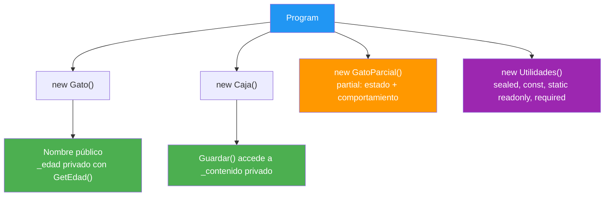

# 01. Primeros pasos: clases y objetos

## Enunciado

Primer contacto con la programación orientada a objetos en C#: definir clases, crear objetos y controlar qué se ve desde fuera de la clase.

1. **`Gato`**: clase con estado (`Nombre` público, `_edad` privado) y comportamiento (`Maullar()`, `Dormir()`, `GetEdad()`).
2. **`Caja`**: muestra las opciones de acceso: `_contenido` es `private` y solo se toca mediante el método público `Guardar()`.
3. **`GatoParcial`**: la misma clase repartida en dos ficheros con el modificador `partial` (estado en uno, comportamiento en otro).
4. **`Utilidades`**: clase `sealed` con un `const`, un `static readonly` y una propiedad `required`.

## Conceptos clave

- **Clase y objeto:** la clase es el molde; el objeto, una instancia creada con `new`
- **Atributos:** variables de la clase; los `private` no se ven desde fuera
- **Métodos:** el comportamiento del objeto (PascalCase)
- **Modificadores de acceso:** `public`, `private`, `protected`, `internal`
- **`partial`:** una clase definida en varios ficheros
- **`sealed`:** impide que nadie herede de la clase
- **`const` / `static readonly`:** constantes de compilación y de solo lectura estáticas
- **`required`:** obliga a asignar la propiedad al crear el objeto

## Solución

1. **`Gato.cs`** define el estado con acceso controlado y expone `GetEdad()` como única puerta de lectura de `_edad`.
2. **`Caja.cs`** mantiene `_contenido` privado: en `Program.cs` la línea `miCaja._contenido = ...` está comentada porque **no compila**.
3. **`GatoParcialEstado.cs` y `GatoParcialComportamiento.cs`** componen `GatoParcial` entre los dos ficheros.
4. **`Utilidades.cs`** demuestra `sealed`, `const double PI`, `static readonly DateTime FechaInicio` y `required string Nombre`.
5. **`Program.cs`** instancía dos gatos, les da nombre, los hace maullar e intenta (en comentario) romper el encapsulamiento.

## Diagrama

> 💡 **Consejo:** Empieza siempre por `private` y abre la visibilidad solo cuando sea imprescindible. Si algo es `public` "por si acaso", no lo es: estás regalando el estado de tus objetos.

> 📌 **Ejemplo real:** Cuando compras en una web, tu contraseña nunca se lee directamente desde fuera: la clase la guarda `private` y solo un método controlado puede usarla. Eso es exactamente lo que hace `_contenido` en `Caja`.
