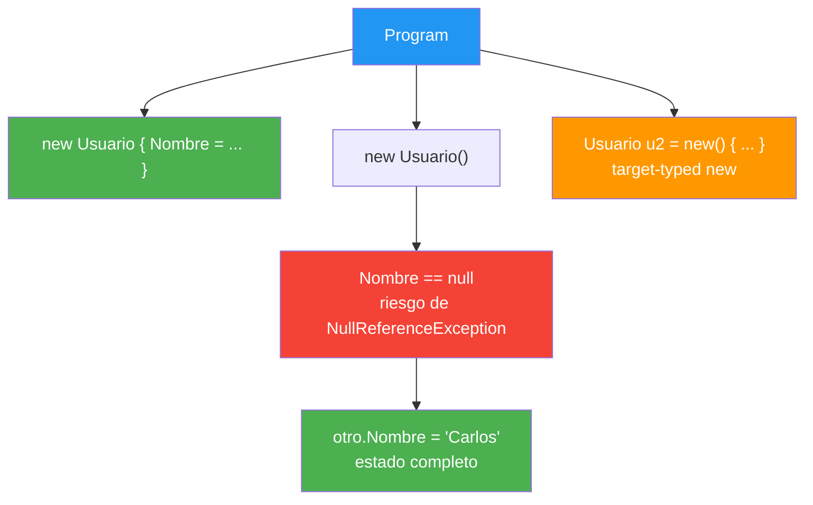

# 02. Inicializadores de objetos en C#

## Enunciado

Crear objetos de cuatro formas distintas y comprobar qué le pasa al campo que nadie inicializa.

1. **Inicializador de objeto:** `new Usuario { Nombre = "Marta" }`.
2. **Campo sin asignar:** `new Usuario()` deja `Nombre` en `null` (es un `string`).
3. **Asignación posterior:** `otro.Nombre = "Carlos"` después de crearlo.
4. **`new()` con tipo deducido:** `Usuario u2 = new() { Nombre = "Ana" }` (target-typed new).

## Conceptos clave

- **Inicializador de objeto:** la sintaxis `{ Propiedad = valor }` al crear
- **Target-typed `new()`:** el compilador deduce el tipo de la variable
- **Valor por defecto de referencia:** un campo `string` sin asignar vale `null`
- **Estado inicial del objeto:** crear no significa "crear bien"

## Solución

1. **`Usuario.cs`** es una clase mínima con un campo público `Nombre` sin inicializar.
2. **`Program.cs`** crea `user` con inicializador y muestra su nombre.
3. Crea `otro` **sin** inicializar y comprueba que `Nombre` es `null` (usa `?? "Nombre no especificado"` para no estallar).
4. Asigna `otro.Nombre` después y repite el experimento con `u2` (`new()`) y `u3` (`new()`).

## Diagrama

> ⚠️ **Advertencia:** `Nombre ?? "valor"` evita la excepción, pero no el problema de fondo. Lo ideal es que el objeto nazca completo: en la UD04 verás los constructores y las propiedades con inicializador para conseguirlo.

> 📌 **Ejemplo real:** Al darte de alta en una app sin rellenar el campo de "nombre de usuario", el sistema guarda un vacío que luego aparece en pantalla. Ese `null` silencioso es exactamente lo que muestra este ejemplo.
