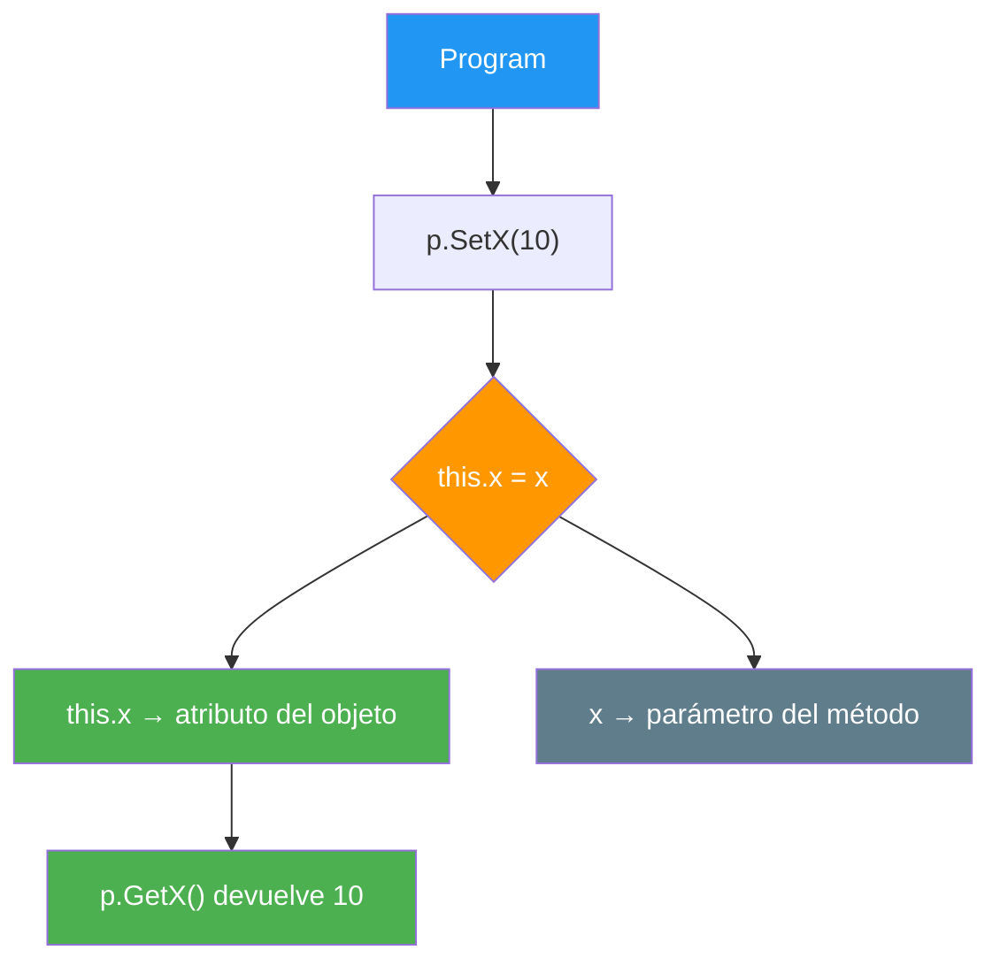

# 03. Atributos, parámetros y la palabra `this`

## Enunciado

Resolver la ambigüedad clásica cuando un atributo y un parámetro se llaman igual, usando la palabra clave `this`.

1. **`Punto`** tiene un atributo privado `x` con sus métodos de acceso `SetX()` y `GetX()`.
2. En `SetX(int x)`, el parámetro `x` y el atributo `x` se llaman igual: `this.x = x` desambigua.

## Conceptos clave

- **`this`:** referencia al objeto actual sobre el que se ejecuta el método
- **Getter y setter:** `GetX()` lee y `SetX()` escribe el atributo privado
- **Colisión de nombres:** parámetro y atributo con el mismo nombre
- **Encapsulamiento:** el atributo es `private` y solo se toca desde los métodos

## Solución

1. **`Punto.cs`** declara `private int x` (invisible desde fuera).
2. **`SetX(int x)`** recibe el nuevo valor como parámetro y lo guarda con `this.x = x`: a la izquierda el atributo, a la derecha el parámetro.
3. **`GetX()`** devuelve el atributo.
4. **`Program.cs`** crea un `Punto`, le pone `10` y lo lee para comprobar que todo llega a su sitio.

## Diagrama

> 💡 **Truco:** Lee `this.x = x` como "este miembro `x` de este objeto recibe el `x` que me han pasado". Si olvidas el `this.`, C# asigna el parámetro consigo mismo y el atributo se queda intacto.

> 📌 **Ejemplo real:** En cualquier formulario de registro, el campo `nombre` de la pantalla y el atributo `nombre` del objeto usuario se llaman igual: `this.nombre = nombre` es lo que guarda lo que escribiste dentro del objeto.
