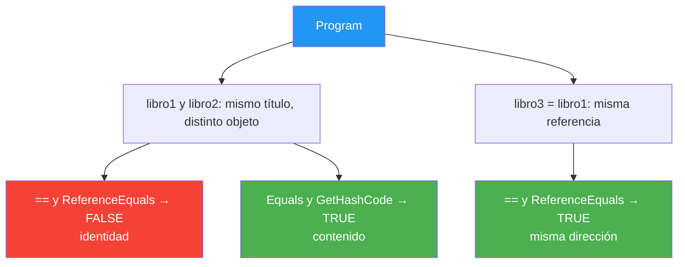

# 04. Igualdad, identidad y `ToString`

## Enunciado

Diferenciar los dos conceptos que confunden a todo el mundo al empezar: **¿son el mismo objeto?** (identidad) frente a **¿tienen los mismos datos?** (igualdad), y ver cómo se imprime un objeto.

1. **`Libro`** sobrescribe `ToString()`, `Equals()` y `GetHashCode()`.
2. **`Gato`** hace lo mismo con cuatro campos (nombre, edad, raza, doméstico).
3. **`Program.cs`** compara tres libros con `==`, `ReferenceEquals`, `Equals()` y `GetHashCode()`.

## Conceptos clave

- **Identidad:** `==` y `ReferenceEquals()` comparan **direcciones de memoria** en las clases
- **Igualdad:** `Equals()` compara **contenido** cuando lo has sobrescrito
- **`ToString()`:** representation legible del objeto (la usa `$"...{obj}..."`)
- **`GetHashCode()`:** huella del objeto; si dos objetos son iguales, deben dar el mismo hash
- **Relación obligatoria:** al sobrescribir `Equals`, sobrescribe también `GetHashCode`

## Solución

1. **`Libro.cs`** implementa `ToString()` (`[Libro: título]`), `Equals()` (compara `Titulo`) y `GetHashCode()` (deriva del título).
2. **`Gato.cs`** repite el patrón con `HashCode.Combine(Nombre, Edad, Raza, EsDomestico)`.
3. **`Program.cs`** crea `libro1` y `libro2` con el mismo título (distintos objetos) y `libro3 = libro1` (la misma referencia).
4. Muestra que `libro1 == libro2` es **falso** (identidad), `libro1.Equals(libro2)` es **verdadero** (contenido), y `libro1 == libro3` es **verdadero** (misma referencia).

## Diagrama

> ⚠️ **Advertencia:** En C# el `==` de las clases **no** compara contenido por defecto: compara referencias. Si quieres igualdad de contenido, implementa `Equals` (y `GetHashCode` con él, siempre juntos).

> 📌 **Ejemplo real:** En una app de mensajería, dos mensajes con el mismo texto son "iguales" en contenido pero "distintos" para el sistema (se pueden eliminar por separado): `Equals` dice que sí, `==` dice que no.
