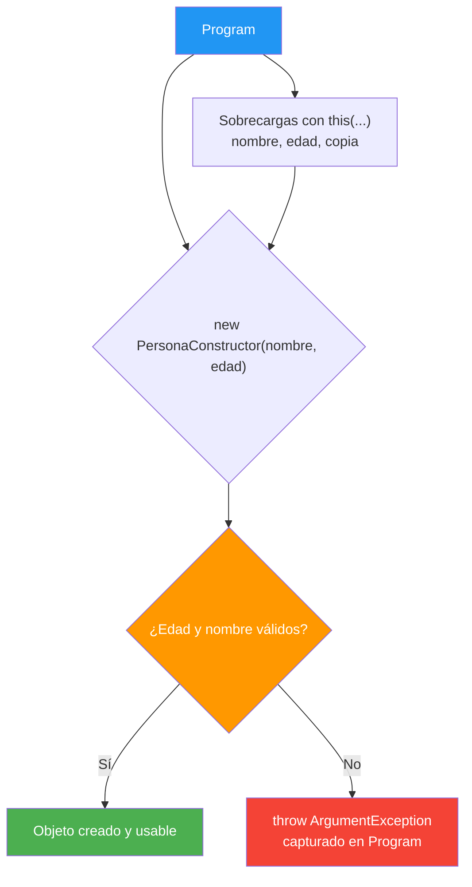

# 05. Constructores e inicialización

## Enunciado

Crear objetos que **nazcan validados**: un constructor con parámetros por defecto, validaciones que lanzan excepción, sobrecarga de constructores con `this(...)` y constructor copia.

1. **`Persona`**: versión simple con campos inicializados y `ToString()`.
2. **`PersonaConstructor`**: constructor con parámetros por defecto que **valida** nombre y edad antes de aceptarlos.

## Conceptos clave

- **Constructor:** método que se ejecuta al crear el objeto con `new`
- **Parámetros por defecto:** `string nombre = "Desconocido"` permite lladas parciales
- **Validación en el constructor:** el objeto no puede nacer en un estado inválido
- **`throw new ArgumentException`:** se rechaza el dato, no se guarda "media verdad"
- **Sobrecarga con `this(...)`:** un constructor llama a otro de la misma clase
- **Constructor copia:** `PersonaConstructor(PersonaConstructor otra)`
- **`try/catch`:** capturar la excepción que lanza el constructor

## Solución

1. **`Persona.cs`** muestra el caso base: campos con valores por defecto y `ToString()`.
2. **`PersonaConstructor.cs`** declara el constructor principal `PersonaConstructor(string nombre = "Desconocido", int edad = 0)` que:
   - lanza `ArgumentException` si `edad < 0`,
   - valida el nombre con una regex (`^[A-Za-z]{3,}$`).
3. Tres sobrecargas delegan con `: this(...)`: una versión con nombre, otra con edad y el **constructor copia**.
4. **`Program.cs`** prueba todas las combinaciones y termina con un `try/catch` que captura la creación inválida `new PersonaConstructor("X", 15)`.

## Diagrama

> 💡 **Consejo:** La regla de oro del constructor: **o el objeto nace bien, o no nace**. Validar aquí te ahorra comprobaciones por todo el programa después.

> 📌 **Ejemplo real:** Al darte de alta en una web, si pones una edad negativa el formulario te lo devuelve sin siquiera crear la cuenta: la validación ocurre en el momento de creación, igual que en `PersonaConstructor`.
