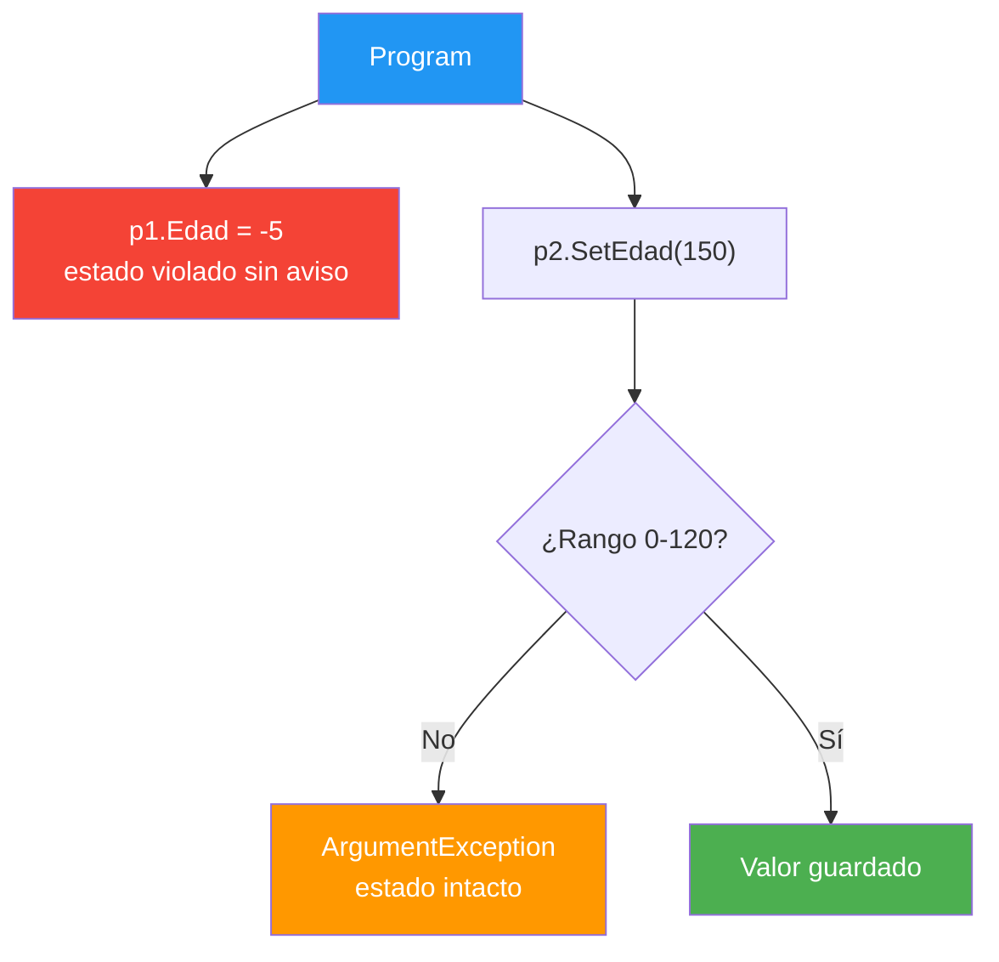

# 06. Getters y setters con validación

## Enunciado

Ver por qué el estado de un objeto no debe exponerse sin control, comparando tres enfoques:

1. **`PersonaVioladaEnEstado`**: `Edad` es `public` y el programa consigue asignarle `-5`... hasta romper las reglas del dominio.
2. **`PersonaPrivada`**: todo `private`, con `GetEdad()`/`SetEdad()` que **validan** antes de aceptar.
3. **`Estudiante`**: lo mismo, más la calificación con su rango 0–10 y una clasificación literal con *switch expressions*.

## Conceptos clave

- **Violación del estado:** un campo `public` permite valores imposibles (`Edad = -5`)
- **Getter:** método que lee un atributo privado (`GetEdad()`)
- **Setter:** método que escribe **validando** (`SetEdad()` lanza `ArgumentException` si el rango es 0–120)
- **Validación con regex:** `^[A-Za-z]{3,}$` para el nombre
- **Switch expression:** `_calificacion switch { < 5.0 => "Suspenso", ... }`
- **`IsAprobado()`:** comportamiento derivado del estado

## Solución

1. **`PersonaVioladaEnEstado.cs`** deja `Edad` pública y en `Program.cs` se le asigna `-5` sin que pase nada: el objeto queda en un estado absurdo.
2. **`PersonaPrivada.cs`** encierra el estado; `SetNombre("X")` y `SetEdad(150)` lanzan `ArgumentException`, que el programa captura y muestra.
3. **`Estudiante.cs`** completa el patrón con calificación, `GetCalificacionLiteral()` (suspenso/aprobado/notable/sobresaliente) y `ToString()`.

## Diagrama

> ⚠️ **Advertencia:** Un `Set` sin validación es un campo público con otro nombre: da la sensación de seguridad sin la seguridad. Si el setter no comprueba nada, mejor deja el campo `public` y no engañes a nadie.

> 📌 **Ejemplo real:** En el portal del alumno, si intentas poner una nota de 15 sobre 10 el sistema te la rechaza en el momento: el setter actúa como puerta de control, igual que `SetCalificacion()` aquí.
