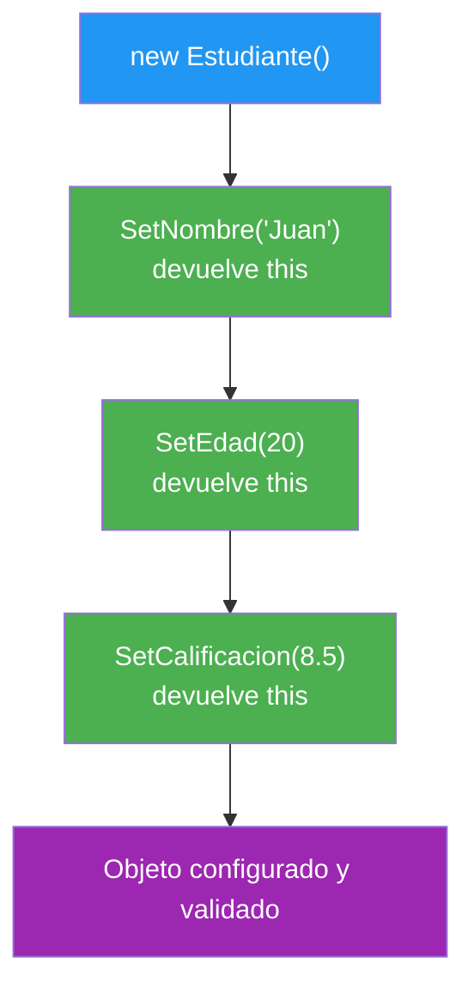

# 07. Patrón fluido (Fluent Interface)

## Enunciado

Convertir los setters de una clase en métodos que **devuelven el propio objeto**, para poder encadenar llamadas y crear el `Estudiante` entero en una sola expresión legible.

```csharp
var persona = new Estudiante()
    .SetNombre("Juan")
    .SetEdad(20)
    .SetCalificacion(8.5);
```

## Conceptos clave

- **Fluent Interface:** método que `return this` permite encadenar
- **Encadenamiento de llamadas:** `obj.A().B().C()` en una sola línea
- **Setters con validación:** cada `Set*` valida igual que en el ejemplo anterior
- **`this` como retorno:** el mismo objeto, no una copia
- **Legibilidad:** la configuración se lee como una frase

## Solución

1. **`Estudiante.cs`** es el `Estudiante` del ejemplo anterior, con una diferencia clave: `SetNombre`, `SetEdad` y `SetCalificacion` devuelven `Estudiante` (`return this;`) en lugar de `void`.
2. Las validaciones (nombre con regex, edad 0–120, calificación 0–10) siguen intactas: el patrón fluido **no** sustituye a la validación, solo cambia el estilo de llamada.
3. **`Program.cs`** construye el objeto completo encadenando los tres setters y lo imprime con `ToString()`.

## Diagrama



> 💡 **Consejo:** El patrón fluido brilla en la **configuración** (constructores con muchas opciones, builders). Para setters con reglas de negocio fuertes, a veces es mejor un constructor explícito: no todo lo encadenable es mejor.

> 📌 **Ejemplo real:** `new LoggerConfiguration().WriteTo.Console().MinimumLevel.Debug().CreateLogger()` — así se configura Serilog, exactamente con este patrón. Lo usarás en los ejemplos de logging de la unidad.
