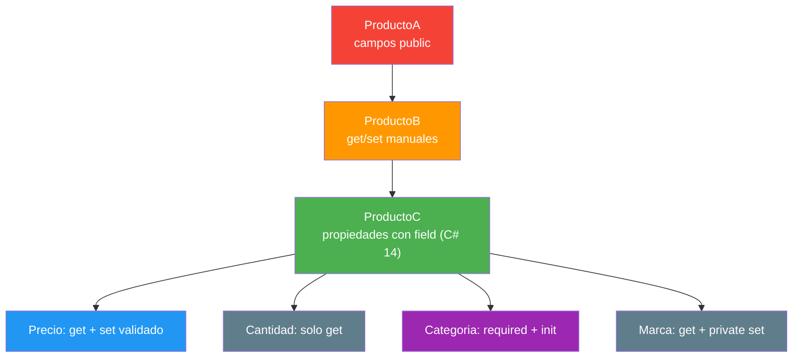

# 08. Propiedades: de campos públicos a `get` y `set`

## Enunciado

Evolucionar el mismo modelo (`Producto`) por tres generaciones hasta llegar a las propiedades de C#, incluida la novedad del campo implícito `field` de C# 14.

1. **`ProductoA`**: campos `public` — cualquiera puede poner un precio negativo.
2. **`ProductoB`**: campos `private` con getters y setters manuales que validan.
3. **`ProductoC`**: propiedades de verdad: validación en el `set`, solo lectura, `required` y `init`.

## Conceptos clave

- **Propiedad:** `public decimal Precio { get; set; }` — controlas el acceso sin escribir métodos a mano
- **`field` (C# 14):** el setter accede al campo implícito sin declararlo: `set => field = ...`
- **Validación en el setter:** `Precio` lanza `ArgumentOutOfRangeException` si es negativo
- **`{ get; }`:** solo lectura (`Cantidad` no se puede cambiar desde fuera)
- **`required` + `init`:** obligatorio al crear y solo durante la inicialización (`Categoria`)
- **`private set`:** público para leer, privado para escribir (`Marca`)

## Solución

1. **`ProductoA.cs`** enumera en comentarios todos los problemas de los campos públicos ("¿cómo congelo la categoría?", "¿cómo evito el precio negativo?").
2. **`ProductoB.cs`** los resuelve a mano: `SetPrecio()` valida, `SetMarca()` es `private` y simplemente no se crea setter para lo que no debe cambiar.
3. **`ProductoC.cs`** consigue lo mismo con propiedades: `Precio` con `field` y validación, `Cantidad { get; }`, `Categoria { get; init; }` con `required` y `Marca { get; private set; }`.
4. **`Program.cs`** comprueba las tres: `new ProductoC { Categoria = "Electronica" }` (obligatoria), no puede reasignar `Categoria` (es `init`) y `p3.Precio = -12` lanza excepción.

## Diagrama

> 💡 **Consejo:** Regla de decisión para cada propiedad: ¿se lee y se cambia? → `get; set;`. ¿Solo se lee? → `get;`. ¿Se cambia solo al crear? → `init` o `required`. ¿Se lee todos y lo cambia solo la clase? → `private set`.

> 📌 **Ejemplo real:** En cualquier e-commerce, el precio no lo pone el cliente: el setter del precio valida como `ProductoC.Precio`. Y el identificador de un pedido nunca cambia tras crearse, como `Categoria { get; init; }`.
